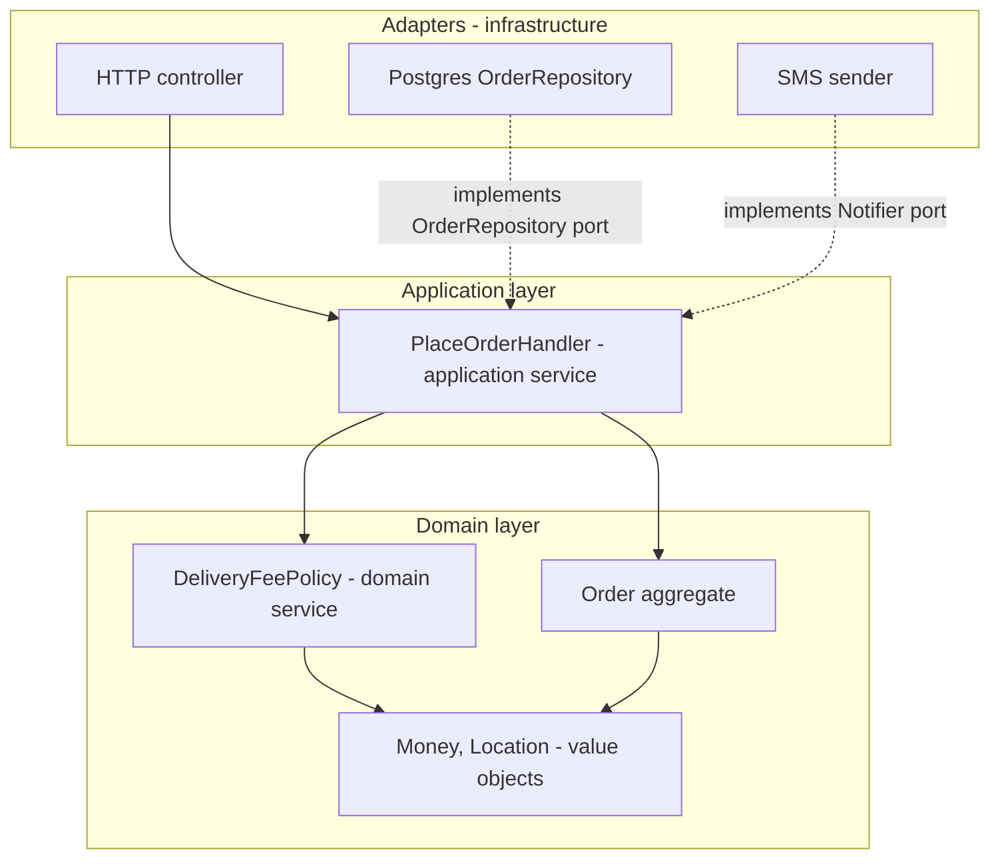
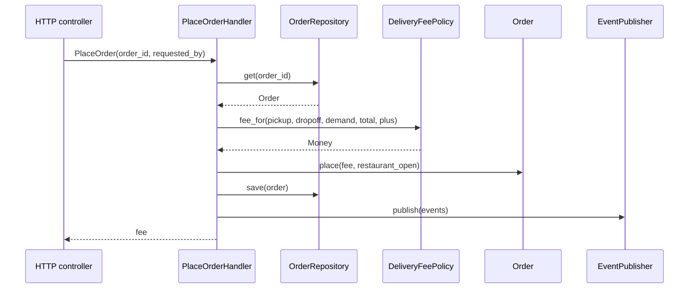

# Domain Services and Application Services

## Introduction

Once you have [entities, value objects](./3-arch-entities-and-value-objects.mdx) and [aggregates](./4-arch-aggregates.mdx), a practical question keeps coming up: **where does this piece of code go?**

- "Calculate the delivery fee from the restaurant's location, the customer's address and current demand." That involves several objects and isn't owned by any one of them.
- "When a customer places an order: load the basket, check the restaurant is open, compute the fee, save the order, publish events." That's a workflow, not a business rule.
- "Send an SMS." That's a technical capability.

DDD names three kinds of "service" for these cases:

| Kind | Contains | Speaks | Example |
| --- | --- | --- | --- |
| **Domain service** | Business logic that doesn't naturally belong to one entity or value object | Ubiquitous language | `DeliveryFeePolicy`, `CourierMatcher` |
| **Application service** | Use case orchestration: load, call the domain, save, publish; transactions and security | Use cases | `PlaceOrderHandler` |
| **Infrastructure service** | Technical capabilities behind interfaces | Technology | `TwilioSmsSender`, `StripePaymentGateway` |

An analogy: a restaurant. The **chef** knows the recipes and makes the food: that's the domain. A **head chef's rule** like "pair this wine with that dish" involves two items and belongs to neither: a domain service. The **waiter** takes the order, brings it to the kitchen, returns with the food and handles payment, but doesn't cook: that's the application service. The **dishwasher and the card terminal** are infrastructure.

The most common mistake is not choosing the wrong kind of service; it's putting all logic into services and leaving entities as empty data holders. Martin Fowler calls that the [Anemic Domain Model](https://martinfowler.com/bliki/AnemicDomainModel.html) and quotes Evans' advice that the application layer should be kept thin. Entities and value objects come first; services are for what's left over.

## The Problem: One Fat Service

Here is QuickBite's checkout as a single "service" class. It mixes HTTP-ish input, business rules, persistence and notifications.

```python
# before.py - business rules, workflow and infrastructure all in one place
import math

DB: dict[str, dict] = {
    "rest:r-9": {"lat": 37.7749, "lon": -122.4194, "open": True},
    "cust:c-1": {"lat": 37.7849, "lon": -122.4094, "plus_member": True},
}


class OrderService:
    def checkout(self, payload: dict) -> dict:
        rest = DB[f"rest:{payload['restaurant_id']}"]
        cust = DB[f"cust:{payload['customer_id']}"]
        if not rest["open"]:
            return {"error": "closed"}
        # distance (rough), fee rules, membership discount, surge... all inline
        km = math.dist((rest["lat"], rest["lon"]), (cust["lat"], cust["lon"])) * 111
        fee = 199 + int(km * 50)
        if payload.get("surge"):
            fee = int(fee * 1.5)
        if cust["plus_member"] and payload["subtotal"] >= 1500:
            fee = 0
        order = {"id": "o-1", "fee": fee, "subtotal": payload["subtotal"]}
        DB["order:o-1"] = order
        print("SMS: your order is confirmed")
        return order


print(OrderService().checkout({"restaurant_id": "r-9", "customer_id": "c-1",
                               "subtotal": 1200, "surge": True}))
```

Output:

```text
SMS: your order is confirmed
{'id': 'o-1', 'fee': 415, 'subtotal': 1200}
```

To test the fee rules, you need the fake database and you get an SMS print. To reuse the fee rules for the "estimate fee" screen, you'd copy them. And nobody can find the business rule "Plus members get free delivery over $15" without reading the whole method.

## Domain Services

A **domain service** holds domain logic that:

- involves **several** domain objects, or
- doesn't naturally belong to any one of them, and
- is a concept domain experts recognize ("the delivery fee policy", "courier matching").

Domain services are usually **stateless**, take and return domain objects, and contain **no infrastructure**: no database, no HTTP, no clock unless it's passed in.

```python
# domain.py - value objects and a domain service for delivery fees
from __future__ import annotations

import math
from dataclasses import dataclass


@dataclass(frozen=True)
class Money:
    cents: int

    def __post_init__(self) -> None:
        if self.cents < 0:
            raise ValueError("negative money")

    def __mul__(self, factor: float) -> Money:
        return Money(round(self.cents * factor))

    def __add__(self, other: Money) -> Money:
        return Money(self.cents + other.cents)


@dataclass(frozen=True)
class Location:
    lat: float
    lon: float

    def distance_km(self, other: Location) -> float:
        """Haversine distance; good enough for fee estimates."""
        r = 6371.0
        p1, p2 = math.radians(self.lat), math.radians(other.lat)
        dp, dl = p2 - p1, math.radians(other.lon - self.lon)
        a = math.sin(dp / 2) ** 2 + math.cos(p1) * math.cos(p2) * math.sin(dl / 2) ** 2
        return 2 * r * math.asin(math.sqrt(a))


@dataclass(frozen=True)
class DemandLevel:
    multiplier: float     # 1.0 normal, 1.5 busy


class DeliveryFeePolicy:
    """Domain service: the business's delivery fee rules in one named place."""

    BASE = Money(199)
    PER_KM = Money(50)
    FREE_DELIVERY_THRESHOLD = Money(1500)

    def fee_for(self, pickup: Location, dropoff: Location, demand: DemandLevel,
                food_total: Money, is_plus_member: bool) -> Money:
        if is_plus_member and food_total.cents >= self.FREE_DELIVERY_THRESHOLD.cents:
            return Money(0)
        distance_fee = self.PER_KM * pickup.distance_km(dropoff)
        return (self.BASE + distance_fee) * demand.multiplier


if __name__ == "__main__":
    policy = DeliveryFeePolicy()
    rest, home = Location(37.7749, -122.4194), Location(37.7849, -122.4094)
    print("distance km:", round(rest.distance_km(home), 2))
    print("normal:", policy.fee_for(rest, home, DemandLevel(1.0), Money(1200), False))
    print("busy:", policy.fee_for(rest, home, DemandLevel(1.5), Money(1200), False))
    print("plus over $15:", policy.fee_for(rest, home, DemandLevel(1.5), Money(1600), True))
```

Output:

```text
distance km: 1.42
normal: Money(cents=270)
busy: Money(cents=405)
plus over $15: Money(cents=0)
```

Why a domain service here and not a method on `Order`? The fee depends on the restaurant's location, the customer's address, membership status and current demand. Putting it on `Order` would force `Order` to know about restaurants, memberships and demand, all of which belong to other aggregates or contexts. As a separate, named policy it can be tested with plain values, reused by the "estimate fee" screen, and discussed with the pricing team by name.

:::tip Is it really a domain service?
Before creating a domain service, try to put the logic on an entity or value object. `Location.distance_km` lives on the value object because it only needs two locations. Only logic that genuinely spans objects, or that experts think of as a standalone "policy" or "calculation", should become a domain service.
:::

## Application Services

An **application service** implements one **use case**. Its job is coordination, not business decisions:

1. Receive a command (input data).
2. Load the aggregates it needs through repositories.
3. Call domain methods and domain services.
4. Save changes in one transaction.
5. Publish [domain events](./5-arch-domain-events.mdx).
6. Return a result.

It also handles cross-cutting application concerns: transactions, authorization, logging. In [Hexagonal](../7-arch-clean-architecture/0-arch-hexagonal.mdx) and [Clean Architecture](../7-arch-clean-architecture/2-arch-clean-architecture.mdx) terms, application services are the use cases, and they depend on **ports** (interfaces) rather than concrete infrastructure.

```python
# application.py - a thin application service for the PlaceOrder use case
from __future__ import annotations

from dataclasses import dataclass, field
from typing import Protocol

from domain import DeliveryFeePolicy, DemandLevel, Location, Money


# --- Domain model (simplified) --------------------------------------------------
@dataclass(eq=False)
class Order:
    id: str
    customer_id: str
    restaurant_id: str
    food_total: Money
    delivery_fee: Money = Money(0)
    placed: bool = False
    events: list[str] = field(default_factory=list)

    def place(self, delivery_fee: Money, restaurant_open: bool) -> None:
        if not restaurant_open:
            raise ValueError("Restaurant is not accepting orders")
        if self.placed:
            raise ValueError("Order already placed")
        self.delivery_fee = delivery_fee
        self.placed = True
        self.events.append(f"OrderPlaced({self.id})")


# --- Ports the application needs -----------------------------------------------
class OrderRepository(Protocol):
    def get(self, order_id: str) -> Order: ...
    def save(self, order: Order) -> None: ...


class RestaurantDirectory(Protocol):
    def location_of(self, restaurant_id: str) -> Location: ...
    def is_open(self, restaurant_id: str) -> bool: ...


class CustomerDirectory(Protocol):
    def address_of(self, customer_id: str) -> Location: ...
    def is_plus_member(self, customer_id: str) -> bool: ...


class DemandSensor(Protocol):
    def current(self, location: Location) -> DemandLevel: ...


class EventPublisher(Protocol):
    def publish(self, events: list[str]) -> None: ...


# --- Command and application service ---------------------------------------------
@dataclass(frozen=True)
class PlaceOrder:
    order_id: str
    requested_by: str


class NotAllowed(Exception):
    pass


class PlaceOrderHandler:
    def __init__(self, orders: OrderRepository, restaurants: RestaurantDirectory,
                 customers: CustomerDirectory, demand: DemandSensor,
                 publisher: EventPublisher, fee_policy: DeliveryFeePolicy) -> None:
        self.orders, self.restaurants, self.customers = orders, restaurants, customers
        self.demand, self.publisher, self.fee_policy = demand, publisher, fee_policy

    def __call__(self, cmd: PlaceOrder) -> Money:
        order = self.orders.get(cmd.order_id)
        if order.customer_id != cmd.requested_by:                 # authorization
            raise NotAllowed("Customers can only place their own orders")

        pickup = self.restaurants.location_of(order.restaurant_id)
        dropoff = self.customers.address_of(order.customer_id)
        fee = self.fee_policy.fee_for(                            # domain service
            pickup, dropoff, self.demand.current(pickup), order.food_total,
            self.customers.is_plus_member(order.customer_id))

        order.place(fee, self.restaurants.is_open(order.restaurant_id))  # aggregate
        self.orders.save(order)                                   # persistence
        self.publisher.publish(order.events)                      # side effects
        return fee
```

The handler contains no `if` about fees, membership thresholds or demand. Those decisions live in `DeliveryFeePolicy` and `Order`. The handler's only branch is authorization, which is an application concern.

### Testing with fakes

Because the handler depends on protocols, tests use simple in-memory fakes. No database, no network:

```python
# test_application.py - the use case tested with in-memory fakes
from application import (Order, PlaceOrder, PlaceOrderHandler, NotAllowed)
from domain import DeliveryFeePolicy, DemandLevel, Location, Money


class FakeOrders:
    def __init__(self, *orders: Order) -> None:
        self.rows = {o.id: o for o in orders}
        self.saved: list[str] = []

    def get(self, order_id: str) -> Order:
        return self.rows[order_id]

    def save(self, order: Order) -> None:
        self.saved.append(order.id)


class FakeRestaurants:
    def location_of(self, restaurant_id: str) -> Location:
        return Location(37.7749, -122.4194)

    def is_open(self, restaurant_id: str) -> bool:
        return True


class FakeCustomers:
    def address_of(self, customer_id: str) -> Location:
        return Location(37.7849, -122.4094)

    def is_plus_member(self, customer_id: str) -> bool:
        return customer_id == "c-plus"


class BusyDemand:
    def current(self, location: Location) -> DemandLevel:
        return DemandLevel(1.5)


class RecordingPublisher:
    def __init__(self) -> None:
        self.published: list[str] = []

    def publish(self, events: list[str]) -> None:
        self.published.extend(events)


orders = FakeOrders(Order("o-1", "c-1", "r-9", Money(1200)),
                    Order("o-2", "c-plus", "r-9", Money(1800)))
publisher = RecordingPublisher()
handler = PlaceOrderHandler(orders, FakeRestaurants(), FakeCustomers(), BusyDemand(),
                            publisher, DeliveryFeePolicy())

print("o-1 fee:", handler(PlaceOrder("o-1", requested_by="c-1")))
print("o-2 fee:", handler(PlaceOrder("o-2", requested_by="c-plus")))
print("saved:", orders.saved, "published:", publisher.published)
try:
    handler(PlaceOrder("o-1", requested_by="c-999"))
except NotAllowed as err:
    print("Rejected:", err)
```

Output:

```text
o-1 fee: Money(cents=405)
o-2 fee: Money(cents=0)
saved: ['o-1', 'o-2'] published: ['OrderPlaced(o-1)', 'OrderPlaced(o-2)']
Rejected: Customers can only place their own orders
```

A real implementation would also wrap the load-change-save in a [Unit of Work](../5-arch-modern-patterns/2-arch-unit-of-work.mdx) so the save and the event outbox commit together.

## How the Layers Fit





## Where Does This Logic Go?

| The logic... | Put it in | Example |
| --- | --- | --- |
| Depends only on one value's own data | Value object | `Money.__add__`, `Location.distance_km` |
| Changes one entity's state and checks its rules | Entity or aggregate root method | `Order.place` |
| Spans several aggregates or is a named business policy | Domain service | `DeliveryFeePolicy`, `CourierMatcher` |
| Coordinates a use case: load, call, save, publish, authorize | Application service | `PlaceOrderHandler` |
| Talks to a database, broker, email or external API | Infrastructure behind a port | `PostgresOrderRepository`, `SmsNotifier` |
| Formats data for a screen or API | Presentation or adapter layer | Controller, view model |

A quick test for application services: **if you replaced the domain experts' rules, would this code change?** If yes, it's domain logic and shouldn't be in the application service.

## Real-World Scenario

QuickBite's marketing team runs many promotions: "free delivery for Plus members over $15", "$3 off at new restaurants this week", "20% off your third order". Today these rules are scattered across the checkout controller, the mobile "estimate" endpoint and a nightly job that issues refunds when the checkout got it wrong. Each promotion takes two weeks and usually ships with a bug.

**What you do:**

1. **Name the concept with marketing**: "promotion eligibility" and "discount calculation". They become a domain service, `PromotionPolicy`, with a method `best_discount_for(basket, customer_profile, restaurant_profile, today)`.
2. **Make each promotion a small value object** implementing a common protocol (a [Specification](../5-arch-modern-patterns/3-arch-specification-pattern.mdx) plus a discount rule). New promotions are new classes, not new `if` branches.
3. **Keep application services thin.** `PlaceOrderHandler` and `EstimateBasketHandler` both call the same `PromotionPolicy`. They differ only in whether they save and publish.
4. **Pass time in.** The domain service takes `today` as a parameter, so tests can check "this promo ends Sunday" without patching the clock.
5. **Delete the nightly correction job** once both paths use the same policy.

**Why this approach:** the bug source was duplicated rules in different entry points. A named domain service gives one home for the rules, and thin application services make every entry point use it.

**When to use it / when not to:** use domain services when a business rule spans several objects and has a name experts use. Use application services for every use case in a DDD-style codebase. Don't introduce either for simple CRUD: a controller that saves a form directly through an ORM is fine for a supporting "edit restaurant description" screen.

**Alternatives and trade-offs:**

| Approach | Pros | Cons | Best for |
| --- | --- | --- | --- |
| Rich entities, domain services for cross-object rules, thin application services | Rules are findable and testable; entry points stay consistent | More classes and layers | Complex core domains |
| [Transaction Script](https://martinfowler.com/eaaCatalog/transactionScript.html) (one procedure per use case) | Simple and direct; easy to follow | Rules duplicate across scripts as the domain grows | Simple domains, supporting subdomains |
| Fat application services with anemic entities | Familiar to many teams | Business rules buried in orchestration; entities can be put into invalid states | Rarely a good choice; common in practice |
| Logic in controllers | Fastest to write | Can't reuse from jobs, CLI or other endpoints; hard to test | Prototypes |

## Common Mistakes

- **"Service" for everything.** `OrderService`, `OrderManager` and `OrderHelper` with all the logic leave `Order` anemic. Move behavior that belongs to one aggregate into that aggregate.
- **Domain services that call the database.** Once a domain service depends on a repository or HTTP client, it's harder to test and starts acting like an application service. Pass in the data it needs, or depend on a port only when unavoidable.
- **Business rules in the application service.** "If the subtotal is over $15 and the customer is Plus, the fee is zero" is a business rule. It belongs in the domain.
- **Application services calling other application services.** This tangles use cases together. Share logic through the domain, or use domain events.
- **Stateful domain services.** Services that cache per-request data or hold mutable fields cause subtle concurrency bugs. Keep them stateless.
- **Hiding the clock and randomness.** `datetime.now()` inside a domain service makes rules hard to test. Pass time in.

## Summary

- **Domain services** hold business logic that spans several domain objects or is a named policy; they are stateless and free of infrastructure.
- **Application services** implement use cases: load aggregates, call domain logic, save in one transaction, publish events, and handle authorization. They stay **thin**.
- **Infrastructure services** provide technical capabilities behind interfaces (ports).
- Default to putting behavior on entities and value objects; use domain services only for what's left.
- Depending on protocols makes application services easy to test with in-memory fakes.

## Further Learning

**Exercises:**

1. Write an `EstimateFeeHandler` application service that reuses `DeliveryFeePolicy` but doesn't save anything. What's the only difference from `PlaceOrderHandler`?
2. Implement a `CourierMatcher` domain service that picks the nearest available courier from a list of `(courier_id, Location, active_deliveries)` tuples, skipping couriers with two active deliveries.
3. Take the `before.py` `OrderService` and list each line under "domain rule", "orchestration" or "infrastructure". Then refactor it into the three kinds of service.
4. Add a `Clock` protocol to `PlaceOrderHandler` and a rule in `Order.place` that orders can't be placed less than 10 minutes before the restaurant closes.

**Related pages:**

- Previous: [Domain Events](./5-arch-domain-events.mdx)
- Next: [Event Storming](./7-arch-event-storming.mdx), for discovering commands, policies and aggregates with experts
- [Dependency Injection](../1-arch-design-principles/10-arch-dependency-injection.mdx) and [Dependency Inversion Principle](../1-arch-design-principles/5-arch-dependency-inversion.mdx) for wiring application services
- [CQRS](../9-arch-distributed-systems/3-arch-cqrs.mdx), where application services become command handlers

**Sources:** Martin Fowler, [Anemic Domain Model](https://martinfowler.com/bliki/AnemicDomainModel.html), [Service Layer](https://martinfowler.com/eaaCatalog/serviceLayer.html) and [Transaction Script](https://martinfowler.com/eaaCatalog/transactionScript.html); Eric Evans, [DDD Reference](https://www.domainlanguage.com/ddd/reference/); *Architecture Patterns with Python*, [chapter 4: Service Layer](https://www.cosmicpython.com/book/chapter_04_service_layer.html).
