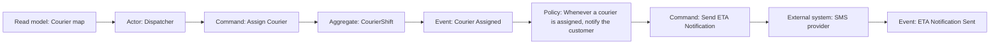
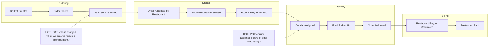
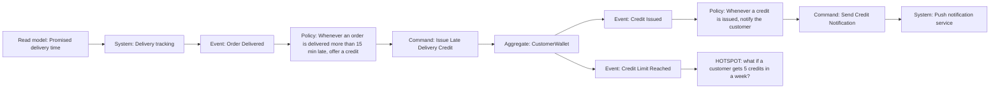

# Event Storming

## Introduction

The fastest way to learn a business is to get the right people in a room and ask, "What happens?" The problem is that a normal meeting quickly turns into one person talking while everyone else waits. Requirements documents are worse: each department writes its own, and the contradictions only show up in production.

**Event Storming** is a workshop technique created by **Alberto Brandolini** for exploring a business domain collaboratively. Participants write **domain events** (things that happen, in the past tense, like "Order Placed") on orange sticky notes and arrange them on a long wall in time order. Then the group adds commands, actors, policies, systems and questions until the whole flow is visible. Brandolini's book is *Introducing EventStorming*, and the official site is [eventstorming.com](https://www.eventstorming.com/).

Imagine reconstructing a murder mystery with every witness at once. Instead of interviewing each person separately, everyone pins what they saw on a shared timeline. Gaps and contradictions jump out immediately: "Wait, you say the butler left at 9, but she says the lights went out at 8:45?" Event Storming does the same for business processes.

It is popular in DDD because it produces exactly what DDD needs:

- a shared **[ubiquitous language](./1-arch-ubiquitous-language.mdx)**, written on the wall
- the **[domain events](./5-arch-domain-events.mdx)** that matter to the business
- candidate **[bounded contexts](./2-arch-bounded-contexts.mdx)** and **[aggregates](./4-arch-aggregates.mdx)**
- a list of **hotspots**: questions, conflicts and risks

## Three Levels of Event Storming

The DDD Crew's [EventStorming glossary and cheat sheet](https://github.com/ddd-crew/eventstorming-glossary-cheat-sheet) describes three formats with different goals and audiences:

| Format | Goal | Who attends | Typical output |
| --- | --- | --- | --- |
| **Big Picture** | Understand a whole business line end to end; find problems and opportunities | 10 to 30+ people from across the business | Timeline of events, hotspots, pivotal events, candidate bounded contexts |
| **Process Modeling** | Model one process in detail; find bottlenecks and decisions | A smaller group: experts for that process plus engineers | Event, command, policy and read model flow for one process |
| **Software Design** | Design the model for one bounded context | Developers with a domain expert | Aggregates, commands, events and policies ready to implement |

You usually go from wide to narrow: one Big Picture session to see the landscape, then process and design sessions on the parts that matter most, typically the core domain.

## The Notation

Colors are a convention, not a law, but sticking to them makes walls readable to anyone who has done Event Storming before. These are the conventional colors listed in the DDD Crew cheat sheet:

| Element | Color | Meaning | QuickBite example |
| --- | --- | --- | --- |
| **Domain event** | Orange | Something that happened, in past tense | "Order Placed", "Food Ready for Pickup" |
| **Command / action** | Blue | A decision or intent that causes an event | "Place Order", "Assign Courier" |
| **Actor** | Small yellow | A person or role who issues a command | Customer, Restaurant staff, Dispatcher |
| **Policy** | Lilac | A reaction: "whenever X, then Y" | "Whenever food is ready, find a courier" |
| **External system** | Wide pink | A system outside our control | Payment provider, partner POS |
| **Query model / information** | Green | Information an actor needs to decide | "Courier map with ETAs" |
| **Hotspot** | Neon pink | A question, conflict or problem | "Who pays if the courier drops the food?" |
| **Aggregate / constraint** | Large yellow | The thing that accepts the command and enforces rules | Order, CourierShift |
| **Opportunity** | Green | An idea for improvement | "Auto-assign couriers before food is ready" |

Process Modeling sessions follow a simple **grammar**: an actor, informed by a read model, issues a command; the command is handled by an aggregate or system, which produces an event; a policy reacts to the event and triggers the next command.



## Running a Big Picture Session

### Preparation

- **Space**: a long wall (several meters) covered with a paper roll, or an online whiteboard for remote teams. The DDD Crew publishes templates for remote sessions.
- **Supplies**: plenty of orange stickies, a few other colors, thick markers so writing is readable from a distance.
- **People**: the people who actually know the process. For QuickBite: customer support, restaurant success, operations, couriers' team lead, finance, product, and a few engineers. Make sure decision makers can attend at least the end.
- **A clear scope**: "From a customer opening the app to the restaurant getting paid."
- **A facilitator** who keeps the energy up and doesn't take sides.

### Step by step

1. **Chaotic exploration (20 to 30 minutes).** Everyone writes events they know about, on their own, and sticks them roughly where they think they belong in time. No discussion yet. Quantity beats quality.
2. **Enforce the timeline.** The group sorts events left to right, removes duplicates, and argues about order. Arguments are good: they reveal different understandings. Mark unresolved arguments with **hotspots** instead of resolving them on the spot.
3. **Find pivotal events.** A few events mark big transitions, like "Order Placed", "Food Picked Up" and "Order Delivered". Draw vertical lines at them. They often hint at boundaries between contexts.
4. **Add people and systems.** Who or what causes each event? Actors and external systems go below the events.
5. **Walk the timeline.** Someone narrates the story from left to right ("A customer browses... places the order... the restaurant accepts..."), and others interrupt when something's missing. Then do it backwards from the end; this often finds missing prerequisites.
6. **Add problems and opportunities.** Hotspots for pain, green notes for ideas.
7. **Vote and choose.** Everyone gets a few votes to mark the most important problems. This tells you where to go deeper.
8. **Sketch boundaries.** Draw loose boundaries around clusters of events with their own language and experts. These are candidate bounded contexts.

### The QuickBite wall (simplified)



The hotspots are the real treasure. "Should we assign a courier before or after the food is ready?" turned out to be the biggest driver of late deliveries, and nobody had written it down anywhere.

## Facilitation Tips and a Sample Agenda

A good facilitator matters more than perfect notation. These practices come up again and again in Event Storming guidance:

- **Remove chairs and the big table** for in-person sessions. People who stand move around and talk to each other; people who sit wait to be called on.
- **Model the domain, not the software.** Ban technical words early ("table", "API", "microservice"). Ask "what happens in the business?"
- **Let it be messy at first.** Duplicate and conflicting stickies are useful. They show where people disagree.
- **Ask "and then what?" and "what had to happen before this?"** to fill gaps.
- **Watch the quiet people.** Ask them directly to walk a part of the timeline they know.
- **Timebox and take breaks.** Big Picture sessions are tiring; energy matters more than completeness.

A sample half-day Big Picture agenda:

| Time | Activity | Facilitator's goal |
| --- | --- | --- |
| 0:00 - 0:15 | Introduce scope, rules and the orange sticky | Everyone knows what a domain event is |
| 0:15 - 0:45 | Chaotic exploration | Get everything on the wall |
| 0:45 - 1:30 | Enforce the timeline, add hotspots | Expose disagreements, don't resolve them yet |
| 1:30 - 1:45 | Break | Recover energy |
| 1:45 - 2:15 | Pivotal events, actors and systems | Structure the story |
| 2:15 - 2:45 | Walk the story forwards and backwards | Find missing steps |
| 2:45 - 3:15 | Problems, opportunities and dot voting | Prioritize |
| 3:15 - 3:30 | Sketch boundaries and agree on next steps | Owners and dates for follow-ups |

### Remote sessions

Remote Event Storming works on an online whiteboard with a pre-built template: a long canvas, a legend of sticky colors, and an area per participant for the chaotic exploration phase. Keep groups smaller than in person, use shorter sessions (two sessions of two hours rather than one of four), and have a co-facilitator who watches the chat and helps people who are stuck with the tool. The DDD Crew repositories link to remote-friendly templates.

## A Process Modeling Example: Late Delivery Credits

Big Picture shows the whole landscape. Process Modeling zooms into one process and applies the grammar strictly. Here is one QuickBite process: giving customers a credit when a delivery is late.



Writing it out this way raised three questions that the team had never asked:

1. **"Late" compared to what?** The time promised at checkout, or the updated ETA shown later? The experts chose the time promised at checkout, which means `Order Placed` must record it.
2. **Who absorbs the cost?** If the restaurant was slow, finance wants to recover part of the credit from the restaurant payout. That's a new policy reacting to `Credit Issued`, owned by Billing.
3. **How do we stop abuse?** The `CustomerWallet` aggregate needs a weekly credit limit invariant, which produced the `Credit Limit Reached` event and a hotspot for the support team to decide on.

Each answer becomes a sentence in the glossary, a test, or an [ADR](../13-arch-documenting-and-evolving/0-arch-decision-records.mdx).

## From Sticky Notes to Code

After a Process Modeling or Software Design session, the wall maps almost directly onto code. Some teams capture the outcome as structured data so it can be reviewed in a pull request and checked automatically. Here's a small example that records a flow and checks it against the grammar:

```python
# board.py - capture an Event Storming flow as data and sanity-check it
from dataclasses import dataclass
from typing import Literal

Kind = Literal["actor", "read_model", "command", "aggregate", "system", "event", "policy", "hotspot"]


@dataclass(frozen=True)
class Note:
    kind: Kind
    text: str


# Allowed "next step" transitions in the process modeling grammar
GRAMMAR: dict[str, set[str]] = {
    "read_model": {"actor"},
    "actor": {"command"},
    "command": {"aggregate", "system"},
    "aggregate": {"event"},
    "system": {"event"},
    "event": {"policy", "read_model"},
    "policy": {"command"},
}

flow = [
    Note("actor", "Restaurant staff"),
    Note("command", "Mark Food Ready"),
    Note("aggregate", "KitchenTicket"),
    Note("event", "Food Ready for Pickup"),
    Note("policy", "Whenever food is ready, find the nearest courier"),
    Note("command", "Assign Courier"),
    Note("aggregate", "CourierShift"),
    Note("event", "Courier Assigned"),
    Note("event", "Customer Notified"),           # skipped the policy and command!
]


PAST_WORDS = {"Paid", "Sent", "Ready", "Built", "Made"}   # irregular forms we accept


def check(flow: list[Note]) -> list[str]:
    problems = []
    for a, b in zip(flow, flow[1:]):
        if b.kind not in GRAMMAR.get(a.kind, set()):
            problems.append(f"'{a.text}' ({a.kind}) -> '{b.text}' ({b.kind}): missing step?")
    for n in flow:
        words = n.text.split()
        if n.kind == "event" and not any(w.endswith("ed") or w in PAST_WORDS for w in words):
            problems.append(f"Event '{n.text}' should be past tense")
        if n.kind == "command" and n.text.split()[0].endswith("ed"):
            problems.append(f"Command '{n.text}' should be imperative")
    return problems


for problem in check(flow) or ["flow OK"]:
    print(problem)

aggregates = sorted({n.text for n in flow if n.kind == "aggregate"})
events = [n.text for n in flow if n.kind == "event"]
print("Candidate aggregates:", aggregates)
print("Domain events:", events)
```

Output:

```text
'Courier Assigned' (event) -> 'Customer Notified' (event): missing step?
Candidate aggregates: ['CourierShift', 'KitchenTicket']
Domain events: ['Food Ready for Pickup', 'Courier Assigned', 'Customer Notified']
```

The check caught a real gap: "Customer Notified" happens, but nobody wrote down which policy triggers it or which system sends it. That's exactly the kind of question to take back to the experts. The tense checks are rough heuristics; treat them as hints.

Each element then has a natural home in code:

| Sticky note | Becomes | Where it's covered |
| --- | --- | --- |
| Command | Command object plus [application service](./6-arch-domain-services.mdx) handler | `AssignCourier`, `AssignCourierHandler` |
| Aggregate | Aggregate root class with invariants | [Aggregates](./4-arch-aggregates.mdx) |
| Domain event | Immutable event class | [Domain Events](./5-arch-domain-events.mdx) |
| Policy | Event handler that issues the next command | `on_food_ready_find_courier` |
| Read model | Query or projection, often a [CQRS](../9-arch-distributed-systems/3-arch-cqrs.mdx) read model | Courier map |
| External system | Port plus adapter, often behind an [ACL](./2-arch-bounded-contexts.mdx) | SMS provider adapter |
| Hotspot | Open question, ticket, or [ADR](../13-arch-documenting-and-evolving/0-arch-decision-records.mdx) | Backlog |

And here is the policy from the wall, written as code:

```python
# policy.py - a lilac sticky note as an event handler
from dataclasses import dataclass


@dataclass(frozen=True)
class FoodReadyForPickup:
    ticket_id: str
    order_id: str
    restaurant_location: tuple[float, float]


@dataclass(frozen=True)
class AssignCourier:
    order_id: str
    near: tuple[float, float]


def whenever_food_is_ready_find_nearest_courier(event: FoodReadyForPickup) -> AssignCourier:
    """Policy: 'Whenever food is ready, find the nearest courier.'"""
    return AssignCourier(order_id=event.order_id, near=event.restaurant_location)


cmd = whenever_food_is_ready_find_nearest_courier(
    FoodReadyForPickup("t-901", "o-42", (37.7749, -122.4194)))
print(cmd)
```

Output:

```text
AssignCourier(order_id='o-42', near=(37.7749, -122.4194))
```

## Real-World Scenario

QuickBite's late-delivery rate has crept up for three quarters. Every team believes the cause is somewhere else: Delivery blames restaurants for slow food, restaurants blame couriers for arriving late, and support has its own theory. Six months of dashboards haven't settled it.

**What you do:**

1. **Run a half-day Big Picture session** with two restaurant partners, two couriers, support, operations, product and engineers from Ordering, Kitchen and Delivery. The scope: "from Order Placed to Order Delivered, including when things go wrong".
2. **Chaotic exploration** produces about 150 events. Enforcing the timeline reveals two competing flows: some regions assign couriers at "Order Accepted" and others at "Food Ready", each set by a different ops manager years ago.
3. **Hotspots cluster** around courier assignment timing, restaurants marking food ready too early, and refunds after rejections.
4. **Votes** pick courier assignment timing as the top problem.
5. **A Process Modeling session** the following week, with Dispatch engineers and ops, models assignment in detail. The policy becomes "Whenever an order is accepted, predict ready time; assign a courier so they arrive within 3 minutes of predicted ready time". A new read model, "Kitchen prep time history", is needed.
6. **A Software Design session** with the Dispatch team produces the `CourierShift` and `DispatchPlan` aggregates and the events they emit.

**Why this approach:** the problem crossed team boundaries, and each team only saw its own part. A shared timeline put all perspectives on one wall, and the hotspots focused the follow-up work.

**When to use it / when not to:** Event Storming shines for complex, cross-team processes, new product areas, and legacy systems nobody fully understands. It's less useful for purely technical problems (database tuning), very simple CRUD features, or when the key experts can't attend; a wall built only by engineers repeats their assumptions.

**Alternatives and trade-offs:**

| Approach | Pros | Cons | Best for |
| --- | --- | --- | --- |
| Event Storming | Fast, visual, many perspectives at once; surfaces conflicts | Needs a good facilitator and the right people at the same time | Complex, cross-team domains |
| [Domain Storytelling](https://domainstorytelling.org/) | Pictographic stories of concrete scenarios; good with less technical experts | Covers one scenario at a time | Understanding specific workflows |
| User story mapping | Great for planning releases around user journeys | Focuses on users' activities, less on business rules and events | Product backlog planning |
| BPMN process modeling | Precise, standard notation; can be executed by workflow engines | Heavy notation; experts rarely draw it themselves | Formal process documentation, automation |
| One-on-one interviews | Easy to schedule; deep detail | Contradictions between departments stay hidden | Early discovery, sensitive topics |

## Common Mistakes

- **Missing the real experts.** A wall made only by developers documents what the code does, not what the business needs.
- **Jumping to solutions.** If people start drawing database tables or service boxes during Big Picture, gently bring them back to events.
- **Resolving every argument on the spot.** Mark it with a hotspot and keep moving. Arguments are data.
- **Too much notation too early.** Start with orange events only. Add other colors once the timeline is solid.
- **Losing the output.** Photograph the wall, transcribe the important parts, and turn hotspots into tickets or ADRs within a few days.
- **Skipping the follow-up.** Big Picture finds problems; Process Modeling and Software Design sessions solve them. One session alone rarely changes the code.
- **Present-tense events.** "Place order" is a command. Insist on the past tense for events; it forces precision about what actually happened.

## Summary

- **Event Storming**, created by Alberto Brandolini, is a collaborative workshop where participants map a domain with **domain events** on a timeline.
- Three formats: **Big Picture** (whole business), **Process Modeling** (one process) and **Software Design** (one bounded context).
- Conventional colors: orange events, blue commands, yellow actors and aggregates, lilac policies, green read models, pink systems and hotspots.
- The grammar is: actor and read model, then command, then aggregate or system, then event, then policy, then the next command.
- Outputs feed straight into DDD: ubiquitous language, bounded contexts, aggregates, events and policies, plus a prioritized list of hotspots.

## Further Learning

**Exercises:**

1. Run a solo 20-minute Event Storming of a process you know well, such as booking a doctor's appointment. Write at least 25 orange events, then sort them and mark three hotspots.
2. Extend `board.py` so it also reports policies that are never followed by a command, and commands that have no actor or policy before them.
3. Turn one policy from your exercise 1 wall into a handler function like `whenever_food_is_ready_find_nearest_courier`.
4. Compare Event Storming with Domain Storytelling for a process at your workplace. Which would you use first and why?

**Related pages:**

- Previous: [Domain Services and Application Services](./6-arch-domain-services.mdx)
- Next: [Strategic vs Tactical DDD](./8-arch-strategic-vs-tactical-ddd.mdx)
- [Bounded Contexts and Context Mapping](./2-arch-bounded-contexts.mdx), to turn wall boundaries into contexts
- [Conway's Law and Team Topologies](../0-arch-fundamentals/9-arch-conways-law.mdx), since boundaries often follow teams

**Sources:** [eventstorming.com](https://www.eventstorming.com/) (Alberto Brandolini); DDD Crew, [EventStorming Glossary and Cheat Sheet](https://github.com/ddd-crew/eventstorming-glossary-cheat-sheet); [Domain Storytelling](https://domainstorytelling.org/).
