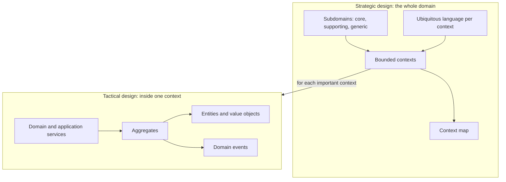
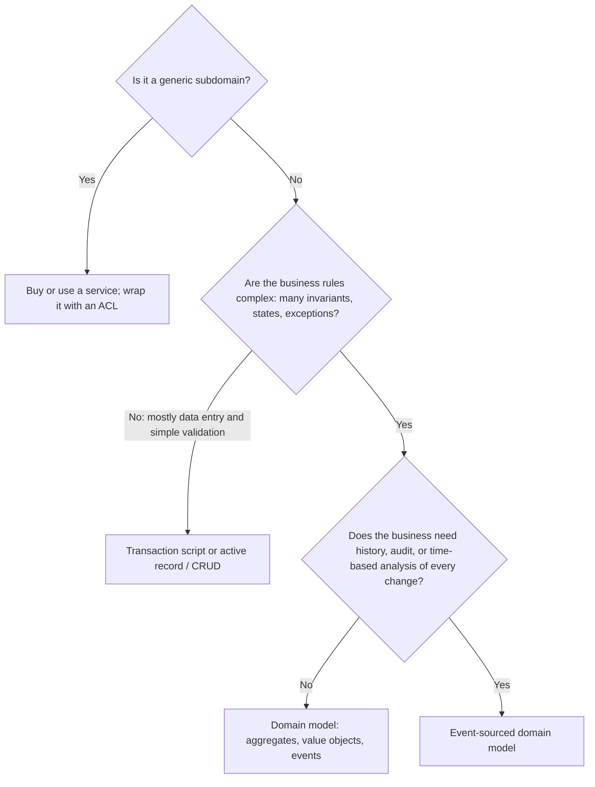

# Strategic vs Tactical DDD

## Introduction

Domain-Driven Design has two halves, and they answer different questions:

- **Strategic design** asks: *What is our business made of? Which parts matter most? Where are the boundaries between models and teams?* Its tools are subdomains, [ubiquitous language](./1-arch-ubiquitous-language.mdx), [bounded contexts and context maps](./2-arch-bounded-contexts.mdx), and discovery workshops like [Event Storming](./7-arch-event-storming.mdx).
- **Tactical design** asks: *Inside one boundary, how do we write code that keeps the business rules correct?* Its tools are [entities and value objects](./3-arch-entities-and-value-objects.mdx), [aggregates](./4-arch-aggregates.mdx), [domain events](./5-arch-domain-events.mdx), [domain and application services](./6-arch-domain-services.mdx), repositories and factories.

An analogy: city planning versus architecture. A city planner decides where the residential, industrial and commercial zones go, where the roads connect them, and which districts get investment. An architect designs a single building inside one zone. A beautifully designed factory in the middle of a residential street is still a mistake. Likewise, a perfect aggregate in the wrong boundary doesn't help much.

Many teams meet DDD through its tactical patterns, because they're concrete and look like code. Vaughn Vernon calls tactical-only DDD "DDD-Lite" in *Implementing Domain-Driven Design*, and warns that it misses most of the value. This page compares the two halves, shows what goes wrong when you only use one, and gives a practical way to decide how much of each to apply where.

## Side-by-Side Comparison

| Aspect | Strategic DDD | Tactical DDD |
| --- | --- | --- |
| Main question | What are the parts, which matter, where are the boundaries? | How do we model rules inside one boundary? |
| Scope | Whole domain, many teams | One bounded context, one team |
| Key tools | Subdomains (core, supporting, generic), ubiquitous language, bounded contexts, context maps | Entities, value objects, aggregates, domain events, services, repositories, factories |
| Discovery techniques | Big Picture Event Storming, Core Domain Charts, Bounded Context Canvas | Software Design Event Storming, example mapping, TDD |
| Main participants | Domain experts, product, architects, team leads | Developers with domain experts |
| Output | Context map, investment decisions, team boundaries | Domain model code and tests |
| Applies to | Every non-trivial system | Mostly the complex parts, usually the core domain |
| Cost of skipping it | Wrong boundaries, shared models, team friction, effort spent on commodity features | Business rules scattered and duplicated, invalid states |
| Changes how often | Slowly; boundaries are revisited every few months | Constantly, with every feature |



## What Goes Wrong With Tactical-Only DDD

Imagine QuickBite starts "doing DDD" by adding `Entity`, `ValueObject` and `AggregateRoot` base classes and making one big `Customer` aggregate, without strategic design. Every team needs something from customers, so everyone adds to it:

```python
# tactical_only.py - well-formed tactical code, wrong strategic boundary
from dataclasses import dataclass, field, fields


@dataclass(eq=False)
class Customer:                       # "aggregate root" used by every team
    id: str
    # Ordering
    default_address: str = ""
    favourite_restaurants: list[str] = field(default_factory=list)
    # Billing
    stripe_customer_ref: str = ""
    payment_methods: list[str] = field(default_factory=list)
    unpaid_balance_cents: int = 0
    # Marketing
    email_opt_in: bool = False
    segment: str = ""
    referral_code: str = ""
    # Support
    open_tickets: list[str] = field(default_factory=list)
    vip: bool = False
    # Loyalty
    points: int = 0
    tier: str = "bronze"
    version: int = 0

    def add_points(self, n: int) -> None:
        self.points += n
        self.tier = "gold" if self.points >= 1000 else self.tier

    def record_unpaid(self, cents: int) -> None:
        self.unpaid_balance_cents += cents


print("fields on Customer:", len(fields(Customer)))
owners = {"Ordering": 2, "Billing": 3, "Marketing": 3, "Support": 2, "Loyalty": 2}
print("teams editing this class:", len(owners))
```

Output:

```text
fields on Customer: 14
teams editing this class: 5
```

Each method looks fine in isolation. The problems are strategic:

- **Five teams edit one class**, so every change needs coordination, and the "aggregate" has no single owner.
- **Contention**: a loyalty points update and a billing balance update on the same customer conflict on `version`, even though no business rule links them.
- **The language is confused**: "customer" means a buyer to Ordering, a payer to Billing and a lead to Marketing.
- **Investment is misplaced**: the team spent weeks perfecting value objects for Marketing segments, a supporting area, while dispatch logic, the core domain, is still a tangle.

With strategic design first, each context gets its own small model of the customer: `Buyer` in Ordering, `Payer` in Billing, `Member` in Loyalty, each owned by one team and linked by `customer_id`.

## What Goes Wrong With Strategic-Only DDD

The opposite also happens. A team draws an excellent context map, splits services along it, and then writes every context as anemic data classes plus procedural services. Boundaries are right, but inside the core domain:

- business rules are duplicated across handlers,
- invariants are checked in some code paths but not others,
- and domain experts can't read the code.

For **supporting** and **generic** contexts, that's often perfectly fine. For the **core** domain, it wastes the strategic insight. Strategic design tells you *where* tactical design is worth it; skipping tactical design there leaves value on the table.

### Is tactical-only ever OK?

Tactical patterns used on their own are not worthless. Teams sometimes use them as a learning step, and some tactical ideas help in any codebase:

- **Value objects** for money, time ranges and identifiers prevent bugs anywhere.
- **Intention-revealing methods** (`order.cancel()` instead of setting a status field) make code easier to read regardless of boundaries.
- **Aggregates with clear invariants** are useful even in a single-team, single-context app.

The problem is not using tactical patterns without strategy; it's believing that doing so is "doing DDD" and expecting the strategic benefits (clear ownership, fewer cross-team conflicts, focused investment) to follow. They don't come from class design.

## Choosing the Modeling Approach per Subdomain

You don't choose "DDD or not" for a whole system. You choose per bounded context. Vlad Khononov's *Learning Domain-Driven Design* (O'Reilly, 2021) describes a spectrum of business logic implementation patterns, from **transaction script** and **active record** for simple logic to a **domain model** and an **event-sourced domain model** for complex logic. A practical way to choose:



Here is the same logic as a small helper you could use in an architecture review. The scores are subjective; the value is in making the team discuss them.

```python
# modeling_advisor.py - suggest an implementation approach per subdomain
from dataclasses import dataclass
from typing import Literal

Kind = Literal["core", "supporting", "generic"]


@dataclass(frozen=True)
class Subdomain:
    name: str
    kind: Kind
    rule_complexity: int      # 1 (simple CRUD) to 5 (many interacting rules)
    needs_full_history: bool  # audit trail or temporal queries are a business need


def suggest(sd: Subdomain) -> str:
    if sd.kind == "generic":
        return "buy or use a SaaS/library; protect with an anticorruption layer"
    if sd.rule_complexity <= 2:
        return "transaction script or active record (CRUD)"
    if sd.needs_full_history and sd.kind == "core":
        return "event-sourced domain model"
    if sd.rule_complexity >= 4 or sd.kind == "core":
        return "domain model (aggregates, value objects, domain events)"
    return "simple domain model or well-structured transaction scripts"


quickbite = [
    Subdomain("Dispatch and ETA", "core", 5, needs_full_history=True),
    Subdomain("Ordering and checkout", "core", 4, needs_full_history=False),
    Subdomain("Promotions", "supporting", 4, needs_full_history=False),
    Subdomain("Menu management", "supporting", 2, needs_full_history=False),
    Subdomain("Restaurant onboarding", "supporting", 3, needs_full_history=False),
    Subdomain("Payments", "generic", 4, needs_full_history=True),
    Subdomain("Identity and login", "generic", 3, needs_full_history=False),
]

for sd in quickbite:
    print(f"{sd.name:<24} {sd.kind:<11} -> {suggest(sd)}")
```

Output:

```text
Dispatch and ETA         core        -> event-sourced domain model
Ordering and checkout    core        -> domain model (aggregates, value objects, domain events)
Promotions               supporting  -> domain model (aggregates, value objects, domain events)
Menu management          supporting  -> transaction script or active record (CRUD)
Restaurant onboarding    supporting  -> simple domain model or well-structured transaction scripts
Payments                 generic     -> buy or use a SaaS/library; protect with an anticorruption layer
Identity and login       generic     -> buy or use a SaaS/library; protect with an anticorruption layer
```

Notice that **Promotions** is supporting, yet complex enough to deserve a domain model. Complexity and business importance are separate axes, which is why the DDD Crew's [Core Domain Charts](https://github.com/ddd-crew/core-domain-charts) plot both. And "event-sourced" for Dispatch is a suggestion to evaluate, not a decision; [Event Sourcing](../9-arch-distributed-systems/4-arch-event-sourcing.mdx) carries real operational costs.

## How Strategic Decisions Shape Tactical Ones

The two halves aren't independent. Strategic choices set the constraints for tactical design:

| Strategic decision | Tactical consequence |
| --- | --- |
| Ordering and Kitchen are separate contexts | `Order` and `KitchenTicket` are different aggregates in different codebases; they share only an ID |
| Kitchen protects itself with an ACL from partner POS systems | Kitchen's value objects stay clean; translation code lives in one adapter |
| Ordering publishes a Published Language | Domain events are translated to versioned integration events |
| Payments is generic and bought | No payment aggregates; a `PaymentGateway` port plus adapter |
| Dispatch is core | Rich aggregates, domain services for matching, thorough tests |

And tactical work feeds back into strategy. If an aggregate keeps needing data from another context to enforce its rules, the boundary may be in the wrong place. If two contexts publish dozens of events to each other for every operation, they might be one context.

## What Different Contexts Look Like in One Codebase

In a [modular monolith](../6-arch-architectural-styles/3-arch-modular-monolith.mdx), it is normal and healthy for contexts to have **different internal structures**. Here is what QuickBite's repository might look like:

```text
quickbite/
  ordering/                 # core: domain model
    domain/
      order.py              # Order aggregate, OrderLine value object
      money.py              # Money value object
      events.py             # OrderPlaced, OrderCancelledByCustomer
      fee_policy.py         # DeliveryFeePolicy domain service
    application/
      place_order.py        # PlaceOrderHandler
    adapters/
      postgres_orders.py    # OrderRepository implementation
      http_api.py
  dispatch/                 # core: domain model, maybe event-sourced later
    domain/ application/ adapters/
  menu/                     # supporting: simple CRUD
    api.py                  # request handlers
    queries.py              # SQL in plain functions
    validation.py           # the few rules that exist
  payments/                 # generic: thin wrapper around a provider
    gateway.py              # PaymentGateway port
    provider_adapter.py     # anticorruption layer for the vendor SDK
  shared/
    ids.py                  # tiny shared kernel: typed IDs only
```

Nobody should be surprised that `menu/` has no `domain/` folder. The structure of each context reflects its complexity. See [Structuring a Codebase](../7-arch-clean-architecture/6-arch-structuring-a-codebase.mdx) and [Vertical Slice Architecture](../7-arch-clean-architecture/3-arch-vertical-slice.mdx) for more layouts.

## Questions for a Design Review

Use these questions to check that both halves are getting attention:

**Strategic:**

- Which subdomain is this, and is it core, supporting or generic? Who decided?
- Which bounded context owns this concept? Does any other context have its own version of it?
- What is the relationship to upstream contexts: conformist, ACL or customer/supplier?
- Is there one team that clearly owns this context?

**Tactical (for complex contexts):**

- What invariants must hold at the end of every transaction? Which aggregate enforces each one?
- Are other aggregates referenced by ID?
- Which value objects remove primitive obsession here?
- Which domain events does this produce, and who consumes them? Are any of them public contracts?
- Could a domain expert read the tests and agree with them?

## Signs the Balance Is Off

| Symptom you notice | Likely missing | What to do |
| --- | --- | --- |
| Several teams edit the same domain classes and block each other | Strategic: boundaries | Split models per bounded context; assign owners |
| The same word causes repeated misunderstandings between teams | Strategic: language per context | Write glossaries per context; make translations explicit |
| Elegant aggregates exist for features nobody considers important | Strategic: subdomain classification | Classify subdomains and simplify supporting ones |
| Business rules are duplicated across handlers in the core | Tactical: domain model | Move rules into aggregates, value objects or domain services |
| Invalid states appear in production data | Tactical: invariants | Add value objects and aggregate roots that enforce rules |
| Every change needs a long chain of synchronous calls between services | Both | Revisit boundaries; use domain events and eventual consistency |

## A Practical Adoption Path

For a team new to DDD, this order tends to work:

1. **Learn the domain with experts.** Run a Big Picture Event Storming or a series of interviews.
2. **Classify subdomains** (core, supporting, generic) and agree on where to invest.
3. **Draw bounded contexts and a context map**, aligned with teams. Start with a few larger contexts.
4. **Write a glossary per context** and start using it in tickets, code and tests.
5. **Apply tactical patterns in the core domain first**, starting with value objects (cheap, high value), then aggregates for real invariants, then domain events where several reactions exist.
6. **Keep supporting and generic contexts simple.**
7. **Revisit** the context map and models as you learn. Record important decisions in [ADRs](../13-arch-documenting-and-evolving/0-arch-decision-records.mdx).

## Real-World Scenario

A QuickBite team of eight engineers adopted DDD a year ago after reading about aggregates. Every service now has `domain/`, `application/` and `infrastructure/` folders, every table has an aggregate and a repository, and every change publishes domain events. Velocity has dropped, and the restaurant success team complains that simple menu changes take weeks.

**What you do:**

1. **Step back to strategy.** In a half-day session with product and operations, classify subdomains. Menu management and restaurant onboarding are supporting; dispatch and checkout are core.
2. **Simplify supporting contexts.** Replace menu management's aggregates, events and repositories with a straightforward CRUD module over the database. Tests focus on the few validation rules that exist.
3. **Double down in the core.** Move the engineers freed up into dispatch, where tangled rules cause late deliveries. Apply aggregates and domain events there, with the Dispatch experts reviewing the language.
4. **Fix the context map.** Discover that "Customer" was a shared aggregate across four services; split it into per-context models.
5. **Write an ADR** stating which contexts use which modeling approach, so new hires don't "DDD-ify" everything again.

**Why this approach:** the team's problem was not too little DDD, it was tactical DDD applied uniformly without strategic guidance. Strategic classification showed where the effort pays off.

**When to use it / when not to:** strategic design is valuable for almost any system with several teams or a non-trivial business. Tactical design should be used selectively, in contexts with complex rules. A small app with one team and simple rules needs neither in a formal sense; see [When Not to Use DDD](./9-arch-when-not-ddd.mdx).

**Alternatives and trade-offs:**

| Approach | Pros | Cons | Best for |
| --- | --- | --- | --- |
| Strategic and tactical, tactical focused on the core | Effort goes where value is; clear boundaries | Requires discipline and expert access | Most complex, multi-team products |
| Strategic only | Good boundaries and language with simple code | Core rules may scatter | Medium-complexity domains; teams new to modeling |
| Tactical only ("DDD-Lite") | Better code structure quickly | Wrong boundaries; effort spread evenly; shared models | Rarely ideal; sometimes a learning step |
| Neither (pragmatic layered or CRUD design) | Fast and familiar | Struggles as domain complexity grows | Simple domains, prototypes, small teams |

## Common Mistakes

- **Treating DDD as a set of class types.** Base classes named `AggregateRoot` don't make a model domain-driven. Language and boundaries do.
- **Uniform architecture across all contexts.** Each context should use the simplest approach that handles its complexity.
- **Doing strategy once.** Context maps and subdomain classifications change as the business changes. Today's core can become tomorrow's commodity.
- **Letting tactical design ignore the context map.** Aggregates that reach into other contexts' data break the boundaries strategy set up.
- **Equating bounded contexts with microservices.** Strategy defines model boundaries; deployment is a separate decision. See [Modular Monolith](../6-arch-architectural-styles/3-arch-modular-monolith.mdx).

## Summary

- **Strategic DDD** finds subdomains, language and boundaries across the whole domain; **tactical DDD** models rules inside one boundary.
- Tactical-only DDD ("DDD-Lite") often produces well-crafted code in the wrong boundaries, with effort wasted on non-core areas.
- Strategic-only DDD gives good boundaries but can leave the core domain's rules scattered.
- Choose an implementation approach **per context**: buy for generic, CRUD or transaction scripts for simple logic, a domain model for complex logic, event sourcing only when history is a business need.
- Strategy constrains tactics, and tactical friction is feedback that boundaries may need to move.

## Further Learning

**Exercises:**

1. List the subdomains of a product you know, score each for rule complexity and business differentiation, and run them through `modeling_advisor.py`. Do you agree with every suggestion? Adjust the rules where you don't.
2. Find a "god" entity in a codebase you know (like the `Customer` above). Split its fields by context and name the per-context models.
3. Write a one-page ADR for QuickBite stating which modeling approach each context uses and why.
4. Explain to a colleague in three sentences why "we use aggregates and repositories" doesn't mean "we do DDD".

**Related pages:**

- Previous: [Event Storming](./7-arch-event-storming.mdx)
- Next: [When Not to Use DDD](./9-arch-when-not-ddd.mdx)
- [Domain-Driven Design Introduction](./0-arch-ddd-introduction.mdx) for the subdomain basics
- [Choosing an Architectural Style](../6-arch-architectural-styles/10-arch-choosing-a-style.mdx) and [Comparing Hexagonal, Onion, Clean and Vertical Slice](../7-arch-clean-architecture/7-arch-comparing-layered-styles.mdx) for per-context structure choices

**Sources:** Eric Evans, [DDD Reference](https://www.domainlanguage.com/ddd/reference/); Vaughn Vernon, *Implementing Domain-Driven Design* (Addison-Wesley, 2013); Vlad Khononov, [*Learning Domain-Driven Design*](https://www.oreilly.com/library/view/learning-domain-driven-design/9781098100124/) (O'Reilly, 2021); DDD Crew, [Core Domain Charts](https://github.com/ddd-crew/core-domain-charts).
