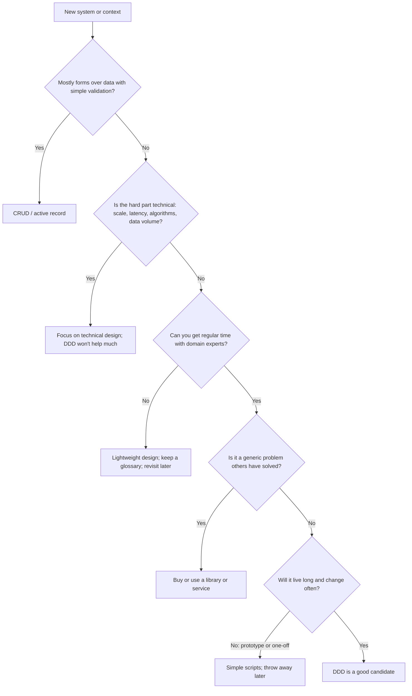

# When Not to Use DDD

## Introduction

Domain-Driven Design is a tool for **complex business logic**. Like any tool, it has a cost, and applied in the wrong place it makes software slower to build and harder to understand. A team that wraps a three-field settings form in aggregates, repositories, domain events and an anticorruption layer hasn't made the code better. It has made it longer.

Evans himself framed DDD as a response to complexity "in the heart of software", and the strategic half of DDD exists largely to tell you **where not to** apply the heavy tactical patterns: generic subdomains get bought, supporting subdomains get simple code, and only the core gets the full treatment (see [Strategic vs Tactical DDD](./8-arch-strategic-vs-tactical-ddd.mdx)).

An analogy: you wouldn't hire a structural engineer to design a garden shed. You'd use a kit. But you also wouldn't build a ten-story building from a shed kit. The skill is recognizing which one you're building, and noticing when the shed has quietly turned into a house.

This page covers:

- what DDD actually costs
- situations where it's the wrong choice
- cheap DDD ideas that are worth keeping almost everywhere
- warning signs that a simple design has outgrown itself

## What DDD Costs

Be honest about the price before you pay it.

| Cost | What it looks like |
| --- | --- |
| **Expert time** | Workshops, reviews and ongoing conversations with busy domain experts |
| **More code and concepts** | Value objects, aggregates, repositories, mappers, events, handlers; new team members must learn them |
| **Mapping overhead** | Translating between domain objects, database rows, API DTOs and integration events |
| **Slower start** | Modeling takes time before the first feature ships |
| **Eventual consistency** | Small aggregates and events mean some data is temporarily out of sync, and you need to handle that |
| **Risk of dogma** | Debates over whether something is "really" an aggregate, instead of shipping |

These costs are worth paying when the domain's complexity would otherwise cost more in bugs, duplicated rules and slow changes. When it wouldn't, they're pure overhead.

## When DDD Is the Wrong Tool



### 1. CRUD and simple data entry

If the system mostly stores and displays what users type, with simple validation, there are no interesting invariants to protect. An admin panel for restaurant descriptions, a contact form, or a feature-flag settings page doesn't need aggregates.

### 2. The complexity is technical, not domain

A real-time leaderboard, a video transcoding pipeline, a search index or a high-throughput log collector are hard because of performance, concurrency or data volume. DDD has little to say about those. Use the relevant technical patterns: [caching](../11-arch-data-architecture/2-arch-caching-strategies.mdx), [pipes and filters](../6-arch-architectural-styles/9-arch-pipes-and-filters.mdx), [sharding](../11-arch-data-architecture/3-arch-replication-and-sharding.mdx), and good [algorithms](/docs/fundamental/algorithm).

### 3. No access to domain experts

DDD's core loop is learning the domain from experts. Without them, the "ubiquitous language" is developers guessing, and elaborate models encode those guesses rigidly. Prefer a simple, easy-to-change design until you can validate the model.

### 4. Generic subdomains

Authentication, payments processing, email delivery, invoicing PDFs and calendar sync have well-tested products and libraries. Modeling them yourself is rarely a good use of time. Integrate them behind a port, perhaps with a thin [anticorruption layer](./2-arch-bounded-contexts.mdx).

### 5. Prototypes and short-lived software

A two-week experiment to test whether customers want grocery delivery should optimize for learning speed. If it succeeds, you'll rebuild it with what you learned; if it fails, the model didn't matter.

### 6. Reporting and analytics

Dashboards and analytical queries are about reading and aggregating data across many entities. Aggregates are built for consistent writes and are a poor fit for reads. Use SQL, a read model or a warehouse; see [Search and Analytics Architecture](../11-arch-data-architecture/6-arch-search-and-analytics.mdx) and [CQRS](../9-arch-distributed-systems/3-arch-cqrs.mdx).

### 7. Very small teams with simple products

One or two developers on a simple product already share a language and context. Formal context maps and workshops add process without solving a real problem.

## Over-Engineered vs Right-Sized: An Example

QuickBite's restaurant success team needs to edit a restaurant's display name and description. Here's what happens when a team applies tactical DDD by reflex:

```python
# overkill.py - full tactical DDD ceremony for a two-field edit
from __future__ import annotations

import sqlite3
from abc import ABC, abstractmethod
from dataclasses import dataclass, field


@dataclass(frozen=True)
class RestaurantName:
    value: str

    def __post_init__(self) -> None:
        if not 1 <= len(self.value) <= 80:
            raise ValueError("Name must be 1-80 characters")


@dataclass(frozen=True)
class Description:
    value: str

    def __post_init__(self) -> None:
        if len(self.value) > 500:
            raise ValueError("Description too long")


@dataclass(frozen=True)
class RestaurantProfileUpdated:
    restaurant_id: str


@dataclass(eq=False)
class RestaurantProfile:
    id: str
    name: RestaurantName
    description: Description
    events: list[RestaurantProfileUpdated] = field(default_factory=list)

    def update(self, name: RestaurantName, description: Description) -> None:
        self.name, self.description = name, description
        self.events.append(RestaurantProfileUpdated(self.id))


class RestaurantProfileRepository(ABC):
    @abstractmethod
    def get(self, rid: str) -> RestaurantProfile: ...
    @abstractmethod
    def save(self, profile: RestaurantProfile) -> None: ...


class SqliteRestaurantProfileRepository(RestaurantProfileRepository):
    def __init__(self, conn: sqlite3.Connection) -> None:
        self.conn = conn

    def get(self, rid: str) -> RestaurantProfile:
        name, desc = self.conn.execute(
            "SELECT name, description FROM restaurants WHERE id = ?", (rid,)).fetchone()
        return RestaurantProfile(rid, RestaurantName(name), Description(desc))

    def save(self, profile: RestaurantProfile) -> None:
        self.conn.execute("UPDATE restaurants SET name = ?, description = ? WHERE id = ?",
                          (profile.name.value, profile.description.value, profile.id))


@dataclass(frozen=True)
class UpdateRestaurantProfile:
    restaurant_id: str
    name: str
    description: str


class UpdateRestaurantProfileHandler:
    def __init__(self, repo: RestaurantProfileRepository) -> None:
        self.repo = repo

    def __call__(self, cmd: UpdateRestaurantProfile) -> None:
        profile = self.repo.get(cmd.restaurant_id)
        profile.update(RestaurantName(cmd.name), Description(cmd.description))
        self.repo.save(profile)
        for event in profile.events:
            pass  # nobody subscribes to this event


conn = sqlite3.connect(":memory:")
conn.execute("CREATE TABLE restaurants (id TEXT PRIMARY KEY, name TEXT, description TEXT)")
conn.execute("INSERT INTO restaurants VALUES ('r-9', 'Thai Garden', 'Family run')")
UpdateRestaurantProfileHandler(SqliteRestaurantProfileRepository(conn))(
    UpdateRestaurantProfile("r-9", "Thai Garden Express", "Family run since 1998"))
print(conn.execute("SELECT * FROM restaurants").fetchone())
```

Output:

```text
('r-9', 'Thai Garden Express', 'Family run since 1998')
```

About 90 lines, seven classes, and an event no one listens to. Now the right-sized version for a supporting subdomain with two validation rules:

```python
# right_sized.py - a plain function with the same rules
import sqlite3


def update_restaurant_profile(conn: sqlite3.Connection, restaurant_id: str,
                              name: str, description: str) -> None:
    if not 1 <= len(name) <= 80:
        raise ValueError("Name must be 1-80 characters")
    if len(description) > 500:
        raise ValueError("Description too long")
    with conn:
        updated = conn.execute(
            "UPDATE restaurants SET name = ?, description = ? WHERE id = ?",
            (name, description, restaurant_id)).rowcount
    if updated != 1:
        raise LookupError(f"No restaurant {restaurant_id}")


conn = sqlite3.connect(":memory:")
conn.execute("CREATE TABLE restaurants (id TEXT PRIMARY KEY, name TEXT, description TEXT)")
conn.execute("INSERT INTO restaurants VALUES ('r-9', 'Thai Garden', 'Family run')")
update_restaurant_profile(conn, "r-9", "Thai Garden Express", "Family run since 1998")
print(conn.execute("SELECT * FROM restaurants").fetchone())
```

Output:

```text
('r-9', 'Thai Garden Express', 'Family run since 1998')
```

Same behavior, about a quarter of the code, readable by anyone on day one, and it even checks that the restaurant exists, which the "proper" version forgot. This is a [Transaction Script](https://martinfowler.com/eaaCatalog/transactionScript.html), and for this problem it's the better design. [KISS and YAGNI](../1-arch-design-principles/6-arch-dry-kiss-yagni.mdx) apply to DDD too.

## Cheap DDD Ideas Worth Keeping Almost Everywhere

Skipping full DDD doesn't mean throwing everything away. Some ideas cost almost nothing and help even in simple systems:

| Idea | Cost | Why it's worth it |
| --- | --- | --- |
| A short **glossary** of business terms | An hour, plus updates | Prevents the "cancel vs reject" class of bugs |
| **Business names** in code | Free | `accept_order()` beats `update_status(2)` |
| **Value objects for money, time ranges and IDs** | A few small classes | Eliminates whole bug categories |
| **Module boundaries** around clearly different areas | Some discipline | Makes later splitting much easier |
| **Talking to the people who use it** | Calendar time | Most requirements bugs are misunderstandings |

```mermaid
flowchart LR
    subgraph Always["Almost always worth it"]
        A1["Glossary"]
        A2["Business names in code"]
        A3["Value objects for money and IDs"]
        A4["Clear module boundaries"]
    end
    subgraph Sometimes["When complexity justifies it"]
        B1["Aggregates with invariants"]
        B2["Domain events"]
        B3["Context maps and ACLs"]
        B4["Event Storming workshops"]
    end
    subgraph Rarely["Only with a clear need"]
        C1["Event sourcing"]
        C2["Separate service per context"]
    end
    Always --> Sometimes --> Rarely
```



## Warning Signs That You Need More Modeling

Simple designs can outgrow themselves. Watch for these signals that a context has become complex enough to deserve tactical DDD:

- **The same rule appears in several places** (checkout API, mobile estimate endpoint, nightly job) and they disagree.
- **Bugs come from invalid states**: orders that are both cancelled and delivered, negative balances, overlapping time windows.
- **`if` statements on status and type flags multiply**, and every new feature adds more branches to existing functions.
- **Domain experts can't verify behavior** by reading code or tests, and every rule question needs a developer to investigate.
- **Changes in one area break unrelated features**, because everything shares one model.
- **New developers take months** to understand the business rules.

When you see these, don't rewrite everything. Refactor incrementally: introduce value objects first, then pull scattered rules into an aggregate or a domain service, one use case at a time. See [Refactoring to Patterns](../5-arch-modern-patterns/8-arch-refactoring-to-patterns.mdx) and [Technical Debt](../0-arch-fundamentals/8-arch-technical-debt.mdx).

### A first refactoring step

Suppose the right-sized `update_restaurant_profile` grows. Restaurants now have opening hours, and three places (the profile editor, the ordering API and a nightly job) each check "is the restaurant open?" slightly differently. The first step is not aggregates; it's a value object that gives the rule one home:

```python
# opening_hours.py - step one: one value object owns the rule
from dataclasses import dataclass
from datetime import time


@dataclass(frozen=True)
class OpeningHours:
    opens: time
    closes: time
    last_order_minutes_before_close: int = 15

    def __post_init__(self) -> None:
        if self.closes <= self.opens:
            raise ValueError("Closing time must be after opening time")

    def accepts_orders_at(self, t: time) -> bool:
        close_minutes = self.closes.hour * 60 + self.closes.minute
        last_order = close_minutes - self.last_order_minutes_before_close
        now = t.hour * 60 + t.minute
        return self.opens <= t and now <= last_order


hours = OpeningHours(time(11, 0), time(22, 0))
for t in (time(10, 59), time(21, 44), time(21, 50)):
    print(t, hours.accepts_orders_at(t))
```

Output:

```text
10:59:00 False
21:44:00 True
21:50:00 False
```

All three callers now use `OpeningHours.accepts_orders_at`, and the rest of the code stays as simple functions. If more rules arrive later, such as holiday hours, temporary pauses during rushes or per-city regulations, you can grow this into a `Restaurant` aggregate. Each step is small, and you only take the next one when the complexity is actually there.

## Real-World Scenario

A five-person startup is building an internal tool to help QuickBite's operations team schedule courier shifts across three cities. A senior engineer who loves DDD proposes Event Storming workshops, four bounded contexts, event sourcing for shift changes and a separate service per context.

**What you do:**

1. **Check the domain complexity.** Ops explains the rules: couriers pick shifts from a list, a shift has a city, start, end and capacity, and couriers can't overlap their own shifts. That's a handful of rules.
2. **Check the expected lifetime and change rate.** The tool replaces a spreadsheet; the company plans to buy a workforce management product within a year if the pilot works.
3. **Decide on a right-sized design**: one modular monolith with a simple database schema, transaction scripts for most operations, and a `TimeWindow` value object for shift times because overlap checks are the one tricky rule.
4. **Keep the cheap ideas**: a one-page glossary (shift, slot, capacity, swap), business names in code, and module boundaries between "shifts" and "courier profiles".
5. **Write an ADR** recording the decision and the triggers that would justify more modeling: shift swaps with approval rules, union constraints, or pay calculation moving into the tool.

**Why this approach:** the business value is in shipping quickly and replacing a spreadsheet. The domain is simple, the tool may be replaced, and the triggers for revisiting are written down.

**When to use it / when not to:** choose right-sized simple designs whenever complexity is low or uncertain. Choose fuller DDD once rules multiply, experts are engaged, and the software is a long-lived differentiator.

**Alternatives and trade-offs:**

| Approach | Pros | Cons | Best for |
| --- | --- | --- | --- |
| Transaction scripts and CRUD | Fast; minimal concepts; easy onboarding | Rules can scatter as complexity grows | Simple or short-lived systems |
| Simple design plus cheap DDD ideas (glossary, value objects, modules) | Most of the clarity for little cost; easy to evolve | Requires judgment about when to go further | Most supporting subdomains and new products |
| Full strategic and tactical DDD | Handles complex rules and many teams well | Highest upfront cost; needs experts | Complex, long-lived core domains |
| Buy a product | No modeling at all; vendor maintains it | Less control; integration and vendor lock-in | Generic subdomains |

## Common Mistakes

- **DDD as a default architecture.** Every project template with `domain/`, `application/` and `infrastructure/` folders and an aggregate per table is a sign DDD is being applied by habit.
- **Rejecting DDD entirely after one bad experience.** Over-engineering a CRUD app doesn't mean DDD is useless; it means it was used in the wrong place.
- **Waiting for "the right time" forever.** If the warning signs are there and experts are available, start with small steps now.
- **Mistaking technical complexity for domain complexity.** Microservices, Kafka and Kubernetes don't make a domain complex. Ask whether the *business rules* are hard.
- **Not writing down the decision.** Without an ADR, the next engineer may add DDD ceremony, or remove the parts that matter, without knowing why the design is the way it is.

## Summary

- DDD has real costs: expert time, more code and concepts, mapping, and eventual consistency.
- Skip the heavy parts for **CRUD**, **technically complex but rule-light systems**, **generic subdomains**, **prototypes**, **reporting**, and situations **without domain expert access**.
- Right-sized code (transaction scripts, active record) is often the better design for simple contexts.
- Cheap DDD ideas such as a glossary, business names, value objects and module boundaries are worth keeping almost everywhere.
- Watch for warning signs (duplicated rules, invalid states, flag explosions) and refactor toward a richer model incrementally when they appear.

## Further Learning

**Exercises:**

1. List three features in a system you know. For each, decide whether it needs a domain model, a transaction script, or a bought product, and justify the choice in one sentence.
2. Take `overkill.py` and identify which pieces you would keep if a new rule arrived: "name changes require approval from restaurant success if the restaurant has more than 100 reviews".
3. Write an ADR for the courier shift tool scenario, including explicit triggers for revisiting the design.
4. Find a module in your codebase showing two or more of the warning signs above. Outline a three-step incremental refactoring plan.

**Related pages:**

- Previous: [Strategic vs Tactical DDD](./8-arch-strategic-vs-tactical-ddd.mdx)
- Back to the start: [Domain-Driven Design Introduction](./0-arch-ddd-introduction.mdx)
- Next section: [Distributed Systems Fundamentals](../9-arch-distributed-systems/0-arch-distributed-fundamentals.mdx)
- [Thinking in Trade-offs](../0-arch-fundamentals/4-arch-trade-offs.mdx) and [Common Anti-Patterns](../5-arch-modern-patterns/7-arch-anti-patterns.mdx)

**Sources:** Eric Evans, [DDD Reference](https://www.domainlanguage.com/ddd/reference/); Martin Fowler, [Transaction Script](https://martinfowler.com/eaaCatalog/transactionScript.html), [Anemic Domain Model](https://martinfowler.com/bliki/AnemicDomainModel.html) and [Domain-Driven Design](https://martinfowler.com/bliki/DomainDrivenDesign.html); Vlad Khononov, [*Learning Domain-Driven Design*](https://www.oreilly.com/library/view/learning-domain-driven-design/9781098100124/) (O'Reilly, 2021).
