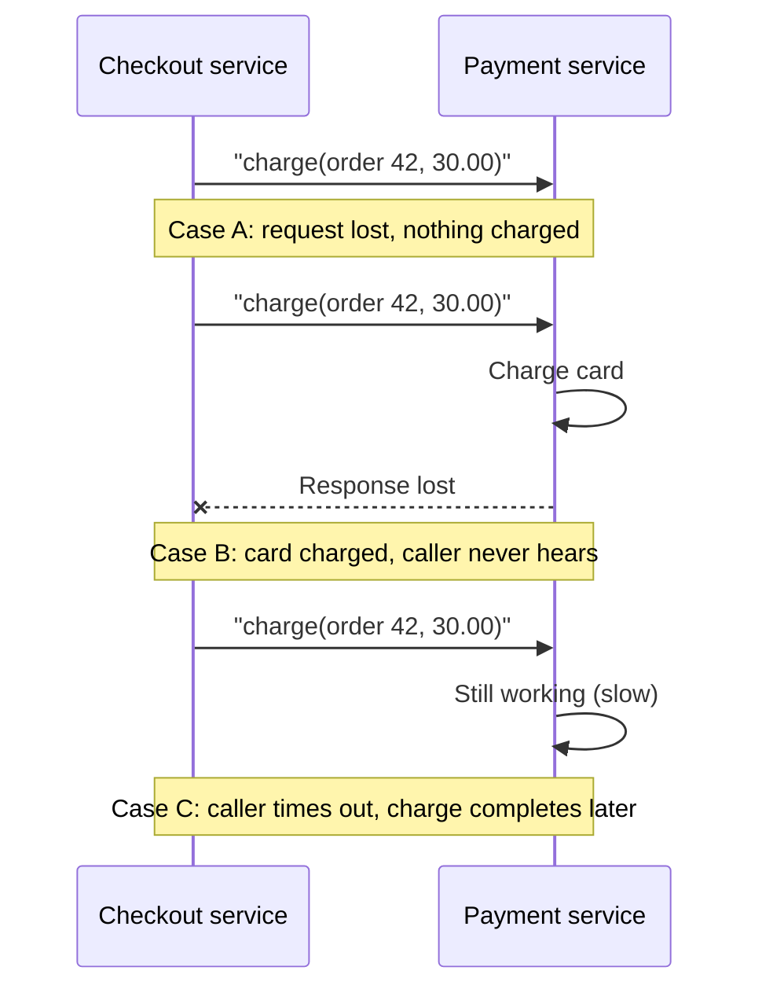
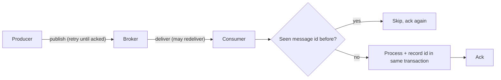
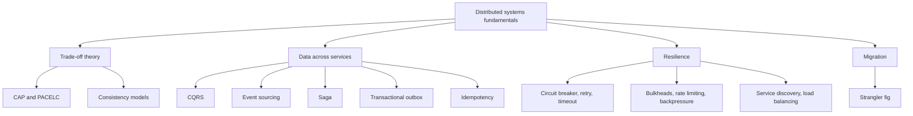

# Distributed Systems Fundamentals

## Introduction

A **distributed system** is a set of programs, running on different machines, that cooperate over a network to look like one system to the user. The moment your bookstore's checkout code calls a separate payment service, a managed database, or even a cache on another host, you are building one.

Everything in this section of the tutorial (CQRS, sagas, outboxes, circuit breakers and the rest) exists because of a handful of uncomfortable facts about networks and machines. This page covers those facts so the patterns that follow make sense.

A useful analogy: a single-process program is like talking to a colleague at the same desk. A distributed system is like coordinating with colleagues by post. Letters get lost, arrive late, arrive twice, or arrive out of order. Sometimes your colleague is on holiday. And when you do not get a reply, you cannot tell whether your letter was lost, their reply was lost, or they are simply slow.

Why accept that pain at all? Usually for one of these reasons:

- **Scale:** one machine cannot hold the data or handle the traffic.
- **Availability:** you want the system to survive the loss of a machine, a rack, or a data centre.
- **Latency:** you want servers close to users in several regions.
- **Organisation:** separate teams own separate services (see [Conway's Law and Team Topologies](../0-arch-fundamentals/9-arch-conways-law.mdx)).

If none of these apply, a single well-built application with one database is usually the better choice. The [Modular Monolith](../6-arch-architectural-styles/3-arch-modular-monolith.mdx) page makes that case in detail.

## The Fallacies of Distributed Computing

In the 1990s, engineers at Sun Microsystems listed assumptions that newcomers to distributed systems tend to make, and that turn out to be false. L. Peter Deutsch is credited with the first seven, and James Gosling added the eighth. They are still the best checklist for reviewing a design:

| Fallacy | What actually happens | Pattern that helps |
| --- | --- | --- |
| The network is reliable | Packets drop, connections reset, load balancers restart | Retries, idempotency, outbox |
| Latency is zero | Every hop adds milliseconds, and tail latency can be far worse | Timeouts, caching, fewer round trips |
| Bandwidth is infinite | Large payloads saturate links and slow everyone | Pagination, compression, claim check |
| The network is secure | Traffic can be read or forged | TLS, mTLS, zero trust |
| Topology does not change | Instances come and go every deploy | Service discovery |
| There is one administrator | Many teams, vendors and clouds are involved | Clear ownership, contracts |
| Transport cost is zero | Serialisation and egress cost CPU and money | Batching, efficient formats |
| The network is homogeneous | Different OSes, versions and protocols | Standard protocols, versioned APIs |

The Azure Architecture Center's [cloud design patterns catalogue](https://learn.microsoft.com/azure/architecture/patterns/) opens with this same list, and adds modern variations such as "component versioning is simple" and "observability can be delayed".

## Partial Failure: The Core Problem

In a single process, a function call either returns or throws. In a distributed system, a remote call has **three** possible outcomes:

1. **Success:** you got a response saying it worked.
2. **Failure:** you got a response saying it did not work.
3. **Unknown:** you got nothing back before your timeout expired.

The third outcome is the one that makes distributed systems hard. When a request times out, any of these may have happened:



From the caller's side, cases A, B and C look identical. If you retry, you might charge the customer twice (case B or C). If you do not retry, you might never charge them (case A). The patterns in this section exist to make that choice safe:

- [Idempotency](./7-arch-idempotency.mdx) makes retries harmless.
- [Circuit Breaker, Retry and Timeout](./8-arch-circuit-breaker.mdx) makes retries disciplined.
- [Transactional Outbox](./6-arch-outbox.mdx) makes "save and notify" reliable.

### Simulating an unreliable network

The following script simulates a payment service behind a network that sometimes drops requests, sometimes drops responses, and sometimes is slow. It is pure standard-library Python, so you can run it as is.

```python
import random
from dataclasses import dataclass, field
from enum import Enum


class Outcome(Enum):
    OK = "ok"
    TIMEOUT = "timeout"


@dataclass
class PaymentService:
    charges: list[tuple[int, float]] = field(default_factory=list)

    def charge(self, order_id: int, amount: float) -> str:
        self.charges.append((order_id, amount))
        return f"charged order {order_id}"


@dataclass
class FlakyNetwork:
    """Wraps a remote call and injects the classic network failures."""
    rng: random.Random
    drop_request: float = 0.2
    drop_response: float = 0.2

    def call(self, service: PaymentService, order_id: int, amount: float) -> Outcome:
        if self.rng.random() < self.drop_request:
            return Outcome.TIMEOUT          # server never saw it
        service.charge(order_id, amount)    # server did the work
        if self.rng.random() < self.drop_response:
            return Outcome.TIMEOUT          # caller never hears back
        return Outcome.OK


def naive_checkout(net: FlakyNetwork, svc: PaymentService, order_id: int) -> None:
    # "Just retry until it works" - the most common first attempt
    for attempt in range(1, 6):
        outcome = net.call(svc, order_id, 30.0)
        print(f"order {order_id} attempt {attempt}: {outcome.value}")
        if outcome is Outcome.OK:
            return


if __name__ == "__main__":
    net = FlakyNetwork(rng=random.Random(7))
    svc = PaymentService()
    for order in (1, 2, 3):
        naive_checkout(net, svc, order)
    print("charges recorded by the payment service:", svc.charges)
```

Example output:

```text
order 1 attempt 1: timeout
order 1 attempt 2: timeout
order 1 attempt 3: ok
order 2 attempt 1: timeout
order 2 attempt 2: timeout
order 2 attempt 3: timeout
order 2 attempt 4: timeout
order 2 attempt 5: ok
order 3 attempt 1: timeout
order 3 attempt 2: ok
charges recorded by the payment service: [(1, 30.0), (1, 30.0), (1, 30.0), (2, 30.0), (2, 30.0), (2, 30.0), (3, 30.0)]
```

Order 1 was charged **three times**: both timed-out attempts reached the server, and only the responses were lost. Order 2 was also charged three times in five attempts. Order 3 was charged once, because its first timeout was a lost *request*. The caller saw the same "timeout" in every case, so it had no way to tell them apart. The exact output depends on the random seed, but with almost any seed you will see duplicate charges.

:::tip
The fix is not "retry less". It is to make the operation safe to repeat, by sending an idempotency key the server can deduplicate on. The [Idempotency](./7-arch-idempotency.mdx) page builds that fix.
:::

## Time and Clocks

Single-machine code often relies on timestamps to decide "what happened first". Across machines that is unsafe.

- **Wall clocks drift.** Each server's clock is synchronised with NTP (or a cloud time service) but can still be off by milliseconds or more, and can jump backwards when corrected.
- **Monotonic clocks** never go backwards, but they only make sense within one process. Use them for measuring durations and timeouts (`time.monotonic()` in Python), never for ordering events across machines.
- **"Last write wins" by timestamp** can silently discard a newer write if the newer writer's clock was behind.

### Logical clocks

Leslie Lamport's 1978 paper "Time, Clocks, and the Ordering of Events in a Distributed System" showed how to order events without trusting wall clocks. A **Lamport clock** is a counter that each node increments on every event, and that jumps forward when it sees a larger value in an incoming message:

```python
from dataclasses import dataclass


@dataclass
class LamportClock:
    node: str
    time: int = 0

    def tick(self) -> int:
        """A local event happened."""
        self.time += 1
        return self.time

    def send(self) -> int:
        """Stamp an outgoing message."""
        return self.tick()

    def receive(self, msg_time: int) -> int:
        """Merge the sender's time, then count the receive event."""
        self.time = max(self.time, msg_time)
        return self.tick()


orders = LamportClock("orders")
kitchen = LamportClock("kitchen")

t1 = orders.tick()               # order created
t2 = orders.send()               # send "OrderPlaced"
t3 = kitchen.tick()              # kitchen does unrelated work
t4 = kitchen.receive(t2)         # kitchen receives "OrderPlaced"
t5 = kitchen.send()              # kitchen sends "OrderAccepted"
t6 = orders.receive(t5)          # orders receives it

print(f"orders:  created={t1} sent={t2} got-accept={t6}")
print(f"kitchen: local={t3} got-order={t4} sent-accept={t5}")
```

Output:

```text
orders:  created=1 sent=2 got-accept=5
kitchen: local=1 got-order=3 sent-accept=4
```

If event A caused event B, A's Lamport timestamp is always smaller. The reverse is not guaranteed: two unrelated events can have any order. **Vector clocks** extend the idea so you can also detect concurrent events, which is how some Dynamo-style databases detect conflicting writes. You rarely implement these yourself, but knowing they exist explains why databases offer the guarantees described in [Consistency Models](./2-arch-consistency-models.mdx).

## Message Delivery Guarantees

When services talk through a message broker such as [RabbitMQ](/docs/middleware/rabbitmq) or Kafka, you choose a delivery guarantee:

| Guarantee | How it works | Risk |
| --- | --- | --- |
| At-most-once | Send once, never retry; ack before processing | Messages can be lost |
| At-least-once | Retry until acknowledged; ack after processing | Messages can be duplicated |
| Exactly-once | Not achievable end to end over an unreliable network in general | Vendors mean something narrower, see below |

In practice, almost every reliable system uses **at-least-once delivery plus idempotent processing**. That combination is often called "effectively once". When a product advertises exactly-once (for example Kafka transactions), it usually means exactly-once *within that system's boundary*, such as read-process-write between Kafka topics. As soon as your consumer also sends an email or calls a payment API, you are back to needing idempotency.



## Agreement and Consensus

Some problems need several machines to agree on one value: who is the leader, which configuration is current, whether a lock is held. This is the **consensus** problem.

The classic "two generals" thought experiment shows why it is hard: two armies that can only communicate by messengers who might be captured can never be *certain* they agree on an attack time, because the last messenger's arrival can never be confirmed. Practical consensus algorithms such as **Paxos** and **Raft** work around this by requiring a majority (a quorum) of nodes to agree, so the system can tolerate a minority of failures.

You almost never write consensus code. You use a system that already implements it:

- **etcd** (Raft), which stores Kubernetes cluster state.
- **ZooKeeper** (its own protocol, ZAB), used historically by Kafka and Hadoop.
- **Consul** (Raft), used for service discovery and configuration.
- Distributed SQL databases such as CockroachDB and Spanner-style systems, which use consensus per data range.

Rule of thumb: a cluster of **3** consensus nodes tolerates 1 failure, and **5** tolerates 2. Adding a fourth node does not increase failure tolerance, which is why these clusters usually have an odd size.

:::caution
Do not build a distributed lock on top of a plain cache key with a TTL and assume it is safe for correctness. A paused process (a long garbage-collection pause, for example) can still believe it holds a lock that has expired. If correctness depends on the lock, use fencing tokens or a consensus-backed store, and read Martin Kleppmann's analysis "How to do distributed locking" before choosing.
:::

## A Checklist for Every Remote Call

Before you add a network call to any code path, answer these questions. Each one maps to a page later in this section:

| Question | If you have no answer | Where to read more |
| --- | --- | --- |
| What is the timeout? | Workers can hang forever | [Circuit Breaker, Retry and Timeout](./8-arch-circuit-breaker.mdx) |
| Is it safe to retry? | Duplicates or lost operations | [Idempotency](./7-arch-idempotency.mdx) |
| What happens if the dependency is down for 10 minutes? | Cascading failure | [Circuit Breaker, Retry and Timeout](./8-arch-circuit-breaker.mdx) |
| Can one slow dependency starve the others? | Whole-service outage | [Bulkheads, Rate Limiting and Backpressure](./9-arch-bulkhead-and-rate-limiting.mdx) |
| How does the caller find the callee? | Hard-coded addresses break on deploy | [Service Discovery and Load Balancing](./10-arch-service-discovery.mdx) |
| Must a database change and a message happen together? | Lost or phantom events | [Transactional Outbox](./6-arch-outbox.mdx) |
| Does a business operation span several services? | Half-finished operations | [Saga Pattern](./5-arch-saga.mdx) |
| How stale can the data be? | Confusing user-visible anomalies | [Consistency Models](./2-arch-consistency-models.mdx) |

## A Map of This Section

The rest of this section groups patterns by the problem they solve:



## Real-World Scenario

Your team runs **QuickBite**, a food delivery app. Today it is one Django application and one PostgreSQL database. The business wants three things: restaurants in a new country, a separate team owning the courier dispatch logic, and an end to outages when the payment provider is slow.

### The proposal

An enthusiastic engineer proposes splitting into twelve microservices at once. Before agreeing, the team walks the design through the fallacies:

1. **Network reliability:** checkout would make five synchronous calls (menu, pricing, payment, kitchen, dispatch). Each can time out with an unknown outcome. The payment call in particular needs an idempotency key.
2. **Latency:** five sequential calls each adding tail latency would slow checkout. Some calls can become asynchronous events.
3. **Topology changes:** with autoscaling, instances change constantly, so services need discovery rather than fixed IPs.
4. **One administrator:** the payment provider is a third party with its own rate limits and outages.

### The decision

The team chooses a smaller step:

- Keep the core ordering flow in the monolith, organised as modules.
- Extract **dispatch** as a separate service, because a separate team owns it and it has different scaling needs (location updates).
- Wrap the **payment provider** call with a timeout, a circuit breaker and an idempotency key.
- Publish `OrderPlaced` events to dispatch through a transactional outbox, so an order is never saved without its event.

### Why this approach

It applies distributed-systems machinery only where a real driver exists (team ownership, a third-party dependency) and keeps everything else in-process, where a function call cannot partially fail.

### When to use it, and when not to

Distribute when you have a concrete driver: independent scaling, team autonomy, fault isolation, or geography. Do not distribute to "be modern". Every network hop you add buys you the problems on this page.

### Alternatives and trade-offs

| Approach | Pros | Cons | Best for |
| --- | --- | --- | --- |
| Single monolith, one database | Simple transactions, easy debugging | Scales as one unit, team contention | Most early products |
| Modular monolith | Clear boundaries, still one deploy and ACID | Needs discipline to keep modules separate | Growing teams, uncertain boundaries |
| Selective extraction (QuickBite plan) | Distribution only where it pays | Two worlds to operate | One or two clear drivers |
| Full microservices | Independent deploys and scaling per service | Partial failure everywhere, eventual consistency | Large organisations with platform maturity |

## Common Mistakes

- **Treating a remote call like a local call.** Hiding the network behind an innocent-looking method (the old "distributed objects" idea) encourages chatty, fragile designs. Make remote calls look remote.
- **No timeouts.** Many HTTP clients wait forever by default. In Python's `requests`, for example, there is no timeout unless you pass one. Always set one.
- **Assuming a timeout means failure.** It means "unknown". Design for that.
- **Ordering events by wall-clock timestamps** from different machines.
- **Believing a vendor's "exactly-once"** applies to side effects outside that vendor's system.
- **Distributing too early.** Splitting a system before you understand its boundaries creates a distributed monolith: all the costs, none of the independence.

## Summary

- A distributed system is several programs cooperating over a network; you choose it for scale, availability, latency or team autonomy.
- The eight fallacies of distributed computing are a design checklist.
- Remote calls have three outcomes: success, failure and **unknown**. Unknown is the hard one.
- Wall clocks cannot order events across machines; logical clocks can capture causality.
- At-least-once delivery plus idempotent processing is the practical standard.
- Consensus (Raft, Paxos) is solved by tools like etcd and Consul; use them rather than inventing locks.

## Exercises

1. Run the flaky network simulation with five different seeds. Count how many orders are double-charged and how many are lost if you stop retrying after one attempt.
2. Extend `LamportClock` into a vector clock (a dict of node name to counter) and write a function that reports whether two events are ordered or concurrent.
3. Take a system you know and list every network hop in its most important user flow. For each hop, write down what happens on a timeout.
4. Explain to a colleague why a cluster of four consensus nodes is no more fault-tolerant than three.

### Related pages

- [CAP and PACELC](./1-arch-cap-and-pacelc.mdx), the trade-off theory behind distributed data.
- [Microservices Architecture](../6-arch-architectural-styles/4-arch-microservices.mdx), the style that makes these patterns necessary.
- [Synchronous vs Asynchronous Communication](../10-arch-integration-and-apis/0-arch-communication-styles.mdx).
- [Designing for Reliability and Resilience](../12-arch-quality-and-operations/2-arch-reliability.mdx).
