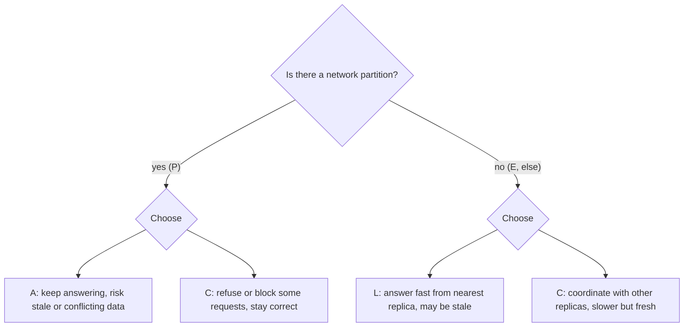
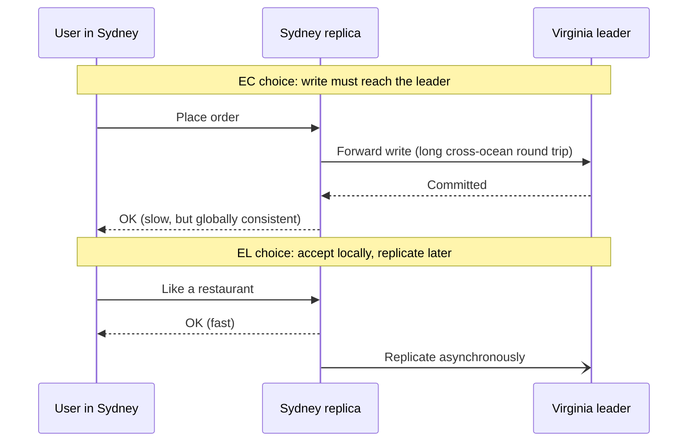

# CAP and PACELC

## Introduction

The **CAP theorem** is probably the most quoted and most misquoted idea in distributed systems. You will hear "pick two of consistency, availability and partition tolerance" in design reviews and interviews. That slogan is close enough to be memorable and wrong enough to lead to bad decisions.

This page explains what CAP actually says, why "pick two" misleads, and why **PACELC** is the more useful everyday tool: it reminds you that even when nothing is broken, replicated data forces a trade-off between **latency** and **consistency**.

An analogy: two bank branches share one customer ledger by phone. If the phone line goes down (a partition), each branch must decide. Either refuse withdrawals until the line comes back (stay consistent, lose availability), or keep serving customers and risk the same money being withdrawn twice (stay available, lose consistency). And even when the line works, phoning the other branch before every withdrawal makes customers wait (the latency cost PACELC adds).

## Where CAP Comes From

- Eric Brewer presented the idea as a conjecture in a keynote at the PODC conference in 2000.
- Seth Gilbert and Nancy Lynch published a formal proof in 2002, "Brewer's Conjecture and the Feasibility of Consistent, Available, Partition-Tolerant Web Services".
- In 2012 Brewer wrote "CAP Twelve Years Later: How the 'Rules' Have Changed" (IEEE Computer), explaining that "two of three" was always an oversimplification.

## The Three Properties, Precisely

In the formal proof the terms are narrower than everyday English:

| Letter | Meaning in the theorem | Everyday misreading |
| --- | --- | --- |
| **C**onsistency | Linearizability: every read sees the most recent completed write, as if there were one copy | "The data is valid" (that is the C in ACID, a different idea) |
| **A**vailability | Every request to a non-failed node eventually gets a non-error response | "The site is up 99.9% of the time" |
| **P**artition tolerance | The system keeps operating even if the network drops arbitrary messages between nodes | "We have several servers" |

With those definitions, the theorem says: **when a network partition happens, a replicated system must choose between consistency and availability.**

### Why "pick two" is misleading

You do not get to "drop P". Partitions are not a design choice; they are something the network does to you (switch failures, misconfigured firewalls, cloud zone issues, long GC pauses that look like a dead node). A "CA" system is really a system that has not decided what to do during a partition, or a single-node system that is not distributed at all.

So the real choice is narrower: **during a partition, does each operation prefer C or A?** And when there is no partition, CAP says nothing at all. That gap is what PACELC fills.



## Seeing the Trade-off in Code

The simulation below has three replicas of a key-value store. You can cut the network between them and then run the same write in **CP** mode (require a majority) or **AP** mode (accept the write locally).

```python
from dataclasses import dataclass, field


class Unavailable(Exception):
    pass


@dataclass
class Replica:
    name: str
    data: dict[str, tuple[int, str]] = field(default_factory=dict)  # key -> (version, value)


@dataclass
class Cluster:
    replicas: list[Replica]
    links: set[frozenset[str]] = field(default_factory=set)

    def __post_init__(self) -> None:
        names = [r.name for r in self.replicas]
        self.links = {frozenset((a, b)) for a in names for b in names if a < b}

    def partition(self, group: set[str]) -> None:
        """Cut every link between `group` and the rest."""
        self.links = {l for l in self.links if len(l & group) != 1}

    def reachable(self, origin: str) -> list[Replica]:
        return [r for r in self.replicas
                if r.name == origin or frozenset((origin, r.name)) in self.links]

    def write(self, origin: str, key: str, value: str, mode: str) -> str:
        peers = self.reachable(origin)
        majority = len(self.replicas) // 2 + 1
        if mode == "CP" and len(peers) < majority:
            raise Unavailable(f"{origin} sees {len(peers)}/{len(self.replicas)} replicas, need {majority}")
        version = max((r.data.get(key, (0, ""))[0] for r in peers), default=0) + 1
        for r in peers:
            r.data[key] = (version, value)
        return f"{origin} wrote {key}={value} v{version} to {[r.name for r in peers]}"

    def read(self, origin: str, key: str) -> str:
        return f"{origin} reads {key} -> {self.replicas_by_name()[origin].data.get(key)}"

    def replicas_by_name(self) -> dict[str, Replica]:
        return {r.name: r for r in self.replicas}


def demo(mode: str) -> None:
    print(f"--- mode {mode} ---")
    c = Cluster([Replica("eu-1"), Replica("eu-2"), Replica("us-1")])
    print(c.write("eu-1", "stock:pizza", "10", mode))
    c.partition({"us-1"})                       # us-1 is cut off
    for origin, value in (("eu-1", "9"), ("us-1", "8")):
        try:
            print(c.write(origin, "stock:pizza", value, mode))
        except Unavailable as e:
            print("REJECTED:", e)
    print(c.read("eu-2", "stock:pizza"))
    print(c.read("us-1", "stock:pizza"))


demo("CP")
demo("AP")
```

Output:

```text
--- mode CP ---
eu-1 wrote stock:pizza=10 v1 to ['eu-1', 'eu-2', 'us-1']
eu-1 wrote stock:pizza=9 v2 to ['eu-1', 'eu-2']
REJECTED: us-1 sees 1/3 replicas, need 2
eu-2 reads stock:pizza -> (2, '9')
us-1 reads stock:pizza -> (1, '10')
--- mode AP ---
eu-1 wrote stock:pizza=10 v1 to ['eu-1', 'eu-2', 'us-1']
eu-1 wrote stock:pizza=9 v2 to ['eu-1', 'eu-2']
us-1 wrote stock:pizza=8 v2 to ['us-1']
eu-2 reads stock:pizza -> (2, '9')
us-1 reads stock:pizza -> (2, '8')
```

Notice three things:

1. In **CP** mode the majority side (`eu-1`, `eu-2`) keeps working; only the isolated minority refuses writes. CP does not mean "everything stops".
2. Even in CP mode, the minority's *read* returned stale data. A truly linearizable system must also refuse (or redirect) reads on the minority side. Real CP systems such as etcd route reads through the leader or use a read quorum for this reason.
3. In **AP** mode both sides accepted writes, and now there are **two different "version 2" values**. When the partition heals, something must resolve the conflict: last-writer-wins (one write is silently lost), a merge function, or a human. For a stock counter, both decrements should count, which is why AP systems often use special data types (CRDTs, such as counters that merge by adding).

### What counts as a partition?

"Partition" sounds like a cut cable, but in practice anything that stops nodes hearing each other in time behaves the same way:

- A switch, router or firewall rule that drops traffic between racks or availability zones.
- A cloud region or zone with degraded networking.
- A node paused by a long garbage-collection pause or a VM migration. Other nodes cannot tell "paused" from "dead".
- A node so overloaded that it misses heartbeats.
- An asymmetric fault where A can reach B but B cannot reach A.

This is why the "C or A during a partition" decision is not academic. Large deployments see some of these events regularly.

### Resolving AP conflicts with a CRDT

If you choose availability, you must merge divergent replicas later. **Conflict-free replicated data types (CRDTs)** are data structures designed so that merging is automatic and always gives the same answer regardless of order. The simplest is a grow-only counter, and a pair of them gives a counter that can go up and down:

```python
from dataclasses import dataclass, field


@dataclass
class PNCounter:
    """Positive-negative counter CRDT: each replica only increments its own slots."""
    replica: str
    incs: dict[str, int] = field(default_factory=dict)
    decs: dict[str, int] = field(default_factory=dict)

    def add(self, n: int) -> None:
        bucket = self.incs if n >= 0 else self.decs
        bucket[self.replica] = bucket.get(self.replica, 0) + abs(n)

    def value(self) -> int:
        return sum(self.incs.values()) - sum(self.decs.values())

    def merge(self, other: "PNCounter") -> None:
        for mine, theirs in ((self.incs, other.incs), (self.decs, other.decs)):
            for r, n in theirs.items():
                mine[r] = max(mine.get(r, 0), n)


eu = PNCounter("eu-1")
eu.add(10)                        # initial stock, replicated everywhere
us = PNCounter("us-1")
us.merge(eu)

# partition: each side sells independently
eu.add(-1)
us.add(-2)
print("during partition: eu sees", eu.value(), "| us sees", us.value())

# partition heals: merge in both directions, in any order
eu.merge(us)
us.merge(eu)
print("after merge:      eu sees", eu.value(), "| us sees", us.value())
```

Output:

```text
during partition: eu sees 9 | us sees 8
after merge:      eu sees 7 | us sees 7
```

Both sides converge on 7, and no sale was lost, unlike last-writer-wins, which would have kept either 9 or 8. Note what the CRDT **cannot** do: it cannot stop stock going below zero while the sides are apart. If overselling is unacceptable, that operation needs CP behaviour, or a business compensation afterwards (apologise and refund). Riak, Redis Enterprise's active-active databases and collaborative editors such as those built on Automerge or Yjs use CRDTs for this kind of merge.

## Quorums: Tuning Between C and A

Many databases let you choose per request how many replicas must respond. With **N** replicas, a write waits for **W** acknowledgements and a read queries **R** replicas.

- If **R + W &gt; N**, every read set overlaps every write set, so a read sees at least one replica with the latest write (assuming versions let you pick the newest).
- Lower R or W means faster responses and better availability, but possibly stale reads.

```python
from itertools import combinations


def always_overlaps(n: int, r: int, w: int) -> bool:
    nodes = range(n)
    return all(set(rs) & set(ws)
               for ws in combinations(nodes, w)
               for rs in combinations(nodes, r))


for n, r, w in [(3, 1, 1), (3, 2, 2), (3, 1, 3), (5, 3, 3), (5, 2, 3)]:
    rule = r + w > n
    print(f"N={n} R={r} W={w}  R+W>N={rule!s:5}  every read sees latest write: {always_overlaps(n, r, w)}")
```

Output:

```text
N=3 R=1 W=1  R+W>N=False  every read sees latest write: False
N=3 R=2 W=2  R+W>N=True   every read sees latest write: True
N=3 R=1 W=3  R+W>N=True   every read sees latest write: True
N=5 R=3 W=3  R+W>N=True   every read sees latest write: True
N=5 R=2 W=3  R+W>N=False  every read sees latest write: False
```

`R=1, W=3` gives fast reads but means a single unreachable replica blocks every write. `R=2, W=2` with N=3 balances the two. Apache Cassandra exposes exactly this choice as per-query consistency levels (`ONE`, `QUORUM`, `ALL`, `LOCAL_QUORUM` and others). Overlapping quorums are necessary for fresh reads but, on their own, are not a full guarantee of linearizability; edge cases such as concurrent writes and failed partial writes need extra mechanisms.

## PACELC: The Trade-off You Pay Every Day

Daniel Abadi proposed PACELC in "Consistency Tradeoffs in Modern Distributed Database System Design" (IEEE Computer, February 2012). His point: partitions are rare, but replication latency is constant. To keep replicas consistent, a write (or a read) must wait for other replicas, possibly in another region. So:

In short: **if** there is a **P**artition, choose **A** or **C**; **E**lse, choose **L**atency or **C**onsistency.

| Class | During partition | Normal operation | Typical examples (default settings, as classified by Abadi in 2012) |
| --- | --- | --- | --- |
| PA/EL | Stay available | Prefer low latency | Dynamo-style stores, Cassandra, Riak |
| PC/EC | Stay consistent | Pay latency for consistency | Fully ACID distributed databases such as VoltDB/H-Store, Megastore |
| PA/EC | Stay available | Consistent in normal operation | MongoDB (as configured at the time) |
| PC/EL | Stay consistent | Prefer low latency | Yahoo! PNUTS |

:::caution
Treat these labels as descriptions of **default configurations at a point in time**, not permanent facts. Most modern databases are tunable. Amazon DynamoDB, for example, offers eventually consistent reads by default and strongly consistent reads as an option; MongoDB behaviour depends on read and write concerns. Always check the current documentation of the exact product and version you use.
:::

### Why PACELC is more useful than CAP in design reviews

When a product manager asks "why is checkout in Sydney slow?", the answer is rarely "a partition". It is usually that your strongly consistent database is in Virginia and every write waits for a round trip. That is the **EC** choice in action. PACELC makes that cost visible before you build.



## A Design Review Checklist

When someone proposes replicating data, ask these questions out loud. They turn CAP and PACELC into decisions:

1. **Where are the replicas?** Same zone, several zones, several regions? The answer sets the latency cost of consistency.
2. **Who accepts writes?** One leader, several leaders, or any replica?
3. **During a partition, what does the minority side do** for reads and for writes? Refuse, serve stale data, or accept conflicting writes?
4. **If conflicting writes are possible, how are they merged?** Last-writer-wins, CRDT, application merge, or manual?
5. **What is the replication lag in normal operation,** and is it monitored?
6. **Which operations need read-your-writes or stronger guarantees?** (See [Consistency Models](./2-arch-consistency-models.mdx).)
7. **What does the business lose** if a value is stale for one second? One minute? If two writes conflict?

## Real-World Scenario

QuickBite, the food delivery app from the [previous page](./0-arch-distributed-fundamentals.mdx), is launching in Australia while its main database stays in Europe. Different features have different needs, so the team classifies them **per feature, not per system**:

| Feature | What happens if it is stale or conflicting? | Choice |
| --- | --- | --- |
| Restaurant menus and photos | A dish shows for a few seconds after removal; mildly annoying | PA/EL: local read replicas and caches |
| Restaurant ratings and likes | Counts are briefly off by a few | PA/EL with mergeable counters |
| Payment capture | A customer is charged twice or not at all | PC/EC: single leader, idempotent writes |
| Limited-stock promotions ("first 100 orders get a free dessert") | Overselling costs money | PC/EC, or AP with a compensating action |
| Courier location | Old location is useless anyway; newest wins | PA/EL, last-writer-wins is fine |

### Why this approach

There is no single "CAP choice" for a whole system. Each piece of data has its own cost of being wrong versus being slow or unavailable. Asking "what does a stale or conflicting value cost the business here?" turns an abstract theorem into a concrete decision.

### When to use it, and when not to

- Use explicit C-versus-A and L-versus-C classification whenever data is replicated across zones or regions, or across services that each own copies.
- For a single-region application with one primary database and synchronous replicas, you are mostly in "EC" territory by default. Do not invent eventual consistency you do not need.

### Alternatives and trade-offs

| Approach | Pros | Cons | Best for |
| --- | --- | --- | --- |
| One strongly consistent database for everything | Simple mental model | Remote users pay latency; outage of leader region hurts | Single-region products |
| Per-feature classification (above) | Fast where it can be, correct where it must be | More components and rules to explain | Multi-region, mixed workloads |
| Everything eventually consistent | Fast and highly available | Conflict handling everywhere, hard bugs | Social feeds, telemetry, caches |
| Globally distributed SQL (Spanner-style) | Strong consistency across regions | Write latency still bounded by physics; cost and vendor choice | Global financial or inventory data |

## Common Mistakes

- **Calling a single-node database "CA".** It is not distributed, so CAP does not apply. Once you add a replica, you must decide what happens during a partition.
- **Confusing CAP consistency with ACID consistency.** CAP's C is about replicas agreeing on recency; ACID's C is about invariants such as foreign keys.
- **Labelling a whole product "AP" or "CP".** Most systems are tunable per operation.
- **Ignoring the E in PACELC.** Partitions are rare; latency for consistency is paid on every request.
- **Using last-writer-wins on data where every write matters**, such as counters or carts. Use merges or CRDTs instead.

## Summary

- CAP: during a network partition, a replicated system must choose consistency or availability for each operation.
- "Pick two" misleads, because partitions are not optional.
- In the theorem, C means linearizability and A means every non-failed node answers.
- Quorums (R + W &gt; N) let you tune where you sit between C and A.
- PACELC adds the everyday trade-off: without partitions, you still choose latency or consistency.
- Classify data **per feature** by the business cost of stale or conflicting values.

## Exercises

1. Modify the `Cluster` simulation so that reads in CP mode also require a majority. Show that `us-1` now refuses the stale read.
2. Add a `heal()` method to the AP cluster and implement two conflict policies: last-writer-wins and "sum of decrements". Compare the final stock values.
3. Pick a database you use at work. Look up its replication and read options and classify its default configuration in PACELC terms.
4. For an online bookstore, list five data items and decide PA/EL or PC/EC for each, with one sentence of justification.

### Related pages

- [Consistency Models](./2-arch-consistency-models.mdx) goes beyond "strong vs eventual".
- [Replication and Sharding](../11-arch-data-architecture/3-arch-replication-and-sharding.mdx).
- [Choosing SQL vs NoSQL](../11-arch-data-architecture/1-arch-sql-vs-nosql.mdx).
- [Thinking in Trade-offs](../0-arch-fundamentals/4-arch-trade-offs.mdx).
