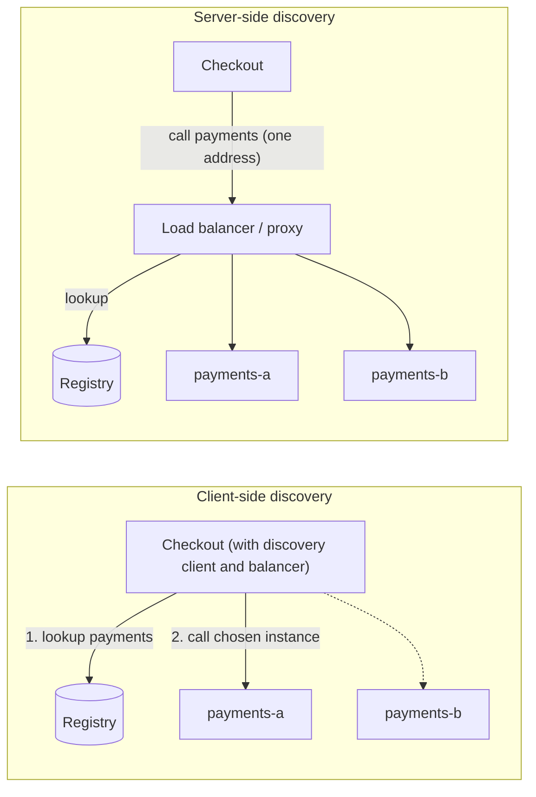

# Service Discovery and Load Balancing

## Introduction

When you had one server, you could put its address in a config file. In a modern deployment, the payment service might run as eight containers today, twelve during lunch rush, and get completely new IP addresses on every deploy. Two questions follow:

1. **Service discovery:** how does the checkout service find the *current* addresses of healthy payment instances?
2. **Load balancing:** given several healthy instances, which one should handle *this* request?

Analogy: a phone directory and a switchboard. The directory (registry) knows who currently works at which desk. The switchboard operator (load balancer) picks which available person takes the next call, ideally someone who is not already on three calls.

This page explains the main approaches and their trade-offs. In most teams today, the platform (Kubernetes, a cloud load balancer, or a service mesh) does much of this for you, but you still need to understand what it is doing to configure health checks, timeouts and balancing correctly.

## Service Registries

A **service registry** is a database of service instances and their network locations. Instances are added when they start, removed when they stop, and checked continuously so dead ones disappear.

| Registry | Typical setting | Notes |
| --- | --- | --- |
| Kubernetes API + EndpointSlices | Kubernetes clusters | Built in; Services and DNS on top |
| HashiCorp Consul | VMs, mixed environments, multi-platform | Raft-based, health checks, DNS and HTTP interfaces |
| Netflix Eureka | Spring Cloud applications | AP-style registry designed to keep serving during partitions |
| etcd / ZooKeeper | Building blocks for custom discovery | Consensus stores, used by other systems |
| Cloud-native (AWS Cloud Map, load balancer target groups) | Managed cloud deployments | Integrates with the provider's compute services |

### Registration styles

- **Self-registration:** each instance registers itself on startup and sends heartbeats. Simple, but every service needs registry client code.
- **Third-party registration:** a separate component (the Kubernetes control plane, a Consul agent, a cloud load balancer) watches the deployment platform and updates the registry. Services contain no discovery code. This is the norm on Kubernetes.

Richardson's [microservices.io](https://microservices.io/patterns/service-registry.html) has pages on each of these variants.

### A registry with heartbeats

The core mechanism is a **lease**: an instance stays registered only while it keeps renewing.

```python
from dataclasses import dataclass, field
from typing import Callable


@dataclass
class Instance:
    service: str
    address: str
    last_heartbeat: float


@dataclass
class Registry:
    clock: Callable[[], float]
    ttl: float = 10.0
    instances: dict[str, Instance] = field(default_factory=dict)

    def register(self, service: str, address: str) -> None:
        self.instances[address] = Instance(service, address, self.clock())

    def heartbeat(self, address: str) -> None:
        if address in self.instances:
            self.instances[address].last_heartbeat = self.clock()

    def deregister(self, address: str) -> None:
        self.instances.pop(address, None)

    def lookup(self, service: str) -> list[str]:
        now = self.clock()
        return sorted(i.address for i in self.instances.values()
                      if i.service == service and now - i.last_heartbeat <= self.ttl)


now = [0.0]
reg = Registry(clock=lambda: now[0])
for addr in ("10.0.1.4:8080", "10.0.1.7:8080", "10.0.2.9:8080"):
    reg.register("payments", addr)
print("t=0 ", reg.lookup("payments"))

now[0] = 8
reg.heartbeat("10.0.1.4:8080")
reg.heartbeat("10.0.2.9:8080")           # 10.0.1.7 has crashed and stops sending heartbeats
reg.deregister("10.0.2.9:8080")          # graceful shutdown during a deploy
reg.register("payments", "10.0.3.2:8080")
print("t=8 ", reg.lookup("payments"))

now[0] = 15
print("t=15", reg.lookup("payments"))    # crashed instance's lease expired
```

Output:

```text
t=0  ['10.0.1.4:8080', '10.0.1.7:8080', '10.0.2.9:8080']
t=8  ['10.0.1.4:8080', '10.0.1.7:8080', '10.0.3.2:8080']
t=15 ['10.0.1.4:8080', '10.0.3.2:8080']
```

Note the gap: between the crash (sometime after t=0) and lease expiry (t=15), the crashed instance is still listed. Discovery is always **slightly stale**, which is why callers also need [timeouts and retries](./8-arch-circuit-breaker.mdx), and why load balancers also do their own health checks.

## Client-Side vs Server-Side Discovery



| | Client-side | Server-side |
| --- | --- | --- |
| Who picks the instance | A library in the caller | A load balancer, proxy or sidecar |
| Extra network hop | No | Usually yes (unless it is a local sidecar) |
| Language support | Library needed per language | Language-neutral |
| Smart balancing (per-request latency) | Easy | Depends on the proxy |
| Examples | Spring Cloud LoadBalancer with Eureka, gRPC client-side balancing | Kubernetes Services, cloud load balancers, NGINX, Envoy |

A **service mesh** blends the two: a sidecar proxy next to each instance does client-side-style balancing, but outside your code. See [Service Mesh and Sidecars](../10-arch-integration-and-apis/8-arch-service-mesh.mdx).

## Service Discovery in Kubernetes

Kubernetes provides third-party registration and server-side discovery out of the box:

- A **Service** selects pods by label and gets a stable virtual IP and a DNS name such as `payments.shop.svc.cluster.local` (service `payments` in namespace `shop`).
- The control plane maintains **EndpointSlices** listing the ready pod IPs behind each Service.
- On each node, **kube-proxy** programs packet-forwarding rules (iptables by default; IPVS and nftables modes also exist) so traffic to the virtual IP reaches one of the ready pods.
- Pods are only added to the endpoints when their **readiness probe** passes.

```yaml
apiVersion: apps/v1
kind: Deployment
metadata:
  name: payments
  namespace: shop
spec:
  replicas: 3
  selector:
    matchLabels:
      app: payments
  template:
    metadata:
      labels:
        app: payments
    spec:
      containers:
        - name: payments
          image: registry.example.com/quickbite/payments:1.4.2
          ports:
            - containerPort: 8080
          readinessProbe:            # controls whether the pod receives traffic
            httpGet:
              path: /ready
              port: 8080
            periodSeconds: 5
            failureThreshold: 2
          livenessProbe:             # controls whether the container is restarted
            httpGet:
              path: /live
              port: 8080
            periodSeconds: 10
            failureThreshold: 3
---
apiVersion: v1
kind: Service
metadata:
  name: payments
  namespace: shop
spec:
  selector:
    app: payments
  ports:
    - port: 80
      targetPort: 8080
```

Other services simply call `http://payments.shop` (or `http://payments` from the same namespace). The [Kubernetes tutorial](/docs/devops/kubernetes) covers Services, probes and networking in depth.

:::caution
Readiness and liveness probes mean different things. **Readiness** answers "should I get traffic right now?" and may fail temporarily (warming caches, overloaded). **Liveness** answers "am I stuck and need a restart?". A liveness probe that checks a shared database will restart **every** pod when the database blips, turning a small incident into a big one. Keep liveness checks local to the process.
:::

### Graceful shutdown: leaving the registry cleanly

When Kubernetes stops a pod, it sends `SIGTERM` and, in parallel, starts removing the pod from the Service's endpoints. Those two things are not synchronised: for a short time, other nodes may still route new connections to a pod that is shutting down. A well-behaved service therefore:

1. On `SIGTERM`, starts failing its readiness check (so it is removed from endpoints if it is not already).
2. Keeps serving for a few seconds while routing rules everywhere catch up.
3. Stops accepting new connections, finishes in-flight requests, then exits before the termination grace period (30 seconds by default) runs out.

```python
import signal
import threading
import time
from http.server import BaseHTTPRequestHandler, ThreadingHTTPServer

draining = threading.Event()


class Handler(BaseHTTPRequestHandler):
    def do_GET(self) -> None:
        if self.path == "/ready":
            status = 503 if draining.is_set() else 200     # leave the load balancer first
        elif self.path == "/live":
            status = 200                                   # still alive while draining
        else:
            time.sleep(0.2)                                # pretend to do real work
            status = 200
        self.send_response(status)
        self.end_headers()
        self.wfile.write(f"{self.path} -> {status}\n".encode())

    def log_message(self, *args) -> None:
        pass


def main() -> None:
    server = ThreadingHTTPServer(("0.0.0.0", 8080), Handler)

    def on_sigterm(signum, frame) -> None:
        print("SIGTERM: failing readiness, draining for 5s")
        draining.set()
        # shut down from another thread; shutdown() blocks until serve_forever returns
        threading.Timer(5.0, server.shutdown).start()

    signal.signal(signal.SIGTERM, on_sigterm)
    print("serving on :8080")
    server.serve_forever()
    server.server_close()
    print("drained, exiting")


if __name__ == "__main__":
    main()
```

Run it, then send `kill -TERM` to the process and call `curl localhost:8080/ready` during the five-second window to watch readiness flip to 503 while other requests still succeed.

Example output (server log, then three `curl` calls: before the signal, and two during draining):

```text
serving on :8080
SIGTERM: failing readiness, draining for 5s
drained, exiting

/ready -> 200
/ready -> 503
/orders -> 200
```

Many frameworks (Spring Boot, ASP.NET Core, Uvicorn and others) have built-in graceful shutdown settings; prefer those, and add a short `preStop` sleep in the pod spec if routing updates lag behind.

### The long-lived connection trap

kube-proxy balances **connections**, not requests. Protocols that keep one connection open and send many requests over it, such as gRPC over HTTP/2, can pin all of a client's traffic to a single pod, leaving new pods idle after a scale-up. Common fixes are client-side balancing over a **headless Service** (which returns all pod IPs from DNS), a service mesh or an L7 proxy that balances per request, or periodically recycling connections.

## Load Balancing Algorithms

| Algorithm | How it chooses | Good for | Weakness |
| --- | --- | --- | --- |
| Round robin | Next instance in turn | Identical instances, uniform requests | Ignores slow or busy instances |
| Weighted round robin | In turn, proportional to weights | Mixed instance sizes, canary releases | Static weights |
| Random | Uniformly at random | Simplicity, no shared state | Same as round robin |
| Least connections / least outstanding requests | Instance with fewest in-flight requests | Variable request durations | Needs accurate counts (hard across many balancers) |
| Power of two choices | Pick two at random, send to the less loaded | Many balancers, little coordination | Slightly less optimal than full least-loaded |
| Consistent hashing | Hash a key (user ID) to an instance | Cache locality, sticky sessions | Uneven load with hot keys |

"Power of two random choices" deserves attention: research by Michael Mitzenmacher showed that comparing just two random candidates gives dramatically better load distribution than one random choice, without global coordination. Envoy and NGINX both offer it (Envoy's `LEAST_REQUEST` policy uses this approach by default; NGINX has a `random two least_conn` option).

### Comparing algorithms when one instance is slow

```python
import heapq
import random


def simulate(policy: str, seed: int = 1, requests: int = 3000) -> dict[str, float]:
    rng = random.Random(seed)
    service_time = {"a": 0.010, "b": 0.010, "c": 0.050}   # instance c is 5x slower (noisy neighbour)
    names = list(service_time)
    busy_until = {n: 0.0 for n in names}
    in_flight: dict[str, list[float]] = {n: [] for n in names}
    latencies: list[float] = []
    rr = 0
    t = 0.0
    for _ in range(requests):
        t += rng.expovariate(150)                         # about 150 requests per second
        for n in names:                                  # drop completed requests
            while in_flight[n] and in_flight[n][0] <= t:
                heapq.heappop(in_flight[n])
        if policy == "round_robin":
            choice = names[rr % len(names)]
            rr += 1
        elif policy == "random":
            choice = rng.choice(names)
        else:                                            # power of two choices
            x, y = rng.sample(names, 2)
            choice = x if len(in_flight[x]) <= len(in_flight[y]) else y
        start = max(t, busy_until[choice])               # each instance handles one request at a time
        done = start + service_time[choice]
        busy_until[choice] = done
        heapq.heappush(in_flight[choice], done)
        latencies.append(done - t)
    latencies.sort()
    return {"p50_ms": round(1000 * latencies[len(latencies) // 2], 1),
            "p99_ms": round(1000 * latencies[int(len(latencies) * 0.99)], 1)}


for policy in ("round_robin", "random", "power_of_two"):
    print(f"{policy:13}", simulate(policy))
```

Example output:

```text
round_robin   {'p50_ms': 10.0, 'p99_ms': 29007.5}
random        {'p50_ms': 18.5, 'p99_ms': 29894.1}
power_of_two  {'p50_ms': 14.1, 'p99_ms': 162.0}
```

Round robin and random keep sending a third of the traffic to the slow instance, which can only handle about 20 requests per second but receives about 50. Its queue grows for the whole run, so the 99th percentile reaches tens of seconds. Power of two choices notices that the slow instance has a queue and routes around it. The exact numbers depend on the simplified model; the shape of the result is what matters.

## Real-World Scenario

QuickBite moved from VMs with hard-coded IPs in config files to Kubernetes. After the move, two problems appear: deploys cause a burst of errors, and the gRPC-based dispatch service shows one pod at 90% CPU while others idle.

### The design

1. **Use Kubernetes Services and DNS** for discovery. Remove all hard-coded addresses.
2. **Fix deploy errors:** add readiness probes, and make pods fail readiness and drain in-flight requests on shutdown (a `preStop` delay plus graceful shutdown handling), so they leave the endpoints before they stop accepting connections.
3. **Fix gRPC imbalance:** expose dispatch through a headless Service and enable gRPC client-side round-robin balancing in callers. Later, when the team adopts a mesh, the sidecars take over per-request balancing.
4. **Keep liveness probes local**, with no database checks.

### Why this approach

The platform already provides a registry, health checking and server-side balancing. The team only needs to configure it correctly and handle the one protocol (gRPC) where connection-level balancing is not enough.

### When to use it, and when not to

- On Kubernetes, use built-in Services first. Add a separate registry such as Consul only if you must discover services **across** clusters or between Kubernetes and VMs.
- Client-side balancing libraries are worth it for high-volume RPC where per-request decisions matter. For ordinary HTTP traffic, server-side balancing is simpler.
- Consistent hashing is for when locality matters (per-user caches, sharded state). Otherwise it just makes load less even.

### Alternatives and trade-offs

| Approach | Pros | Cons | Best for |
| --- | --- | --- | --- |
| Static config / hard-coded IPs | Zero infrastructure | Breaks with autoscaling and redeploys | A few fixed servers |
| DNS round robin | Universal, simple | Caching delays updates; no health awareness by itself | Coarse balancing, external endpoints |
| Kubernetes Service (kube-proxy) | Built in, language-neutral | Connection-level balancing | Most in-cluster traffic |
| Client-side library + registry | Per-request decisions, no extra hop | Library per language, registry to run | High-volume RPC, polyglot-light stacks |
| Cloud / L7 load balancer | Managed, TLS termination, routing | Cost, extra hop | Edge and cross-service HTTP |
| Service mesh sidecars | Per-request balancing, retries, mTLS without code | Operational complexity | Large polyglot fleets |

## Common Mistakes

- **Hard-coding addresses** or caching DNS results forever in the client.
- **No readiness probe**, so new pods get traffic before they can serve it.
- **Liveness probes that depend on downstream services**, causing mass restarts.
- **Ignoring graceful shutdown**, so in-flight requests fail on every deploy.
- **Assuming kube-proxy balances gRPC requests evenly.**
- **Round robin with heterogeneous instances or requests**, where least-request or power-of-two would cut tail latency.
- **Forgetting discovery is eventually consistent**: always pair it with timeouts and retries.

## Summary

- Service discovery maps a service name to the current set of healthy instances; a registry with leases or platform integration keeps it current.
- Client-side discovery puts balancing in the caller; server-side puts it in a load balancer or proxy; meshes use sidecars.
- Kubernetes provides Services, DNS, EndpointSlices and readiness-gated routing out of the box.
- Choose the load balancing algorithm for your workload; least-request or power-of-two choices handle slow instances far better than round robin.
- Readiness, liveness and graceful shutdown are part of discovery, not afterthoughts.

## Exercises

1. Extend the `Registry` with metadata (version, zone) and a lookup that prefers instances in the caller's zone.
2. Add a "least outstanding requests across all instances" policy to the simulation and compare it with power of two choices.
3. Add consistent hashing by user ID to the simulation. What happens to p99 latency when one user sends 20% of all requests?
4. Write the readiness and liveness endpoints for a service that depends on a database and a cache. Decide what each should check.

### Related pages

- [Bulkheads, Rate Limiting and Backpressure](./9-arch-bulkhead-and-rate-limiting.mdx).
- [API Gateway and Backend for Frontend](../10-arch-integration-and-apis/4-arch-api-gateway.mdx).
- [gRPC](../10-arch-integration-and-apis/3-arch-grpc.mdx).
- [Designing for Deployability](../12-arch-quality-and-operations/6-arch-deployability.mdx).
