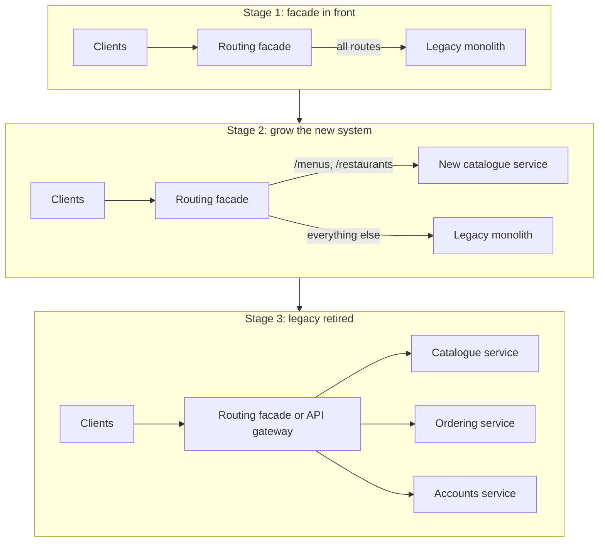
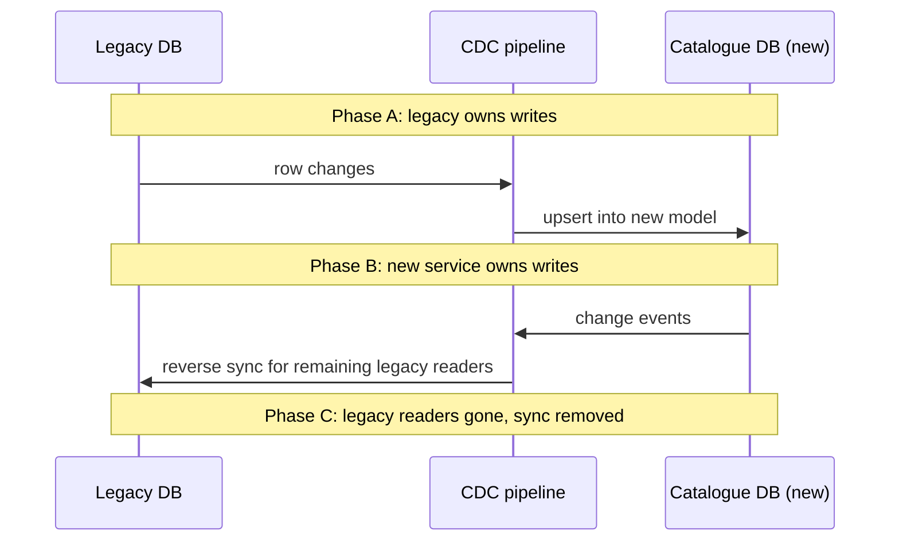

# Strangler Fig Migration

## Introduction

Sooner or later most teams face a system that is too important to switch off and too painful to keep extending. The tempting answer is a **big-bang rewrite**: build a new system from scratch and switch over on a chosen date. Experience says this often goes badly. The rewrite takes longer than planned, the old system keeps changing underneath it, the business waits years for new features, and the switch-over day becomes a high-stakes gamble.

The **strangler fig** pattern is the incremental alternative. You place a routing layer in front of the legacy system, then move functionality to new code **one piece at a time**, redirecting traffic for each piece as it is ready. Over time the new system grows around the old one until the legacy code handles nothing and can be removed.

The name comes from Martin Fowler, who saw strangler fig vines in Queensland's rainforests: they start in the branches of a host tree, grow roots down around it, and eventually stand on their own after the host dies. He first wrote about it in 2004 as "Strangler Application" and later renamed it [Strangler Fig Application](https://martinfowler.com/bliki/StranglerFigApplication.html) to keep the botanical reference and drop the violent overtones. His updated article (August 2024) links to the longer [Patterns of Legacy Displacement](https://martinfowler.com/articles/patterns-legacy-displacement/) series. The Azure Architecture Center also documents the [Strangler Fig pattern](https://learn.microsoft.com/azure/architecture/patterns/strangler-fig).

This pattern sits in the distributed systems section because it usually means **introducing** a distributed system: the legacy application and the new services run side by side, talking over the network, for months or years.

## The Pattern



The steps, repeated for each slice of functionality:

1. **Intercept:** put a routing layer (reverse proxy, API gateway, or a facade inside the code) in front of the legacy system. At first it forwards everything unchanged.
2. **Choose a seam:** pick a piece of functionality with a clear boundary, real business value, and manageable risk.
3. **Build** the replacement, often with an [anti-corruption layer](https://learn.microsoft.com/azure/architecture/patterns/anti-corruption-layer) that translates between legacy models and the new model.
4. **Verify** behaviour, for example by running both side by side and comparing results.
5. **Redirect** traffic gradually: a percentage of users, internal staff first, one region at a time.
6. **Remove** the legacy code path once nothing uses it.

Fowler's article summarises the broader activities (from work by Ian Cartwright, Rob Horn and James Lewis) as: understand the outcomes you want, break the problem into parts, deliver those parts, and change the organisation so the new system does not grow into a new tangle.

## Step 1: The Routing Facade

At the HTTP level, the facade is often an existing reverse proxy. With [NGINX](/docs/middleware/nginx), moving the menu endpoints to a new service is a routing change:

```nginx
upstream legacy_app   { server legacy.internal:8080; }
upstream catalogue_v2 { server catalogue.internal:8000; }

server {
    listen 80;

    # Strangled: menus and restaurants now served by the new catalogue service
    location /api/menus/       { proxy_pass http://catalogue_v2; }
    location /api/restaurants/ { proxy_pass http://catalogue_v2; }

    # Everything else still goes to the monolith
    location / { proxy_pass http://legacy_app; }
}
```

For finer control (percentages, per-customer rollout, comparing results), many teams put the logic in a small application-level router or in an API gateway.

### A routing facade with gradual rollout and shadow comparison

The Python sketch below shows the core ideas: per-route rules, a rollout percentage based on a stable hash of the user ID (so each user consistently sees one implementation), and a **shadow** mode that calls both systems, returns the legacy answer, and logs differences.

```python
import hashlib
from dataclasses import dataclass, field
from typing import Callable

Handler = Callable[[str, str], dict]   # (path, user_id) -> response


def legacy_app(path: str, user_id: str) -> dict:
    if path.startswith("/api/menus/"):
        restaurant = path.rsplit("/", 1)[-1]
        # legacy quirk: prices as strings with currency symbol
        return {"restaurant": restaurant, "items": [{"name": "Margherita", "price": "$11.00"}]}
    return {"legacy": True, "path": path}


def catalogue_v2(path: str, user_id: str) -> dict:
    restaurant = path.rsplit("/", 1)[-1]
    return {"restaurant": restaurant, "items": [{"name": "Margherita", "price": "$11.00"}]}


def bucket(user_id: str) -> int:
    """Stable 0-99 bucket so a user always gets the same routing decision."""
    return int(hashlib.sha256(user_id.encode()).hexdigest(), 16) % 100


@dataclass
class Route:
    prefix: str
    new_handler: Handler
    mode: str = "legacy"          # legacy | shadow | rollout | new
    rollout_percent: int = 0


@dataclass
class StranglerFacade:
    legacy: Handler
    routes: list[Route]
    mismatches: list[str] = field(default_factory=list)

    def handle(self, path: str, user_id: str) -> tuple[str, dict]:
        route = next((r for r in self.routes if path.startswith(r.prefix)), None)
        if route is None or route.mode == "legacy":
            return "legacy", self.legacy(path, user_id)
        if route.mode == "shadow":
            old = self.legacy(path, user_id)
            try:
                new = route.new_handler(path, user_id)
                if new != old:
                    self.mismatches.append(f"{path}: legacy={old} new={new}")
            except Exception as e:                   # the new system must never break users here
                self.mismatches.append(f"{path}: new system error {e!r}")
            return "legacy (shadowed)", old
        if route.mode == "rollout" and bucket(user_id) >= route.rollout_percent:
            return "legacy", self.legacy(path, user_id)
        return "new", route.new_handler(path, user_id)


menus = Route("/api/menus/", catalogue_v2, mode="shadow")
facade = StranglerFacade(legacy_app, [menus])

print(facade.handle("/api/menus/42", "alice")[0])
print(facade.handle("/api/orders/9", "alice")[0])
print("mismatches:", facade.mismatches)

menus.mode, menus.rollout_percent = "rollout", 25
users = [f"user{i}" for i in range(1000)]
share = sum(facade.handle("/api/menus/42", u)[0] == "new" for u in users) / len(users)
print(f"rollout 25%: {share:.1%} of users on the new service")
print("alice stable:", {facade.handle("/api/menus/42", "alice")[0] for _ in range(5)})

menus.mode = "new"
print(facade.handle("/api/menus/42", "bob")[0])
```

Example output:

```text
legacy (shadowed)
legacy
mismatches: []
rollout 25%: 24.2% of users on the new service
alice stable: {'new'}
new
```

The progression for each route is **legacy, shadow, rollout (increasing percentages), new**, and each step can be reversed instantly by changing configuration. That reversibility is the main reason the pattern is lower-risk than a big-bang switch.

### Shadow, parallel run, canary and dark launch

These verification techniques are often mixed up:

| Technique | What happens | Who sees the new result | Good for |
| --- | --- | --- | --- |
| Shadow (traffic mirroring) | Both systems handle the request; legacy answer is returned | Nobody | Read-only endpoints, comparing outputs |
| Parallel run | Both systems process real work over a period; outputs are reconciled | Nobody, or operators | Batch jobs, calculations (billing, payroll) |
| Canary | A small share of real users is routed to the new system | A few users | Catching problems with limited blast radius |
| Dark launch | New code runs in production behind a flag that is off, or for internal users only | Internal users | Testing performance and integration early |

Be careful when shadowing **writes**: if both systems perform a side effect (send an email, charge a card), the customer gets it twice. Shadow writes only against a sandbox, or compare the *intended* effects without executing them.

## The Anti-Corruption Layer

Legacy systems carry old models: prices as strings, status codes as magic numbers, one table doing five jobs. If the new service consumes those shapes directly, the legacy model "corrupts" the new design. An **anti-corruption layer** (a term from Domain-Driven Design) translates at the boundary, so the new code only ever sees its own model.

```python
from dataclasses import dataclass
from decimal import Decimal
from enum import Enum


# ---- the new service's own model ----
class Availability(Enum):
    AVAILABLE = "available"
    SOLD_OUT = "sold_out"
    HIDDEN = "hidden"


@dataclass(frozen=True)
class MenuItem:
    sku: str
    name: str
    price: Decimal
    currency: str
    availability: Availability


# ---- translation from the legacy shape ----
LEGACY_STATUS = {0: Availability.AVAILABLE, 1: Availability.SOLD_OUT, 9: Availability.HIDDEN}


def from_legacy(row: dict) -> MenuItem:
    """Legacy row example: {'ITEM_ID': 77, 'ITEM_NM': ' Margherita ', 'PRC': '$11.00', 'STAT_CD': 0}"""
    raw_price = row["PRC"].strip()
    currency = {"$": "USD", "€": "EUR"}.get(raw_price[0], "USD")
    return MenuItem(
        sku=f"legacy-{row['ITEM_ID']}",
        name=row["ITEM_NM"].strip(),
        price=Decimal(raw_price.lstrip("$€")),
        currency=currency,
        availability=LEGACY_STATUS.get(row["STAT_CD"], Availability.HIDDEN),
    )


legacy_rows = [
    {"ITEM_ID": 77, "ITEM_NM": " Margherita ", "PRC": "$11.00", "STAT_CD": 0},
    {"ITEM_ID": 78, "ITEM_NM": "Calzone", "PRC": "$13.50", "STAT_CD": 1},
    {"ITEM_ID": 79, "ITEM_NM": "Test item DO NOT USE", "PRC": "$0.00", "STAT_CD": 9},
]
for row in legacy_rows:
    print(from_legacy(row))
```

Output:

```text
MenuItem(sku='legacy-77', name='Margherita', price=Decimal('11.00'), currency='USD', availability=<Availability.AVAILABLE: 'available'>)
MenuItem(sku='legacy-78', name='Calzone', price=Decimal('13.50'), currency='USD', availability=<Availability.SOLD_OUT: 'sold_out'>)
MenuItem(sku='legacy-79', name='Test item DO NOT USE', price=Decimal('0.00'), currency='USD', availability=<Availability.HIDDEN: 'hidden'>)
```

All knowledge of `STAT_CD` codes and string prices lives in one function. When the legacy system is retired, this layer is deleted and the rest of the new service is untouched. It is the [Adapter Pattern](../3-arch-structural-patterns/0-arch-adapter.mdx) applied at system scale, and the Azure catalogue lists it as the [Anti-Corruption Layer pattern](https://learn.microsoft.com/azure/architecture/patterns/anti-corruption-layer).

## Choosing Seams

A **seam** is a place where you can change behaviour without editing the code around it (Michael Feathers' term from *Working Effectively with Legacy Code*). For strangling, good first candidates:

| Good first slice | Why |
| --- | --- |
| Read-only features (catalogue, search, reports) | No data ownership change; easy to compare outputs |
| New features | Build them in the new system from day one instead of adding to the legacy |
| Features with a clear API boundary | The facade can route by URL or message type |
| Areas with high change frequency | Moving them first gives the biggest delivery speed-up |

Harder slices to leave for later: features that share tables with everything else, batch jobs that touch all data, and core transactional flows such as checkout.

### Seams below the HTTP level

- **Branch by abstraction** (inside one codebase): introduce an interface in front of the old implementation, build the new implementation behind the same interface, switch callers over with a flag, then delete the old one. Useful when the code to replace is not reachable by URL. See [Dependency Inversion Principle](../1-arch-design-principles/5-arch-dependency-inversion.mdx).
- **Event interception:** if the legacy system emits messages or writes to a queue, new services can subscribe and gradually take over processing.
- **Database triggers or change data capture** to observe legacy writes without modifying legacy code. See [Change Data Capture](../11-arch-data-architecture/5-arch-change-data-capture.mdx).

## The Hard Part: Data

Routing requests is the easy half. The hard half is that legacy and new code usually need the **same data** during the transition. Typical strategies, in rough order of risk:

1. **New service reads legacy database directly** (read-only) at first. Fast to start, but couples you to the legacy schema. Treat it as temporary.
2. **Sync legacy data into the new store** with CDC or batch jobs. The new service reads its own copy; the legacy system remains the writer.
3. **Switch the writer:** the new service becomes the owner and writes; legacy reads a synchronised copy (reverse sync) until it no longer needs it.
4. **Remove sync** when the legacy code path is gone.



Never let **both** systems write the same data independently without a clear owner; that produces conflicts nobody can resolve. These temporary sync paths are what Fowler calls **transitional architecture**: real work that you plan to throw away, justified by the risk it removes.

## Tracking Progress and Finishing

A migration that is never finished is the most common failure mode of this pattern, so make progress visible:

- **Traffic share per route:** what percentage of requests the legacy system still serves, tracked on a dashboard from the facade's logs.
- **Legacy code removed:** lines, modules, tables and scheduled jobs deleted. Deletion is the real finish line, not routing.
- **Transitional components remaining:** sync jobs, reverse syncs, temporary adapters. Each should have an owner and a planned removal date, recorded in an [Architecture Decision Record](../13-arch-documenting-and-evolving/0-arch-decision-records.mdx).
- **Delivery speed:** lead time for changes in migrated areas versus legacy areas. This is the business case for continuing.

It is also legitimate to decide to **stop**. If the remaining legacy part is stable, rarely changed and cheap to run, leaving it in place behind the facade may be the right economic choice. What matters is that it is a deliberate decision, not drift.

## Real-World Scenario

QuickBite's original system is a ten-year-old PHP monolith. Every change to menus requires a full regression test and a weekend deploy. The business wants restaurant partners to edit menus in real time, and wants faster delivery overall.

### The plan

1. **Facade first:** route all traffic through the existing NGINX layer (already in place) and add request logging per route to learn which endpoints matter.
2. **First slice: menu reads.** Build a catalogue service with its own PostgreSQL database, fed by CDC from the legacy `menu_items` tables. Run in shadow mode for two weeks, fix mismatches (price formatting, hidden items), then roll out 5%, 25%, 100%.
3. **Second slice: menu writes** for the new partner portal. The catalogue service becomes the owner; a reverse sync keeps legacy tables updated for the old checkout, which still reads them.
4. **Third slice: checkout** much later, once the team has experience, using a [saga](./5-arch-saga.mdx) only if the payment and order data end up in separate services.
5. **Retire:** delete legacy menu code and the reverse sync when checkout no longer reads legacy menu tables.

### Why this approach

Each step delivers value (real-time menus) within weeks, risk is limited to one slice at a time, every routing decision is reversible, and the team learns the domain's hidden rules (shown up by shadow mismatches) before they matter.

### When to use it, and when not to

Use the strangler fig when:

- The legacy system is business-critical and cannot be frozen.
- Requests can be intercepted (HTTP, messages, a code-level seam).
- You can afford to run old and new side by side for a while.

Consider something else when:

- The system is small enough to rewrite and replace in a few weeks with low risk.
- There is no way to intercept calls (a closed vendor system with no API), in which case data-level migration or replacement with a vendor product may be the realistic path.
- The real problem is code quality, not architecture. Refactoring inside the monolith (towards a [modular monolith](../6-arch-architectural-styles/3-arch-modular-monolith.mdx)) may be cheaper than extracting services at all.

### Alternatives and trade-offs

| Approach | Pros | Cons | Best for |
| --- | --- | --- | --- |
| Big-bang rewrite | Clean slate, no transitional architecture | Long delay before value, high cutover risk, moving target | Small systems, or when the old platform is truly dead |
| Strangler fig | Incremental value, reversible steps, learning as you go | Two systems to run, sync and routing overhead, can stall halfway | Large, critical, actively used systems |
| Refactor in place (modularise) | No distribution, cheaper | Stays on old platform and runtime | Sound platform, messy code |
| Branch by abstraction | Works inside one codebase, no network hops | Needs a codebase you can change and deploy | Replacing libraries, components, data access |
| Replace with a vendor product | No build effort | Migration and customisation limits | Commodity capabilities (billing, CRM) |

## Common Mistakes

- **Stalling halfway.** The new system handles 60% of traffic, the legacy 40%, forever, and you now run both. Set retirement milestones and budget for removal work.
- **Strangling only the UI** while all logic and data remain in the legacy system.
- **Shared database between old and new without an owner**, causing silent overwrites.
- **Rebuilding legacy quirks blindly.** Shadow mismatches reveal behaviour; decide with the business whether each quirk is a rule or a bug.
- **Making the facade smart.** It should route, not hold business logic, or it becomes the next monolith.
- **Ignoring the organisation.** Without changes to team ownership, the new services can grow just as tangled (Conway's Law, see [Conway's Law and Team Topologies](../0-arch-fundamentals/9-arch-conways-law.mdx)).

## Summary

- The strangler fig replaces a legacy system incrementally behind a routing facade.
- Each slice goes legacy, shadow, gradual rollout, new, then legacy removal; every step is reversible.
- Pick seams with clear boundaries and real value; leave tangled transactional cores for later.
- Data migration (CDC, sync, owner switch) is the hardest part; always keep a single writer per piece of data.
- Plan and fund the removal of transitional architecture, or the migration stalls.

## Exercises

1. Add a "canary by user list" mode to `StranglerFacade` so internal staff always get the new service before any percentage rollout.
2. Make the shadow comparison ignore fields that are allowed to differ (timestamps, ordering of list items) and report only meaningful mismatches.
3. For a legacy system you know, list five candidate slices and score each on value, risk and boundary clarity. Which would you strangle first?
4. Write the data migration phases (who writes, who reads, which sync runs) for moving customer accounts out of a monolith.

### Related pages

- [Legacy System Modernization](../13-arch-documenting-and-evolving/5-arch-legacy-modernization.mdx).
- [Case Study: Breaking Up a Monolith](../14-arch-case-studies/7-arch-case-monolith-to-microservices.mdx).
- [API Gateway and Backend for Frontend](../10-arch-integration-and-apis/4-arch-api-gateway.mdx).
- [Bounded Contexts and Context Mapping](../8-arch-domain-driven-design/2-arch-bounded-contexts.mdx), for choosing slice boundaries.
