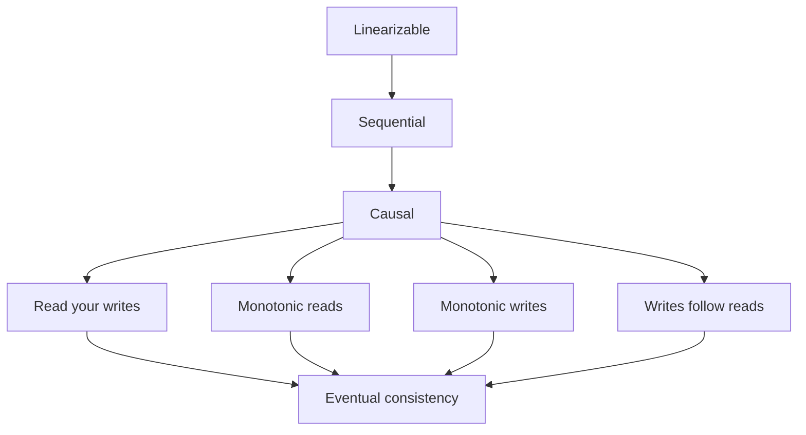
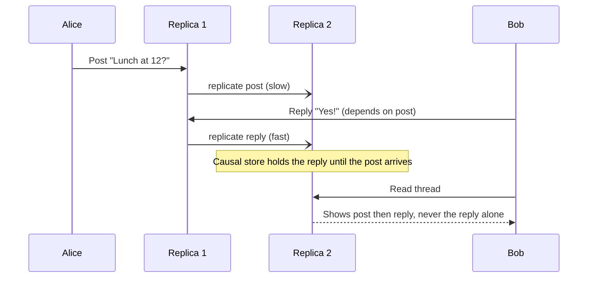

# Consistency Models

## Introduction

"Strong" and "eventual" consistency are the two words most teams use, but they are the two ends of a long spectrum. In between sit models with names like **causal**, **read-your-writes** and **monotonic reads**. These middle models matter in practice, because they are often exactly what users notice, and they are much cheaper than full strong consistency.

A **consistency model** is a contract between a data store and its clients: "if you do these operations, these are the results you are allowed to see". A stronger model forbids more surprising results but usually costs latency or availability (see [CAP and PACELC](./1-arch-cap-and-pacelc.mdx)).

Analogy: a group chat. Strong consistency means everyone sees every message in the same order at the same moment. Eventual consistency means everyone will see all messages *eventually*, possibly in different orders. Causal consistency is the reasonable middle: you might see unrelated messages in different orders, but you will never see an answer before the question it replies to.

## The Spectrum

Jepsen, the database testing project, maintains a well-known [map of consistency models](https://jepsen.io/consistency/models). A simplified version of the single-object (non-transactional) part:



Each arrow points from a stronger model to a weaker one it implies. Jepsen's page also classifies models by what they can offer during network partitions:

| Model | Plain-language promise | Available during a partition? |
| --- | --- | --- |
| Linearizable | Behaves like a single copy; once a write completes, every later read sees it | No (some nodes must refuse) |
| Sequential | All clients see operations in the same order, consistent with each client's own order, but possibly lagging real time | No |
| Causal | If B depends on A, everyone sees A before B | "Sticky available": yes, if each client keeps talking to the same server |
| Read your writes | You always see your own earlier writes | Sticky available |
| Monotonic reads | Once you have seen a value, you never see an older one | Yes |
| Monotonic writes | Your writes are applied in the order you made them | Yes |
| Writes follow reads | A write you make after reading X is ordered after X | Yes |
| Eventual | If writes stop, all replicas converge | Yes |

The four middle models (read your writes, monotonic reads, monotonic writes, writes follow reads) are called **session guarantees**. They were described by Terry and colleagues in 1994 for the Bayou system, and they are guarantees about what **one client** sees, which is why they are cheap to provide.

:::note
Transaction **isolation levels** (serializable, snapshot isolation, read committed and so on) are a related but separate axis. They describe what concurrent *multi-object transactions* can see of each other. **Strict serializability** combines serializable transactions with linearizable real-time ordering. When a database says "strongly consistent", ask which of these it means. The [Database tutorial](/docs/fundamental/database) covers transactions and concurrency control in more depth.
:::

## Seeing the Anomalies

Most real systems use a **leader with asynchronous followers**: writes go to the leader, and reads are spread over followers to scale. The simulation below models that setup with replication lag.

```python
from dataclasses import dataclass, field


@dataclass
class Node:
    name: str
    log: list[tuple[str, str]] = field(default_factory=list)  # applied writes

    @property
    def version(self) -> int:
        return len(self.log)

    def get(self, key: str) -> str | None:
        for k, v in reversed(self.log):
            if k == key:
                return v
        return None


@dataclass
class ReplicatedStore:
    leader: Node
    followers: list[Node]

    def write(self, key: str, value: str) -> int:
        self.leader.log.append((key, value))
        return self.leader.version          # position in the log

    def replicate(self, follower: Node, upto: int) -> None:
        """Copy leader log entries to a follower, up to a version."""
        follower.log = self.leader.log[:upto]

    def read_any(self, key: str, follower_index: int) -> str | None:
        return self.followers[follower_index].get(key)


store = ReplicatedStore(Node("leader"), [Node("f1"), Node("f2")])

# Alice changes her delivery address
store.write("alice:address", "1 Old Road")
store.replicate(store.followers[0], 1)
store.replicate(store.followers[1], 1)
v = store.write("alice:address", "9 New Street")
store.replicate(store.followers[0], v)      # f1 caught up, f2 is lagging

# Read-your-writes violation: load balancer sends Alice to the lagging follower
print("Alice reads (f2):", store.read_any("alice:address", 1))

# Monotonic-reads violation: first request hits f1, second hits f2
print("Alice refresh 1 (f1):", store.read_any("alice:address", 0))
print("Alice refresh 2 (f2):", store.read_any("alice:address", 1))
```

Output:

```text
Alice reads (f2): 1 Old Road
Alice refresh 1 (f1): 9 New Street
Alice refresh 2 (f2): 1 Old Road
```

Alice just saved a new address and the app shows the old one. Then she refreshes and the new address appears, then disappears again. Both are legal under eventual consistency, and both feel like bugs. The database is "working as designed".

## Providing Session Guarantees Cheaply

You do not need a globally strongly consistent database to fix these. You need the client (or a thin layer) to remember what it has seen.

### Read your writes with a version token

After a write, return the log position (sometimes called a log sequence number, LSN, or a "causality token"). On later reads, only use a follower that has caught up to at least that position, or fall back to the leader.

```python
from dataclasses import dataclass, field


@dataclass
class Node:
    name: str
    log: list[tuple[str, str]] = field(default_factory=list)

    @property
    def version(self) -> int:
        return len(self.log)

    def get(self, key: str) -> str | None:
        for k, v in reversed(self.log):
            if k == key:
                return v
        return None


@dataclass
class Session:
    """Per-user session state, e.g. kept in a cookie or request header."""
    min_version: int = 0


@dataclass
class SessionAwareStore:
    leader: Node
    followers: list[Node]

    def write(self, session: Session, key: str, value: str) -> None:
        self.leader.log.append((key, value))
        session.min_version = max(session.min_version, self.leader.version)

    def read(self, session: Session, key: str, preferred: int) -> tuple[str, str | None]:
        node = self.followers[preferred]
        if node.version < session.min_version:
            node = self.leader                       # follower too stale for this session
        session.min_version = max(session.min_version, node.version)  # monotonic reads
        return node.name, node.get(key)


leader = Node("leader")
f1, f2 = Node("f1"), Node("f2")
store = SessionAwareStore(leader, [f1, f2])

alice = Session()
store.write(alice, "alice:address", "1 Old Road")
f1.log = leader.log[:]
f2.log = leader.log[:]
store.write(alice, "alice:address", "9 New Street")
f1.log = leader.log[:]                               # f2 still lagging

print("read via f2:", store.read(alice, "alice:address", preferred=1))
print("read via f1:", store.read(alice, "alice:address", preferred=0))
print("read via f2:", store.read(alice, "alice:address", preferred=1))

bob = Session()                                      # Bob never wrote anything
print("bob via f2:", store.read(bob, "alice:address", preferred=1))
```

Output:

```text
read via f2: ('leader', '9 New Street')
read via f1: ('f1', '9 New Street')
read via f2: ('leader', '9 New Street')
bob via f2: ('f2', '1 Old Road')
```

Alice always sees her own latest write, and never goes backwards. Bob, who has no reason to expect the new value, still reads from the cheap lagging follower. This is the core trick: **guarantees scoped to a session cost far less than guarantees for everyone.**

Real systems offer the same idea under different names:

- **MongoDB** causally consistent sessions pass an operation time between operations in a session.
- **Azure Cosmos DB** has a "Session" consistency level built on a session token, alongside Strong, Bounded Staleness, Consistent Prefix and Eventual.
- **PostgreSQL** applications can record the primary's WAL position after a write (for example with `pg_current_wal_lsn()`) and check a replica's replay position before reading from it.
- Many web frameworks simply pin a user to the primary database for a few seconds after that user writes. It is crude but effective.

Check each product's current documentation for exact behaviour, since these options evolve.

### Monotonic reads with sticky routing

An even simpler fix for monotonic reads is to route each user to the same replica every time (for example by hashing the user ID). If that replica fails, you lose the guarantee unless you also carry a version token, which is why the token approach is more robust.

## Bounded Staleness: Putting a Number on "Eventually"

Between "always fresh" and "eventually" sits **bounded staleness**: reads may lag, but by no more than a stated amount of time or number of versions. Azure Cosmos DB offers it as a named consistency level. You can approximate it yourself with any leader-follower database by measuring lag and refusing to read from replicas that are too far behind.

On PostgreSQL, the primary reports per-replica lag in the `pg_stat_replication` view (the `write_lag`, `flush_lag` and `replay_lag` columns exist since PostgreSQL 10):

```sql
-- On the primary: how far behind is each replica?
SELECT application_name,
       client_addr,
       state,
       replay_lag
FROM pg_stat_replication;

-- On a replica: roughly how old is the last replayed transaction?
SELECT now() - pg_last_xact_replay_timestamp() AS approx_staleness;
```

The second query over-reports staleness when the primary is idle (no new transactions to replay), so use it as an alert signal combined with write activity, not as an exact measure.

A read router that enforces a staleness bound is then straightforward:

```python
from dataclasses import dataclass


@dataclass
class ReplicaStatus:
    name: str
    lag_seconds: float


def choose_replica(replicas: list[ReplicaStatus], max_staleness: float) -> str:
    fresh = [r for r in replicas if r.lag_seconds <= max_staleness]
    if not fresh:
        return "primary"                    # no replica is fresh enough
    return min(fresh, key=lambda r: r.lag_seconds).name


replicas = [ReplicaStatus("r1", 0.2), ReplicaStatus("r2", 4.5), ReplicaStatus("r3", 0.9)]
print("menu page (stale up to 5s ok):", choose_replica(replicas, 5.0))
print("order status (max 1s):        ", choose_replica(replicas, 1.0))
print("during lag spike (max 1s):    ", choose_replica([ReplicaStatus("r1", 3.0)], 1.0))
```

Output:

```text
menu page (stale up to 5s ok): r1
order status (max 1s):         r1
during lag spike (max 1s):     primary
```

Different pages pass different bounds, which turns a vague "eventually consistent" into an explicit, per-feature service level.

## Causal Consistency in Practice

Causal consistency matters whenever one piece of data only makes sense after another:

- A comment must not appear before the post it replies to.
- An "order shipped" notification must not arrive before "order placed".
- A permission removal followed by a sensitive upload: if a friend sees the upload but not the permission change, you have a privacy bug.

In event-driven systems, the usual tools are:

- **Partitioning by key** so all events for one order go through one ordered partition (Kafka partitions, RabbitMQ single-consumer queues).
- **Version numbers on events**, so a consumer can detect "I got version 5 but I have only applied version 3" and wait or fetch.
- **Carrying causal metadata** (a vector clock or the version the client read) with each write.



## Testing for Consistency Anomalies

Consistency bugs rarely appear on a developer laptop with one database. Ways to find them before users do:

- **Inject lag in tests.** Wrap your data access layer in tests so reads go to a fake replica that is deliberately behind, like the simulations on this page, and assert that user-facing flows still behave.
- **Write invariant checks.** Background jobs that verify "every confirmed order has a payment" or "no stock count is negative" catch anomalies that slip through.
- **Read independent analyses.** Jepsen's published reports test real databases under partitions and clock faults, and have found violations of documented guarantees in many products. Read the report for your database and version, if one exists.
- **Chaos experiments** in staging: add network delay between application and replicas, and watch what users would see.

## Choosing a Model

| Question | If yes, consider |
| --- | --- |
| Would two users acting on different values cause money loss or a safety issue? | Linearizable or serializable (single leader, consensus) |
| Do users mostly care about their own data looking right? | Read your writes + monotonic reads |
| Does the data have reply / follow-up relationships? | Causal |
| Is it fine for anyone to see slightly old data for a few seconds? | Eventual, with a bounded lag you measure |

## Real-World Scenario

QuickBite's support inbox is full of tickets like "I changed my address and the app still shows the old one" and "my order status flickers between Preparing and Placed". The read path uses three PostgreSQL read replicas behind a load balancer, and replication lag spikes to a few seconds during lunch rush.

### The design

1. After any write, the API returns the primary's WAL position in a response header, and the mobile app sends it back on subsequent requests.
2. The data access layer checks the chosen replica's replay position. If it is behind the token, the query goes to the primary.
3. Order status pages read with the same token, and status events carry a monotonically increasing `status_version`. The app ignores any status with a lower version than it has already shown.
4. Everything else (menus, ratings) stays on any replica with no token.

### Why this approach

The complaints were all about a user's *own* view. Session guarantees fix exactly that while keeping almost all read traffic on replicas. Making all reads go to the primary would also fix it, but would remove the reason for having replicas.

### When to use it, and when not to

Use session guarantees when anomalies are visible to the person who caused them. They do **not** help when two different users must agree in real time, such as two couriers both accepting the same delivery; that needs a single authority (a conditional update on the primary, or a lock with fencing).

### Alternatives and trade-offs

| Approach | Pros | Cons | Best for |
| --- | --- | --- | --- |
| All reads from primary | Simplest, strongest | Primary becomes the bottleneck | Low read volume |
| Sticky user-to-replica routing | Very simple, monotonic reads | Breaks on failover, no read-your-writes across replicas | Quick fix |
| Version token (LSN or session token) | Precise, scales | Client must carry a token; more code | Read-heavy apps with replicas |
| "Pin to primary for N seconds after a write" | Easy framework support | Guess-based; fails when lag exceeds N | Moderate lag, simple apps |
| Globally strong database | No anomalies | Latency, cost | Data where any anomaly is costly |

## Common Mistakes

- **Saying "eventually consistent" without a bound.** Measure and alert on replication lag; "eventually" that means "ten minutes" is a different product.
- **Mixing up isolation levels and consistency models.** "Serializable" says nothing about real-time recency across replicas unless it is *strict* serializable.
- **Fixing user-visible anomalies with global strong consistency** when a session guarantee would do.
- **Ignoring out-of-order events.** Consumers should use versions and discard stale updates.
- **Trusting a vendor label without reading the definition.** "Strong" in one product's docs may mean something narrower than linearizable. Jepsen's published analyses are a good reality check.

## Summary

- A consistency model is a contract about which results reads may return.
- The spectrum runs from linearizable through sequential and causal to eventual.
- Session guarantees (read your writes, monotonic reads, monotonic writes, writes follow reads) are cheap and fix the anomalies users notice most.
- Version tokens let you serve most reads from replicas while guaranteeing each user a consistent view.
- Causal consistency matters wherever data has "reply to" or "happens after" relationships.

## Exercises

1. Extend `SessionAwareStore` with a third follower that is never updated, and show that a session never reads from it after its first write.
2. Implement "writes follow reads": when Alice reads an order and then writes a review of it, make the review carry the version she read, and make replicas refuse to apply the review until they have that version.
3. List three features in an application you know and pick the weakest consistency model each can tolerate.

### Related pages

- [CAP and PACELC](./1-arch-cap-and-pacelc.mdx).
- [CQRS](./3-arch-cqrs.mdx), where read models are eventually consistent by design.
- [Replication and Sharding](../11-arch-data-architecture/3-arch-replication-and-sharding.mdx).
- [Caching Strategies](../11-arch-data-architecture/2-arch-caching-strategies.mdx), since caches are another source of stale reads.
