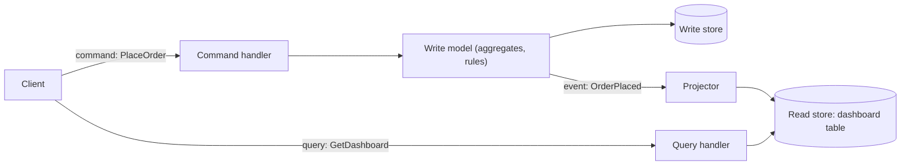
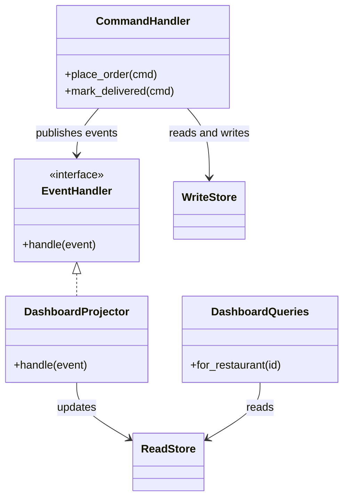

# CQRS

## Introduction

**CQRS** stands for **Command Query Responsibility Segregation**. The idea is simple: use one model to **change** data (commands) and a different model to **read** data (queries).

Most applications start with one model for both. An `Order` class is loaded, modified and saved, and the same `Order` tables are joined and aggregated to build dashboards. That works until the two jobs start pulling the model in opposite directions:

- Writes want a **normalised** model that protects business rules (an order cannot be confirmed twice; a refund cannot exceed the total).
- Reads want **denormalised**, pre-shaped data that matches each screen ("orders per restaurant in the last hour with average prep time").

CQRS lets each side be good at its job. Think of a restaurant: the kitchen works from order tickets (the write side, optimised for getting each order right), while the manager's screen shows totals and trends (the read side, optimised for quick answers). Nobody expects the manager to count tickets by hand.

The term was popularised by Greg Young around 2010, building on Bertrand Meyer's older **Command Query Separation** (CQS) principle for methods. Martin Fowler's [CQRS article](https://martinfowler.com/bliki/CQRS.html) is the classic short introduction, and it is notably cautious, as this page will be.

:::note
**CQS** is about *methods*: a method should either change state or return data, not both. **CQRS** applies the same split at the level of *models*, and often of storage.
:::

## The Problem: One Model Doing Two Jobs

QuickBite stores orders in a normalised schema. The restaurant dashboard needs live stats per restaurant. Here is the "before" version, with one repository serving both purposes.

```python
import sqlite3
from dataclasses import dataclass


SCHEMA = """
CREATE TABLE orders (id INTEGER PRIMARY KEY, restaurant_id INTEGER, status TEXT, created_at TEXT);
CREATE TABLE order_items (order_id INTEGER, dish TEXT, qty INTEGER, price_cents INTEGER);
"""


@dataclass
class OrderRepository:
    db: sqlite3.Connection

    # --- write side concerns ---
    def place(self, order_id: int, restaurant_id: int, items: list[tuple[str, int, int]]) -> None:
        self.db.execute("INSERT INTO orders VALUES (?, ?, 'PLACED', datetime('now'))",
                        (order_id, restaurant_id))
        self.db.executemany("INSERT INTO order_items VALUES (?, ?, ?, ?)",
                            [(order_id, *item) for item in items])

    def mark_delivered(self, order_id: int) -> None:
        self.db.execute("UPDATE orders SET status='DELIVERED' WHERE id=?", (order_id,))

    # --- read side concerns, growing every sprint ---
    def dashboard(self, restaurant_id: int) -> tuple:
        return self.db.execute("""
            SELECT COUNT(DISTINCT o.id),
                   SUM(i.qty * i.price_cents),
                   SUM(CASE WHEN o.status = 'DELIVERED' THEN 1 ELSE 0 END)
            FROM orders o JOIN order_items i ON i.order_id = o.id
            WHERE o.restaurant_id = ?""", (restaurant_id,)).fetchone()


db = sqlite3.connect(":memory:")
db.executescript(SCHEMA)
repo = OrderRepository(db)
repo.place(1, 7, [("margherita", 2, 1100), ("cola", 2, 250)])
repo.place(2, 7, [("calzone", 1, 1300)])
repo.mark_delivered(1)
print("orders, revenue_cents, delivered:", repo.dashboard(7))
```

Output:

```text
orders, revenue_cents, delivered: (2, 4000, 2)
```

Look closely at the result: **delivered is 2, but only one order was delivered.** The join multiplies the order row by its two items, so the `CASE` counts it twice. This is the kind of bug that creeps in when reporting queries are written against a model designed for writes. Other symptoms you may recognise:

- Dashboard queries get slower as data grows, and they compete with checkout for the same database.
- The repository grows dozens of `find_by_x_and_y` methods, each joining the same tables differently.
- Adding a field for one screen forces a migration on the table that guards your business rules.

## The Pattern: Separate Write and Read Models



- A **command** expresses intent: `PlaceOrder`, `MarkDelivered`. It is handled by code that loads the write model, checks rules, and saves.
- Each successful change emits an **event** describing what happened.
- A **projector** (also called a projection or denormaliser) listens to events and updates one or more **read models** shaped for specific queries.
- A **query** reads the read model directly. No business rules, no joins across aggregates.

### The "after" code

```python
import sqlite3
from dataclasses import dataclass
from typing import Protocol


# ---------- commands and events ----------
@dataclass(frozen=True)
class PlaceOrder:
    order_id: int
    restaurant_id: int
    items: tuple[tuple[str, int, int], ...]


@dataclass(frozen=True)
class MarkDelivered:
    order_id: int


@dataclass(frozen=True)
class OrderPlaced:
    order_id: int
    restaurant_id: int
    total_cents: int


@dataclass(frozen=True)
class OrderDelivered:
    order_id: int
    restaurant_id: int


Event = OrderPlaced | OrderDelivered


class EventHandler(Protocol):
    def handle(self, event: Event) -> None: ...


# ---------- write side ----------
class CommandHandler:
    def __init__(self, db: sqlite3.Connection, subscribers: list[EventHandler]) -> None:
        self.db = db
        self.subscribers = subscribers

    def _publish(self, event: Event) -> None:
        for s in self.subscribers:
            s.handle(event)

    def place_order(self, cmd: PlaceOrder) -> None:
        if not cmd.items:
            raise ValueError("an order needs at least one item")
        self.db.execute("INSERT INTO orders VALUES (?, ?, 'PLACED')", (cmd.order_id, cmd.restaurant_id))
        self.db.executemany("INSERT INTO order_items VALUES (?, ?, ?, ?)",
                            [(cmd.order_id, *i) for i in cmd.items])
        total = sum(qty * price for _, qty, price in cmd.items)
        self._publish(OrderPlaced(cmd.order_id, cmd.restaurant_id, total))

    def mark_delivered(self, cmd: MarkDelivered) -> None:
        row = self.db.execute("SELECT restaurant_id, status FROM orders WHERE id=?", (cmd.order_id,)).fetchone()
        if row is None:
            raise KeyError(cmd.order_id)
        restaurant_id, status = row
        if status == "DELIVERED":
            return                                   # already done: nothing to publish
        self.db.execute("UPDATE orders SET status='DELIVERED' WHERE id=?", (cmd.order_id,))
        self._publish(OrderDelivered(cmd.order_id, restaurant_id))


# ---------- read side ----------
class DashboardProjector:
    def __init__(self, db: sqlite3.Connection) -> None:
        self.db = db

    def handle(self, event: Event) -> None:
        match event:
            case OrderPlaced(restaurant_id=r, total_cents=t):
                self.db.execute("""INSERT INTO dashboard VALUES (?, 1, ?, 0)
                    ON CONFLICT(restaurant_id) DO UPDATE SET
                      orders = orders + 1, revenue_cents = revenue_cents + excluded.revenue_cents""", (r, t))
            case OrderDelivered(restaurant_id=r):
                self.db.execute("UPDATE dashboard SET delivered = delivered + 1 WHERE restaurant_id=?", (r,))


class DashboardQueries:
    def __init__(self, db: sqlite3.Connection) -> None:
        self.db = db

    def for_restaurant(self, restaurant_id: int) -> tuple:
        return self.db.execute("SELECT orders, revenue_cents, delivered FROM dashboard WHERE restaurant_id=?",
                               (restaurant_id,)).fetchone()


write_db = sqlite3.connect(":memory:")
write_db.executescript("""
CREATE TABLE orders (id INTEGER PRIMARY KEY, restaurant_id INTEGER, status TEXT);
CREATE TABLE order_items (order_id INTEGER, dish TEXT, qty INTEGER, price_cents INTEGER);
""")
read_db = sqlite3.connect(":memory:")
read_db.execute("""CREATE TABLE dashboard (restaurant_id INTEGER PRIMARY KEY,
                   orders INTEGER, revenue_cents INTEGER, delivered INTEGER)""")

commands = CommandHandler(write_db, [DashboardProjector(read_db)])
queries = DashboardQueries(read_db)

commands.place_order(PlaceOrder(1, 7, (("margherita", 2, 1100), ("cola", 2, 250))))
commands.place_order(PlaceOrder(2, 7, (("calzone", 1, 1300),)))
commands.mark_delivered(MarkDelivered(1))
commands.mark_delivered(MarkDelivered(1))          # duplicate command is ignored
print("orders, revenue_cents, delivered:", queries.for_restaurant(7))
```

Output:

```text
orders, revenue_cents, delivered: (2, 4000, 1)
```

The read side is now a single-row lookup, the count is correct, and the write side no longer knows that dashboards exist. Adding a new screen means adding a new projector and table, without touching the write model.

The structure as a class diagram:



## Levels of CQRS

CQRS is not all-or-nothing. Pick the lightest level that solves your problem.

| Level | What is separated | Consistency | Cost |
| --- | --- | --- | --- |
| 1. Separate code paths | Command handlers and query services in code; same tables | Immediate | Very low |
| 2. Separate read tables, same database, same transaction | Projections updated in the write transaction | Immediate | Low |
| 3. Separate read store, updated asynchronously | Read DB (or search index, cache) fed by events | Eventual | Medium to high |
| 4. Combined with event sourcing | Events are the write store; all state is projected | Eventual | High |

The example above is close to level 2 (synchronous projection, though in two databases for clarity). At level 3, the projector runs in a separate process, reading events from a broker or from a [transactional outbox](./6-arch-outbox.mdx). Then the read model **lags** the write model, and your UI must cope with that.

### Handling read-model lag

When the read side is asynchronous, a user who places an order and is redirected to "My orders" may not see it yet. Common fixes:

- Return the new data in the command response and let the UI show it optimistically.
- Return a version number and have the query wait briefly (or poll) until the projection reaches it, the same idea as the session token in [Consistency Models](./2-arch-consistency-models.mdx).
- Design the UI honestly: "Your order is being processed."

### Rebuilding read models

Because read models are derived data, you can drop and rebuild them by replaying events. This is one of CQRS's quiet superpowers: a new report can be backfilled from history. It requires that you keep the events (event sourcing, or an event log with long retention). Without stored events, rebuilding means a batch job from the write database.

## Where You Have Already Met CQRS

- **Database read replicas and materialized views** are a mild form: a separate structure optimised for reads, refreshed from the source of truth.
- **Search indexes** (Elasticsearch, OpenSearch) fed from a primary database are read models in all but name. See [Search and Analytics Architecture](../11-arch-data-architecture/6-arch-search-and-analytics.mdx).
- **Axon Framework** (Java) is built around commands, events and queries as first-class concepts, and is often paired with event sourcing.
- In .NET codebases you will often see a "mediator" library dispatching separate command and query objects to handlers. Note that this is CQRS at the code level only (level 1).
- The Azure Architecture Center lists [CQRS](https://learn.microsoft.com/azure/architecture/patterns/cqrs) and the related [Materialized View](https://learn.microsoft.com/azure/architecture/patterns/materialized-view) pattern in its cloud design patterns catalogue.

## Real-World Scenario

QuickBite's restaurant dashboard query now takes several seconds at peak and causes lock contention on the orders tables, slowing checkout. Restaurants also want new views every month: hourly heat maps, best-selling dishes, average courier wait.

### The design

- Keep the order write model in PostgreSQL, unchanged.
- Each order state change writes an event to an **outbox** table in the same transaction.
- A projector service consumes those events and maintains read tables (`restaurant_dashboard`, `dish_sales_hourly`) in a separate database tuned for reads.
- The dashboard UI states "updated a few seconds ago" and refreshes on a timer.
- New reports are added as new projectors and backfilled by replaying the retained events.

### Why this approach

The pain is specifically **read load and read-model churn**. CQRS isolates both: checkout no longer competes with dashboards, and new views do not touch the write schema. The business accepts seconds of staleness on dashboards.

### When to use it, and when not to

Use CQRS when:

- Read and write workloads differ sharply in shape or scale.
- You need many differently shaped views of the same data.
- The domain is complex enough that the write model benefits from being free of query concerns.

Do **not** use it when:

- The application is mostly CRUD forms over tables. One model is simpler and correct.
- Users need to read their writes instantly everywhere and you cannot design around lag.
- The team is new to event-driven systems. Fowler warns that CQRS adds risky complexity and that suitable cases are a minority; apply it to one bounded context, not a whole system.

### Alternatives and trade-offs

| Approach | Pros | Cons | Best for |
| --- | --- | --- | --- |
| Single model + better indexes | Zero new moving parts | Limited by one schema | Most apps; try this first |
| Read replica | Offloads reads, easy | Same schema, replica lag | Read scale with same query shapes |
| Materialized views / reporting database | Pre-shaped reads, SQL only | Refresh scheduling, limited real-time | Reports and analytics |
| CQRS with sync projections | Separate models, no lag | Write transactions do more work | Complex domains, moderate scale |
| CQRS with async projections | Independent scaling, many views | Eventual consistency, more infrastructure | High read load, many views |

## Common Mistakes

- **Applying CQRS to the whole system** instead of the one bounded context that needs it.
- **Assuming CQRS requires event sourcing.** They pair well, but are independent. Many CQRS systems use a normal relational write model.
- **Putting business rules in projectors.** Projectors should only reshape data. Rules belong in command handlers.
- **Non-idempotent projectors.** With at-least-once delivery, the same event may arrive twice. Track the last processed event position per projection (see [Idempotency](./7-arch-idempotency.mdx)).
- **Ignoring lag in the UI**, leading to "my order disappeared" support tickets.
- **Commands that return large query results.** Return an ID, a version, or a small acknowledgement.

## Summary

- CQRS separates the model that changes data from the model(s) that read it.
- Commands express intent and enforce rules; projectors build read models from events; queries read pre-shaped data.
- It ranges from simple code-level separation to fully asynchronous read stores.
- Async read models bring eventual consistency, which the UI must handle.
- Fowler's caution stands: most systems do not need it. Use it where read and write needs truly diverge.

## Exercises

1. Add a `DishSalesProjector` to the example that maintains a `dish_sales(dish, qty)` table, and a query for the top three dishes.
2. Make `DashboardProjector` idempotent by giving each event an `event_id` and recording processed IDs in the read database.
3. Simulate asynchronous projection: put events on a `queue.Queue` and process them in a separate thread. Show a query that runs before the projection catches up.
4. For an online bookstore, decide whether the catalogue search page and the checkout should use CQRS. Justify each answer in two sentences.

### Related pages

- [Event Sourcing](./4-arch-event-sourcing.mdx), CQRS's frequent partner.
- [Transactional Outbox](./6-arch-outbox.mdx), for reliably feeding projections.
- [Domain Events](../8-arch-domain-driven-design/5-arch-domain-events.mdx).
- [Repository Pattern](../5-arch-modern-patterns/1-arch-repository-pattern.mdx).
