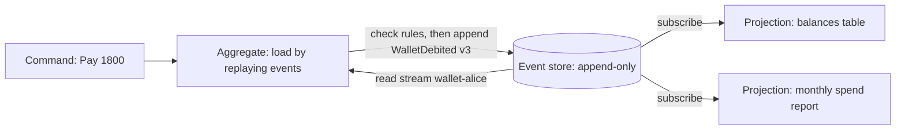

# Event Sourcing

## Introduction

Most applications store **current state**: the `orders` row says `status = 'DELIVERED'`, and whatever it said before is gone. **Event sourcing** stores something different: the full sequence of **events** that happened (`OrderPlaced`, `PaymentCaptured`, `CourierAssigned`, `OrderDelivered`). Current state is not stored as the source of truth; it is **derived** by replaying those events.

You already trust systems that work this way:

- A **bank account** statement is a list of transactions. The balance is a sum, not the other way round.
- **Git** stores commits. Your working tree is what you get by applying them.
- An accountant's **ledger** is append-only. Mistakes are fixed with correcting entries, never with an eraser.

Event sourcing brings that model to application data. Fowler's article [Event Sourcing](https://martinfowler.com/eaaDev/EventSourcing.html) and the Azure [Event Sourcing pattern](https://learn.microsoft.com/azure/architecture/patterns/event-sourcing) are the standard references.

:::note
"Event sourcing" is often confused with "using events". Fowler's article [What do you mean by "Event-Driven"?](https://martinfowler.com/articles/201701-event-driven.html) separates four ideas: event notification, event-carried state transfer, event sourcing and CQRS. You can publish events between services without event sourcing. Event sourcing is specifically about using events **as your storage model**.
:::

## The Problem: State Without History

Here is a typical state-based design for a QuickBite customer wallet (prepaid credit).

```python
from dataclasses import dataclass


@dataclass
class Wallet:
    customer_id: str
    balance_cents: int = 0

    def top_up(self, amount: int) -> None:
        self.balance_cents += amount

    def pay(self, amount: int) -> None:
        if amount > self.balance_cents:
            raise ValueError("insufficient funds")
        self.balance_cents -= amount


w = Wallet("alice")
w.top_up(5000)
w.pay(1800)
w.pay(1200)
w.top_up(1000)
print("balance:", w.balance_cents)
```

Output:

```text
balance: 3000
```

Now Alice contacts support: "I think I was charged twice last Tuesday." The database says her balance is 3000. **That is all it can say.** To answer her you would need a separate audit table, which someone must remember to write in every code path, and which will drift from the real data the first time someone forgets.

Other questions state-only storage cannot answer:

- What was the balance at 18:00 yesterday?
- How many customers topped up and then never spent anything?
- A bug mis-applied discounts for a week. Which wallets were affected, and by how much?

## The Pattern: Events as the Source of Truth



The core pieces:

1. **Events** are immutable facts in the past tense, with a stream ID (usually one stream per aggregate, such as `wallet-alice`) and a version number.
2. An **event store** appends events to streams and reads them back in order. Appends use **optimistic concurrency**: "append this as version 4, but only if the stream is currently at version 3".
3. An **aggregate** rebuilds its state by applying past events, decides whether a new command is allowed, and emits new events.
4. **Projections** subscribe to the event stream and build read models. This is where event sourcing meets [CQRS](./3-arch-cqrs.mdx): reading "current balance" by replaying every time would be slow, so you project it.

### A small event store on SQLite

```python
import json
import sqlite3
from dataclasses import dataclass, asdict


class ConcurrencyError(Exception):
    pass


@dataclass(frozen=True)
class StoredEvent:
    stream_id: str
    version: int
    type: str
    data: dict


class EventStore:
    def __init__(self, db: sqlite3.Connection) -> None:
        self.db = db
        self.db.execute("""CREATE TABLE IF NOT EXISTS events (
            position  INTEGER PRIMARY KEY AUTOINCREMENT,
            stream_id TEXT NOT NULL,
            version   INTEGER NOT NULL,
            type      TEXT NOT NULL,
            data      TEXT NOT NULL,
            UNIQUE (stream_id, version))""")

    def append(self, stream_id: str, expected_version: int, events: list[tuple[str, dict]]) -> int:
        try:
            with self.db:                                   # one transaction
                for i, (etype, data) in enumerate(events, start=1):
                    self.db.execute(
                        "INSERT INTO events (stream_id, version, type, data) VALUES (?, ?, ?, ?)",
                        (stream_id, expected_version + i, etype, json.dumps(data)))
        except sqlite3.IntegrityError:
            raise ConcurrencyError(f"{stream_id} is no longer at version {expected_version}") from None
        return expected_version + len(events)

    def read(self, stream_id: str) -> list[StoredEvent]:
        rows = self.db.execute(
            "SELECT stream_id, version, type, data FROM events WHERE stream_id=? ORDER BY version",
            (stream_id,)).fetchall()
        return [StoredEvent(s, v, t, json.loads(d)) for s, v, t, d in rows]

    def read_all(self, after_position: int = 0) -> list[tuple[int, StoredEvent]]:
        rows = self.db.execute(
            "SELECT position, stream_id, version, type, data FROM events WHERE position > ? ORDER BY position",
            (after_position,)).fetchall()
        return [(p, StoredEvent(s, v, t, json.loads(d))) for p, s, v, t, d in rows]
```

The `UNIQUE (stream_id, version)` constraint does the concurrency control: if two requests both load version 3 and both try to write version 4, the database rejects the second.

### An event-sourced aggregate

Save the previous block as `event_store.py`, then:

```python
import sqlite3
from dataclasses import dataclass, field

from event_store import ConcurrencyError, EventStore, StoredEvent


@dataclass
class Wallet:
    customer_id: str
    balance_cents: int = 0
    version: int = 0
    pending: list[tuple[str, dict]] = field(default_factory=list)

    # ----- rebuilding state -----
    @classmethod
    def load(cls, store: EventStore, customer_id: str) -> "Wallet":
        wallet = cls(customer_id)
        for event in store.read(f"wallet-{customer_id}"):
            wallet._apply(event.type, event.data)
            wallet.version = event.version
        return wallet

    def _apply(self, etype: str, data: dict) -> None:
        match etype:
            case "WalletToppedUp":
                self.balance_cents += data["amount"]
            case "WalletDebited":
                self.balance_cents -= data["amount"]

    # ----- deciding (commands) -----
    def _record(self, etype: str, data: dict) -> None:
        self._apply(etype, data)
        self.pending.append((etype, data))

    def top_up(self, amount: int) -> None:
        if amount <= 0:
            raise ValueError("amount must be positive")
        self._record("WalletToppedUp", {"amount": amount})

    def pay(self, amount: int, order_id: int) -> None:
        if amount > self.balance_cents:
            raise ValueError("insufficient funds")
        self._record("WalletDebited", {"amount": amount, "order_id": order_id})

    def save(self, store: EventStore) -> None:
        self.version = store.append(f"wallet-{self.customer_id}", self.version, self.pending)
        self.pending.clear()


store = EventStore(sqlite3.connect(":memory:"))

w = Wallet.load(store, "alice")
w.top_up(5000)
w.pay(1800, order_id=101)
w.save(store)

w = Wallet.load(store, "alice")
w.pay(1200, order_id=102)
w.top_up(1000)
w.save(store)

print("balance:", Wallet.load(store, "alice").balance_cents)
for e in store.read("wallet-alice"):
    print(f"  v{e.version} {e.type:15} {e.data}")

# Two concurrent requests load the same version
a = Wallet.load(store, "alice")
b = Wallet.load(store, "alice")
a.pay(2500, order_id=103)
b.pay(2500, order_id=104)
a.save(store)
try:
    b.save(store)
except ConcurrencyError as err:
    print("second save rejected:", err)
print("final balance:", Wallet.load(store, "alice").balance_cents)
```

Output:

```text
balance: 3000
  v1 WalletToppedUp  {'amount': 5000}
  v2 WalletDebited   {'amount': 1800, 'order_id': 101}
  v3 WalletDebited   {'amount': 1200, 'order_id': 102}
  v4 WalletToppedUp  {'amount': 1000}
second save rejected: wallet-alice is no longer at version 4
final balance: 500
```

Same balance as before, but now support can see exactly which orders debited Alice's wallet. And the concurrency check stopped two simultaneous 2500 payments from overdrawing a 3000 balance. On a `ConcurrencyError`, the application reloads the aggregate and re-runs the command, which here would fail with "insufficient funds", as it should.

### Projections

A projection reads the global event log in order and maintains a read model, remembering how far it got:

```python
import sqlite3

from event_store import EventStore


class BalanceProjection:
    def __init__(self, db: sqlite3.Connection) -> None:
        self.db = db
        db.execute("CREATE TABLE IF NOT EXISTS balances (stream_id TEXT PRIMARY KEY, cents INTEGER)")
        db.execute("CREATE TABLE IF NOT EXISTS checkpoint (name TEXT PRIMARY KEY, position INTEGER)")

    def position(self) -> int:
        row = self.db.execute("SELECT position FROM checkpoint WHERE name='balances'").fetchone()
        return row[0] if row else 0

    def catch_up(self, store: EventStore) -> int:
        handled = 0
        for pos, e in store.read_all(after_position=self.position()):
            delta = {"WalletToppedUp": 1, "WalletDebited": -1}.get(e.type, 0) * e.data.get("amount", 0)
            with self.db:   # read-model update and checkpoint commit together
                self.db.execute("""INSERT INTO balances VALUES (?, ?)
                    ON CONFLICT(stream_id) DO UPDATE SET cents = cents + excluded.cents""", (e.stream_id, delta))
                self.db.execute("INSERT OR REPLACE INTO checkpoint VALUES ('balances', ?)", (pos,))
            handled += 1
        return handled


db = sqlite3.connect(":memory:")
store = EventStore(db)
store.append("wallet-alice", 0, [("WalletToppedUp", {"amount": 5000}), ("WalletDebited", {"amount": 1800})])
store.append("wallet-bob", 0, [("WalletToppedUp", {"amount": 2000})])

proj = BalanceProjection(db)
print("handled:", proj.catch_up(store))
print("handled again:", proj.catch_up(store))       # nothing new, nothing double-counted
print(db.execute("SELECT * FROM balances ORDER BY stream_id").fetchall())
```

Output:

```text
handled: 3
handled again: 0
[('wallet-alice', 3200), ('wallet-bob', 2000)]
```

Because the checkpoint and the read-model update commit together, re-running the projection is safe. To build a brand-new report, create a new projection with checkpoint 0 and let it replay history.

:::caution
Reading "all events after position N" by an auto-increment column is fine on a single SQLite connection. On a busy multi-writer database, transactions can commit out of ID order, so a reader can skip an event that commits later with a smaller ID. Production event stores (KurrentDB, Marten, the Python `eventsourcing` library) handle this for you. That is one reason not to roll your own for real systems.
:::

## Operating an Event-Sourced System

### Snapshots

Replaying thousands of events per load is slow. A **snapshot** stores the aggregate state at version N; loading becomes "latest snapshot + events after N". Add snapshots only when you measure a problem; most aggregates have short streams.

### Event versioning

Events are stored forever, but your code changes. Strategies, from simplest:

- **Only add optional fields**, with defaults when reading old events.
- **Upcasting:** when reading, convert old event shapes (`WalletDebited` v1) to the current shape in code before applying.
- **New event type** (`WalletDebitedV2`) when meaning changes.
- **Copy-and-transform** the stream as a last resort.

Greg Young's free online book "Versioning in an Event Sourced System" covers this in depth. See also [Schema Evolution and Data Migrations](../11-arch-data-architecture/7-arch-data-migrations.mdx).

### Personal data and deletion

An append-only log conflicts with "delete my data" requests under laws like the GDPR. Common approaches are to keep personal data out of events (store a reference instead), or **crypto-shredding**: encrypt personal fields with a per-person key and delete the key. Get legal advice for your situation; this page is not legal guidance.

### Correcting mistakes

You never edit events. You append a compensating event (`WalletAdjusted` with a reason) exactly as an accountant would. This keeps the audit trail honest.

## Where You Have Already Met Event Sourcing

- **Database write-ahead logs** (PostgreSQL WAL, MySQL binlog) are event logs that the database replays for recovery and replication.
- **Git** commits and **Redux** actions in front-end apps follow the same "state is a fold over events" idea.
- **KurrentDB**, formerly EventStoreDB (the company renamed itself from Event Store to Kurrent in December 2024), is a database purpose-built for event streams.
- **Marten** turns PostgreSQL into an event store for .NET; **Axon Framework** does similar for Java; the **eventsourcing** package on PyPI does so for Python.

## Real-World Scenario

QuickBite's finance team must reconcile wallet balances with the payment provider every month and answer regulator questions about any transaction. Disputes take days because the team reconstructs history from application logs.

### The design

- Only the **Wallet** bounded context is event-sourced. Menus, restaurants and courier profiles stay as ordinary CRUD tables.
- Each wallet is a stream; every top-up, debit, refund and adjustment is an event with the order ID and the actor.
- Projections build the current-balance table (used by checkout) and a monthly statement table (used by finance).
- Disputes are answered by reading one stream. "Balance at time T" is a replay up to T.

### Why this approach

The domain is **inherently a ledger**: auditors already think in transactions. Event sourcing gives an audit trail that cannot drift from the data, plus temporal queries, at the cost of complexity in one small, valuable context.

### When to use it, and when not to

Use event sourcing when history is a first-class requirement (finance, compliance, logistics tracking), when you need temporal queries or to rebuild new views from history, or when the domain is naturally a sequence of events.

Avoid it when:

- The data is simple CRUD with no interesting history (user profile settings, static catalogue).
- You need ad hoc queries across current state and cannot invest in projections.
- The team has no experience with eventual consistency, event versioning and projections. The learning curve is real.
- You would be event-sourcing the whole system. Like CQRS, it is best applied per bounded context.

### Alternatives and trade-offs

| Approach | Pros | Cons | Best for |
| --- | --- | --- | --- |
| State-based CRUD | Simple, familiar, easy queries | No history | Most data |
| CRUD + audit table | Some history, small change | Audit can drift, written by convention | Light compliance needs |
| CRUD + change data capture into a log | History without changing app code | Captures row changes, not business intent | Analytics, integration |
| Temporal tables (system-versioned) | Point-in-time queries in SQL | Row-level, not intent-level; DB support varies | Regulated record-keeping |
| Event sourcing | Complete intent-level history, replayable projections | Versioning, projections, learning curve | Ledgers, workflows, audit-heavy domains |

## Common Mistakes

- **Event-sourcing everything.** Apply it where history pays for itself.
- **CRUD-shaped events** like `WalletUpdated {balance: 3000}`. They lose intent. Prefer `WalletDebited {amount, order_id}`.
- **Querying the event store for current state** instead of building projections.
- **Publishing internal events directly to other services.** Your storage events are private and change with your model; publish separate, stable integration events.
- **No plan for event versioning** until the first breaking change.
- **Using the event store as a message broker** without understanding ordering and delivery guarantees.

## Summary

- Event sourcing stores immutable events as the source of truth; state is derived by replaying them.
- Optimistic concurrency on `(stream_id, version)` prevents conflicting writes.
- Projections build read models and can be rebuilt from history; this pairs naturally with CQRS.
- Snapshots, event versioning and personal-data handling are part of the operating cost.
- Use it for ledger-like, audit-heavy bounded contexts, not as a default.

## Exercises

1. Add a `WalletRefunded` event and a `refund(order_id)` command that only refunds orders that were actually debited.
2. Write `balance_at(store, customer_id, version)` that replays only up to a given version.
3. Add snapshotting: store the state every 100 events and load from the latest snapshot.
4. Implement an upcaster that converts an old `WalletDebited` event without `order_id` into the current shape with `order_id = None`.

### Related pages

- [CQRS](./3-arch-cqrs.mdx).
- [Aggregates and Consistency Boundaries](../8-arch-domain-driven-design/4-arch-aggregates.mdx).
- [Domain Events](../8-arch-domain-driven-design/5-arch-domain-events.mdx).
- [Change Data Capture](../11-arch-data-architecture/5-arch-change-data-capture.mdx).
