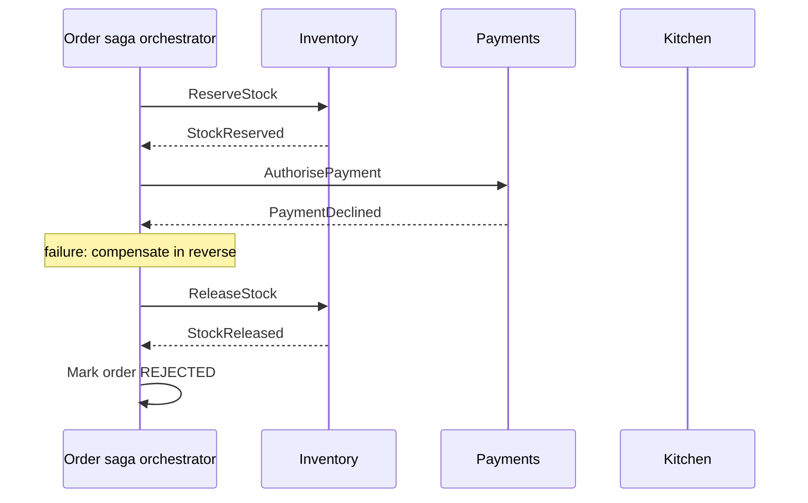
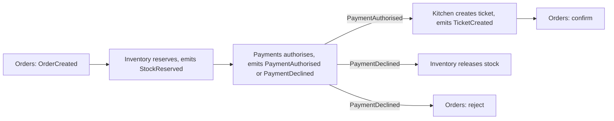

# Saga Pattern

## Introduction

In a single database, placing an order is one ACID transaction: reserve stock, charge the card, create the order, and either everything commits or everything rolls back. Once those steps live in **different services with their own databases** (see [Database per Service vs Shared Database](../11-arch-data-architecture/0-arch-database-per-service.mdx)), that single transaction is gone.

A **saga** replaces one big transaction with a **sequence of local transactions**, one per service. If a step fails, the saga runs **compensating transactions** that semantically undo the steps that already succeeded.

The term comes from a 1987 paper by Hector Garcia-Molina and Kenneth Salem, "Sagas", which addressed long-lived transactions in a single database. Microservices brought it back as the standard way to manage cross-service business transactions; Chris Richardson's [saga pattern page](https://microservices.io/patterns/data/saga.html) and the Azure [Saga design pattern](https://learn.microsoft.com/azure/architecture/patterns/saga) are the usual references.

Analogy: booking a holiday. You book a flight, then a hotel, then a rental car. If the car is unavailable, nobody "rolls back" time. You **cancel** the hotel and **cancel** the flight, possibly paying a cancellation fee. Compensation is a new business action, not an erase button.

## Why Not a Distributed Transaction?

The classic alternative is **two-phase commit (2PC)**: a coordinator asks every participant to prepare, then tells all of them to commit. It gives atomicity across databases, but:

- Participants hold locks while waiting for the coordinator, so a slow or failed coordinator blocks everyone.
- Many modern data stores and message brokers do not support XA-style distributed transactions at all.
- Third-party APIs (payment providers, email services) can never join your transaction.
- It couples the availability of every service to every other.

For these reasons, most microservice architectures avoid 2PC and accept **eventual consistency** managed by sagas.

## The Problem: Sequential Calls Without a Plan

Here is QuickBite's checkout after the services were split, written the obvious way.

```python
class OutOfStock(Exception):
    pass


class PaymentDeclined(Exception):
    pass


inventory = {"margherita": 1}
charges: list[str] = []
orders: dict[int, str] = {}


def reserve_stock(order_id: int, dish: str) -> None:
    if inventory[dish] < 1:
        raise OutOfStock(dish)
    inventory[dish] -= 1


def charge_card(order_id: int, amount: int) -> None:
    if amount > 4000:
        raise PaymentDeclined(order_id)
    charges.append(f"order {order_id}: {amount}")


def notify_kitchen(order_id: int) -> None:
    raise TimeoutError("kitchen service unavailable")


def checkout(order_id: int, dish: str, amount: int) -> None:
    orders[order_id] = "PENDING"
    reserve_stock(order_id, dish)
    charge_card(order_id, amount)
    notify_kitchen(order_id)
    orders[order_id] = "CONFIRMED"


try:
    checkout(1, "margherita", 2200)
except Exception as e:
    print("checkout failed:", repr(e))
print("inventory:", inventory, "| charges:", charges, "| orders:", orders)
```

Output:

```text
checkout failed: TimeoutError('kitchen service unavailable')
inventory: {'margherita': 0} | charges: ['order 1: 2200'] | orders: {1: 'PENDING'}
```

The last pizza is reserved, the customer is charged, and the order is stuck in `PENDING` forever. Nothing undoes the earlier steps, and if this process crashes halfway, nothing even remembers that it was halfway.

## The Pattern: Local Transactions Plus Compensations

A saga design starts by listing each step and its compensation:

| Step | Service | Action | Compensation |
| --- | --- | --- | --- |
| 1 | Orders | Create order as `PENDING` | Mark order `REJECTED` |
| 2 | Inventory | Reserve stock | Release reservation |
| 3 | Payments | Authorise payment | Void authorisation (or refund) |
| 4 | Kitchen | Create ticket | Cancel ticket |
| 5 | Orders | Mark order `CONFIRMED` | (none, final step) |

Richardson classifies saga steps into three kinds, which helps ordering:

- **Compensatable** steps can be undone (reserve stock, create pending order).
- The **pivot** step is the point of no return. If it succeeds, the saga will run to completion (often payment capture).
- **Retriable** steps come after the pivot and are guaranteed to succeed eventually if retried (notify kitchen, send email).

Put risky, compensatable steps **before** the pivot and only must-succeed, retriable steps **after** it. In the example, a kitchen outage should cause a retry, not a refund.

### Two coordination styles



**Orchestration:** one component (the orchestrator) tells each participant what to do next and tracks the saga's state. The flow lives in one place.



**Choreography:** no central coordinator. Each service reacts to events from the others and emits its own. The flow is implicit in the subscriptions.

| | Orchestration | Choreography |
| --- | --- | --- |
| Where the flow lives | One orchestrator | Spread across services |
| Visibility and debugging | Easy: one place shows saga state | Harder: reconstruct from events and traces |
| Coupling | Orchestrator knows all participants | Services know each other's events |
| Good for | Many steps, complex branching, compensations | Few steps, simple linear flows |
| Risk | Orchestrator becomes a "god service" with business logic | Cyclic event dependencies nobody can follow |

### An orchestrated saga in Python

The orchestrator below persists each completed step, so after a crash it knows exactly which compensations to run. Services are in-memory stand-ins.

```python
from dataclasses import dataclass, field
from typing import Callable


class BusinessRejection(Exception):
    """A step said no. Compensate; do not retry."""


@dataclass
class Step:
    name: str
    action: Callable[[dict], None]
    compensation: Callable[[dict], None] | None = None
    retriable: bool = False          # after the pivot: retry, never compensate


@dataclass
class SagaLog:
    """Stands in for a saga_state table, written after each step."""
    entries: list[str] = field(default_factory=list)

    def record(self, saga_id: str, event: str) -> None:
        self.entries.append(f"{saga_id}: {event}")


@dataclass
class SagaOrchestrator:
    steps: list[Step]
    log: SagaLog
    max_retries: int = 3

    def run(self, saga_id: str, ctx: dict) -> str:
        done: list[Step] = []
        for step in self.steps:
            attempts = self.max_retries if step.retriable else 1
            for attempt in range(1, attempts + 1):
                try:
                    step.action(ctx)
                    self.log.record(saga_id, f"{step.name} ok")
                    done.append(step)
                    break
                except BusinessRejection as e:
                    self.log.record(saga_id, f"{step.name} rejected: {e}")
                    self.compensate(saga_id, ctx, done)
                    return "REJECTED"
                except Exception as e:
                    self.log.record(saga_id, f"{step.name} attempt {attempt} failed: {e!r}")
                    if not step.retriable:
                        self.compensate(saga_id, ctx, done)
                        return "REJECTED"
            else:
                self.log.record(saga_id, f"{step.name} still failing, parked for operator")
                return "STUCK"
        return "CONFIRMED"

    def compensate(self, saga_id: str, ctx: dict, done: list[Step]) -> None:
        for step in reversed(done):
            if step.compensation:
                step.compensation(ctx)
                self.log.record(saga_id, f"compensated {step.name}")


# ----- fake participants -----
inventory = {"margherita": 5}
payments: dict[str, str] = {}
kitchen_failures = {"count": 1}


def create_order(ctx): ctx["status"] = "PENDING"
def reject_order(ctx): ctx["status"] = "REJECTED"
def reserve(ctx): inventory[ctx["dish"]] -= 1
def release(ctx): inventory[ctx["dish"]] += 1


def authorise(ctx):
    if ctx["amount"] > 4000:
        raise BusinessRejection("card limit exceeded")
    payments[ctx["order_id"]] = "AUTHORISED"


def void(ctx): payments[ctx["order_id"]] = "VOIDED"


def kitchen_ticket(ctx):
    if kitchen_failures["count"] > 0:
        kitchen_failures["count"] -= 1
        raise TimeoutError("kitchen slow")


def confirm(ctx): ctx["status"] = "CONFIRMED"


steps = [
    Step("create_order", create_order, reject_order),
    Step("reserve_stock", reserve, release),
    Step("authorise_payment", authorise, void),          # pivot
    Step("kitchen_ticket", kitchen_ticket, retriable=True),
    Step("confirm_order", confirm, retriable=True),
]

log = SagaLog()
saga = SagaOrchestrator(steps, log)
print("order A:", saga.run("A", {"order_id": "A", "dish": "margherita", "amount": 2200}))
print("order B:", saga.run("B", {"order_id": "B", "dish": "margherita", "amount": 9900}))
print("\n".join(log.entries))
print("inventory:", inventory, "| payments:", payments)
```

Output:

```text
order A: CONFIRMED
order B: REJECTED
A: create_order ok
A: reserve_stock ok
A: authorise_payment ok
A: kitchen_ticket attempt 1 failed: TimeoutError('kitchen slow')
A: kitchen_ticket ok
A: confirm_order ok
B: create_order ok
B: reserve_stock ok
B: authorise_payment rejected: card limit exceeded
B: compensated reserve_stock
B: compensated create_order
inventory: {'margherita': 4} | payments: {'A': 'AUTHORISED'}
```

Order A survived a kitchen timeout because that step is retriable after the pivot. Order B was declined, so the saga released the stock and rejected the order, in reverse order.

In production, three more things are essential:

1. **Durable saga state.** The log must be a database table (or a workflow engine's history), written in the same transaction as the orchestrator's own changes, so a crash mid-saga can resume.
2. **Reliable messaging.** Commands and replies between orchestrator and participants go through a broker, using the [Transactional Outbox](./6-arch-outbox.mdx) so no message is lost.
3. **Idempotent participants and compensations.** Messages can be redelivered, and a compensation may run for a step whose action half-completed. Every handler must tolerate being called twice. See [Idempotency](./7-arch-idempotency.mdx).

## The Isolation Problem

A saga gives you atomicity (eventually all or nothing) but **not isolation**. Between step 2 and a later compensation, other transactions can see the intermediate state. Typical anomalies:

- **Dirty reads:** a report counts stock as sold while the saga is still pending and later compensates.
- **Lost updates:** one saga overwrites a change another saga made, then compensates to an old value.

Richardson lists **countermeasures**; the most common:

| Countermeasure | Idea | Example |
| --- | --- | --- |
| Semantic lock | Mark records as "in progress" so others treat them carefully | Order status `PENDING`; stock "reserved" not "sold" |
| Commutative updates | Design updates so order does not matter | Increment and decrement, not "set to value" |
| Pessimistic view | Order steps to minimise the risk of dirty reads | Do the risky step before updating shared counters |
| Reread value | Check the record has not changed before overwriting | Optimistic concurrency with a version column |

The compensation in the example (`inventory += 1`) is commutative, which is why it remains correct even if other orders changed the stock in between. A compensation that wrote `inventory = 5` back would be a lost-update bug.

## Tools You Can Use Instead of Hand-Rolling

- **Temporal** (and similar durable execution engines) persist workflow progress automatically; the [Temporal saga guide](https://docs.temporal.io/design-patterns/saga-pattern) shows registering a compensation per step and running them in reverse on failure.
- **AWS Step Functions** and **Azure Durable Functions** model orchestrated workflows with retries and catch blocks.
- **Camunda** models sagas as BPMN processes with compensation events.
- **Eventuate Tram Sagas** (Java), from Chris Richardson's work, and **MassTransit** state machines (.NET) offer library-level orchestration.

A workflow engine removes most of the boilerplate (durable state, retries, timers) but is a significant new piece of infrastructure. For one or two simple sagas, a saga-state table plus an outbox may be enough.

## Real-World Scenario

QuickBite splits checkout across **Orders**, **Inventory** (limited daily specials), **Payments** (wrapping an external provider) and **Kitchen** services. Support reports orders stuck in `PENDING` and customers charged for unavailable specials.

### The design

- An **orchestrated saga** in the Orders service owns checkout, with saga state in the Orders database.
- Step order: create pending order, reserve special, **authorise** payment (pivot), then create kitchen ticket and capture payment as retriable steps.
- Payment authorisation (not capture) before the pivot means a decline or later problem can be voided rather than refunded.
- Every command carries the saga ID as an idempotency key; participants dedupe on it.
- A timeout: if no reply in 2 minutes, the saga retries or compensates according to the step type, and an alert fires for any saga in `STUCK`.

### Why this approach

Checkout has several steps, real money and compensations whose order matters. Orchestration makes the whole flow visible in one place, which the on-call engineer needs when a customer asks "where is my order?".

### When to use it, and when not to

Use a saga when a business operation must change data owned by **several services** and you cannot (or should not) use a distributed transaction.

Avoid it when:

- All the data lives in one database. Use a local ACID transaction; it is far simpler.
- You are splitting services and a saga appears in every feature. That often means the boundaries are wrong; data that must change together usually belongs in one service. Revisit [Bounded Contexts and Context Mapping](../8-arch-domain-driven-design/2-arch-bounded-contexts.mdx).
- A step has no meaningful compensation and cannot be made retriable (an irreversible external action in the middle of a flow). Redesign the order of steps first.

### Alternatives and trade-offs

| Approach | Pros | Cons | Best for |
| --- | --- | --- | --- |
| Local ACID transaction (one service / modular monolith) | Simple, isolated, atomic | Requires data in one database | Data that must change together |
| Two-phase commit | Atomic across resources | Blocking, rare support, couples availability | Legacy enterprise systems with XA |
| Choreographed saga | Loose coupling, no central service | Flow hard to see and change | 2-4 steps, simple linear flows |
| Orchestrated saga (hand-written) | Explicit flow, clear state | Orchestrator code and durability are on you | A few important flows |
| Workflow engine (Temporal, Step Functions) | Durable state, retries, timers built in | New infrastructure and programming model | Many long-running flows |

## Common Mistakes

- **Forgetting compensations are business actions.** A refund may cost fees and send emails. Design and name them with domain experts.
- **Non-idempotent steps and compensations**, which break under redelivery.
- **Compensating with absolute values** ("set stock to 5") instead of commutative changes.
- **Putting a retriable step before the pivot** or an irreversible step before compensatable ones.
- **No timeout or stuck-saga monitoring.** Every saga needs a deadline and an alert.
- **Choreography sprawl.** With many steps, nobody can answer "what happens after PaymentAuthorised?" without reading five codebases.

## Summary

- A saga is a sequence of local transactions with compensating transactions for failure.
- Compensatable steps go before the pivot; retriable steps go after it.
- Orchestration centralises the flow; choreography spreads it across event handlers.
- Sagas lack isolation; use semantic locks, commutative updates and rereads.
- Durable saga state, reliable messaging and idempotent handlers are mandatory in production.
- Prefer a single local transaction when the data can live together.

## Exercises

1. Add a `capture_payment` step after `kitchen_ticket` and make it retriable. What happens if it fails permanently? Add a "parked for operator" alert path.
2. Persist the `SagaLog` to SQLite and write a `resume(saga_id)` function that continues a saga after a simulated crash.
3. Rewrite the checkout as a choreography with an in-memory event bus. Compare how hard it is to answer "which step failed for order B?".
4. Find a flow in a system you know that spans two data stores. Write its step and compensation table and identify the pivot.

### Related pages

- [Transactional Outbox](./6-arch-outbox.mdx).
- [Idempotency](./7-arch-idempotency.mdx).
- [Event-Driven Architecture](../6-arch-architectural-styles/5-arch-event-driven.mdx).
- [Case Study: E-Commerce Checkout](../14-arch-case-studies/1-arch-case-ecommerce.mdx).
