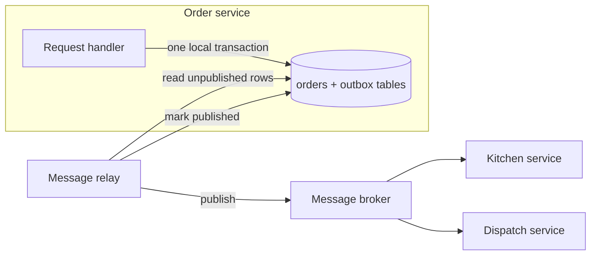
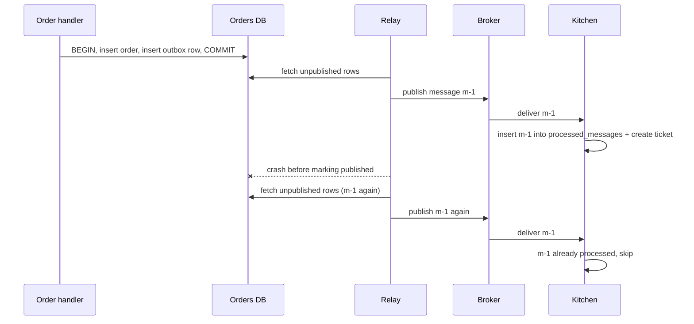

# Transactional Outbox

## Introduction

Almost every service eventually needs to do two things at once: **update its database** and **tell other services** about it. Save the order, then publish `OrderPlaced` so the kitchen and the courier dispatcher can react.

That sounds trivial, but the database and the message broker are two separate systems, and there is no transaction that spans both. Whichever you do first, a crash between the two leaves them disagreeing. This is called the **dual-write problem**.

The **transactional outbox** pattern solves it with a simple trick: write the message into an `outbox` table **in the same database transaction** as the business data. A separate relay process then reads the outbox and publishes to the broker. Either both the order and its message are saved, or neither is.

Analogy: instead of running to the post office every time you finish a task (and sometimes forgetting), you drop each letter into an outbox tray on your desk as part of finishing the task. A colleague empties the tray to the post office regularly. Letters may occasionally be posted twice if the colleague is interrupted, but none are ever lost.

Chris Richardson's [Transactional outbox](https://microservices.io/patterns/data/transactional-outbox.html) page is the canonical description.

## The Problem: Dual Writes

```python
import sqlite3


class Broker:
    def __init__(self) -> None:
        self.messages: list[str] = []

    def publish(self, msg: str) -> None:
        self.messages.append(msg)


def place_order_commit_then_publish(db, broker, order_id: int, crash: bool) -> None:
    with db:
        db.execute("INSERT INTO orders VALUES (?, 'PLACED')", (order_id,))
    if crash:
        raise SystemExit("process killed after commit")     # deploy, OOM, node loss
    broker.publish(f"OrderPlaced {order_id}")


def place_order_publish_then_commit(db, broker, order_id: int, fail_db: bool) -> None:
    broker.publish(f"OrderPlaced {order_id}")
    with db:
        if fail_db:
            raise sqlite3.OperationalError("database is locked")
        db.execute("INSERT INTO orders VALUES (?, 'PLACED')", (order_id,))


db = sqlite3.connect(":memory:")
db.execute("CREATE TABLE orders (id INTEGER PRIMARY KEY, status TEXT)")
broker = Broker()

try:
    place_order_commit_then_publish(db, broker, 1, crash=True)
except SystemExit as e:
    print("crash:", e)
try:
    place_order_publish_then_commit(db, broker, 2, fail_db=True)
except sqlite3.OperationalError as e:
    print("db error:", e)

print("orders in db:", db.execute("SELECT id FROM orders").fetchall())
print("messages published:", broker.messages)
```

Output:

```text
crash: process killed after commit
db error: database is locked
orders in db: [(1,)]
messages published: ['OrderPlaced 2']
```

Order 1 exists but nobody was told: the kitchen never cooks it. Order 2 does not exist, but the kitchen was told to cook it. Neither ordering of the two writes is safe, and retries do not help because the process that would retry may be gone.

:::note
"Publish inside the database transaction, before commit" does not help either. The publish is not rolled back if the commit then fails.
:::

## The Pattern



1. The handler inserts the business row **and** an outbox row in one transaction.
2. A **message relay** reads unpublished outbox rows, publishes them, and marks them as published (or deletes them).
3. If the relay crashes after publishing but before marking, it publishes the same row again next time. So the outbox gives **at-least-once** delivery, and consumers must be idempotent.

There are two common ways to build the relay:

| Relay style | How it reads the outbox | Pros | Cons |
| --- | --- | --- | --- |
| **Polling publisher** | Periodically queries `WHERE published_at IS NULL` | Simple, any database, no extra infrastructure | Polling load and latency; care needed with multiple relays |
| **Transaction log tailing (CDC)** | Reads the database's replication log (PostgreSQL WAL, MySQL binlog) | Low latency, no polling queries | Needs a CDC tool such as Debezium and Kafka Connect |

## Building It: Polling Publisher

```python
import json
import random
import sqlite3
import uuid


class FlakyBroker:
    def __init__(self, fail_rate: float, rng: random.Random) -> None:
        self.delivered: list[dict] = []
        self.fail_rate = fail_rate
        self.rng = rng

    def publish(self, topic: str, key: str, payload: dict) -> None:
        if self.rng.random() < self.fail_rate:
            raise ConnectionError("broker unavailable")
        self.delivered.append({"topic": topic, "key": key, **payload})


def setup(db: sqlite3.Connection) -> None:
    db.executescript("""
    CREATE TABLE orders (id TEXT PRIMARY KEY, customer TEXT, total_cents INTEGER, status TEXT);
    CREATE TABLE outbox (
        id             TEXT PRIMARY KEY,           -- message id, used by consumers to dedupe
        aggregate_type TEXT NOT NULL,
        aggregate_id   TEXT NOT NULL,
        event_type     TEXT NOT NULL,
        payload        TEXT NOT NULL,
        created_seq    INTEGER NOT NULL,
        published_at   TEXT
    );
    """)


def place_order(db: sqlite3.Connection, customer: str, total: int, seq: int) -> str:
    order_id = str(uuid.uuid4())[:8]
    event = {"order_id": order_id, "customer": customer, "total_cents": total}
    with db:  # business row and message commit together, or not at all
        db.execute("INSERT INTO orders VALUES (?, ?, ?, 'PLACED')", (order_id, customer, total))
        db.execute("INSERT INTO outbox VALUES (?, 'order', ?, 'OrderPlaced', ?, ?, NULL)",
                   (str(uuid.uuid4()), order_id, json.dumps(event), seq))
    return order_id


def relay_once(db: sqlite3.Connection, broker: FlakyBroker, batch: int = 10) -> int:
    rows = db.execute("""SELECT id, aggregate_type, aggregate_id, event_type, payload FROM outbox
                         WHERE published_at IS NULL ORDER BY created_seq LIMIT ?""", (batch,)).fetchall()
    sent = 0
    for msg_id, agg_type, agg_id, etype, payload in rows:
        try:
            broker.publish(topic=f"{agg_type}.events", key=agg_id,
                           payload={"message_id": msg_id, "type": etype, **json.loads(payload)})
        except ConnectionError:
            break                   # keep order: stop at the first failure, retry next round
        with db:
            db.execute("UPDATE outbox SET published_at = datetime('now') WHERE id = ?", (msg_id,))
        sent += 1
    return sent


db = sqlite3.connect(":memory:")
setup(db)
broker = FlakyBroker(fail_rate=0.3, rng=random.Random(3))

for i, (name, total) in enumerate([("alice", 2200), ("bob", 1500), ("chen", 3100), ("dana", 900)]):
    place_order(db, name, total, seq=i)

round_no = 0
while db.execute("SELECT COUNT(*) FROM outbox WHERE published_at IS NULL").fetchone()[0]:
    round_no += 1
    print(f"relay round {round_no}: published {relay_once(db, broker)}")

print("delivered in order:", [m["customer"] for m in broker.delivered])
```

Example output:

```text
relay round 1: published 0
relay round 2: published 4
delivered in order: ['alice', 'bob', 'chen', 'dana']
```

The broker was unavailable for the first message, so the relay published nothing in round 1 and resumed in round 2, keeping order. Nothing was lost while the broker was down: the orders were safely committed and their messages waited in the outbox. In a real service the relay runs in a loop with a short sleep, or is triggered after each commit with polling as a fallback.

### Production details for a polling relay

- **Multiple relay instances:** on PostgreSQL, select a batch with `SELECT ... FOR UPDATE SKIP LOCKED` so instances do not grab the same rows, or elect a single active relay. Note that parallel relays can break per-key ordering.
- **Ordering:** order by a sequence column, and use the aggregate ID as the broker message key (for example the Kafka partition key) so all events for one order stay in order.
- **Cleanup:** delete or archive published rows on a schedule. An ever-growing outbox slows polling.
- **Index:** a partial index on unpublished rows keeps polling cheap.
- **Monitoring:** alert on the age of the oldest unpublished row. It is the single best health signal for the pattern.

## Building It: Log Tailing with Debezium

With **change data capture**, you do not write a relay at all. A CDC connector reads inserts on the outbox table from the database log and publishes them. Debezium provides an **outbox event router** single message transform (SMT) for exactly this. By default it expects outbox columns named `id`, `aggregatetype`, `aggregateid`, `type` and `payload`, and routes each row to a topic named `outbox.event.` followed by the aggregate type.

A minimal Kafka Connect configuration for PostgreSQL looks like this (property names are from the Debezium documentation; check the [outbox event router docs](https://debezium.io/documentation/reference/stable/transformations/outbox-event-router.html) for the version you run):

```json
{
  "name": "orders-outbox-connector",
  "config": {
    "connector.class": "io.debezium.connector.postgresql.PostgresConnector",
    "plugin.name": "pgoutput",
    "database.hostname": "orders-db",
    "database.port": "5432",
    "database.user": "debezium",
    "database.password": "change-me",
    "database.dbname": "orders",
    "topic.prefix": "orders",
    "table.include.list": "public.outbox",
    "transforms": "outbox",
    "transforms.outbox.type": "io.debezium.transforms.outbox.EventRouter"
  }
}
```

With CDC the outbox rows can even be deleted immediately after insert: the log still contains the insert, which is all the connector needs. See [Change Data Capture](../11-arch-data-architecture/5-arch-change-data-capture.mdx) for how CDC works more broadly.

## The Consumer Side: Idempotent Consumer (Inbox)

Because the relay can publish twice, each consumer records the message IDs it has processed, **in the same transaction** as its own changes:

```python
import sqlite3

db = sqlite3.connect(":memory:")
db.executescript("""
CREATE TABLE processed_messages (message_id TEXT PRIMARY KEY);
CREATE TABLE kitchen_tickets (order_id TEXT PRIMARY KEY, status TEXT);
""")


def handle_order_placed(msg: dict) -> str:
    try:
        with db:
            db.execute("INSERT INTO processed_messages VALUES (?)", (msg["message_id"],))
            db.execute("INSERT INTO kitchen_tickets VALUES (?, 'NEW')", (msg["order_id"],))
        return "processed"
    except sqlite3.IntegrityError:
        return "duplicate ignored"


msg = {"message_id": "m-1", "order_id": "o-42"}
print(handle_order_placed(msg))
print(handle_order_placed(msg))      # redelivery after a relay crash
print(db.execute("SELECT * FROM kitchen_tickets").fetchall())
```

Output:

```text
processed
duplicate ignored
[('o-42', 'NEW')]
```

This is sometimes called the **inbox** pattern. The Azure catalogue lists it as [Idempotent Consumer](https://learn.microsoft.com/azure/architecture/patterns/idempotent-consumer). The [Idempotency](./7-arch-idempotency.mdx) page covers it in more depth.



## Real-World Scenario

QuickBite's dispatch team reports a handful of orders a week that were paid for but never assigned a courier. Investigation shows the order service commits the order and then publishes `OrderPlaced` to RabbitMQ; pods killed during deploys sometimes die between the two.

### The design

- Add an `outbox` table to the orders database. `place_order` writes the order and the outbox row in one transaction.
- Run a polling relay as a separate small deployment with one active instance, publishing to [RabbitMQ](/docs/middleware/rabbitmq) with publisher confirms enabled before marking rows published.
- Dispatch and kitchen consumers add a `processed_messages` table.
- Add an alert when the oldest unpublished outbox row is older than one minute.
- Later, when the company adopts Kafka for analytics, swap the polling relay for Debezium without changing the order service's code.

### Why this approach

The bug is a classic dual write. The outbox fixes it with only the database the team already runs, and keeps the order service's code simple: it just inserts a row.

### When to use it, and when not to

Use the outbox whenever a state change **must** be followed by a message: order events, payment events, saga commands and replies, cache invalidation that must not be missed.

You may not need it when:

- Losing the occasional message is acceptable (analytics click events, metrics).
- The message *is* the state change: if the broker is your source of truth (event streaming where services consume and produce only to Kafka), you can use the broker's own transactions instead.
- You already use event sourcing, where the event store is both the record and the feed.

### Alternatives and trade-offs

| Approach | Pros | Cons | Best for |
| --- | --- | --- | --- |
| Commit then publish (dual write) | Simplest code | Lost or phantom messages on crash | Non-critical notifications only |
| Outbox + polling relay | Reliable, any SQL database | Polling latency and load; relay to operate | Most teams starting out |
| Outbox + CDC (Debezium) | Low latency, no polling | Kafka Connect and CDC to operate | Teams already on Kafka |
| Listen to yourself (publish to broker, update DB from your own consumer) | Broker is single source of truth | Read-your-writes is harder; broker becomes critical | Event-streaming-first systems |
| Event sourcing | Events are the data | Large paradigm shift | Ledger-like domains |
| Two-phase commit (XA) across DB and broker | Atomic | Limited support, blocking | Legacy enterprise stacks |

## Common Mistakes

- **Writing the outbox row in a separate transaction.** Then you have rebuilt the dual write.
- **Assuming exactly-once delivery.** The outbox is at-least-once. Every consumer must deduplicate.
- **Losing order** by running parallel relays or by not keying messages by aggregate.
- **Never cleaning up** the outbox table.
- **Putting huge payloads in the outbox.** Store a reference and let consumers fetch details, or use the Claim Check pattern.
- **Marking rows published before the broker confirms.** Wait for the broker's acknowledgement (publisher confirms in RabbitMQ, `acks=all` in Kafka) first.

## Summary

- Updating a database and publishing a message are two writes with no shared transaction: the dual-write problem.
- The outbox puts the message in the same database transaction as the data.
- A polling relay or CDC (such as Debezium's outbox event router) publishes outbox rows to the broker.
- Delivery is at-least-once; consumers deduplicate with an inbox of processed message IDs.
- Monitor the age of the oldest unpublished message.

## Exercises

1. Modify `relay_once` to simulate a crash after `publish` but before the `UPDATE`. Run it twice and show the duplicate delivery.
2. Add a cleanup function that deletes published rows older than a given age, and an index that keeps polling fast.
3. Connect the outbox example and the inbox example so duplicates from the relay are ignored end to end.
4. Sketch how a [saga](./5-arch-saga.mdx) orchestrator would use an outbox for its commands and an inbox for participant replies.

### Related pages

- [Idempotency](./7-arch-idempotency.mdx).
- [Change Data Capture](../11-arch-data-architecture/5-arch-change-data-capture.mdx).
- [Messaging Patterns: Queues, Pub/Sub and Streams](../10-arch-integration-and-apis/5-arch-messaging-patterns.mdx).
- [Domain Events](../8-arch-domain-driven-design/5-arch-domain-events.mdx).
