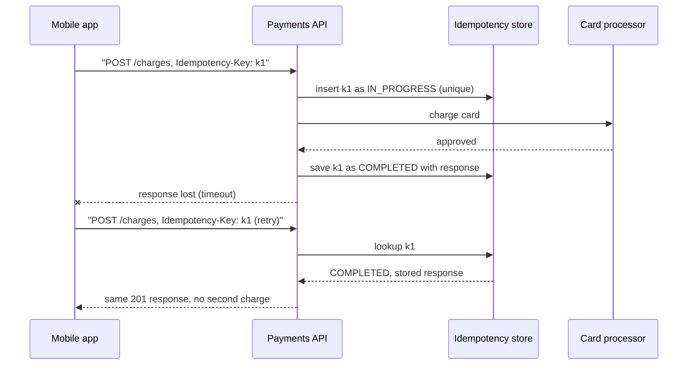

# Idempotency

## Introduction

An operation is **idempotent** if doing it once or doing it many times has the same effect. Pressing a lift's call button five times does not summon five lifts. Setting a thermostat to 21 degrees twice leaves it at 21. But pressing "Pay" twice on a badly built checkout can charge you twice.

In distributed systems, idempotency is not a nice-to-have. As the [fundamentals page](./0-arch-distributed-fundamentals.mdx) showed, a timeout leaves the caller not knowing whether the operation happened. The only safe response is to retry, and retrying is only safe if the operation is idempotent. Message brokers add the same problem from the other side: at-least-once delivery means your consumer **will** see some messages twice.

Idempotency is what lets the other patterns in this section work:

- [Retries](./8-arch-circuit-breaker.mdx) are only safe on idempotent operations.
- The [transactional outbox](./6-arch-outbox.mdx) delivers at least once, so consumers must deduplicate.
- [Saga](./5-arch-saga.mdx) steps and compensations can be redelivered and must tolerate it.

## Idempotency in HTTP

HTTP defines which methods are idempotent. [RFC 9110](https://www.rfc-editor.org/rfc/rfc9110#name-idempotent-methods), the current HTTP semantics specification, says:

| Method | Safe (no side effects) | Idempotent | Notes |
| --- | --- | --- | --- |
| GET, HEAD, OPTIONS, TRACE | Yes | Yes | Read-only by contract |
| PUT | No | Yes | "Set this resource to exactly this" |
| DELETE | No | Yes | Deleting twice leaves it deleted (the second call may return 404, which is fine) |
| POST | No | **No** | "Create" or "process"; repeating creates duplicates |
| PATCH | No | **No** (in general) | Depends on the patch format: "set name" is idempotent, "add 1" is not |

Idempotency is about the **effect on the server**, not the response. A second `DELETE` returning 404 instead of 204 is still idempotent.

The specification also allows clients and proxies to retry idempotent requests automatically when a connection fails. Your PUT and DELETE handlers must therefore genuinely be idempotent, or infrastructure you do not control may cause duplicate effects.

## Natural Idempotency: Design It In

The cheapest idempotency is the kind you get from the shape of the operation.

```python
import sqlite3

db = sqlite3.connect(":memory:")
db.execute("CREATE TABLE stock (dish TEXT PRIMARY KEY, qty INTEGER)")
db.execute("CREATE TABLE orders (id TEXT PRIMARY KEY, status TEXT)")
db.execute("INSERT INTO stock VALUES ('pizza', 10)")
db.execute("INSERT INTO orders VALUES ('o-1', 'PLACED')")


# NOT idempotent: relative change
def sell_one_relative() -> None:
    db.execute("UPDATE stock SET qty = qty - 1 WHERE dish='pizza'")


# Idempotent: absolute value (but beware lost updates under concurrency)
def set_stock_absolute(qty: int) -> None:
    db.execute("UPDATE stock SET qty = ? WHERE dish='pizza'", (qty,))


# Idempotent: conditional state transition
def mark_shipped(order_id: str) -> bool:
    cur = db.execute("UPDATE orders SET status='SHIPPED' WHERE id=? AND status='PLACED'", (order_id,))
    return cur.rowcount == 1          # True only for the call that actually changed it


# Idempotent: upsert keyed by a natural ID
def record_rating(order_id: str, stars: int) -> None:
    db.execute("CREATE TABLE IF NOT EXISTS ratings (order_id TEXT PRIMARY KEY, stars INTEGER)")
    db.execute("INSERT INTO ratings VALUES (?, ?) ON CONFLICT(order_id) DO UPDATE SET stars=excluded.stars",
               (order_id, stars))


for _ in range(3):
    sell_one_relative()
print("after 3 relative calls:", db.execute("SELECT qty FROM stock").fetchone()[0])

for _ in range(3):
    set_stock_absolute(5)
print("after 3 absolute calls:", db.execute("SELECT qty FROM stock").fetchone()[0])

print("mark_shipped results:", [mark_shipped("o-1") for _ in range(3)])

for _ in range(3):
    record_rating("o-1", 5)
print("ratings rows:", db.execute("SELECT COUNT(*) FROM ratings").fetchone()[0])
```

Output:

```text
after 3 relative calls: 7
after 3 absolute calls: 5
mark_shipped results: [True, False, False]
ratings rows: 1
```

Techniques shown:

- **Absolute instead of relative** updates ("set to 5", not "subtract 1"). Simple, but can overwrite concurrent changes, so combine with a version check where concurrency matters.
- **Conditional state transitions** (`WHERE status = 'PLACED'`). The state machine itself rejects repeats. Only the first call returns `True`, so only it should trigger side effects such as sending an email.
- **Upserts keyed by a natural or client-supplied ID.** A client that generates the order ID (a UUID) before calling "create order" makes creation idempotent: a repeat just finds the existing row.

When none of these fit (charging a card, sending an SMS, calling a third party), you need an explicit **idempotency key**.

## Idempotency Keys for Non-Idempotent APIs

The client generates a unique key per **logical operation** (not per attempt) and sends it with the request, typically in an `Idempotency-Key` header. The server remembers the key and the result. A retry with the same key gets the stored result instead of executing again.

This convention was popularised by Stripe; its [idempotent requests documentation](https://docs.stripe.com/api/idempotent_requests) describes the behaviour: clients send V4 UUIDs or similar random keys, keys can be pruned after at least 24 hours, a reused key with different parameters is rejected, and the saved status code and body are replayed for retries. AWS uses the same idea under the name "client token" (for example on EC2 `RunInstances`).

An IETF Internet-Draft, [The Idempotency-Key HTTP Header Field](https://datatracker.ietf.org/doc/draft-ietf-httpapi-idempotency-key-header/), tried to standardise the header. Its revision 07 (October 2025) suggests `400` for a missing required key, `422` for a key reused with a different payload, and `409` for a retry arriving while the original is still processing. At the time of writing that draft is listed as expired and is **not** an RFC, so treat it as useful guidance rather than a standard, and check the datatracker for its current status.



### Implementing an idempotency layer

The implementation has to handle four cases: a new key, a completed key, a key still in progress (a concurrent duplicate), and a key reused with a different request.

```python
import hashlib
import json
import sqlite3
import uuid
from dataclasses import dataclass
from typing import Callable


@dataclass
class Response:
    status: int
    body: dict


class IdempotencyStore:
    def __init__(self, db: sqlite3.Connection) -> None:
        self.db = db
        db.execute("""CREATE TABLE IF NOT EXISTS idempotency_keys (
            key TEXT PRIMARY KEY, fingerprint TEXT NOT NULL, state TEXT NOT NULL,
            status INTEGER, body TEXT, created_at TEXT DEFAULT (datetime('now')))""")

    @staticmethod
    def fingerprint(method: str, path: str, payload: dict) -> str:
        raw = json.dumps([method, path, payload], sort_keys=True).encode()
        return hashlib.sha256(raw).hexdigest()

    def handle(self, key: str | None, method: str, path: str, payload: dict,
               execute: Callable[[dict], Response]) -> Response:
        if not key:
            return Response(400, {"error": "Idempotency-Key header required"})
        fp = self.fingerprint(method, path, payload)
        try:
            with self.db:   # claim the key atomically: the PRIMARY KEY rejects a second claim
                self.db.execute("INSERT INTO idempotency_keys (key, fingerprint, state) VALUES (?, ?, 'IN_PROGRESS')",
                                (key, fp))
        except sqlite3.IntegrityError:
            stored_fp, state, status, body = self.db.execute(
                "SELECT fingerprint, state, status, body FROM idempotency_keys WHERE key=?", (key,)).fetchone()
            if stored_fp != fp:
                return Response(422, {"error": "key reused with a different request"})
            if state == "IN_PROGRESS":
                return Response(409, {"error": "original request still processing, retry later"})
            return Response(status, json.loads(body) | {"replayed": True})

        try:
            resp = execute(payload)
        except Exception:
            with self.db:   # unexpected crash before any side effect: release the key so retry can run
                self.db.execute("DELETE FROM idempotency_keys WHERE key=?", (key,))
            raise
        with self.db:
            self.db.execute("UPDATE idempotency_keys SET state='COMPLETED', status=?, body=? WHERE key=?",
                            (resp.status, json.dumps(resp.body), key))
        return resp


# ----- the non-idempotent operation we are protecting -----
charges: list[dict] = []


def create_charge(payload: dict) -> Response:
    charge = {"id": f"ch_{len(charges) + 1}", "amount": payload["amount"]}
    charges.append(charge)
    return Response(201, charge)


store = IdempotencyStore(sqlite3.connect(":memory:"))
key = str(uuid.uuid4())

print(store.handle(key, "POST", "/charges", {"amount": 2200}, create_charge))
print(store.handle(key, "POST", "/charges", {"amount": 2200}, create_charge))   # retry
print(store.handle(key, "POST", "/charges", {"amount": 9999}, create_charge))   # misuse
print(store.handle(None, "POST", "/charges", {"amount": 2200}, create_charge))  # no key

# simulate a concurrent duplicate: the key is claimed but not finished yet
with store.db:
    store.db.execute("INSERT INTO idempotency_keys (key, fingerprint, state) VALUES ('k-busy', ?, 'IN_PROGRESS')",
                     (IdempotencyStore.fingerprint("POST", "/charges", {"amount": 500}),))
print(store.handle("k-busy", "POST", "/charges", {"amount": 500}, create_charge))
print("charges actually created:", len(charges))
```

Output:

```text
Response(status=201, body={'id': 'ch_1', 'amount': 2200})
Response(status=201, body={'id': 'ch_1', 'amount': 2200, 'replayed': True})
Response(status=422, body={'error': 'key reused with a different request'})
Response(status=400, body={'error': 'Idempotency-Key header required'})
Response(status=409, body={'error': 'original request still processing, retry later'})
charges actually created: 1
```

### The hard part: crashes in the middle

The sketch above has a gap you must think about in production: what if the process crashes **after** charging the card but **before** saving `COMPLETED`? The key stays `IN_PROGRESS` forever, and you do not know whether the charge happened.

Real implementations handle this in one or more ways:

- **Keep the side effect and the key in one transaction** when the side effect is a local database write. Then they commit or roll back together, and there is no gap.
- **Pass the idempotency key downstream.** If the card processor also accepts an idempotency key, send it (or a key derived from it). A retry after a crash can then safely call the processor again, because the processor deduplicates. This chaining is the most robust approach.
- **Record recovery points.** Brandur Leach's article "Implementing Stripe-like Idempotency Keys in Postgres" describes storing progress ("recovery points") so a retried request resumes from the last completed step.
- **Expire stale `IN_PROGRESS` locks** after a timeout and reconcile with the downstream system before retrying.

### What it looks like on the wire

From a client's point of view, a retried request is identical to the first, including the key:

```bash
KEY=$(uuidgen)   # generated once, when the user taps "Pay"

curl -i https://api.quickbite.example/v1/charges \
  -H "Idempotency-Key: $KEY" \
  -H "Content-Type: application/json" \
  -d '{"order_id": "o-42", "amount": 2200}'

# network error or timeout? send exactly the same request again
curl -i https://api.quickbite.example/v1/charges \
  -H "Idempotency-Key: $KEY" \
  -H "Content-Type: application/json" \
  -d '{"order_id": "o-42", "amount": 2200}'
```

Example output (status lines only):

```text
HTTP/1.1 201 Created
HTTP/1.1 201 Created
```

The second response carries the same charge ID as the first. Some providers also add a response header marking a replayed response (check your provider's documentation for the exact name), which helps clients and support staff debug. Doing the same in your own API is cheap and useful. The hostname here is a placeholder.

### Testing for concurrent duplicates

The most important test sends the same key from several threads at once. Exactly one execution must happen:

```python
import sqlite3
import threading
import time

db = sqlite3.connect(":memory:", check_same_thread=False, isolation_level=None)
db.execute("CREATE TABLE keys (key TEXT PRIMARY KEY, state TEXT)")
lock = threading.Lock()          # sqlite connection is shared; a real DB would use separate connections
executions: list[str] = []
results: list[int] = []


def handle(key: str) -> int:
    try:
        with lock:
            db.execute("INSERT INTO keys VALUES (?, 'IN_PROGRESS')", (key,))   # atomic claim
    except sqlite3.IntegrityError:
        return 409
    time.sleep(0.05)             # the slow, non-idempotent work
    executions.append(key)
    with lock:
        db.execute("UPDATE keys SET state='COMPLETED' WHERE key=?", (key,))
    return 201


threads = [threading.Thread(target=lambda: results.append(handle("k-1"))) for _ in range(10)]
for t in threads:
    t.start()
for t in threads:
    t.join()

print("status codes:", sorted(results))
print("executions:", len(executions))
assert len(executions) == 1
```

Output:

```text
status codes: [201, 409, 409, 409, 409, 409, 409, 409, 409, 409]
executions: 1
```

Try replacing the atomic insert with "SELECT, and if no row, INSERT" and the test will start failing intermittently. That race is the bug this test exists to catch.

### Key scope and lifetime

- Scope keys **per client or account**, so two customers cannot collide (store `(account_id, key)` as the primary key).
- Generate keys on the **client**, once per user intent: when the user taps "Pay", not on each retry.
- Keep keys at least as long as clients may retry (Stripe's documented minimum is 24 hours), then delete them.
- Do not use sensitive data (emails, card numbers) as keys.

## Idempotent Message Consumers

For messages, the "key" is a message ID assigned by the producer (for example the outbox row ID). The consumer records processed IDs **in the same transaction** as its effects, as shown on the [Transactional Outbox](./6-arch-outbox.mdx) page. Variations:

| Technique | How | Trade-off |
| --- | --- | --- |
| Processed-ID table | Insert message ID with the business change; unique constraint rejects repeats | Table grows; prune old IDs |
| Version / sequence check | Each aggregate event has a version; ignore events with version not greater than the last applied | Requires ordered, versioned events |
| Natural idempotency | Handler is an upsert or conditional transition | Only works for some operations |
| Deduplication window in the broker | Some brokers drop duplicates seen within a time window | Only covers producer retries within the window; consumers still need care |

## Real-World Scenario

QuickBite's mobile app runs on flaky mobile networks. Customers occasionally see "payment failed" and tap "Pay" again, and finance finds a few duplicate charges every week. The payment service calls an external card processor.

### The design

1. The app generates an idempotency key (UUID v4) when the checkout screen opens and reuses it for every attempt of that payment, including after an app restart (stored locally).
2. The payment service stores `(customer_id, key)` with a request fingerprint and state, using the logic above.
3. The payment service passes a key derived from the same value to the card processor's own idempotency mechanism, so a crash between charging and recording is safe to retry.
4. Duplicate taps while a payment is in flight receive `409`, and the app shows "Payment in progress" and polls the order status.
5. Keys are deleted after 7 days by a nightly job.

### Why this approach

The root cause is that "Pay" is a non-idempotent POST over an unreliable network. An idempotency key turns "maybe charged" into "safe to ask again", and chaining it downstream closes the crash gap.

### When to use it, and when not to

Use explicit idempotency keys on any non-idempotent operation that clients may retry: payments, order creation, sending messages, provisioning resources. Use natural idempotency (upserts, conditional transitions, client-generated IDs) wherever the operation allows; it is simpler.

You do not need keys for reads, or for genuinely idempotent PUT and DELETE handlers, or for operations where a duplicate is harmless and cheap.

### Alternatives and trade-offs

| Approach | Pros | Cons | Best for |
| --- | --- | --- | --- |
| Do nothing, no retries | Simple | Lost operations on timeouts | Truly non-critical operations |
| Client-generated resource IDs + upsert | Natural, no extra table | Only works for "create" style operations | Creating orders, documents |
| Conditional updates / state machines | Built into the model | Needs explicit states | Status transitions |
| Idempotency-key layer | Works for any operation, replays responses | Extra storage, crash-gap handling | Payments, public APIs |
| Downstream key chaining | Closes the crash gap | Requires downstream support | Calls to payment processors and cloud APIs |

## Common Mistakes

- **Generating a new key on every retry.** Then nothing is deduplicated.
- **Check-then-act races.** "Look up the key, and if absent, execute" lets two concurrent requests both execute. Claim the key with an atomic insert, as above.
- **Not comparing request fingerprints**, so a client bug that reuses a key for a different payment silently returns the old result.
- **Storing the key in a different transaction** from the effect when both are local.
- **Assuming PUT and DELETE handlers are idempotent** when they increment counters or send emails.
- **Forgetting side effects outside the database** (emails, webhooks). Trigger them only from the call that actually changed state (the `True` from `mark_shipped`).

## Summary

- Idempotent means repeating an operation has no additional effect; it is what makes retries safe.
- HTTP GET, PUT and DELETE are idempotent by definition; POST and PATCH generally are not.
- Prefer natural idempotency: absolute updates, conditional transitions, upserts with client-generated IDs.
- For everything else, use idempotency keys: claim atomically, fingerprint the request, replay the stored response.
- Message consumers deduplicate by message ID or version in the same transaction as their effects.
- Chain keys downstream to close the crash-in-the-middle gap.

## Exercises

1. Change `IdempotencyStore` to scope keys per account, and show that two accounts can use the same key independently.
2. Simulate a crash after `create_charge` but before the `UPDATE` to `COMPLETED`. What does the next retry return? Design a recovery strategy.
3. Write a consumer that uses aggregate version numbers instead of a processed-ID table, and test it with duplicated and out-of-order events.
4. Review an API you maintain and classify every endpoint as naturally idempotent, idempotent with a key, or unsafe to retry.

### Related pages

- [Circuit Breaker, Retry and Timeout](./8-arch-circuit-breaker.mdx).
- [REST API Design](../10-arch-integration-and-apis/1-arch-rest-api-design.mdx).
- [Webhooks and Callbacks](../10-arch-integration-and-apis/7-arch-webhooks.mdx), where receivers must handle duplicate deliveries.
- [Case Study: Payment Processing](../14-arch-case-studies/4-arch-case-payments.mdx).
