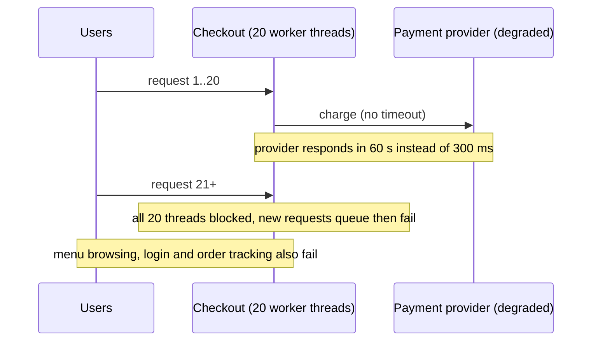
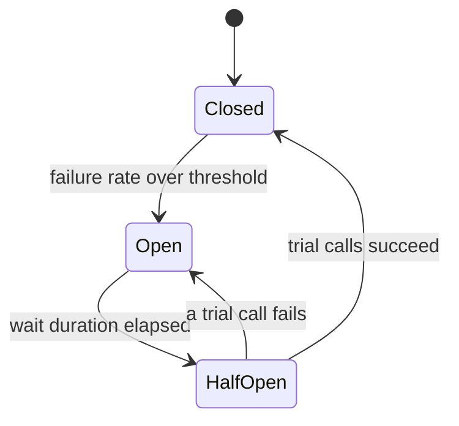
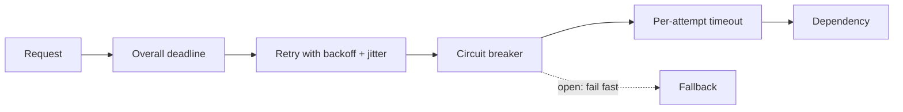

# Circuit Breaker, Retry and Timeout

## Introduction

Every remote call can be slow or fail. Three small patterns, used together, decide how your service behaves when that happens:

- A **timeout** limits how long you wait.
- A **retry** tries again when a failure is probably temporary.
- A **circuit breaker** stops calling a dependency that is clearly broken, so you fail fast and give it room to recover.

Get them right and a struggling payment provider causes a few slow checkouts. Get them wrong and the same incident takes down your whole platform, because threads pile up waiting, retries multiply the load, and the struggling provider never gets a chance to recover.

The electrical analogy is exact: a circuit breaker in your house trips when a fault draws too much current, protecting the wiring. You do not keep flipping it back on while the fault is still there; you wait, then try once.

These patterns were popularised by Michael Nygard's book *Release It!*, Martin Fowler's [CircuitBreaker](https://martinfowler.com/bliki/CircuitBreaker.html) article, and the Amazon Builders' Library article "Timeouts, retries, and backoff with jitter". The Azure Architecture Center documents [Retry](https://learn.microsoft.com/azure/architecture/patterns/retry) and [Circuit Breaker](https://learn.microsoft.com/azure/architecture/patterns/circuit-breaker) and recommends combining them.

## The Problem: A Slow Dependency Takes You Down



The "before" code looks innocent:

```python
import requests


def charge(order_id: str, amount: int) -> dict:
    # No timeout: requests will wait as long as the server keeps the connection open
    for attempt in range(5):
        try:
            resp = requests.post("https://payments.internal/charges",
                                 json={"order_id": order_id, "amount": amount})
            resp.raise_for_status()
            return resp.json()
        except requests.RequestException:
            continue                    # retry immediately, five times
    raise RuntimeError("payment failed")
```

Three problems hide here:

1. **No timeout.** The `requests` library does not time out unless you pass `timeout=`. A hung connection blocks a worker indefinitely.
2. **Immediate retries.** When the provider is overloaded, every client retries at once, multiplying load exactly when it hurts most.
3. **No memory.** Each request rediscovers that the provider is down, paying the full timeout every time.

## Timeouts

Set a timeout on **every** remote call: HTTP, database, cache, broker. Most client libraries let you set two separately:

- **Connect timeout:** how long to wait to establish a connection. Usually short.
- **Read (response) timeout:** how long to wait for data once connected.

```python
import requests

resp = requests.get("https://example.com", timeout=(3.05, 10))  # (connect, read) seconds
```

How long? The Amazon Builders' Library suggests picking an acceptable rate of false timeouts (say 0.1%) and setting the timeout near the matching latency percentile of the dependency (p99.9 in that example), with some padding. That requires **measuring** the dependency's latency first.

### Deadlines, not just timeouts

If checkout has a 2-second budget and calls three services in sequence, each with a 2-second timeout, the total can reach 6 seconds. A **deadline** is an absolute point in time that is passed along the call chain; each hop uses whatever time remains. gRPC supports deadlines natively and propagates them to downstream calls.

```python
import time


class DeadlineExceeded(Exception):
    pass


class Deadline:
    def __init__(self, seconds: float) -> None:
        self.expires_at = time.monotonic() + seconds

    def remaining(self) -> float:
        left = self.expires_at - time.monotonic()
        if left <= 0:
            raise DeadlineExceeded()
        return left


def call_service(name: str, work_seconds: float, deadline: Deadline) -> str:
    budget = deadline.remaining()
    timeout = min(budget, 1.0)                  # never wait longer than our own cap either
    if work_seconds > timeout:
        time.sleep(timeout)
        raise TimeoutError(f"{name} exceeded {timeout:.2f}s")
    time.sleep(work_seconds)
    return f"{name} ok ({budget:.2f}s budget left before call)"


d = Deadline(1.0)
for name, work in [("pricing", 0.3), ("inventory", 0.4), ("payments", 0.5)]:
    try:
        print(call_service(name, work, d))
    except (TimeoutError, DeadlineExceeded) as e:
        print("stop:", repr(e))
        break
```

Example output:

```text
pricing ok (1.00s budget left before call)
inventory ok (0.70s budget left before call)
stop: TimeoutError('payments exceeded 0.30s')
```

Payments was given only the 0.3 seconds left in the budget, instead of a fresh second that the user would never wait for.

## Retries Done Right

Retry only when **all** of these are true:

- The failure is likely **transient**: a connection reset, a timeout, HTTP 503, or 429 with a `Retry-After` header. Do not retry 400 Bad Request or 401 Unauthorized; they will fail the same way again.
- The operation is **idempotent**, or protected with an [idempotency key](./7-arch-idempotency.mdx).
- There is **time left** in the deadline.

And retry with:

- **A small maximum number of attempts** (often 2 or 3 in total).
- **Exponential backoff:** wait longer after each failure (for example 100 ms, 200 ms, 400 ms), with a cap.
- **Jitter:** randomise each wait, so thousands of clients that failed at the same moment do not retry in lockstep. The AWS Architecture Blog post "Exponential Backoff And Jitter" compared variants; "full jitter" (a random wait between 0 and the exponential value) is a common default.

```python
import random


def backoff_delays(attempts: int, base: float = 0.1, cap: float = 2.0,
                   rng: random.Random | None = None) -> list[float]:
    rng = rng or random.Random()
    delays = []
    for attempt in range(attempts):
        exp = min(cap, base * 2 ** attempt)
        delays.append(round(rng.uniform(0, exp), 3))      # full jitter
    return delays


rng = random.Random(42)
for client in ("client A", "client B", "client C"):
    print(client, backoff_delays(5, rng=rng))
```

Output:

```text
client A [0.064, 0.005, 0.11, 0.179, 1.178]
client B [0.068, 0.178, 0.035, 0.338, 0.048]
client C [0.022, 0.101, 0.011, 0.159, 1.04]
```

Without jitter all three clients would retry at exactly 0.1, 0.2, 0.4, 0.8 and 1.6 seconds, producing synchronised spikes.

### Retry amplification

Retries multiply across layers. If a request passes through five services and each retries 3 times (3 attempts), a failing database at the bottom can receive up to 3 to the power 5, or **243**, attempts for one user action. The Builders' Library uses exactly this example. Rules of thumb:

- **Retry at one layer**, usually the one closest to the caller or the one that knows the operation is safe to retry.
- Use a **retry budget**: allow retries only while they are a small fraction of total traffic (for example, a token bucket that retries consume and successes refill). The AWS SDKs implement this kind of client-side retry limiting.
- **Honour `Retry-After`** and 429 responses from servers.

## Circuit Breaker

A circuit breaker wraps calls to a dependency and tracks recent failures. It has three states:



- **Closed:** calls flow normally; outcomes are recorded.
- **Open:** calls fail immediately without touching the dependency (or return a fallback).
- **Half-open:** after a cool-down, a few trial calls are allowed. Success closes the circuit; failure opens it again.

### A circuit breaker in Python

The implementation below uses a sliding window of recent results and an injectable clock so the demo is deterministic.

```python
from collections import deque
from dataclasses import dataclass, field
from enum import Enum
from typing import Callable, TypeVar

T = TypeVar("T")


class State(Enum):
    CLOSED = "closed"
    OPEN = "open"
    HALF_OPEN = "half_open"


class CircuitOpenError(Exception):
    pass


@dataclass
class CircuitBreaker:
    name: str
    clock: Callable[[], float]
    window_size: int = 10              # how many recent calls to consider
    minimum_calls: int = 5             # do not judge on too little data
    failure_rate_threshold: float = 0.5
    open_seconds: float = 30.0
    half_open_trials: int = 2
    state: State = State.CLOSED
    _results: deque = field(default_factory=deque)
    _opened_at: float = 0.0
    _trial_successes: int = 0

    def call(self, fn: Callable[[], T]) -> T:
        if self.state is State.OPEN:
            if self.clock() - self._opened_at >= self.open_seconds:
                self._transition(State.HALF_OPEN)
            else:
                raise CircuitOpenError(f"{self.name} circuit is open")
        try:
            result = fn()
        except Exception:
            self._on_failure()
            raise
        self._on_success()
        return result

    def _record(self, ok: bool) -> None:
        self._results.append(ok)
        if len(self._results) > self.window_size:
            self._results.popleft()

    def _on_success(self) -> None:
        if self.state is State.HALF_OPEN:
            self._trial_successes += 1
            if self._trial_successes >= self.half_open_trials:
                self._transition(State.CLOSED)
            return
        self._record(True)

    def _on_failure(self) -> None:
        if self.state is State.HALF_OPEN:
            self._transition(State.OPEN)
            return
        self._record(False)
        failures = self._results.count(False)
        if len(self._results) >= self.minimum_calls and failures / len(self._results) >= self.failure_rate_threshold:
            self._transition(State.OPEN)

    def _transition(self, new: State) -> None:
        print(f"  [{self.name}] {self.state.value} -> {new.value}")
        self.state = new
        if new is State.OPEN:
            self._opened_at = self.clock()
        if new is State.HALF_OPEN:
            self._trial_successes = 0
        if new is State.CLOSED:
            self._results.clear()


# ----- demo with a fake clock and a dependency that goes down then recovers -----
now = [0.0]
provider_up = [True]


def charge() -> str:
    if not provider_up[0]:
        raise TimeoutError("provider timed out")
    return "charged"


cb = CircuitBreaker("payments", clock=lambda: now[0], open_seconds=30)


def attempt(label: str) -> None:
    try:
        print(f"t={now[0]:>4.0f}s {label}: {cb.call(charge)}")
    except CircuitOpenError as e:
        print(f"t={now[0]:>4.0f}s {label}: fast fail ({e})")
    except TimeoutError as e:
        print(f"t={now[0]:>4.0f}s {label}: error ({e})")


for i in range(3):
    attempt(f"req{i}")
provider_up[0] = False
for i in range(3, 9):
    now[0] += 1
    attempt(f"req{i}")
now[0] += 30
provider_up[0] = True
for i in range(9, 12):
    attempt(f"req{i}")
```

Output:

```text
t=   0s req0: charged
t=   0s req1: charged
t=   0s req2: charged
t=   1s req3: error (provider timed out)
t=   2s req4: error (provider timed out)
  [payments] closed -> open
t=   3s req5: error (provider timed out)
t=   4s req6: fast fail (payments circuit is open)
t=   5s req7: fast fail (payments circuit is open)
t=   6s req8: fast fail (payments circuit is open)
  [payments] open -> half_open
t=  36s req9: charged
  [payments] half_open -> closed
t=  36s req10: charged
t=  36s req11: charged
```

The breaker opened during `req5`, when 3 of the last 6 calls had failed (50%, with at least 5 calls recorded). From then on, calls failed instantly instead of waiting for timeouts. After the cool-down, two trial calls succeeded and traffic resumed.

### What to do when the circuit is open

Failing fast is only half the value. Decide on a **fallback** per call:

- Return cached or default data (show yesterday's menu photos).
- Degrade a feature (hide "estimated delivery time" if the routing service is down).
- Queue the work for later (accept the order, charge when the provider recovers, if the business allows).
- Return a clear error quickly, so the client can tell the user.

## Putting Them Together

The usual order, from outside in: **deadline/overall timeout, then retry, then circuit breaker, then per-attempt timeout, then the call.** The retry sees "circuit open" as a non-retriable error and stops.



### Libraries you will meet

You rarely need to write these yourself:

- **Java:** [Resilience4j](https://resilience4j.readme.io/) provides CircuitBreaker, Retry, TimeLimiter, Bulkhead and RateLimiter modules. Netflix Hystrix, its predecessor, has been in maintenance mode since 2018.
- **.NET:** Polly v8 "resilience pipelines", and `Microsoft.Extensions.Http.Resilience`, which adds a standard handler (rate limiter, total timeout, retry, circuit breaker, attempt timeout) to `HttpClient`.
- **Python:** `tenacity` for retries with backoff and jitter; `pybreaker` for circuit breakers.
- **Infrastructure:** service meshes and proxies such as Envoy and Istio can apply timeouts, retries and outlier detection (ejecting unhealthy instances) without code changes. See [Service Mesh and Sidecars](../10-arch-integration-and-apis/8-arch-service-mesh.mdx).

In Java, where these patterns are configured as decorators around a call, Resilience4j reads like this:

```java
import io.github.resilience4j.circuitbreaker.CircuitBreaker;
import io.github.resilience4j.circuitbreaker.CircuitBreakerConfig;
import io.github.resilience4j.core.IntervalFunction;
import io.github.resilience4j.retry.Retry;
import io.github.resilience4j.retry.RetryConfig;

import java.time.Duration;
import java.util.function.Supplier;

public class PaymentClient {
    private final CircuitBreaker breaker = CircuitBreaker.of("payments",
        CircuitBreakerConfig.custom()
            .failureRateThreshold(50)
            .slidingWindowSize(20)
            .minimumNumberOfCalls(10)
            .waitDurationInOpenState(Duration.ofSeconds(30))
            .permittedNumberOfCallsInHalfOpenState(3)
            .build());

    private final Retry retry = Retry.of("payments",
        RetryConfig.custom()
            .maxAttempts(3)
            .intervalFunction(IntervalFunction.ofExponentialRandomBackoff(Duration.ofMillis(200), 2.0))
            .build());

    public String charge(String orderId) {
        Supplier<String> call = () -> httpCharge(orderId);
        Supplier<String> guarded = Retry.decorateSupplier(retry,
            CircuitBreaker.decorateSupplier(breaker, call));
        return guarded.get();
    }

    private String httpCharge(String orderId) {
        return "charged " + orderId;   // real HTTP call with its own timeout goes here
    }
}
```

The decorators are the same idea you met in the [Decorator Pattern](../3-arch-structural-patterns/3-arch-decorator.mdx): each one wraps the call and adds a behaviour. Check the Resilience4j documentation for current defaults; for example its default `waitDurationInOpenState` is 60 seconds and default sliding window is 100 calls, which may be too large for a low-traffic service.

And with `tenacity` in Python:

```python
import random

from tenacity import retry, retry_if_exception_type, stop_after_attempt, wait_random_exponential

calls = {"n": 0}


@retry(stop=stop_after_attempt(3),
       wait=wait_random_exponential(multiplier=0.1, max=2),
       retry=retry_if_exception_type((TimeoutError, ConnectionError)),
       reraise=True)
def fetch_eta(order_id: str) -> int:
    calls["n"] += 1
    if random.random() < 0.5:
        raise TimeoutError("routing service slow")
    return 25


print(fetch_eta("o-1"), "minutes after", calls["n"], "call(s)")
```

Example output (varies by run):

```text
25 minutes after 2 call(s)
```

## Real-World Scenario

QuickBite depends on an external payment provider and an internal routing service that estimates delivery times. Last month the provider had a 20-minute brown-out with 30-second response times; checkout pods ran out of worker threads and the **whole app** went down, including browsing and order tracking.

### The design

- **Payments:** 3-second connect timeout and 8-second read timeout (based on measured p99.9 plus headroom), 2 attempts in total with full-jitter backoff, retries only on connection errors and 503, an idempotency key on every charge, and a circuit breaker that opens at 50% failures over the last 20 calls. When open, checkout shows "Payments are delayed, please try again in a minute" immediately.
- **Routing ETA:** 500 ms timeout, no retries (a stale estimate is fine), circuit breaker with a fallback to a static "30 to 45 minutes" estimate.
- **Bulkhead:** payments calls get their own limited thread pool so they cannot exhaust the workers serving browsing (see the [next page](./9-arch-bulkhead-and-rate-limiting.mdx)).
- Dashboards show breaker state changes, and an alert fires when any breaker stays open for more than 5 minutes.

### Why this approach

The outage was caused by **waiting** (no timeouts, no isolation) and **hammering** (immediate retries). Timeouts bound the wait, the breaker stops the hammering and enables fast fallbacks, and retries with jitter recover the many failures that really are brief.

### When to use it, and when not to

- **Timeouts:** always, on every remote call. There is no good reason to omit them.
- **Retries:** for transient failures on idempotent (or key-protected) operations, at one layer, with backoff, jitter and a budget. Not for validation errors, not for non-idempotent operations, and not on top of retries in lower layers.
- **Circuit breakers:** around dependencies that can fail for extended periods and where failing fast or a fallback is better than waiting. For in-process calls, or a dependency so critical that there is no alternative behaviour, a breaker adds little. At very low traffic the breaker may have too few calls to judge; tune the window and minimum-calls settings or rely on timeouts alone.

### Alternatives and trade-offs

| Approach | Pros | Cons | Best for |
| --- | --- | --- | --- |
| Timeouts only | Simple, bounds waiting | Still sends full load to a dead dependency | Low-traffic or non-critical calls |
| Timeouts + jittered retries | Recovers brief blips | Amplifies load during long outages | Transient network errors |
| + Circuit breaker | Fails fast, protects the dependency, enables fallbacks | More configuration and states to monitor | Critical external dependencies |
| Retry budget (token bucket) instead of breaker | Smooth behaviour, no hard on/off modes | Less common in libraries | High-volume internal RPC |
| Mesh-level policies (Envoy, Istio) | No code changes, consistent across languages | Less context about which operations are idempotent | Polyglot service fleets |
| Asynchronous queue instead of a call | Caller never waits | Eventual consistency, more infrastructure | Work that does not need an immediate answer |

## Common Mistakes

- **No timeout, or a default of minutes.** The single most common cause of cascading failures.
- **Retrying non-idempotent operations** without an idempotency key.
- **Retrying at every layer**, creating exponential amplification.
- **Retries without jitter**, causing synchronised retry storms.
- **Retrying on 4xx client errors** that will never succeed.
- **One breaker for many endpoints**, so a failing report endpoint blocks healthy payment calls. Scope breakers per dependency and, when needed, per operation.
- **No fallback and no monitoring** for open circuits.
- **Treating "circuit open" as a retriable error** in the outer retry loop.

## Summary

- Timeouts bound waiting; deadlines bound the whole request across hops.
- Retry only transient failures on idempotent operations, a few times, with exponential backoff and jitter, at one layer, within a budget.
- Circuit breakers move between closed, open and half-open to fail fast and let dependencies recover.
- Combine them in a deliberate order and define a fallback for every guarded call.
- Use proven libraries (Resilience4j, Polly, tenacity) or mesh policies rather than hand-rolling.

## Exercises

1. Add a `retry_with_backoff` function that wraps `cb.call` and stops immediately on `CircuitOpenError`. Show the combined behaviour with the fake clock.
2. Change the circuit breaker to also count **slow** calls (over a threshold duration) as failures.
3. Calculate the worst-case number of database calls for one user action in a system with 4 layers, each making 2 attempts. Then redesign so only the top layer retries.
4. Pick three dependencies of a service you know and write the timeout, retry and fallback policy for each, with a one-line reason.

### Related pages

- [Idempotency](./7-arch-idempotency.mdx).
- [Bulkheads, Rate Limiting and Backpressure](./9-arch-bulkhead-and-rate-limiting.mdx).
- [Designing for Reliability and Resilience](../12-arch-quality-and-operations/2-arch-reliability.mdx).
- [Decorator Pattern](../3-arch-structural-patterns/3-arch-decorator.mdx).
