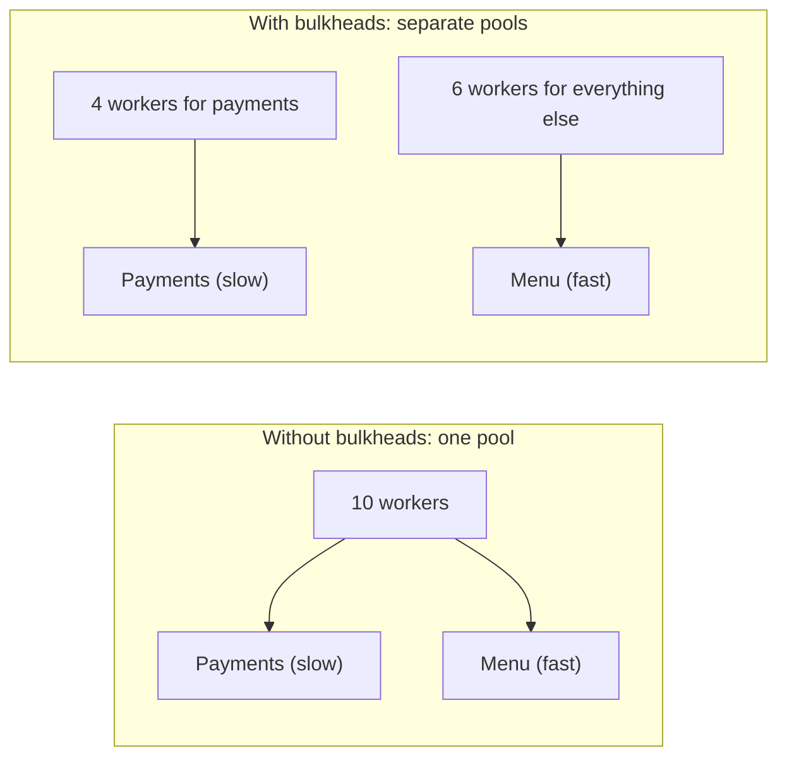
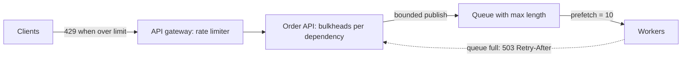

# Bulkheads, Rate Limiting and Backpressure

## Introduction

The [previous page](./8-arch-circuit-breaker.mdx) dealt with dependencies that **fail**. This page deals with **too much load**, whether it comes from users, from a misbehaving client, or from a fast part of your own system flooding a slow part. Three patterns work together:

- **Bulkheads** split resources into isolated pools so one overloaded part cannot sink the rest. The name comes from ships: watertight compartments mean a hole in one does not flood the whole hull.
- **Rate limiting** caps how many requests a client (or a whole service) may send per unit of time.
- **Backpressure** lets a slow consumer signal a fast producer to slow down, instead of buffering until memory runs out.

A restaurant analogy: the kitchen has separate stations (bulkheads), so a rush on desserts does not stop the grill. The host only seats so many tables per quarter hour (rate limiting). And when the kitchen is behind, the host stops seating people and the waiting list grows at the door, not inside the kitchen (backpressure).

The Azure Architecture Center documents [Bulkhead](https://learn.microsoft.com/azure/architecture/patterns/bulkhead), [Rate Limiting](https://learn.microsoft.com/azure/architecture/patterns/rate-limiting-pattern), [Throttling](https://learn.microsoft.com/azure/architecture/patterns/throttling) and [Queue-Based Load Leveling](https://learn.microsoft.com/azure/architecture/patterns/queue-based-load-leveling) as separate catalogue entries.

## Bulkheads

### The problem: one shared pool

Most web servers have one pool of workers (threads, processes or connections). If one slow dependency ties up every worker, all endpoints fail, even those that never call that dependency.



### Bulkheads with asyncio semaphores

In async Python, a bulkhead is usually a semaphore per dependency: at most N concurrent calls, and callers that cannot get a slot fail fast (or wait briefly) instead of queuing forever.

```python
import asyncio
import time


class BulkheadFull(Exception):
    pass


class Bulkhead:
    def __init__(self, name: str, max_concurrent: int, max_wait: float) -> None:
        self.name = name
        self.sem = asyncio.Semaphore(max_concurrent)
        self.max_wait = max_wait

    async def run(self, coro_fn, *args):
        try:
            await asyncio.wait_for(self.sem.acquire(), timeout=self.max_wait)
        except asyncio.TimeoutError:
            raise BulkheadFull(f"{self.name} bulkhead full") from None
        try:
            return await coro_fn(*args)
        finally:
            self.sem.release()


async def slow_payment(i: int) -> str:
    await asyncio.sleep(2.0)           # degraded provider
    return f"payment {i} ok"


async def fast_menu(i: int) -> str:
    await asyncio.sleep(0.05)
    return f"menu {i} ok"


async def main() -> None:
    payments = Bulkhead("payments", max_concurrent=3, max_wait=0.1)
    menu = Bulkhead("menu", max_concurrent=20, max_wait=0.1)
    start = time.monotonic()

    async def timed(label, coro):
        try:
            result = await coro
        except BulkheadFull as e:
            result = f"rejected: {e}"
        return f"{time.monotonic() - start:4.2f}s {label}: {result}"

    tasks = [timed(f"pay{i}", payments.run(slow_payment, i)) for i in range(5)]
    tasks += [timed(f"menu{i}", menu.run(fast_menu, i)) for i in range(3)]
    for line in sorted(await asyncio.gather(*tasks)):
        print(line)


asyncio.run(main())
```

Example output:

```text
0.05s menu0: menu 0 ok
0.05s menu1: menu 1 ok
0.05s menu2: menu 2 ok
0.10s pay3: rejected: payments bulkhead full
0.10s pay4: rejected: payments bulkhead full
2.00s pay0: payment 0 ok
2.00s pay1: payment 1 ok
2.00s pay2: payment 2 ok
```

Menu requests are served in 50 ms even though payments are stuck. The two extra payment calls are rejected after 0.1 seconds rather than piling up behind the slow ones.

### Bulkhead granularity

Bulkheads exist at many levels, from cheapest to most isolated:

| Level | Example | Isolation |
| --- | --- | --- |
| Semaphore per dependency | `asyncio.Semaphore`, Resilience4j `Bulkhead` | Concurrency only |
| Thread or connection pool per dependency | Separate HTTP client pools, database pools per workload | Threads and connections |
| Separate deployments per workload | Checkout pods separate from reporting pods | CPU, memory, crashes |
| Cells or deployment stamps | Each group of customers served by a full independent copy of the stack | Almost everything, including bad deploys |

Larger bulkheads cost more (idle capacity in each compartment), so match isolation to the cost of a shared failure. See the Azure [Deployment Stamps](https://learn.microsoft.com/azure/architecture/patterns/deployment-stamp) pattern for the cell-based extreme.

## Rate Limiting

Rate limiting protects a service from clients that send too much, whether by accident (a retry loop), by design (a batch job), or maliciously. When a client exceeds its limit, the server responds with **HTTP 429 Too Many Requests** (defined in RFC 6585), ideally with a `Retry-After` header saying when to try again.

### Algorithms

| Algorithm | How it works | Pros | Cons |
| --- | --- | --- | --- |
| Fixed window | Count requests per calendar minute | Trivial | Bursts at window edges (up to double the limit) |
| Sliding window log | Store a timestamp per request; count those within the last minute | Precise | Memory per request |
| Sliding window counter | Weighted mix of current and previous window counts | Cheap, smooth | Approximate |
| Token bucket | Tokens refill at a steady rate up to a capacity; each request spends one | Allows controlled bursts, simple | Burst size must be tuned |
| Leaky bucket | Requests enter a queue drained at a fixed rate | Very smooth output | Adds queuing delay |

The **token bucket** is the most widely used. It has two parameters: a refill **rate** (sustained requests per second) and a **capacity** (largest burst allowed).

```python
from dataclasses import dataclass, field
from typing import Callable


@dataclass
class TokenBucket:
    rate: float                    # tokens added per second
    capacity: float                # maximum burst
    clock: Callable[[], float]
    tokens: float = field(init=False)
    updated: float = field(init=False)

    def __post_init__(self) -> None:
        self.tokens = self.capacity
        self.updated = self.clock()

    def allow(self, cost: float = 1.0) -> tuple[bool, float]:
        """Return (allowed, seconds until enough tokens)."""
        now = self.clock()
        self.tokens = min(self.capacity, self.tokens + (now - self.updated) * self.rate)
        self.updated = now
        if self.tokens >= cost:
            self.tokens -= cost
            return True, 0.0
        return False, (cost - self.tokens) / self.rate


now = [0.0]
bucket = TokenBucket(rate=2, capacity=5, clock=lambda: now[0])   # 2 req/s, bursts of 5

for t, n in [(0.0, 7), (1.0, 3), (3.0, 6)]:
    now[0] = t
    results = []
    for _ in range(n):
        ok, wait = bucket.allow()
        results.append("200" if ok else f"429 (Retry-After {wait:.1f}s)")
    print(f"t={t}s:", ", ".join(results))
```

Output:

```text
t=0.0s: 200, 200, 200, 200, 200, 429 (Retry-After 0.5s), 429 (Retry-After 0.5s)
t=1.0s: 200, 200, 429 (Retry-After 0.5s)
t=3.0s: 200, 200, 200, 200, 429 (Retry-After 0.5s), 429 (Retry-After 0.5s)
```

At t=0 the full bucket absorbs a burst of 5. One second later only 2 tokens have refilled. After two quiet seconds, 4 tokens are back.

### Distributed rate limiting

With many API instances, an in-memory bucket per instance lets a client get N times the limit. Common solutions:

- **A shared counter in Redis**, updated atomically (a Lua script or `INCR` with `EXPIRE` for fixed windows). See the [Redis tutorial](/docs/middleware/redis).
- **Rate limiting at the edge**, in an API gateway or reverse proxy such as [NGINX](/docs/middleware/nginx) (`limit_req`) or [Kong](/docs/middleware/kong) (rate-limiting plugin). See [API Gateway and Backend for Frontend](../10-arch-integration-and-apis/4-arch-api-gateway.mdx).
- **Approximate local limits**: divide the global limit by the number of instances. Cheap, but inaccurate when instances scale or traffic is uneven.

### Telling clients about limits

Many APIs return headers such as `X-RateLimit-Limit` and `X-RateLimit-Remaining`, but these are conventions, not standards. The IETF HTTPAPI working group has an Internet-Draft, [RateLimit header fields for HTTP](https://datatracker.ietf.org/doc/draft-ietf-httpapi-ratelimit-headers/), whose recent revisions (revision 11, May 2026) define `RateLimit-Policy` and `RateLimit` fields. It is still a draft and its field names have changed between revisions, so check its status before adopting it. `Retry-After` on a 429 response **is** standard and widely understood.

### Choosing the limits

Limits picked by guesswork either block legitimate users or protect nothing. A practical process:

1. **Measure** current per-client request rates (p50, p99 and maximum per key) from access logs.
2. **Find capacity:** how many requests per second the service handles before latency degrades, from load tests.
3. **Set the sustained rate** comfortably above normal heavy usage, and the **burst** to cover legitimate spikes such as a mobile app syncing on startup.
4. **Start in "log only" mode,** recording who would have been limited, before enforcing.
5. **Publish the limits** in your API documentation and make them visible per key.

Different endpoints usually deserve different limits: a cheap read can allow far more than an expensive report or a login attempt (where tight limits also slow down password guessing).

### Rate limiting vs throttling vs load shedding

- **Rate limiting** is usually per client: "each API key may make 100 requests per minute".
- **Throttling** (as Azure uses the term) is the service reducing what it accepts when its own resources are under strain, possibly for all clients.
- **Load shedding** drops low-priority work when overloaded: reject analytics calls first and keep checkout. The Amazon Builders' Library article "Using load shedding to avoid overload" is a good deep dive.

## Backpressure

Backpressure applies inside a pipeline. If a producer generates work faster than a consumer can process it, something must give. Options:

1. **Buffer without limit:** memory grows until the process crashes. Never do this.
2. **Drop:** discard new or old items (fine for metrics, bad for orders).
3. **Backpressure:** make the producer wait, or tell it to slow down.

The simplest implementation is a **bounded queue**: when it is full, the producer blocks (or gets an error) until the consumer catches up.

```python
import asyncio
import time


async def producer(queue: asyncio.Queue, start: float) -> None:
    for i in range(6):
        t0 = time.monotonic()
        await queue.put(i)                    # blocks while the queue is full
        waited = time.monotonic() - t0
        note = f" (waited {waited:.1f}s for space)" if waited > 0.05 else ""
        print(f"{time.monotonic() - start:4.1f}s produced location update {i}{note}")
    await queue.put(None)


async def consumer(queue: asyncio.Queue, start: float) -> None:
    while (item := await queue.get()) is not None:
        await asyncio.sleep(0.5)              # slow processing (e.g. database write)
        print(f"{time.monotonic() - start:4.1f}s   consumed {item}")


async def main() -> None:
    queue: asyncio.Queue = asyncio.Queue(maxsize=2)   # bounded
    start = time.monotonic()
    await asyncio.gather(producer(queue, start), consumer(queue, start))


asyncio.run(main())
```

Example output:

```text
 0.0s produced location update 0
 0.0s produced location update 1
 0.0s produced location update 2
 0.5s   consumed 0
 0.5s produced location update 3 (waited 0.5s for space)
 1.0s   consumed 1
 1.0s produced location update 4 (waited 0.5s for space)
 1.5s   consumed 2
 1.5s produced location update 5 (waited 0.5s for space)
 2.0s   consumed 3
 2.5s   consumed 4
 3.0s   consumed 5
```

The producer automatically slows to the consumer's pace. Memory use is bounded by the queue size.

Backpressure appears throughout the stack:

- **TCP flow control** slows a sender when the receiver's buffer fills.
- **Reactive Streams** (Java `Flow`, Project Reactor, RxJava) let subscribers request a specific number of items.
- **Pull-based consumers** (Kafka consumers polling, RabbitMQ prefetch limits) only take what they can handle. See [Messaging Patterns](../10-arch-integration-and-apis/5-arch-messaging-patterns.mdx).
- **HTTP 429 and 503 with `Retry-After`** are backpressure signals across service boundaries.



## Real-World Scenario

QuickBite offers a public API to restaurant partners for updating menus and reading orders. During Friday lunch rush, one partner's integration bug caused a tight retry loop: thousands of requests per second. The API's database connections were exhausted and customer checkout slowed down too.

### The design

1. **Per-partner rate limits** at the API gateway: a token bucket per API key (for example 10 requests per second, bursts of 50), returning 429 with `Retry-After`. Larger partners can buy higher limits.
2. **Bulkheads:** the partner API runs as a separate deployment with its own database connection pool, so even a partner flood within limits cannot touch checkout's connections.
3. **Backpressure for menu imports:** bulk menu uploads go to a bounded queue processed by workers; when the queue is full the API returns 503 with `Retry-After` instead of accepting unbounded work.
4. **Load shedding:** under extreme load, the gateway rejects reporting endpoints before order endpoints.

### Why this approach

The incident had two parts: one client consuming far more than its fair share (rate limiting fixes that) and shared resources letting that client hurt unrelated users (bulkheads fix that). Backpressure stops the same thing happening internally with bulk imports.

### When to use it, and when not to

- **Rate limits:** on any API exposed to clients you do not control, and on expensive internal endpoints. Internal service-to-service limits are useful but must be coordinated with callers' retry policies.
- **Bulkheads:** when one workload or dependency can starve others of a shared resource. Do not split every endpoint into its own pool; each split leaves idle capacity and needs tuning.
- **Backpressure:** wherever producers and consumers run at different speeds. Prefer it to unbounded buffers everywhere.

### Alternatives and trade-offs

| Approach | Pros | Cons | Best for |
| --- | --- | --- | --- |
| Autoscaling only | No client-visible errors | Slow to react, costly, does not stop abuse | Predictable, legitimate growth |
| Per-client rate limits | Fairness, abuse protection | Clients must handle 429 | Public and partner APIs |
| Global throttling / load shedding | Protects the service as a whole | Can reject good traffic | Overload emergencies |
| Bulkheads | Contains blast radius | Idle reserved capacity, tuning | Mixed critical and non-critical workloads |
| Queue-based load leveling | Absorbs spikes smoothly | Latency, eventual processing | Work that can be asynchronous |
| Bounded queues with backpressure | Bounded memory, natural pacing | Producers must handle waiting or rejection | Internal pipelines |

## Common Mistakes

- **Unbounded queues and buffers**, which turn overload into an out-of-memory crash minutes later.
- **Per-instance rate limits** that multiply the real limit when you scale out.
- **Returning 500 instead of 429**, so clients retry immediately instead of backing off.
- **Rate limiting without telling clients the limits**, or without `Retry-After`.
- **Bulkhead sizes chosen by guesswork.** Base them on measured concurrency (roughly throughput multiplied by latency) and revisit after changes.
- **Retry policies that ignore 429**, turning a rate limit into a retry storm.

## Summary

- Bulkheads isolate resources so one overloaded part cannot exhaust shared capacity.
- Rate limiting caps client traffic; the token bucket is the usual algorithm; respond with 429 and `Retry-After`.
- Distributed limits need a shared store (such as Redis) or enforcement at the gateway.
- Backpressure bounds work in progress; a bounded queue is the simplest form.
- Combine them with timeouts and circuit breakers for a complete overload strategy.

## Exercises

1. Implement a sliding-window-log limiter and compare it with the token bucket for a burst of 10 requests at t=0 and 10 more at t=0.9 seconds.
2. Change the bulkhead demo so rejected payment calls fall back to "queue the charge for later" instead of failing.
3. Modify the backpressure demo so the producer uses `put_nowait` and drops the **oldest** location update when the queue is full. When is that better than blocking?
4. Design rate-limit tiers for a public API with free, standard and enterprise plans, including burst sizes and what headers you return.

### Related pages

- [Circuit Breaker, Retry and Timeout](./8-arch-circuit-breaker.mdx).
- [Service Discovery and Load Balancing](./10-arch-service-discovery.mdx).
- [Designing for Scalability](../12-arch-quality-and-operations/0-arch-scalability.mdx).
- [Case Study: Multi-Tenant SaaS](../14-arch-case-studies/6-arch-case-saas-multitenancy.mdx), where per-tenant limits matter.
