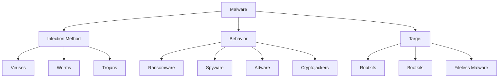
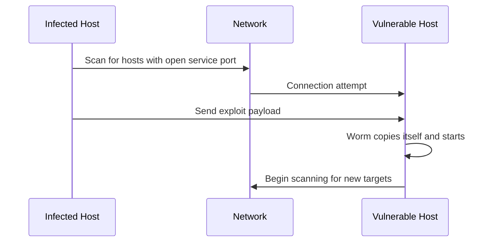

# Malware Types

## Introduction

Malware, short for "malicious software," refers to any software specifically designed to damage, disrupt, or gain unauthorized access to computer systems. As a beginning programmer, understanding different types of malware is crucial for developing secure applications and protecting your systems.

In this guide, we'll explore the most common types of malware, how they function, their potential impacts, and fundamental protection strategies. This knowledge forms an essential foundation for anyone entering the world of programming.

## Common Types of Malware

Malware can be grouped by how it spreads, what it does once it runs, and which part of the system it targets. Many real-world samples combine several of these traits.



## Malware Classified by Infection Method

### Viruses

A **virus** attaches itself to a legitimate program or file (the *host*). It cannot run on its own: it executes only when the infected host is run, and then copies itself into other files.

Key characteristics:

- Requires user action (running a program, opening a document) to activate
- Modifies existing executable files, boot sectors, or documents with macros
- Spreads when infected files are shared

A simple way to see why viruses modify files is to look at how file-integrity checking detects them. The following Python script records a SHA-256 hash for each file in a directory and later reports any file whose contents have changed:

```python
import hashlib
import json
import os
import sys

def hash_file(path):
    sha = hashlib.sha256()
    with open(path, "rb") as f:
        for chunk in iter(lambda: f.read(8192), b""):
            sha.update(chunk)
    return sha.hexdigest()

def scan(directory):
    hashes = {}
    for root, _, files in os.walk(directory):
        for name in files:
            full = os.path.join(root, name)
            hashes[full] = hash_file(full)
    return hashes

if __name__ == "__main__":
    mode, directory = sys.argv[1], sys.argv[2]
    if mode == "baseline":
        with open("baseline.json", "w") as f:
            json.dump(scan(directory), f, indent=2)
        print("Baseline saved.")
    elif mode == "check":
        with open("baseline.json") as f:
            baseline = json.load(f)
        current = scan(directory)
        for path, digest in current.items():
            if path not in baseline:
                print(f"NEW FILE:  {path}")
            elif baseline[path] != digest:
                print(f"MODIFIED:  {path}")
```

Example run:

```bash
$ python3 integrity.py baseline /usr/local/bin
Baseline saved.
$ python3 integrity.py check /usr/local/bin
MODIFIED:  /usr/local/bin/backup-tool
```

Tools such as AIDE and Tripwire work on the same principle, with protected storage for the baseline so that malware cannot simply rewrite it.

### Worms

A **worm** is self-contained and spreads on its own across networks, usually by exploiting a vulnerability in a network service. No user action is needed.

- Spreads automatically from machine to machine
- Often consumes large amounts of bandwidth while scanning for new targets
- Famous examples include the Morris worm (1988), which exploited flaws in Unix services, and WannaCry (2017), which spread via a Windows SMB vulnerability



### Trojans

A **Trojan horse** pretends to be useful software (a free game, a cracked application, a fake update) while performing hidden malicious actions. Unlike viruses and worms, Trojans do not replicate; they rely on tricking the user into installing them.

Common Trojan payloads include:

- **Backdoors** that give an attacker remote access
- **Downloaders** that fetch additional malware
- **Banking Trojans** that steal credentials from web sessions

## Malware Classified by Behavior

### Ransomware

**Ransomware** encrypts the victim's files (or locks the system) and demands payment for the decryption key. Modern ransomware often also steals data first and threatens to publish it ("double extortion").

The most effective defense is a tested backup strategy, commonly summarized as the **3-2-1 rule**: three copies of the data, on two different types of media, with one copy offline or off-site.

### Spyware

**Spyware** secretly collects information about the user: browsing habits, keystrokes (keyloggers), screenshots, or credentials, and sends it to a third party.

### Adware

**Adware** displays unwanted advertisements, redirects searches, or injects ads into web pages. It is often bundled with free software. While usually less harmful than other malware, it degrades performance and can open the door to more dangerous infections.

### Cryptojackers

A **cryptojacker** uses the victim's CPU or GPU to mine cryptocurrency for the attacker. Typical symptoms are unexplained high CPU usage, fan noise, and overheating. Cryptojacking can also run inside a browser through malicious JavaScript on a compromised website.

## Malware Classified by Target

### Rootkits

A **rootkit** is designed to hide the presence of malware by modifying the operating system itself. Kernel-mode rootkits can intercept system calls so that malicious files, processes, and network connections do not appear in tools like `ls`, `ps`, or `netstat`.

Because the infected OS can no longer be trusted, rootkits are usually detected by scanning from outside the running system (for example, booting from clean media) or by comparing different views of the same data.

### Bootkits

A **bootkit** is a rootkit that infects the boot process, such as the Master Boot Record (MBR) or the UEFI firmware. It loads before the operating system, so it can compromise the OS from the very start. **Secure Boot**, which verifies digital signatures of boot components, is the main OS-level protection against bootkits.

### Fileless Malware

**Fileless malware** runs entirely in memory and abuses legitimate system tools (such as PowerShell or WMI on Windows) instead of writing an executable to disk. Since there is no malicious file to scan, traditional signature-based antivirus has difficulty detecting it. Behavior monitoring and logging of script execution are more effective defenses.

## Comparison of Malware Types

| Type | Self-replicating | Needs user action | Primary goal |
| --- | --- | --- | --- |
| Virus | Yes (into host files) | Yes | Spread and damage |
| Worm | Yes (over network) | No | Spread rapidly |
| Trojan | No | Yes | Gain access, deliver payload |
| Ransomware | Varies | Varies | Extort money |
| Spyware | No | Usually | Steal information |
| Adware | No | Usually | Display ads for revenue |
| Cryptojacker | No | Varies | Steal computing resources |
| Rootkit | No | No (after install) | Hide and maintain access |
| Fileless | No | Varies | Evade detection |

## How Malware Is Detected

Operating systems and security tools use several complementary techniques:

1. **Signature-based detection**: compares files against a database of known malware patterns. Fast and accurate for known threats, but useless against new variants.
2. **Heuristic analysis**: looks for suspicious code structures or instructions, catching some unknown malware at the cost of more false positives.
3. **Behavioral detection**: monitors what programs do at runtime (for example, encrypting many files quickly, or injecting code into other processes).
4. **Sandboxing**: runs suspicious programs in an isolated environment and observes their behavior before allowing them on the real system.
5. **Integrity checking**: detects unauthorized changes to system files, as shown in the script above.

## Protection Strategies

### OS-Level Protections

- **Least privilege**: run applications and daily work with a non-administrator account so malware cannot modify system files
- **Patch management**: apply security updates promptly; most worms exploit vulnerabilities that already have fixes
- **Memory protections**: features such as Address Space Layout Randomization (ASLR) and Data Execution Prevention (DEP/NX) make exploitation harder
- **Application allowlisting**: only permit approved programs to run
- **Secure Boot**: verify the integrity of the boot chain

### Practices for Programmers

- Validate all input to avoid giving malware an entry point through your own code
- Verify the checksums or signatures of dependencies and downloaded tools
- Keep third-party libraries up to date and monitor them for known vulnerabilities
- Never commit credentials to source code repositories
- Sign your own releases so users can confirm they have not been tampered with

For example, verifying a downloaded file against its published checksum on Linux:

```bash
sha256sum downloaded-tool.tar.gz
# Compare the output against the checksum published by the vendor

# Or, if the vendor provides a checksum file:
sha256sum -c downloaded-tool.tar.gz.sha256
```

## Summary

Malware comes in many forms, and understanding the differences helps you choose the right defenses:

- **Viruses, worms, and Trojans** differ in how they spread: by infecting files, by exploiting networks, or by deceiving users.
- **Ransomware, spyware, adware, and cryptojackers** are defined by what they do once installed.
- **Rootkits, bootkits, and fileless malware** focus on hiding deep in the system or avoiding the file system altogether.

No single tool stops every threat. Effective protection combines OS mechanisms (least privilege, patching, Secure Boot, memory protections), detection techniques (signatures, behavior monitoring, integrity checking), and secure development practices.

## Exercises

1. Explain the difference between a virus and a worm, and give one example of a defense that is effective against worms but not viruses.
2. Run the integrity-checking script above on a test directory, modify one file, and confirm that it is reported.
3. Research how Secure Boot verifies the boot chain and describe which malware type it is designed to stop.
4. Why is fileless malware harder for signature-based antivirus to detect? List two alternative detection methods.
5. Design a backup plan for a small office that would allow recovery from a ransomware attack without paying the ransom.

## Additional Resources

- [OWASP Top Ten](https://owasp.org/www-project-top-ten/)
- [NIST Cybersecurity Framework](https://www.nist.gov/cyberframework)
- [MITRE ATT&CK](https://attack.mitre.org/)
