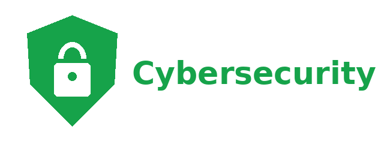
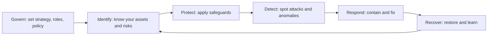
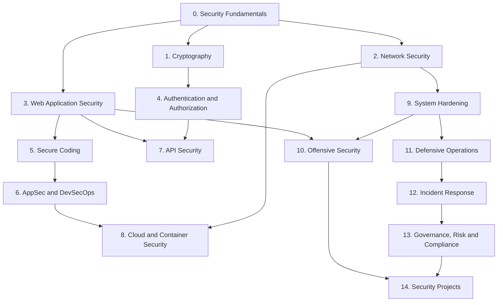
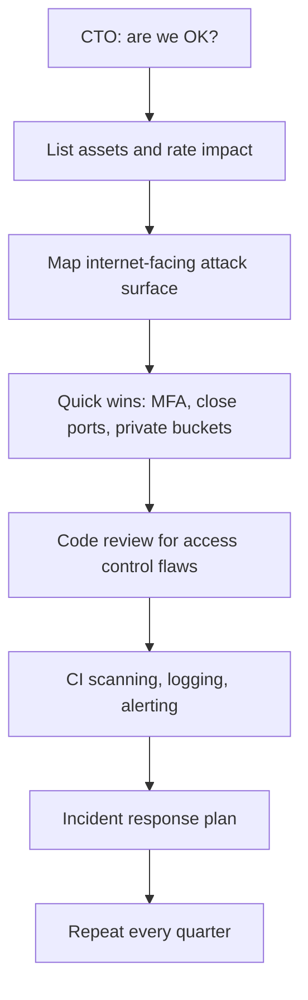

# Cybersecurity Introduction

<div style={{
    "width": "30%",
    "margin": "0 auto",
    "text-align": "center"
}}>
    
</div>

## Introduction

**Cybersecurity** is the practice of protecting systems, networks, software, and data from people who want to read, change, or break them without permission. For a developer or an IT beginner, that sounds like someone else's job. It is not. Most real-world breaches start with an ordinary engineering decision: a database left open to the internet, an API that forgets to check who owns a record, a password stored in plain text, a dependency that nobody updated, or a log that nobody read.

This tutorial teaches security from the **builder and defender** point of view. You will learn how common attacks work so that you can prevent them, detect them when prevention fails, and respond well when something goes wrong. You will see vulnerable code next to fixed code, configure real defensive tools, and practice offensive techniques only against deliberately vulnerable targets in your own lab.

A useful way to think about it:

- **Building software without security** is like building a house without locks, smoke alarms, or insurance. It works fine until the first bad day.
- **Security as a bolt-on** is like adding locks after the house is finished. Some doors never quite close.
- **Security by design** is planning the locks, the fire exits, and the alarm system along with the floor plan. It costs less and works better.

The rest of this page explains what you will learn, how the tutorial is organized, and the ethical rules every page follows.

:::warning Ethics and the law come first
Everything in this tutorial is for defending systems you are responsible for and for learning in safe environments.

- **Only test systems you own or have explicit written permission to test.** Scanning, probing, or attacking someone else's system without permission is illegal in most countries, even if you "did not break anything" and even if your intentions were good.
- Practice offensive techniques only against **deliberately vulnerable targets**: OWASP Juice Shop, DVWA, WebGoat, or Metasploitable running in your own lab, or legal platforms such as PortSwigger Web Security Academy, TryHackMe, and Hack The Box.
- If you find a vulnerability in a real product by accident, report it responsibly. [Ethics, Law and Responsible Disclosure](./8-sec-ethics-and-law.mdx) explains how.

This is not legal advice. Laws differ by country, so check the rules where you live and work.
:::

## Why Security Matters for Every Engineer

Security problems are mostly software and configuration problems. The [OWASP Top 10](https://owasp.org/Top10/2025/) is the most widely used list of web application risks. Its 2025 edition is led by **Broken Access Control** and **Security Misconfiguration**, followed by **Software Supply Chain Failures**. None of those is an exotic hacking trick. They are the result of missing checks, unsafe defaults, and unmanaged dependencies, all of which are decided by the people who build and run software.

Three trends make this knowledge more important every year:

1. **Everything is connected.** Applications talk to dozens of APIs, cloud services, and third-party packages. Each connection is a path an attacker can try.
2. **Attackers automate.** Bots scan the whole internet for exposed services and leaked keys continuously. A misconfigured server can be found within hours of going online.
3. **Regulation is catching up.** Laws such as the EU Cyber Resilience Act and data protection rules such as GDPR now place security duties directly on companies that build software. Security is becoming part of "done", not an optional extra.

:::note
You do not need to become a full-time security specialist. The goal of this tutorial is to make you the engineer on your team who notices the missing authorization check in code review, knows why passwords need a slow hash, and can read an alert without panicking.
:::

## A First Look: Thinking Like a Defender

Here is a small taste of defensive work. The script below reads a few lines from an authentication log and flags any IP address with five or more failed logins. Real systems use a SIEM (Security Information and Event Management) platform for this, but the idea is the same: **collect events, look for patterns that suggest an attack, and raise an alert**.

```python
from collections import Counter

# A few lines from a web app's authentication log (made up for practice).
LOG = """\
2026-10-11T09:00:01Z login_failed user=alice ip=203.0.113.7
2026-10-11T09:00:02Z login_failed user=admin ip=198.51.100.23
2026-10-11T09:00:02Z login_failed user=root ip=198.51.100.23
2026-10-11T09:00:03Z login_failed user=test ip=198.51.100.23
2026-10-11T09:00:03Z login_failed user=guest ip=198.51.100.23
2026-10-11T09:00:04Z login_failed user=oracle ip=198.51.100.23
2026-10-11T09:00:09Z login_ok     user=alice ip=203.0.113.7
"""

THRESHOLD = 5  # failed logins from one IP before we raise an alert

failures = Counter()
users_tried = {}
for line in LOG.splitlines():
    fields = dict(part.split("=", 1) for part in line.split()[2:])
    if "login_failed" in line:
        failures[fields["ip"]] += 1
        users_tried.setdefault(fields["ip"], set()).add(fields["user"])

for ip, count in failures.items():
    if count >= THRESHOLD:
        names = ", ".join(sorted(users_tried[ip]))
        print(f"ALERT: {count} failed logins from {ip} for users: {names}")
    else:
        print(f"ok: {count} failed login(s) from {ip}")
```

Output:

```text
ok: 1 failed login(s) from 203.0.113.7
ALERT: 5 failed logins from 198.51.100.23 for users: admin, guest, oracle, root, test
```

Notice what the alert tells you. One address tried five *different* common account names in a few seconds. That pattern is called **password spraying** or **credential guessing**, and it looks very different from Alice mistyping her password once. Recognizing patterns like this, and then choosing the right control (rate limiting, multi-factor authentication, account lockout, or blocking), is the kind of judgment this tutorial builds.

The IP addresses here come from ranges reserved for documentation (RFC 5737), so they never belong to a real host. You will see these ranges throughout the tutorial.

## The Security Lifecycle at a Glance

Security is not one activity. It is a loop that runs for as long as a system exists. The [NIST Cybersecurity Framework (CSF) 2.0](https://www.nist.gov/cyberframework) describes this loop with six functions: **Govern, Identify, Protect, Detect, Respond, and Recover**.



Each section of this tutorial maps onto this loop. Cryptography, authentication, secure coding, and hardening are mostly **Protect**. Logging, SIEM, and threat hunting are **Detect**. Incident response and forensics are **Respond** and **Recover**. Risk management and compliance are **Govern** and **Identify**.

## What You'll Learn

The tutorial has 15 sections. Each one builds on the fundamentals, but you can jump to any section once you know the basics.

| # | Section | What it covers | Start here |
|---|---------|----------------|------------|
| 0 | Security Fundamentals | CIA triad, risk, attack surface, defense in depth, zero trust, design principles, kill chains, ethics, careers | [The CIA Triad](./1-sec-cia-triad.mdx) |
| 1 | Cryptography | Hashing, password hashing, symmetric and asymmetric encryption, signatures, PKI, TLS, key management, post-quantum | [Cryptography Introduction](../1-sec-cryptography/0-sec-crypto-introduction.mdx) |
| 2 | Network Security | Firewalls, segmentation, VPNs, DNS security, IDS/IPS, DDoS, wireless, packet analysis, Nmap | [Network Security Introduction](../2-sec-network-security/0-sec-network-security-introduction.mdx) |
| 3 | Web Application Security | OWASP Top 10, access control, SQL injection, XSS, CSRF, SSRF, security headers, file uploads | [Web Security Introduction](../3-sec-web-security/0-sec-web-security-introduction.mdx) |
| 4 | Authentication and Authorization | Passwords, MFA, passkeys, sessions, JWT, OAuth 2.0, OpenID Connect, SAML, RBAC and ABAC | [Authentication vs Authorization](../4-sec-authentication/0-sec-authn-vs-authz.mdx) |
| 5 | Secure Coding | Input validation, error handling, secrets, memory safety, race conditions, secure defaults, code review | [Secure Coding Introduction](../5-sec-secure-coding/0-sec-secure-coding-introduction.mdx) |
| 6 | AppSec and DevSecOps | Secure SDLC, threat modeling, SAST, DAST, SCA, supply chain, SBOMs, signing, CI/CD security | [Secure Software Development Lifecycle](../6-sec-appsec-and-devsecops/0-sec-sdlc.mdx) |
| 7 | API Security | OWASP API Top 10, BOLA, rate limiting, schema validation, GraphQL, webhooks, gateways and WAFs | [API Security Introduction](../7-sec-api-security/0-sec-api-security-introduction.mdx) |
| 8 | Cloud and Container Security | Shared responsibility, cloud IAM, misconfigurations, storage, container images, Kubernetes, IaC, CSPM | [The Shared Responsibility Model](../8-sec-cloud-and-container/0-sec-cloud-shared-responsibility.mdx) |
| 9 | System Hardening | Linux and Windows hardening, SSH, patching, EDR, CIS Benchmarks, backups and ransomware resilience | [Linux Hardening](../9-sec-system-hardening/0-sec-linux-hardening.mdx) |
| 10 | Offensive Security | Pentest methodology, safe labs, recon, scanning, Burp Suite, exploitation and privilege escalation concepts, CTFs, bug bounties | [Penetration Testing Introduction](../10-sec-offensive-security/0-sec-pentest-introduction.mdx) |
| 11 | Defensive Security Operations | The SOC, logging and SIEM, detection engineering, MITRE ATT&CK, threat intel, hunting, vulnerability management | [The Security Operations Center](../11-sec-defensive-operations/0-sec-soc.mdx) |
| 12 | Incident Response and Forensics | IR lifecycle, playbooks, forensics basics, log investigation, postmortems, business continuity | [Incident Response Lifecycle](../12-sec-incident-response/0-sec-incident-response-lifecycle.mdx) |
| 13 | Governance, Risk and Compliance | Risk management, NIST CSF, ISO 27001, CIS Controls, SOC 2, PCI DSS, GDPR, privacy, AI security | [Risk Management](../13-sec-governance/0-sec-risk-management.mdx) |
| 14 | Security Projects | Eight hands-on projects, from a secure login system to a production capstone | [Project: Building a Secure Login System](../14-sec-projects/0-sec-project-secure-login.mdx) |

### Section highlights

- **Fundamentals (section 0)** gives you the vocabulary and mental models that every other page uses: confidentiality, integrity, availability, risk, attack surface, and layered defense.
- **Cryptography and authentication (sections 1 and 4)** teach you to use the right primitives correctly, which mostly means *not* inventing your own.
- **Web, API, and secure coding (sections 3, 5, and 7)** are the core for application developers. Every vulnerability is shown as vulnerable code next to fixed code.
- **DevSecOps, cloud, and hardening (sections 6, 8, and 9)** cover the pipeline and the infrastructure your code runs on.
- **Offensive security (section 10)** teaches how attackers work, inside a legal lab, so your defenses are realistic.
- **Defense, incident response, and governance (sections 11 to 13)** cover what happens after deployment: watching, responding, and managing risk at the organization level.
- **Projects (section 14)** put it all together.

## Learning Path



### Suggested routes

Not everyone needs every page in order. Pick the route that matches your goal:

| Your goal | Suggested route |
|-----------|-----------------|
| Write safer web applications | Sections 0, 3, 4, 5, then [Project: Auditing and Fixing a Vulnerable Web App](../14-sec-projects/1-sec-project-vulnerable-app-audit.mdx) |
| Build and secure APIs | Sections 0, 4, 7, then [Schema Validation for APIs](../7-sec-api-security/4-sec-api-input-validation.mdx) |
| Secure a CI/CD pipeline and cloud deployment | Sections 0, 6, 8, then [Project: DevSecOps Pipeline](../14-sec-projects/3-sec-project-devsecops-pipeline.mdx) |
| Run servers safely as a sysadmin or SRE | Sections 0, 2, 9, 11, then [Project: Hardening a Linux Server](../14-sec-projects/5-sec-project-hardened-server.mdx) |
| Explore a career in security operations | Sections 0, 2, 11, 12, then [Project: Detecting Attacks from Logs](../14-sec-projects/4-sec-project-log-monitoring.mdx) |
| Explore penetration testing | Sections 0, 2, 3, 10 (lab first), then capture-the-flag practice |
| Make security decisions as a tech lead or manager | Section 0, then skim 6, 12, and 13 |

## Prerequisites

:::info Prerequisites
You will get the most from this tutorial if you have:

- **Basic programming**, ideally in Python. Most examples use Python with Flask or FastAPI. Frontend topics use a little JavaScript.
- **Comfort with a terminal**: running commands, editing files, and installing packages.
- **Basic networking**: IP addresses, ports, DNS, and HTTP requests and responses. The [Computer Networks tutorial](/docs/fundamental/network) covers these if you need a refresher.
- **Basic Linux**: users, permissions, and services. The [Ubuntu tutorial](/docs/os/ubuntu) is a good companion.

You do **not** need prior security experience or advanced math. The cryptography section explains what you need to *use* crypto correctly, not how to design it.
:::

Later sections also use Docker for practice labs and some Kubernetes and Terraform for cloud topics. If those are new to you, see the [Docker](/docs/devops/docker), [Kubernetes](/docs/devops/kubernetes), and [Terraform](/docs/devops/terraform) tutorials.

## Setting Up a Safe Practice Environment

You will build a proper lab in [Building a Safe Practice Lab](../10-sec-offensive-security/1-sec-lab-setup.mdx). If you want to try something today, the quickest safe target is **OWASP Juice Shop**, an intentionally insecure web shop. It runs in Docker and listens only on your own machine:

```bash
docker pull bkimminich/juice-shop
# Bind to 127.0.0.1 so the vulnerable app is NOT reachable from your network
docker run --rm -p 127.0.0.1:3000:3000 bkimminich/juice-shop
```

Example output (trimmed):

```text
info: All dependencies in ./package.json are satisfied (OK)
info: Server listening on port 3000
```

Open `http://127.0.0.1:3000` in your browser. Everything you do to Juice Shop is legal because it is your own copy of software designed to be attacked.

:::warning
Never expose a deliberately vulnerable application to the internet or your office network. Bind it to `127.0.0.1`, run it in an isolated virtual machine, and stop it when you are done. A vulnerable lab that anyone can reach is a gift to real attackers.
:::

## Key Standards You Will Meet

Security relies on shared standards. These come up again and again in this tutorial. Versions change, so each page links the official source.

| Standard | Maintained by | What it is | Where it appears |
|----------|---------------|------------|------------------|
| OWASP Top 10 (2025) | OWASP | The most critical web application security risks | Sections 3 and 5 |
| OWASP API Security Top 10 (2023) | OWASP | The most critical API risks | Section 7 |
| OWASP ASVS | OWASP | A detailed checklist of application security requirements | Sections 5 and 6 |
| NIST Cybersecurity Framework 2.0 | NIST | Organization-wide security outcomes in six functions | Sections 0 and 13 |
| NIST SP 800-63B | NIST | Digital identity guidelines for passwords and authenticators | Section 4 |
| MITRE ATT&CK | MITRE | Knowledge base of real attacker tactics and techniques | Sections 0 and 11 |
| CVSS v4.0 | FIRST | Scoring system for vulnerability severity | Section 11 |
| CIS Controls and Benchmarks | Center for Internet Security | Prioritized safeguards and hardening baselines | Sections 9 and 13 |

## How Each Page Is Organized

Every page in this tutorial follows the same shape, so you always know where to look:

| Part | What you get |
|------|--------------|
| Introduction | What the topic is, in plain language, often with an analogy |
| Concept sections | The idea built up step by step, with diagrams |
| Code and config examples | Small, runnable examples. Where it applies, **Vulnerable** code is shown next to **Fixed** code |
| Real-World Scenario | A concrete situation, the solution, **why** it fits, **when** to use it or not, and a table of **alternatives and trade-offs** |
| Common Mistakes or Best Practices | Pitfalls that catch real teams |
| Summary | A short recap |
| Further Learning | Exercises and links to related pages |

The Real-World Scenario is the most important part of each page. Security is full of trade-offs: a web application firewall versus a code fix, session cookies versus tokens, blocking an attacker versus watching them. Knowing *which control to choose and why* is what turns knowledge into good engineering decisions.

## Frequently Asked Questions

**Do I need to learn hacking to be good at security?**
You need to understand how attacks work, which is different from being a professional attacker. Most pages explain an attack only as far as you need to recognize it and defend against it. Section 10 goes further, always inside a legal lab.

**Is it legal to practice the techniques in this tutorial?**
Yes, on systems you own or have written permission to test, and on platforms built for practice. No, on anything else. When in doubt, do not. [Ethics, Law and Responsible Disclosure](./8-sec-ethics-and-law.mdx) covers this in detail.

**Which certifications should I get?**
Certifications can help you get past a resume filter, but skills and a portfolio matter more. [Cybersecurity Careers and Roles](./9-sec-careers.mdx) compares common options and explains when each is worth it.

**Will AI tools make this knowledge obsolete?**
No. AI coding assistants generate vulnerable code too, and AI applications bring new risks such as prompt injection. You need to understand the fundamentals to review AI-generated code and to secure AI features. See [Security for AI and LLM Applications](../13-sec-governance/5-sec-ai-security.mdx).

## Real-World Scenario

You are a backend developer at a 30-person startup that runs a SaaS invoicing app. There is no security team. After a competitor suffers a public data breach, your CTO asks you: "Are we OK? What should we do first?"

Here is how the material in this tutorial helps you give a useful answer instead of either "we're fine" or "we need to buy everything."

**Step 1: Know what you are protecting (section 0).** You list the important assets: customer invoices, payment details handled by your payment provider, customer login accounts, and the production database. You rate how bad it would be if each one leaked, was tampered with, or went offline. That is the [CIA triad](./1-sec-cia-triad.mdx) and [risk](./2-sec-threats-vulnerabilities-risk.mdx) applied to your business.

**Step 2: Map the attack surface (section 0).** You list everything reachable from the internet: the web app, the public API, an old admin panel on a forgotten subdomain, and an SSH port on the database server. Two of those surprise the team. See [Attack Surface](./3-sec-attack-surface.mdx).

**Step 3: Fix the cheap, high-value things first (sections 4, 8, and 9).** You turn on multi-factor authentication for all staff accounts, take the admin panel off the internet, close the database SSH port, and confirm your storage buckets are private.

**Step 4: Check the code for the most common problems (sections 3, 5, and 7).** You review the API for missing ownership checks, the most common serious API flaw, and add tests for them.

**Step 5: Add visibility and a plan (sections 6, 11, and 12).** You add dependency and secret scanning to CI, send authentication logs to a central place with an alert like the one above, and write a one-page incident response plan.



### Why this approach

It follows the risk, not the hype. Small teams have limited time, so the plan starts with understanding what matters and where you are exposed, then applies inexpensive controls that remove whole classes of attack. Buying tools before you know your assets usually means paying for coverage you do not need while missing what you do.

### When to use it and when not to

This "assess, quick wins, then build habits" plan suits most small and medium teams. It is **not** enough if you process card data directly, handle health records, or sell to enterprises that demand audits. Then compliance frameworks such as PCI DSS, HIPAA, or SOC 2 set minimum requirements, and you may need outside help. If you suspect an active breach *right now*, skip the plan and go straight to [incident response](../12-sec-incident-response/0-sec-incident-response-lifecycle.mdx).

### Alternatives and trade-offs

| Approach | Pros | Cons | Best for |
|----------|------|------|----------|
| Do nothing until something happens | No upfront cost | Breaches cost far more than prevention; no logs to investigate with | Nobody |
| Buy a security product suite | Fast to switch on, vendor support | Expensive, noisy if untuned, does not fix insecure code or design | Teams that already know their gaps |
| Hire an external penetration test | Expert eyes, report for customers | Point-in-time snapshot, can be costly, findings need engineering time | Before a major launch or audit |
| Risk-based in-house program (this plan) | Cheap, builds lasting skills, targets real risks | Needs engineering time and discipline | Most small and medium teams |
| Full compliance program (SOC 2, ISO 27001) | Satisfies enterprise customers, forces structure | Paperwork overhead, can become box-ticking | Teams selling to regulated or enterprise buyers |

## Best Practices for Learning This Material

- **Build a lab early.** Reading about SQL injection is useful. Finding it in Juice Shop, then fixing it in your own code, is how it sticks.
- **Always read the fix.** For every attack you study, make sure you can explain the defense and why it works.
- **Learn the primitives, not just the tools.** Tools change every few years. Concepts such as least privilege, input validation, and defense in depth do not.
- **Practice in public, legally.** Write up lab solutions and CTF challenges (where the rules allow) to build a portfolio.
- **Stay current.** Standards and tools change. When a page mentions a version or a price, check the official source before relying on it.

## Common Mistakes

- **Testing real websites "just to see".** Even a simple scan of a site you do not own can break the law and the site's terms of service. Use labs and practice platforms.
- **Treating security as a tool you buy.** Tools help, but most breaches come from design, configuration, and process gaps that no product fixes on its own.
- **Inventing your own crypto or auth.** Use well-reviewed libraries and standard protocols. Section 1 and section 4 explain which ones.
- **Ignoring detection.** Prevention eventually fails. If you have no logs and no alerts, you will not know when it does.
- **Studying only attacks.** Offense is exciting, but most security jobs and most of the value to your team are on the defensive and engineering side.

## Summary

- Cybersecurity protects the confidentiality, integrity, and availability of systems and data. Most breaches come from ordinary engineering decisions, which makes security every engineer's job.
- This tutorial teaches from the builder and defender perspective: understand attacks so you can prevent, detect, and respond to them.
- Only test systems you own or have written permission to test. Practice on deliberately vulnerable labs and legal platforms.
- The 15 sections cover fundamentals, cryptography, networks, web and API security, authentication, secure coding, DevSecOps, cloud, hardening, offensive security, defensive operations, incident response, governance, and hands-on projects.
- Every page ends with a real-world scenario that explains which control to choose, why, and what the trade-offs are.

## Further Learning

Exercises:

1. Change `THRESHOLD` in the log example to 3 and add two more failed logins for Alice from her usual IP. Does Alice trigger an alert? Should she? Write one sentence on why a fixed threshold alone produces false positives.
2. Run OWASP Juice Shop locally as shown above. Browse the site for ten minutes without trying to attack it, and list every place where the app accepts input from you. You will use this list in [Attack Surface](./3-sec-attack-surface.mdx).
3. Pick an app you have built or use at work. Write down its three most valuable assets and what would happen if each one leaked, was changed, or went offline. Keep it for [The CIA Triad](./1-sec-cia-triad.mdx).

Next pages in this section:

- [The CIA Triad](./1-sec-cia-triad.mdx)
- [Threats, Vulnerabilities and Risk](./2-sec-threats-vulnerabilities-risk.mdx)
- [Attack Surface](./3-sec-attack-surface.mdx)
- [Defense in Depth](./4-sec-defense-in-depth.mdx)
- [Security Terminology Cheat Sheet](./10-sec-terminology.mdx)

External reading:

- [OWASP Top 10:2025](https://owasp.org/Top10/2025/)
- [NIST Cybersecurity Framework 2.0](https://www.nist.gov/cyberframework)
- [OWASP Juice Shop](https://owasp.org/www-project-juice-shop/)
- [PortSwigger Web Security Academy](https://portswigger.net/web-security)
