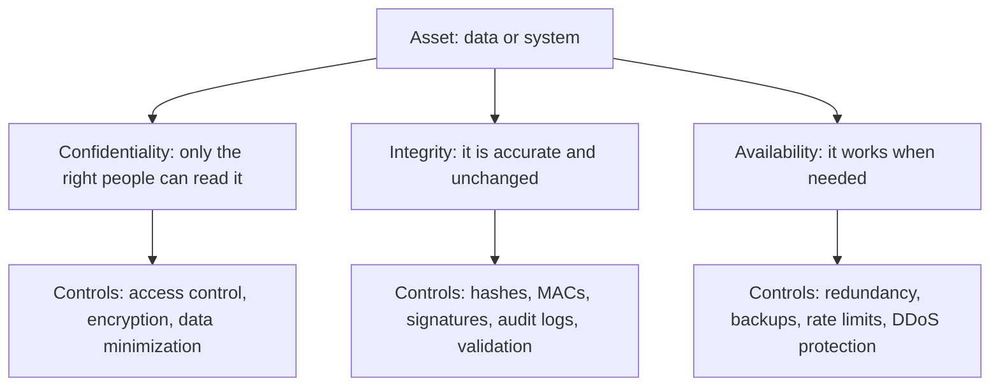
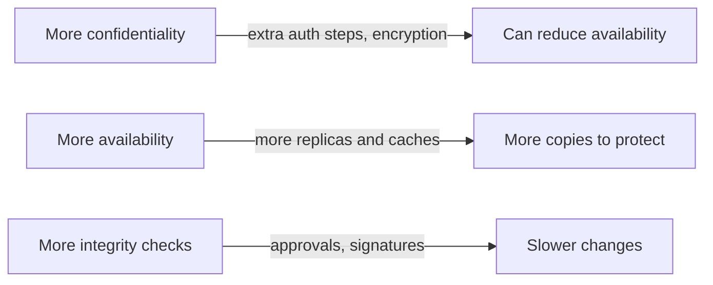

# The CIA Triad

## Introduction

When security people ask "what could go wrong?", they almost always mean one of three things:

- Someone **reads** data they should not see. That is a loss of **confidentiality**.
- Someone **changes** data or a system in a way they should not. That is a loss of **integrity**.
- Someone **stops** people from using a system or data when they need it. That is a loss of **availability**.

Together these form the **CIA triad**. (It has nothing to do with the intelligence agency. The name is just the initials.) It is the oldest and most useful mental model in security, because it turns the vague goal "make it secure" into three concrete questions you can ask about any asset.

Think of a bank vault:

- **Confidentiality:** only authorized people can see what is inside.
- **Integrity:** nobody can swap the gold bars for painted lead without it being noticed.
- **Availability:** customers can get to their safe deposit box during opening hours, even on a busy day.

A vault that nobody can open is perfectly confidential and perfectly useless. That tension between the three goals is the most important lesson on this page.

## The Three Properties



### Confidentiality

Confidentiality means information is disclosed only to people, processes, and systems that are authorized to see it.

Typical threats:

- A storage bucket accidentally made public.
- An API that returns another customer's records when you change an ID in the URL.
- Passwords or API keys committed to a public Git repository.
- Traffic sent over plain HTTP on a shared Wi-Fi network.
- An employee who looks up a celebrity's medical record out of curiosity.

Typical controls:

- **Access control:** authentication (who are you?) and authorization (what are you allowed to do?). See [Authentication vs Authorization](../4-sec-authentication/0-sec-authn-vs-authz.mdx).
- **Encryption** in transit (TLS) and at rest (disk, database, or field-level encryption).
- **Data minimization:** the safest data is the data you never collected or already deleted.
- **Masking and redaction** in logs, screens, and support tools.

Here is encryption at rest in its simplest useful form, using the `cryptography` library's Fernet recipe (authenticated symmetric encryption):

```python
from cryptography.fernet import Fernet, InvalidToken

# In production the key comes from a secrets manager, never from source code.
key = Fernet.generate_key()
f = Fernet(key)

record = b"patient=Jane Doe; diagnosis=asthma"
token = f.encrypt(record)
print("Stored ciphertext starts with:", token[:20], "...")

# Someone who steals the database but not the key sees only ciphertext.
print("Decrypted with the right key:", f.decrypt(token).decode())

wrong = Fernet(Fernet.generate_key())
try:
    wrong.decrypt(token)
except InvalidToken:
    print("Decrypt with the wrong key: InvalidToken (confidentiality holds)")
```

Example output (the ciphertext differs every run):

```text
Stored ciphertext starts with: b'gAAAAABqy2jj89l-cO6A' ...
Decrypted with the right key: patient=Jane Doe; diagnosis=asthma
Decrypt with the wrong key: InvalidToken (confidentiality holds)
```

Install the library with `pip install cryptography`. Encryption moves the problem rather than removing it: the data is now only as confidential as the **key**. [Key Management](../1-sec-cryptography/8-sec-key-management.mdx) covers where keys should live.

### Integrity

Integrity means data and systems are accurate, complete, and changed only in authorized ways. It also covers **detecting** unauthorized changes when prevention fails.

Typical threats:

- An attacker changes the price field in a shopping cart request.
- Malware modifies a system binary to hide itself.
- A compromised dependency ships malicious code in an update (a supply chain attack).
- A bug or a bad migration silently corrupts records.
- An insider edits an audit log to cover their tracks.

Typical controls:

- **Server-side validation:** never trust values the client sends, such as prices, roles, or user IDs.
- **Message authentication codes (MACs)** and **digital signatures** to detect tampering.
- **Hashes** to verify downloaded files and backups.
- **Append-only or write-once audit logs.**
- **Change control:** code review, signed commits, and protected branches.

The example below signs an order with an HMAC. If anyone changes any field, verification fails:

```python
import hashlib
import hmac
import json
import os

SECRET = os.urandom(32)  # shared secret known only to the server

def sign(payload: dict) -> str:
    body = json.dumps(payload, sort_keys=True).encode()
    return hmac.new(SECRET, body, hashlib.sha256).hexdigest()

def verify(payload: dict, signature: str) -> bool:
    expected = sign(payload)
    return hmac.compare_digest(expected, signature)  # constant-time compare

order = {"order_id": 1042, "amount_cents": 4999}
sig = sign(order)
print("Original order valid?", verify(order, sig))

tampered = dict(order, amount_cents=1)  # attacker edits the price
print("Tampered order valid?", verify(tampered, sig))
```

Output:

```text
Original order valid? True
Tampered order valid? False
```

:::tip
Notice `hmac.compare_digest`. A normal `==` comparison can stop at the first differing character, which leaks timing information an attacker can measure. Always use a constant-time comparison for secrets and signatures. [Digital Signatures and MACs](../1-sec-cryptography/5-sec-digital-signatures.mdx) goes deeper.
:::

The simplest integrity fix is often not cryptography at all. If the server already knows the price of product 1042, it should look the price up instead of trusting `amount_cents` from the request.

### Availability

Availability means authorized users can access systems and data in a timely and reliable way.

Typical threats:

- Distributed denial-of-service (DDoS) floods.
- Ransomware that encrypts servers and backups.
- A single expensive API endpoint that one client can call in a tight loop.
- An expired TLS certificate or a deleted DNS record.
- A cloud region outage, a failed disk, or a bad deployment.

Typical controls:

- **Redundancy:** multiple instances, zones, or regions.
- **Backups** that are tested and kept offline or immutable.
- **Rate limiting** and quotas.
- **Timeouts, circuit breakers, and graceful degradation.**
- **Capacity planning** and DDoS protection from your CDN or cloud provider.

Availability is the property most often owned by operations and SRE teams, but it is still security: an attacker who takes your checkout offline on your busiest day has done real damage without reading a single record. Here is a minimal token-bucket rate limiter, the idea behind most API rate limits:

```python
import time

class TokenBucket:
    """Allow `rate` requests per second with bursts up to `capacity`."""

    def __init__(self, rate: float, capacity: int):
        self.rate = rate
        self.capacity = capacity
        self.tokens = capacity
        self.updated = time.monotonic()

    def allow(self) -> bool:
        now = time.monotonic()
        self.tokens = min(self.capacity, self.tokens + (now - self.updated) * self.rate)
        self.updated = now
        if self.tokens >= 1:
            self.tokens -= 1
            return True
        return False

bucket = TokenBucket(rate=5, capacity=5)
results = [bucket.allow() for _ in range(8)]  # 8 requests arrive at once
print("Burst of 8:", ["ok" if r else "429" for r in results])
time.sleep(0.4)  # 0.4 s at 5 tokens/s refills 2 tokens
print("After 0.4 s:", ["ok" if bucket.allow() else "429" for _ in range(3)])
```

Output:

```text
Burst of 8: ['ok', 'ok', 'ok', 'ok', 'ok', '429', '429', '429']
After 0.4 s: ['ok', 'ok', '429']
```

`429` is the HTTP status code "Too Many Requests". A real service keeps one bucket per client (by API key, user, or IP) in a shared store such as Redis. [Rate Limiting and Abuse Prevention](../7-sec-api-security/3-sec-rate-limiting.mdx) builds a production version.

## Beyond the Triad

The triad is a starting point, not a complete list. You will often see these related properties:

| Property | Question it answers | Example control |
|----------|---------------------|-----------------|
| Authenticity | Is this really from who it claims to be? | TLS certificates, signed emails, MFA |
| Non-repudiation | Can the sender later deny they sent it? | Digital signatures with keys only the signer holds, tamper-evident logs |
| Accountability | Can we trace an action to a specific person or service? | Individual accounts (no shared logins), audit logs |
| Privacy | Is personal data collected and used fairly and lawfully? | Consent, minimization, retention limits |
| Safety | Can a failure physically hurt someone? | Fail-safe design in medical, industrial, and automotive systems |

Donn Parker proposed a six-part model, often called the **Parkerian hexad**, that adds possession (control), authenticity, and utility. You do not need to memorize it. The point is that CIA is a lens, and sometimes you need a second lens.

## Mapping Attacks to the Triad

A useful habit is to label every threat you discuss with the property it breaks. Many attacks hit more than one:

| Attack | Confidentiality | Integrity | Availability |
|--------|:---:|:---:|:---:|
| Public storage bucket | Yes | | |
| SQL injection | Yes (read data) | Yes (change data) | Sometimes (drop tables) |
| Ransomware | Often (data stolen first) | Yes (files encrypted) | Yes |
| DDoS | | | Yes |
| Tampered software update | Possible | Yes | Possible |
| Stolen laptop without disk encryption | Yes | | Yes for the owner |
| Cross-site scripting (XSS) | Yes (steal session data) | Yes (act as the user) | |

Modern ransomware groups usually **steal data before encrypting it**, so a good backup restores availability but does nothing for confidentiality. That is why "we have backups" is not a complete ransomware plan. See [Backups and Ransomware Resilience](../9-sec-system-hardening/6-sec-backups-and-ransomware.mdx).

## The Trade-offs Between C, I, and A

The three properties often pull against each other:



Some concrete examples:

- **Encrypting a backup** protects confidentiality, but if you lose the key, you have lost the backup. Availability suffers.
- **Account lockout after five failed logins** stops password guessing, but an attacker can lock out every user on purpose. That is a denial-of-service attack you built yourself.
- **Replicating a database to three regions** improves availability, but now there are three copies to protect, back up, and delete when a customer asks.
- **Requiring two approvals for every production change** protects integrity but slows down an emergency fix during an outage.

There is no universal right answer. The right balance depends on what the asset is and what failure would cost. A public marketing website needs high availability and integrity (nobody should deface it), but its content is not confidential. A password database needs extreme confidentiality and integrity, and can tolerate a short outage.

## Classifying Your Data

Teams turn the triad into decisions by **classifying** data and systems. A simple, practical scheme:

| Level | Examples | Confidentiality | Integrity | Availability |
|-------|----------|-----------------|-----------|--------------|
| Public | Marketing pages, docs, open-source code | Low | Medium | Medium |
| Internal | Wiki pages, internal dashboards | Medium | Medium | Low |
| Confidential | Customer data, source code, contracts | High | High | Medium |
| Restricted | Passwords, keys, payment data, health records | Very high | Very high | Depends |

Each level then maps to required controls, for example: "Restricted data must be encrypted at rest with keys in the KMS, accessed only by named services, and never written to logs." Writing that rule once saves hundreds of individual debates.

You can even encode a basic version in code, so a review tool can check it:

```python
REQUIRED_CONTROLS = {
    "public": {"integrity_monitoring"},
    "internal": {"sso_login"},
    "confidential": {"sso_login", "encryption_at_rest", "audit_log"},
    "restricted": {"sso_login", "encryption_at_rest", "audit_log", "mfa", "no_logging_of_values"},
}

def missing_controls(level: str, controls: set[str]) -> set[str]:
    return REQUIRED_CONTROLS[level] - controls

systems = {
    "marketing-site": ("public", {"integrity_monitoring"}),
    "billing-db": ("restricted", {"sso_login", "encryption_at_rest", "audit_log"}),
}

for name, (level, controls) in systems.items():
    gaps = missing_controls(level, controls)
    status = "OK" if not gaps else f"MISSING {sorted(gaps)}"
    print(f"{name:15} {level:12} {status}")
```

Output:

```text
marketing-site  public       OK
billing-db      restricted   MISSING ['mfa', 'no_logging_of_values']
```

## Real-World Scenario

You are the lead developer for a small chain of physiotherapy clinics. The team is building a web app where patients book appointments, staff write treatment notes, and therapists see their daily schedule. Before writing code, your manager asks which security features are "must have" for launch.

**Step 1: List assets and rate C, I, and A.**

| Asset | Confidentiality | Integrity | Availability | Why |
|-------|-----------------|-----------|--------------|-----|
| Treatment notes | Very high | Very high | Medium | Health data; wrong notes can harm patients |
| Appointment calendar | Medium | High | High | Double bookings and outages hurt the business daily |
| Public clinic info pages | Low | Medium | Medium | Defacement is embarrassing but not dangerous |
| Staff accounts | High | High | High | Every other asset depends on them |

**Step 2: Pick controls that match the ratings.**

- Treatment notes: encrypted at rest, visible only to the treating therapist and clinic admins, every read and edit written to an audit log, no notes in application logs or error messages.
- Calendar: server-side validation so patients cannot book over another slot, database constraints to prevent double booking, a read replica and daily tested backups.
- Staff accounts: single sign-on with MFA, automatic session timeout on shared clinic computers.
- Public pages: served from a CDN with deploys only through the CI pipeline.

**Step 3: Decide what you will *not* do yet.** Multi-region failover for the whole app would be expensive. A two-hour outage is painful but survivable, because clinics can fall back to a printed schedule. You document that decision and the fallback plan.

### Why this approach

Rating each asset separately stops you from applying the strongest (and most expensive) control to everything, or the weakest control to the data that matters most. Health data drives confidentiality and integrity. The calendar drives availability. Each gets controls aimed at its real risk.

### When to use it and when not to

Use a per-asset CIA rating at the start of any project, and revisit it when you add a new type of data. It is less useful as the *only* analysis for complex systems with many data flows. Then you also need structured threat modeling ([Threat Modeling with STRIDE](../6-sec-appsec-and-devsecops/1-sec-threat-modeling.mdx)). In regulated sectors such as health, laws such as HIPAA or GDPR may *require* specific controls regardless of your own rating. See [Compliance: SOC 2, PCI DSS, HIPAA and GDPR](../13-sec-governance/2-sec-compliance.mdx).

### Alternatives and trade-offs

| Approach | Pros | Cons | Best for |
|----------|------|------|----------|
| Same controls for all data | Simple to explain | Over-protects cheap data, under-protects critical data | Very small apps with one data type |
| Per-asset CIA rating (this scenario) | Targets effort where it matters, easy for non-experts | Can miss data flows between assets | Early design and small teams |
| Formal data classification policy | Consistent across teams, auditable | Needs maintenance and training | Growing organizations |
| Full threat model (STRIDE, attack trees) | Finds design-level threats and flows | Takes time and practice | Complex or high-risk systems |
| Compliance-driven control list | Satisfies regulators and auditors | Minimum bar, not tailored to your threats | Regulated industries, alongside the above |

## Common Mistakes

- **Thinking only about confidentiality.** Many teams equate security with "keeping secrets". Tampered data and outages can be just as damaging, and sometimes more.
- **Encrypting without managing keys.** Ciphertext sitting next to its key in the same database protects nothing.
- **Trusting client-side values.** Prices, roles, and IDs sent from a browser or mobile app are attacker-controlled. Integrity checks belong on the server.
- **Backups that are never restored.** An untested backup is a hope, not an availability control.
- **Lockout policies that create denial of service.** Prefer rate limiting, progressive delays, and MFA over hard lockouts. See [Secure Password Authentication](../4-sec-authentication/1-sec-password-authentication.mdx).
- **Logging sensitive data.** Debug logs full of tokens, passwords, or health data quietly undo all your confidentiality controls.

## Summary

- The CIA triad is **confidentiality** (only the right people read it), **integrity** (it is accurate and changed only in authorized ways), and **availability** (it works when needed).
- Every threat breaks one or more of the three. Labeling threats this way makes it easier to pick controls.
- Typical controls: access control and encryption for C; validation, MACs, signatures, and audit logs for I; redundancy, backups, and rate limits for A.
- The properties trade off against each other. Choose the balance per asset, based on the cost of failure.
- Data classification turns the triad into repeatable rules your team can apply and check.

## Exercises

1. Take the three assets you listed in the exercise on [Cybersecurity Introduction](./0-sec-introduction.mdx). Rate each one Low, Medium, or High for C, I, and A, and name one control for each High rating.
2. Modify the HMAC example so the signature also covers a timestamp, and make `verify` reject messages older than five minutes. Which attack does this prevent?
3. In the token bucket example, what happens if one client uses many IP addresses? List two ways an API could identify clients more reliably.
4. Find a recent public breach report from a company or a regulator. Which of C, I, and A was affected, and which control would most likely have prevented it?

Related pages:

- [Threats, Vulnerabilities and Risk](./2-sec-threats-vulnerabilities-risk.mdx)
- [Defense in Depth](./4-sec-defense-in-depth.mdx)
- [Cryptography Introduction](../1-sec-cryptography/0-sec-crypto-introduction.mdx)
- [DDoS Attacks and Mitigation](../2-sec-network-security/7-sec-ddos.mdx)

External reading:

- [NIST Glossary: confidentiality, integrity, availability](https://csrc.nist.gov/glossary)
- [cryptography.io Fernet documentation](https://cryptography.io/en/latest/fernet/)
- [Python `hmac` module](https://docs.python.org/3/library/hmac.html)
