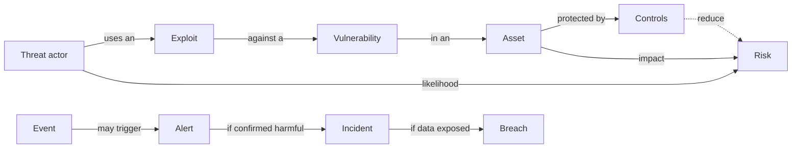

# Security Terminology Cheat Sheet

## Introduction

Security has a lot of jargon, and much of it sounds similar. Is that alert an **event**, an **incident**, or a **breach**? Is a scanner finding a **vulnerability**, a **threat**, or a **risk**? Are we talking about **authentication** or **authorization**? Using the wrong word can cause real confusion: telling executives "we had a breach" when you mean "we blocked an attack" triggers a very different response.

This page is a reference you can come back to. Terms are grouped by topic, each with a short plain-language definition, an example, and a link to the page in this tutorial that explains it in depth. Near the end you will find the most commonly confused pairs, an acronym list, and a scenario that shows why precise language matters during an incident.

Think of it like the glossary at the back of a textbook, except it also tells you where to go next.

:::tip
For authoritative definitions, the [NIST Computer Security Resource Center Glossary](https://csrc.nist.gov/glossary) collects terms from NIST publications, often with several source definitions side by side. The definitions here are simplified for learning.
:::

## How the Core Concepts Fit Together



## Core Concepts

| Term | Definition | Example | Learn more |
|------|------------|---------|------------|
| Asset | Anything of value that needs protecting | Customer database, signing key, reputation | [Threats, Vulnerabilities and Risk](./2-sec-threats-vulnerabilities-risk.mdx) |
| CIA triad | Confidentiality, integrity, availability: the three core security goals | Encryption protects confidentiality | [The CIA Triad](./1-sec-cia-triad.mdx) |
| Threat | A potential cause of harm | A ransomware gang | [Threats, Vulnerabilities and Risk](./2-sec-threats-vulnerabilities-risk.mdx) |
| Threat actor | The person or group behind a threat | Criminal group, insider, nation state | [Threat Intelligence](../11-sec-defensive-operations/4-sec-threat-intelligence.mdx) |
| Vulnerability | A weakness that could be exploited | Missing authorization check | [Threats, Vulnerabilities and Risk](./2-sec-threats-vulnerabilities-risk.mdx) |
| Exploit | Code or a technique that takes advantage of a vulnerability | A crafted request that dumps a table | [Exploitation Basics](../10-sec-offensive-security/5-sec-exploitation-basics.mdx) |
| Risk | Likelihood of harm combined with its impact | "High: public, exploited, sensitive data" | [Risk Management](../13-sec-governance/0-sec-risk-management.mdx) |
| Control | A safeguard that reduces risk | MFA, WAF, backups | [Defense in Depth](./4-sec-defense-in-depth.mdx) |
| Residual risk | Risk remaining after controls | Low risk after patching | [Risk Management](../13-sec-governance/0-sec-risk-management.mdx) |
| Attack surface | All points where an attacker can interact with a system | Routes, ports, staff inboxes | [Attack Surface](./3-sec-attack-surface.mdx) |
| Attack vector | The path or method used to attack | Phishing email, exposed API | [Attack Surface](./3-sec-attack-surface.mdx) |
| Defense in depth | Multiple independent layers of controls | Code fix plus WAF plus least-privilege DB | [Defense in Depth](./4-sec-defense-in-depth.mdx) |
| Least privilege | Minimum access needed, for the shortest time | Read-only role for reporting | [Least Privilege and Zero Trust](./5-sec-least-privilege.mdx) |
| Zero trust | No implicit trust based on network location; verify every request | Identity-aware proxy | [Least Privilege and Zero Trust](./5-sec-least-privilege.mdx) |
| Blast radius | How much damage one compromised component can cause | A key with access to every bucket has a large blast radius | [Least Privilege and Zero Trust](./5-sec-least-privilege.mdx) |
| Secure by default | Safe settings out of the box | MFA enabled for new accounts | [Secure Design Principles](./6-sec-security-principles.mdx) |

## Attacks and Vulnerability Classes

| Term | Definition | Learn more |
|------|------------|------------|
| Zero-day | A vulnerability exploited before the vendor has released a fix | [Vulnerability Management and CVSS](../11-sec-defensive-operations/6-sec-vulnerability-management.mdx) |
| N-day | A known vulnerability with an available fix that has not been applied everywhere yet | [Patch Management](../9-sec-system-hardening/3-sec-patch-management.mdx) |
| Injection | Untrusted data interpreted as code or commands (SQL, OS command, LDAP, template) | [SQL Injection](../3-sec-web-security/3-sec-sql-injection.mdx) |
| XSS (cross-site scripting) | Attacker-controlled script runs in another user's browser | [Cross-Site Scripting (XSS)](../3-sec-web-security/4-sec-xss.mdx) |
| CSRF (cross-site request forgery) | A site tricks a user's browser into sending an unwanted authenticated request | [Cross-Site Request Forgery (CSRF)](../3-sec-web-security/5-sec-csrf.mdx) |
| SSRF (server-side request forgery) | An attacker makes the server send requests to places it should not | [Server-Side Request Forgery (SSRF)](../3-sec-web-security/6-sec-ssrf.mdx) |
| IDOR / BOLA | Accessing another user's object by changing its ID; BOLA is the API term | [Broken Object Level Authorization](../7-sec-api-security/2-sec-bola.mdx) |
| Path traversal | Using `../` sequences to read or write files outside an allowed directory | [Command Injection and Path Traversal](../3-sec-web-security/7-sec-command-injection.mdx) |
| Insecure deserialization | Turning untrusted data into objects in a way that runs code or changes logic | [Insecure Deserialization](../3-sec-web-security/8-sec-insecure-deserialization.mdx) |
| Race condition / TOCTOU | A bug where timing between a check and a use can be exploited | [Race Conditions and TOCTOU](../5-sec-secure-coding/5-sec-race-conditions.mdx) |
| Buffer overflow | Writing past the end of a memory buffer, common in C and C++ | [Memory Safety](../5-sec-secure-coding/4-sec-memory-safety.mdx) |
| Phishing | Deceptive messages that trick people into revealing credentials or running malware | [Social Engineering and Phishing](../10-sec-offensive-security/8-sec-social-engineering.mdx) |
| Credential stuffing | Trying username and password pairs leaked from other sites | [Password Attacks and Defenses](../10-sec-offensive-security/7-sec-password-attacks.mdx) |
| Password spraying | Trying a few common passwords against many accounts | [Password Attacks and Defenses](../10-sec-offensive-security/7-sec-password-attacks.mdx) |
| Brute force | Trying many possibilities until one works | [Password Attacks and Defenses](../10-sec-offensive-security/7-sec-password-attacks.mdx) |
| Man-in-the-middle (on-path attack) | Intercepting or altering traffic between two parties | [Common Network Attacks](../2-sec-network-security/6-sec-network-attacks.mdx) |
| DoS / DDoS | Making a service unavailable; distributed when many sources are used | [DDoS Attacks and Mitigation](../2-sec-network-security/7-sec-ddos.mdx) |
| Supply chain attack | Compromising software or services you depend on to reach you | [Software Supply Chain Security](../6-sec-appsec-and-devsecops/5-sec-supply-chain.mdx) |
| Ransomware | Malware that encrypts data and demands payment, often after stealing data | [Backups and Ransomware Resilience](../9-sec-system-hardening/6-sec-backups-and-ransomware.mdx) |
| Privilege escalation | Gaining higher permissions than originally granted | [Privilege Escalation Concepts](../10-sec-offensive-security/6-sec-privilege-escalation.mdx) |
| Lateral movement | Moving from one compromised system to others | [The Attacker Mindset and Kill Chains](./7-sec-attacker-mindset.mdx) |
| Prompt injection | Instructions hidden in input that hijack an LLM application | [Security for AI and LLM Applications](../13-sec-governance/5-sec-ai-security.mdx) |

## Cryptography

| Term | Definition | Learn more |
|------|------------|------------|
| Encryption | Transforming data so only holders of a key can read it | [Cryptography Introduction](../1-sec-cryptography/0-sec-crypto-introduction.mdx) |
| Symmetric encryption | Same key encrypts and decrypts (for example AES-GCM) | [Symmetric Encryption](../1-sec-cryptography/3-sec-symmetric-encryption.mdx) |
| Asymmetric encryption | Public key encrypts or verifies; private key decrypts or signs | [Asymmetric Encryption](../1-sec-cryptography/4-sec-asymmetric-encryption.mdx) |
| Hash function | One-way function producing a fixed-size fingerprint (for example SHA-256) | [Hash Functions](../1-sec-cryptography/1-sec-hashing.mdx) |
| Password hashing | Deliberately slow, salted hashing for passwords (Argon2id, bcrypt, scrypt) | [Password Hashing](../1-sec-cryptography/2-sec-password-hashing.mdx) |
| Salt | Random value added to each password before hashing so identical passwords hash differently | [Password Hashing](../1-sec-cryptography/2-sec-password-hashing.mdx) |
| MAC / HMAC | A keyed checksum proving integrity and authenticity with a shared secret | [Digital Signatures and MACs](../1-sec-cryptography/5-sec-digital-signatures.mdx) |
| Digital signature | Proof made with a private key that anyone can verify with the public key | [Digital Signatures and MACs](../1-sec-cryptography/5-sec-digital-signatures.mdx) |
| AEAD | Authenticated encryption with associated data: encrypts and detects tampering in one step | [Symmetric Encryption](../1-sec-cryptography/3-sec-symmetric-encryption.mdx) |
| PKI | Public key infrastructure: certificates, certificate authorities, and trust chains | [PKI and Certificates](../1-sec-cryptography/6-sec-pki-and-certificates.mdx) |
| TLS | The protocol that secures HTTPS and many other connections | [TLS and HTTPS](../1-sec-cryptography/7-sec-tls.mdx) |
| KMS / HSM | Key management service; hardware security module that stores keys | [Key Management](../1-sec-cryptography/8-sec-key-management.mdx) |
| CSPRNG | Cryptographically secure random number generator | [Randomness and Secure Tokens](../1-sec-cryptography/9-sec-randomness.mdx) |
| Post-quantum cryptography | Algorithms designed to resist quantum computers (NIST FIPS 203, 204, 205) | [Post-Quantum Cryptography](../1-sec-cryptography/11-sec-post-quantum.mdx) |

## Identity and Access

| Term | Definition | Learn more |
|------|------------|------------|
| Authentication (AuthN) | Proving who you are | [Authentication vs Authorization](../4-sec-authentication/0-sec-authn-vs-authz.mdx) |
| Authorization (AuthZ) | Deciding what you are allowed to do | [Authentication vs Authorization](../4-sec-authentication/0-sec-authn-vs-authz.mdx) |
| MFA | Multi-factor authentication: two or more factor types (know, have, are) | [Multi-Factor Authentication](../4-sec-authentication/2-sec-mfa.mdx) |
| Phishing-resistant MFA | MFA bound to the real site, so a fake site cannot relay it (for example passkeys, FIDO2 keys) | [Passkeys and WebAuthn](../4-sec-authentication/3-sec-passkeys.mdx) |
| Passkey | A FIDO credential that replaces passwords with public key cryptography | [Passkeys and WebAuthn](../4-sec-authentication/3-sec-passkeys.mdx) |
| Session | Server-side state that remembers a logged-in user, usually via a cookie | [Sessions and Cookies](../4-sec-authentication/4-sec-sessions-and-cookies.mdx) |
| JWT | JSON Web Token: a signed, self-contained token format | [JSON Web Tokens](../4-sec-authentication/5-sec-jwt.mdx) |
| OAuth 2.0 | A framework for delegated authorization (letting an app act on your behalf) | [OAuth 2.0](../4-sec-authentication/6-sec-oauth2.mdx) |
| OIDC | OpenID Connect: an identity layer on top of OAuth 2.0 for login | [OpenID Connect](../4-sec-authentication/7-sec-oidc.mdx) |
| SSO / SAML | Single sign-on; SAML is an older XML-based SSO standard common in enterprises | [Single Sign-On and SAML](../4-sec-authentication/8-sec-sso-and-saml.mdx) |
| RBAC / ABAC / ReBAC | Role-, attribute-, and relationship-based access control | [RBAC, ABAC and ReBAC](../4-sec-authentication/9-sec-rbac-abac.mdx) |
| IAM | Identity and access management: users, roles, and policies, especially in cloud | [Cloud IAM Security](../8-sec-cloud-and-container/1-sec-cloud-iam.mdx) |
| JIT access | Just-in-time access: temporary elevated permissions that expire automatically | [Least Privilege and Zero Trust](./5-sec-least-privilege.mdx) |

## Network and Infrastructure

| Term | Definition | Learn more |
|------|------------|------------|
| Firewall / security group | Rules that allow or block network traffic | [Firewalls and Security Groups](../2-sec-network-security/1-sec-firewalls.mdx) |
| Segmentation | Splitting a network into zones that cannot freely reach each other | [Network Segmentation](../2-sec-network-security/2-sec-network-segmentation.mdx) |
| DMZ | A network zone for internet-facing services, separated from internal systems | [Network Segmentation](../2-sec-network-security/2-sec-network-segmentation.mdx) |
| VPN / ZTNA | Encrypted tunnel to a network; zero trust network access grants per-app access instead | [VPNs and Secure Tunnels](../2-sec-network-security/3-sec-vpn.mdx) |
| IDS / IPS | Intrusion detection (alerts) and prevention (blocks) systems | [Intrusion Detection and Prevention](../2-sec-network-security/5-sec-ids-ips.mdx) |
| WAF | Web application firewall: filters HTTP traffic for attack patterns | [API Gateways and WAFs](../7-sec-api-security/7-sec-api-gateway-security.mdx) |
| Bastion host / jump box | A hardened server used as the only entry point to a private network | [SSH Security](../9-sec-system-hardening/2-sec-ssh-security.mdx) |
| Hardening | Reducing a system's attack surface and tightening its configuration | [Linux Hardening](../9-sec-system-hardening/0-sec-linux-hardening.mdx) |
| EDR / XDR | Endpoint (and extended) detection and response tools | [Endpoint Protection and EDR](../9-sec-system-hardening/4-sec-endpoint-protection.mdx) |
| CSPM | Cloud security posture management: finds cloud misconfigurations | [Cloud Security Posture Management](../8-sec-cloud-and-container/7-sec-cspm.mdx) |
| Shared responsibility model | Split of security duties between cloud provider and customer | [The Shared Responsibility Model](../8-sec-cloud-and-container/0-sec-cloud-shared-responsibility.mdx) |

## Security Operations and Incident Response

| Term | Definition | Learn more |
|------|------------|------------|
| Event | Any observable occurrence in a system or network | [Security Logging and SIEM](../11-sec-defensive-operations/1-sec-logging-and-siem.mdx) |
| Alert | A notification that an event matched a detection rule | [Detection Engineering](../11-sec-defensive-operations/2-sec-detection-engineering.mdx) |
| Incident | An event that actually or potentially jeopardizes the security of a system or data, or violates policy | [Incident Response Lifecycle](../12-sec-incident-response/0-sec-incident-response-lifecycle.mdx) |
| Breach | An incident in which data is confirmed to have been accessed or disclosed without authorization (legal definitions vary) | [Compliance: SOC 2, PCI DSS, HIPAA and GDPR](../13-sec-governance/2-sec-compliance.mdx) |
| SOC | Security operations center: the team that monitors and responds | [The Security Operations Center](../11-sec-defensive-operations/0-sec-soc.mdx) |
| SIEM | Security information and event management: collects and correlates logs | [Security Logging and SIEM](../11-sec-defensive-operations/1-sec-logging-and-siem.mdx) |
| SOAR | Security orchestration, automation, and response: automates response steps | [Incident Response Playbooks](../12-sec-incident-response/1-sec-incident-playbooks.mdx) |
| IOC | Indicator of compromise: an artifact (hash, IP, domain) that suggests compromise | [Threat Intelligence](../11-sec-defensive-operations/4-sec-threat-intelligence.mdx) |
| TTPs | Tactics, techniques, and procedures: how an attacker operates | [MITRE ATT&CK](../11-sec-defensive-operations/3-sec-mitre-attack.mdx) |
| False positive / false negative | Alert on harmless activity / no alert on real malicious activity | [Detection Engineering](../11-sec-defensive-operations/2-sec-detection-engineering.mdx) |
| Threat hunting | Proactively searching for attackers that evaded existing detections | [Threat Hunting](../11-sec-defensive-operations/5-sec-threat-hunting.mdx) |
| Dwell time | How long an attacker is present before detection | [Threat Hunting](../11-sec-defensive-operations/5-sec-threat-hunting.mdx) |
| Containment | Limiting the spread and impact of an incident | [Incident Response Lifecycle](../12-sec-incident-response/0-sec-incident-response-lifecycle.mdx) |
| Chain of custody | A record of who handled evidence and when, so it stays trustworthy | [Digital Forensics Basics](../12-sec-incident-response/2-sec-digital-forensics.mdx) |
| Postmortem | A blameless review of what happened and how to prevent it | [Security Postmortems](../12-sec-incident-response/4-sec-postmortems.mdx) |
| RTO / RPO | Recovery time objective (how fast) and recovery point objective (how much data loss) | [Business Continuity and Disaster Recovery](../12-sec-incident-response/5-sec-business-continuity.mdx) |

## Vulnerability Management and AppSec

| Term | Definition | Learn more |
|------|------------|------------|
| CVE | Common Vulnerabilities and Exposures: a public ID for a specific vulnerability, such as CVE-2021-44228 | [Vulnerability Management and CVSS](../11-sec-defensive-operations/6-sec-vulnerability-management.mdx) |
| CWE | Common Weakness Enumeration: a category of weakness, such as CWE-89 for SQL injection | [Secure Coding Introduction](../5-sec-secure-coding/0-sec-secure-coding-introduction.mdx) |
| CVSS | Common Vulnerability Scoring System; v4.0 is current | [Vulnerability Management and CVSS](../11-sec-defensive-operations/6-sec-vulnerability-management.mdx) |
| KEV | CISA's Known Exploited Vulnerabilities catalog | [Threats, Vulnerabilities and Risk](./2-sec-threats-vulnerabilities-risk.mdx) |
| EPSS | Exploit Prediction Scoring System: probability of exploitation soon | [Threats, Vulnerabilities and Risk](./2-sec-threats-vulnerabilities-risk.mdx) |
| SAST / DAST | Static (code) and dynamic (running app) application security testing | [Static Analysis (SAST)](../6-sec-appsec-and-devsecops/2-sec-sast.mdx) |
| SCA | Software composition analysis: finds vulnerable dependencies | [Dependency Scanning and SCA](../6-sec-appsec-and-devsecops/4-sec-dependency-scanning.mdx) |
| SBOM | Software bill of materials: a list of components in your software | [SBOMs, Signing and SLSA](../6-sec-appsec-and-devsecops/6-sec-sbom-and-signing.mdx) |
| SLSA | Supply-chain Levels for Software Artifacts: a framework for build integrity | [SBOMs, Signing and SLSA](../6-sec-appsec-and-devsecops/6-sec-sbom-and-signing.mdx) |
| Threat modeling | Structured analysis of what can go wrong in a design (for example STRIDE) | [Threat Modeling with STRIDE](../6-sec-appsec-and-devsecops/1-sec-threat-modeling.mdx) |
| Virtual patch | A temporary protective rule (often a WAF rule) until the code is fixed | [Defense in Depth](./4-sec-defense-in-depth.mdx) |
| Security champion | A developer who acts as the security point of contact for their team | [Secure Software Development Lifecycle](../6-sec-appsec-and-devsecops/0-sec-sdlc.mdx) |

## Offensive Security and Disclosure

| Term | Definition | Learn more |
|------|------------|------------|
| Penetration test | An authorized, scoped simulated attack to find weaknesses | [Penetration Testing Introduction](../10-sec-offensive-security/0-sec-pentest-introduction.mdx) |
| Red team / blue team / purple team | Attackers simulating adversaries / defenders / both working together to improve detection | [Penetration Testing Introduction](../10-sec-offensive-security/0-sec-pentest-introduction.mdx) |
| Rules of engagement | Written rules for what testers may do, when, and how | [Ethics, Law and Responsible Disclosure](./8-sec-ethics-and-law.mdx) |
| Reconnaissance / OSINT | Information gathering; open-source intelligence from public sources | [Reconnaissance and OSINT](../10-sec-offensive-security/2-sec-reconnaissance.mdx) |
| CTF | Capture the flag: legal security competitions and challenges | [Capture the Flag Competitions](../10-sec-offensive-security/9-sec-ctf.mdx) |
| CVD | Coordinated vulnerability disclosure: private report, fix, then publish together | [Ethics, Law and Responsible Disclosure](./8-sec-ethics-and-law.mdx) |
| VDP / bug bounty | A policy for receiving vulnerability reports / a VDP that pays rewards | [Bug Bounty Programs](../10-sec-offensive-security/10-sec-bug-bounty.mdx) |
| Kill chain | A model of the stages of an attack | [The Attacker Mindset and Kill Chains](./7-sec-attacker-mindset.mdx) |

## Governance, Risk and Compliance

| Term | Definition | Learn more |
|------|------------|------------|
| GRC | Governance, risk, and compliance | [Risk Management](../13-sec-governance/0-sec-risk-management.mdx) |
| Risk appetite | How much risk an organization is willing to accept | [Risk Management](../13-sec-governance/0-sec-risk-management.mdx) |
| NIST CSF | NIST Cybersecurity Framework; version 2.0 has six functions: Govern, Identify, Protect, Detect, Respond, Recover | [Security Frameworks: NIST CSF, ISO 27001 and CIS Controls](../13-sec-governance/1-sec-security-frameworks.mdx) |
| ISO/IEC 27001 | International standard for an information security management system (ISMS) | [Security Frameworks: NIST CSF, ISO 27001 and CIS Controls](../13-sec-governance/1-sec-security-frameworks.mdx) |
| CIS Controls / CIS Benchmarks | Prioritized security safeguards / configuration baselines for specific products | [CIS Benchmarks and Baselines](../9-sec-system-hardening/5-sec-cis-benchmarks.mdx) |
| SOC 2 | An attestation report on a service organization's controls (not the same as a security operations center) | [Compliance: SOC 2, PCI DSS, HIPAA and GDPR](../13-sec-governance/2-sec-compliance.mdx) |
| PCI DSS | Security standard for organizations handling payment card data | [Compliance: SOC 2, PCI DSS, HIPAA and GDPR](../13-sec-governance/2-sec-compliance.mdx) |
| GDPR | EU regulation protecting personal data | [Privacy Engineering](../13-sec-governance/4-sec-privacy-engineering.mdx) |
| PII | Personally identifiable information | [Privacy Engineering](../13-sec-governance/4-sec-privacy-engineering.mdx) |
| Security policy | A written rule set approved by leadership | [Security Policies and Awareness Training](../13-sec-governance/3-sec-security-policies.mdx) |

## Commonly Confused Pairs

| Pair | The difference |
|------|----------------|
| Vulnerability vs threat | A vulnerability is a weakness you have. A threat is something that could exploit it. |
| Vulnerability vs risk | Risk adds likelihood and business impact to the vulnerability. |
| Event vs incident vs breach | Every incident is an event, but most events are harmless. A breach is an incident with confirmed data exposure. |
| Authentication vs authorization | Who you are vs what you may do. |
| Encryption vs hashing | Encryption is reversible with a key. Hashing is one-way. |
| Encoding vs encryption | Encoding (Base64, URL encoding) is a format change anyone can reverse. It provides no secrecy. |
| Hash vs MAC vs signature | Hash: integrity against accidents. MAC: integrity and authenticity with a shared key. Signature: integrity and authenticity verifiable by anyone with the public key. |
| IDS vs IPS | Detection alerts. Prevention blocks. |
| Vulnerability scan vs penetration test | A scan is automated and broad. A pentest is a human-led attempt to exploit and chain issues. |
| SOC (team) vs SOC 2 (report) | Security operations center vs an audit report on controls. Same letters, unrelated. |
| Privacy vs security | Security protects data from unauthorized access. Privacy is about whether data is collected and used appropriately in the first place. |
| CVE vs CWE | A CVE is a specific bug in a specific product. A CWE is the general type of bug. |

## Quick Acronym List

| Acronym | Meaning |
|---------|---------|
| AEAD | Authenticated Encryption with Associated Data |
| APT | Advanced Persistent Threat |
| ASM | Attack Surface Management |
| C2 | Command and Control |
| CNA | CVE Numbering Authority |
| CSIRT / CERT | Computer Security Incident Response Team / Computer Emergency Response Team |
| DFIR | Digital Forensics and Incident Response |
| DLP | Data Loss Prevention |
| IaC | Infrastructure as Code |
| MDM | Mobile Device Management |
| MTTD / MTTR | Mean Time to Detect / Mean Time to Respond (or Recover) |
| OWASP | Open Worldwide Application Security Project |
| RCE | Remote Code Execution |
| SSDLC | Secure Software Development Lifecycle |
| TLP | Traffic Light Protocol, for marking how widely information may be shared |
| VDP | Vulnerability Disclosure Policy |

## Practice: A Tiny Flashcard Quiz

Reading a glossary once does not make terms stick. Here is a small multiple-choice quiz generator you can extend with your own terms:

```python
import random

GLOSSARY = {
    "vulnerability": "A weakness that could be exploited by a threat",
    "exploit": "Code or a technique that takes advantage of a vulnerability",
    "zero-day": "A vulnerability that is exploited before the vendor has a fix",
    "IOC": "An artifact, such as a hash or IP, that suggests a system was compromised",
    "lateral movement": "Moving from one compromised system to others in the network",
    "least privilege": "Granting only the minimum access needed, for the shortest time",
}

def quiz(seed: int, questions: int = 3):
    rng = random.Random(seed)                     # fixed seed: repeatable quiz
    terms = rng.sample(sorted(GLOSSARY), questions)
    for n, term in enumerate(terms, 1):
        wrong = rng.sample([t for t in GLOSSARY if t != term], 2)
        options = wrong + [term]
        rng.shuffle(options)
        print(f"Q{n}. {GLOSSARY[term]}")
        for letter, option in zip("abc", options):
            print(f"    {letter}) {option}")
        print(f"    answer: {'abc'[options.index(term)]}")

quiz(seed=7)
```

Example output (with seed 7 on Python 3.14; other versions may differ):

```text
Q1. Moving from one compromised system to others in the network
    a) least privilege
    b) vulnerability
    c) lateral movement
    answer: c
Q2. Code or a technique that takes advantage of a vulnerability
    a) vulnerability
    b) IOC
    c) exploit
    answer: c
Q3. Granting only the minimum access needed, for the shortest time
    a) vulnerability
    b) least privilege
    c) lateral movement
    answer: b
```

## Real-World Scenario

It is 2 a.m. Your on-call engineer sees an alert: a burst of requests to `/api/invoices/<id>` with sequential IDs from one API key. By 3 a.m. the team confirms that a customer's API key was leaked in a public repository and used to read 1,200 invoices belonging to that customer. No other customers were affected. The CEO asks for a status update at 8 a.m.

**Draft 1 (imprecise):** "We were hacked overnight. Hackers exploited a vulnerability and breached our systems. We are investigating."

**Draft 2 (precise):** "At 01:52 UTC our monitoring raised an **alert** on unusual API activity. We declared a security **incident** at 02:40. A single customer's API key had been published in their public code repository and was used to read 1,200 of **that customer's** invoices. We found **no vulnerability** in our platform and no access to other customers' data. We **revoked the key** at 02:55 (**containment**). Because invoice data includes personal information, legal is assessing whether this counts as a **breach** under data protection law and whether notification is required. Next update at 12:00."

### Why this approach

Draft 1 creates panic and is factually wrong: there was no platform vulnerability, and whether it was a legal "breach" is not yet decided. Draft 2 uses precise terms, so leadership understands the scope, legal can assess notification duties, and the customer success team knows exactly what to tell the affected customer. Precise language prevents both under-reaction and over-reaction.

### When to use it and when not to

Use precise security terms in incident updates, risk registers, audit evidence, and anything legal or compliance teams will read, because words like "breach" can trigger legal obligations. With non-technical audiences, pair each term with a plain-language explanation rather than replacing it. Avoid jargon that adds nothing, such as unexplained acronyms, in customer-facing messages.

### Alternatives and trade-offs

| Approach | Pros | Cons | Best for |
|----------|------|------|----------|
| Plain language only | Everyone understands | Can be vague or legally ambiguous ("hacked") | Public statements reviewed by legal and comms |
| Precise terms with short definitions | Accurate and understandable | Slightly longer | Internal incident updates, executive briefings |
| Heavy jargon and acronyms | Fast among experts | Confuses non-specialists, causes misreadings | Communication within the security team only |
| Framework identifiers (CVE, CWE, ATT&CK IDs) | Unambiguous, searchable | Meaningless without context | Technical reports, tickets, threat intel sharing |
| Shared team glossary | Consistent usage over time | Needs upkeep | Organizations with regular incident and risk reporting |

## Common Mistakes

- **Calling every incident a "breach".** "Breach" can have legal meaning. Let legal decide when it applies.
- **Calling every finding "critical".** Use severity and risk ratings consistently, or people stop listening.
- **Confusing encoding with encryption.** Base64 hides nothing.
- **Mixing up authentication and authorization.** Many access control bugs come from assuming that a logged-in user may access everything.
- **Using SOC to mean both the team and the audit report** in the same document without clarification.
- **Using unexplained acronyms** with executives, customers, or new team members.

## Summary

- Security terms have specific meanings. Precise language prevents confusion, panic, and legal mistakes.
- Core chain: a **threat actor** uses an **exploit** against a **vulnerability** in an **asset**; **risk** combines likelihood and impact; **controls** reduce risk.
- Operational chain: an **event** may trigger an **alert**; a confirmed harmful event is an **incident**; an incident with confirmed data exposure may be a **breach**.
- Many pairs are commonly confused: vulnerability vs risk, authentication vs authorization, encryption vs hashing vs encoding, IDS vs IPS, CVE vs CWE.
- Use this page as a map: each term links to the page in this tutorial that explains it in depth.

## Exercises

1. Add ten terms from this page to the quiz script's `GLOSSARY`, including at least three from the "commonly confused pairs" table. Quiz yourself until you get them all right.
2. Rewrite this sentence precisely: "Hackers breached our firewall vulnerability and stole passwords using encryption." Explain each correction.
3. For each row of the "commonly confused pairs" table, write one real example from a system you know.
4. Start a shared glossary for your team or project with ten terms you use most often. Link each term to an authoritative source such as the NIST glossary.

Related pages:

- [Cybersecurity Introduction](./0-sec-introduction.mdx)
- [Threats, Vulnerabilities and Risk](./2-sec-threats-vulnerabilities-risk.mdx)
- [Incident Response Lifecycle](../12-sec-incident-response/0-sec-incident-response-lifecycle.mdx)
- [OWASP Top 10](../3-sec-web-security/1-sec-owasp-top-10.mdx)

External reading:

- [NIST CSRC Glossary](https://csrc.nist.gov/glossary)
- [MITRE CWE](https://cwe.mitre.org/)
- [CVE Program](https://www.cve.org/)
- [FIRST Traffic Light Protocol](https://www.first.org/tlp/)
