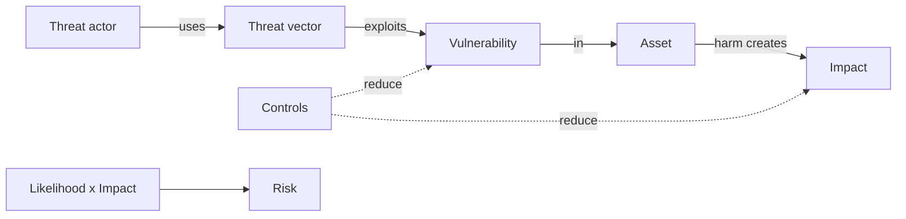
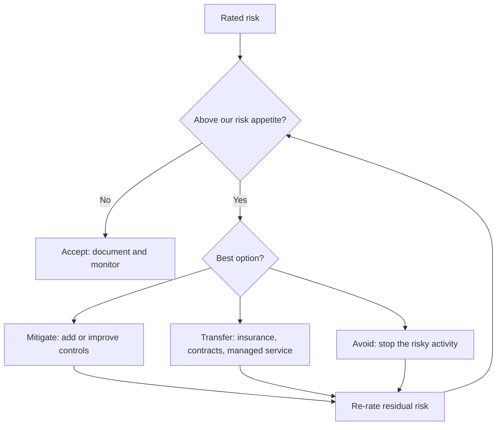

# Threats, Vulnerabilities and Risk

## Introduction

"Is this a big security problem?" is one of the most common questions in engineering, and one of the hardest to answer without the right vocabulary. Three words do most of the work:

- A **threat** is something that could cause harm: a person, group, event, or circumstance. A criminal gang, a bored teenager, a careless employee, or a flood are all threats.
- A **vulnerability** is a weakness that a threat could take advantage of: an unpatched server, a missing authorization check, a weak password, or a server room in a basement.
- **Risk** is the combination of the two, weighted by how likely harm is and how bad it would be.

An everyday analogy: burglars are a **threat** to your house. A window left open is a **vulnerability**. The **risk** depends on how likely a burglar is to try that window (is it on the ground floor? is your street busy?) and how much you would lose (an empty garage or your living room?).

You cannot remove every threat, and you cannot fix every vulnerability. Risk is the language that lets you decide which ones matter most, and that is what this page teaches.

## The Core Vocabulary

| Term | Meaning | Example |
|------|---------|---------|
| Asset | Something of value to protect | Customer database, signing key, brand reputation |
| Threat | Potential cause of harm | Ransomware gang, insider, power outage |
| Threat actor | The person or group behind a threat | Criminal group, nation state, competitor, insider |
| Threat vector | The path a threat uses to reach an asset | Phishing email, exposed API, USB drive |
| Vulnerability | A weakness that can be exploited | SQL injection in the search endpoint |
| Exploit | Code or a technique that takes advantage of a vulnerability | A crafted request that dumps the users table |
| Likelihood | How probable it is that a threat exploits a vulnerability | "Likely: the endpoint is public and the flaw is well known" |
| Impact | The harm if it happens | Fines, lost customers, downtime, safety harm |
| Risk | Likelihood combined with impact | "High: likely to happen and very damaging" |
| Control | A safeguard that reduces risk | Parameterized queries, WAF rule, monitoring |
| Residual risk | Risk left after controls are applied | "Low: fixed in code; WAF as backup" |



The [NIST glossary](https://csrc.nist.gov/glossary) and [NIST SP 800-30 Rev. 1](https://csrc.nist.gov/pubs/sp/800/30/r1/final), the guide for conducting risk assessments, use these terms in the same way. Section 13 covers formal risk management in [Risk Management](../13-sec-governance/0-sec-risk-management.mdx).

### Vulnerability is not the same as risk

A common confusion: a scanner reports a "critical" vulnerability, so people assume it is a critical *risk*. Not necessarily.

- A critical flaw in a service that is not reachable from anywhere, holds no data, and is scheduled for deletion next week is a **low risk**.
- A "medium" flaw in your internet-facing login page that attackers are actively exploiting is a **high risk**.

Severity scores such as the **Common Vulnerability Scoring System (CVSS)** describe how bad a vulnerability is in general. CVSS v4.0, published by FIRST in November 2023, is the current version. Risk adds *your* context: is the system exposed, what data does it hold, and is anyone exploiting this flaw? [Vulnerability Management and CVSS](../11-sec-defensive-operations/6-sec-vulnerability-management.mdx) covers scoring in depth.

Two free signals help bridge the gap between severity and real-world likelihood:

- **CISA's Known Exploited Vulnerabilities (KEV) catalog** lists vulnerabilities with confirmed exploitation in the wild.
- **EPSS (Exploit Prediction Scoring System)** from FIRST estimates the probability that a vulnerability will be exploited in the next 30 days. Version 4 was released in March 2025.

## Who Are the Threat Actors?

Understanding *who* might attack you shapes how likely different attacks are.

| Actor | Typical motive | Typical capability | Example targets |
|-------|----------------|--------------------|-----------------|
| Opportunistic attackers and bots | Easy money, botnet recruitment | Low to medium, highly automated | Anything exposed and unpatched |
| Organized cybercriminals | Money (ransomware, fraud, data theft) | Medium to high, professional | Businesses of all sizes |
| Hacktivists | Publicity, political goals | Low to medium | Government, controversial companies |
| Insiders (malicious) | Money, revenge | High access, varied skill | Employers |
| Insiders (accidental) | None: mistakes | High access | Everyone |
| Nation-state groups | Espionage, disruption | Very high, patient | Governments, critical infrastructure, tech suppliers |

Most organizations should plan primarily for **opportunistic and criminal attackers** and **accidental insiders**. They are by far the most common. Defending against a well-funded nation-state is a different problem, and you usually only need to worry about it if you are in a sector they target.

:::note
Do not dismiss accidental insiders. A misconfigured bucket, an email sent to the wrong person, or a laptop left on a train all cause real breaches with no attacker involved.
:::

## Measuring Risk: Likelihood times Impact

The simplest risk model rates likelihood and impact on a scale, often 1 to 5, and multiplies them. This is a **qualitative** method: the numbers are rankings, not measurements, but they force a structured conversation and make priorities visible.

### A risk register in Python

A **risk register** is a list of risks with their ratings, owners, and treatment decisions. Teams often keep it in a spreadsheet. Here is a minimal version in code:

```python
from dataclasses import dataclass

LEVELS = {1: "Very low", 2: "Low", 3: "Medium", 4: "High", 5: "Very high"}

@dataclass
class Risk:
    name: str
    threat: str
    vulnerability: str
    likelihood: int  # 1-5
    impact: int      # 1-5

    @property
    def score(self) -> int:
        return self.likelihood * self.impact

    @property
    def rating(self) -> str:
        if self.score >= 15:
            return "HIGH"
        if self.score >= 8:
            return "MEDIUM"
        return "LOW"

register = [
    Risk("Credential stuffing on login", "Bots with leaked passwords",
         "No MFA, no rate limit", likelihood=4, impact=4),
    Risk("Customer data in public bucket", "Internet scanners",
         "Bucket policy allows public read", likelihood=3, impact=5),
    Risk("Outdated image library", "Exploit for known CVE",
         "Dependency 2 major versions behind", likelihood=2, impact=4),
    Risk("Office Wi-Fi password shared", "Visitors on guest network",
         "Same network as staff laptops", likelihood=2, impact=2),
]

for r in sorted(register, key=lambda r: r.score, reverse=True):
    print(f"{r.score:>2} {r.rating:6} {r.name}  "
          f"(L={LEVELS[r.likelihood]}, I={LEVELS[r.impact]})")
```

Output:

```text
16 HIGH   Credential stuffing on login  (L=High, I=High)
15 HIGH   Customer data in public bucket  (L=Medium, I=Very high)
 8 MEDIUM Outdated image library  (L=Low, I=High)
 4 LOW    Office Wi-Fi password shared  (L=Low, I=Low)
```

Each entry names the threat **and** the vulnerability. "Credential stuffing" alone is not actionable. "Credential stuffing, because we have no MFA and no rate limit" points straight at the fix.

### A risk matrix

The same data is often shown as a heat map. Rows are impact, columns are likelihood:

| Impact \ Likelihood | 1 Very low | 2 Low | 3 Medium | 4 High | 5 Very high |
|---|---|---|---|---|---|
| 5 Very high | Medium | Medium | **High** (public bucket) | High | High |
| 4 High | Low | Medium (old library) | Medium | **High** (credential stuffing) | High |
| 3 Medium | Low | Low | Medium | Medium | High |
| 2 Low | Low | Low (Wi-Fi) | Low | Medium | Medium |
| 1 Very low | Low | Low | Low | Low | Medium |

:::caution
Qualitative scores feel precise but are not. Two people can rate the same risk 9 and 16. Use scores to **rank and discuss**, write down the reasoning behind each rating, and revisit them when the facts change. Never add or average scores from different raters as if they were measurements.
:::

### Quantitative risk: ALE

Some organizations try to put money on risk. The classic formula from security certification courses is:

- **SLE** (single loss expectancy) = asset value x exposure factor (the fraction lost in one incident)
- **ARO** (annualized rate of occurrence) = expected incidents per year
- **ALE** (annualized loss expectancy) = SLE x ARO

```python
def ale(asset_value, exposure_factor, aro):
    sle = asset_value * exposure_factor   # single loss expectancy
    return sle, sle * aro                 # annualized loss expectancy

# Rough, made-up estimates for a laptop-theft risk (illustration only).
sle, before = ale(asset_value=60_000, exposure_factor=0.5, aro=0.4)
print(f"Without disk encryption: SLE=${sle:,.0f}, ALE=${before:,.0f}")

# With full-disk encryption, a stolen laptop exposes far less data.
sle2, after = ale(asset_value=60_000, exposure_factor=0.05, aro=0.4)
print(f"With disk encryption:    SLE=${sle2:,.0f}, ALE=${after:,.0f}")

control_cost_per_year = 2_000
print(f"Risk reduction ${before - after:,.0f}/yr vs control cost ${control_cost_per_year:,}/yr")
```

Output:

```text
Without disk encryption: SLE=$30,000, ALE=$12,000
With disk encryption:    SLE=$3,000, ALE=$1,200
Risk reduction $10,800/yr vs control cost $2,000/yr
```

The numbers here are invented for illustration. In real life the inputs are hard to estimate, so ALE is most useful for comparing options and explaining a decision to non-technical leaders, not for precise forecasting. More rigorous methods such as FAIR (Factor Analysis of Information Risk) use ranges and simulations instead of single numbers.

### Adding exploitation data to severity

For vulnerability findings specifically, you can combine severity with exposure and real-world exploitation signals in a few lines of code. The rules below are an example policy, not a standard. Tune them to your environment:

```python
findings = [
    # (id, cvss_base, internet_facing, in_kev, epss)
    ("FIND-101 reverse proxy flaw", 7.5, True, True, 0.62),
    ("FIND-102 test image library", 9.8, False, False, 0.03),
    ("FIND-103 admin panel lib",    6.1, True, False, 0.41),
    ("FIND-104 build tool plugin",  8.8, False, False, 0.01),
]

def priority(cvss, internet_facing, in_kev, epss):
    if in_kev and internet_facing:
        return "P1 fix now"
    if internet_facing and (epss >= 0.1 or cvss >= 9.0):
        return "P2 this sprint"
    if cvss >= 7.0:
        return "P3 within 30 days"
    return "P4 backlog"

for name, cvss, exposed, kev, epss in findings:
    print(f"{priority(cvss, exposed, kev, epss):18} CVSS {cvss:<4} "
          f"exposed={str(exposed):5} KEV={str(kev):5} EPSS={epss:.2f}  {name}")
```

Output:

```text
P1 fix now         CVSS 7.5  exposed=True  KEV=True  EPSS=0.62  FIND-101 reverse proxy flaw
P3 within 30 days  CVSS 9.8  exposed=False KEV=False EPSS=0.03  FIND-102 test image library
P2 this sprint     CVSS 6.1  exposed=True  KEV=False EPSS=0.41  FIND-103 admin panel lib
P3 within 30 days  CVSS 8.8  exposed=False KEV=False EPSS=0.01  FIND-104 build tool plugin
```

The finding with the **highest** CVSS score (9.8) is not the top priority, because it sits in a test image that is never exposed. The **known-exploited** flaw on an internet-facing proxy is. The data here is invented; in practice you would pull KEV membership and EPSS scores from their official feeds, which are free to download.

## Where Risks Come From

A risk register is only as good as its inputs. Common sources:

| Source | What it finds | How often |
|--------|---------------|-----------|
| Threat modeling | Design-level risks before code exists | Each new feature or architecture change |
| Vulnerability scanners and SCA | Known flaws in software and dependencies | Continuously or daily |
| Penetration tests and bug reports | Exploitable flaws, chained issues | Yearly, before launches, or via a VDP |
| Incidents and near misses | Weaknesses that were actually used | After every incident |
| Audits and compliance reviews | Missing or ineffective controls | Yearly or per contract |
| Threat intelligence and advisories | New attack techniques and exploited flaws | Weekly |
| Asset and access reviews | Forgotten systems, excess privilege | Quarterly |

Two practical tips: record **near misses** (an attack that almost worked is free information), and review the register whenever the business changes, such as a new product, a new market, or an acquisition. New data and new customers bring new threats.

## Treating Risk: Four Options

Once a risk is rated, you decide what to do about it. There are four standard options:



| Option | What it means | Example |
|--------|---------------|---------|
| Mitigate (reduce) | Add controls to lower likelihood or impact | Add MFA and rate limiting to login |
| Transfer (share) | Shift part of the impact to someone else | Cyber insurance; use a payment provider so card data never touches your servers |
| Avoid | Stop doing the thing that creates the risk | Stop storing date of birth if you do not need it |
| Accept | Consciously live with it, usually because it is low or the fix costs more than the risk | Accept the risk of a two-hour outage for an internal tool |

Notes on each:

- **Transfer never transfers everything.** Insurance pays for some costs, but your customers' trust and your reputation stay with you. Outsourcing payment processing removes most of the card data risk, but you still must protect the integration.
- **Avoid is underrated.** Deleting data you do not need is often the cheapest, strongest control you have.
- **Accept must be explicit.** An accepted risk should have an owner (a named person with authority), a reason, and a review date. "We never got around to it" is not acceptance, it is neglect.

## Real-World Scenario

You work at an e-commerce company with 15 engineers. A routine scan of your dependencies and infrastructure produces a report with 140 findings. Your manager asks you to propose what to fix this sprint. There is time for maybe five items.

**Step 1: Filter by exposure and exploitation.** You tag each finding with three facts: is the affected component internet-facing, does it handle sensitive data, and is the vulnerability in the CISA KEV catalog or does it have a high EPSS score? Most findings are in build tools and internal test containers that never run in production.

**Step 2: Build a short risk register.** You rate the remaining 12 findings for likelihood and impact, writing one sentence of reasoning for each.

**Step 3: Choose a treatment for each high risk.**

| Finding | Exposure | Exploited in the wild? | Treatment |
|---------|----------|------------------------|-----------|
| Known-exploited flaw in the reverse proxy | Internet-facing | Yes (KEV) | Mitigate now: patch today |
| Admin panel without MFA | Internet-facing | Credential attacks are common | Mitigate: add SSO with MFA, restrict by network |
| Old reporting service storing full card numbers | Internal | N/A | Avoid: switch to the payment provider's tokens and delete stored numbers |
| Critical CVE in a test-only image | Not deployed | No | Accept for now: owner and review date recorded; fix in next base-image refresh |
| Medium XSS in the marketing CMS | Internet-facing | Not known | Mitigate next sprint; add a CSP header as an interim control |

**Step 4: Communicate in risk language.** Your summary to the manager does not say "we have 140 vulnerabilities". It says "we have two high risks that we are fixing this week, one we are removing by deleting data, and we have accepted the rest with owners and dates."

### Why this approach

A raw list of findings sorted by CVSS score would have sent the team to the test-only image first. Combining severity with exposure, exploitation data, and business impact focuses scarce engineering time on what attackers are most likely to use against you.

### When to use it and when not to

Use risk-based prioritization whenever findings outnumber the time to fix them, which is almost always. Do not use it as an excuse to defer everything that is not "high". Set time limits by rating (for example, highs in 7 days, mediums in 30) so lower risks still get fixed. If a regulation or contract sets fixed deadlines, such as the patching deadlines in PCI DSS, those deadlines come first.

### Alternatives and trade-offs

| Approach | Pros | Cons | Best for |
|----------|------|------|----------|
| Fix by CVSS score only | Simple, automatic | Ignores exposure and exploitation; wastes effort | Very small environments |
| Risk-based (severity + exposure + KEV/EPSS + impact) | Focuses on real-world danger | Needs asset inventory and judgment | Most teams |
| Fix everything | No judgment calls | Impossible at scale; important items wait behind trivial ones | Tiny scopes, such as one critical service |
| Quantitative (ALE, FAIR) | Speaks the language of finance, good for big investments | Inputs are hard to estimate, time-consuming | Large budget decisions and board reporting |
| Compliance deadlines only | Clear rules, audit-friendly | Minimum bar; may not match your threats | Regulated environments, combined with risk-based |

## Common Mistakes

- **Treating every scanner finding as equal.** Context changes everything. Start with what is exposed and what is being exploited.
- **Rating impact only in technical terms.** "The server goes down" means little to leadership. "Customers cannot check out for four hours" is impact they understand.
- **Forgetting accidental threats.** Mistakes, outages, and misconfigurations cause as many incidents as attackers.
- **Accepting risks silently.** Every accepted risk needs an owner, a written reason, and a review date.
- **Never revisiting ratings.** A low-likelihood vulnerability becomes high-likelihood the day a public exploit appears.
- **Confusing compliance with security.** Passing an audit means you met a baseline, not that you have no significant risks.

## Summary

- A **threat** is a potential cause of harm, a **vulnerability** is a weakness, and **risk** combines likelihood and impact.
- Severity scores such as CVSS describe the vulnerability. Risk adds your context: exposure, data, and real-world exploitation (CISA KEV, EPSS).
- Plan mainly for opportunistic criminals and accidental insiders, unless your sector is a known target for advanced attackers.
- A risk register with likelihood times impact ratings is a simple, effective way to prioritize. Treat the numbers as rankings, not measurements.
- Treat each risk by mitigating, transferring, avoiding, or explicitly accepting it, then re-rate the residual risk.

## Exercises

1. Add a `treatment` field and an `owner` field to the `Risk` dataclass. Make the script print a warning for any HIGH risk with no treatment.
2. Rate the four risks in the register yourself, without looking at the given numbers. Compare with a classmate or colleague. Where did you disagree, and why?
3. Pick one risk and describe one way to mitigate it, one way to transfer it, and one way to avoid it. Which would you choose for a 10-person startup?
4. Look up a vulnerability in the CISA KEV catalog. What product does it affect, and what does CISA require federal agencies to do about it?

Related pages:

- [The CIA Triad](./1-sec-cia-triad.mdx)
- [Attack Surface](./3-sec-attack-surface.mdx)
- [Risk Management](../13-sec-governance/0-sec-risk-management.mdx)
- [Vulnerability Management and CVSS](../11-sec-defensive-operations/6-sec-vulnerability-management.mdx)

External reading:

- [NIST SP 800-30 Rev. 1: Guide for Conducting Risk Assessments](https://csrc.nist.gov/pubs/sp/800/30/r1/final)
- [CISA Known Exploited Vulnerabilities Catalog](https://www.cisa.gov/known-exploited-vulnerabilities-catalog)
- [FIRST EPSS](https://www.first.org/epss/)
- [FIRST CVSS v4.0](https://www.first.org/cvss/v4-0/)
