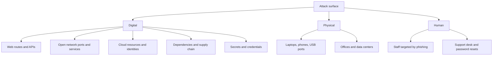
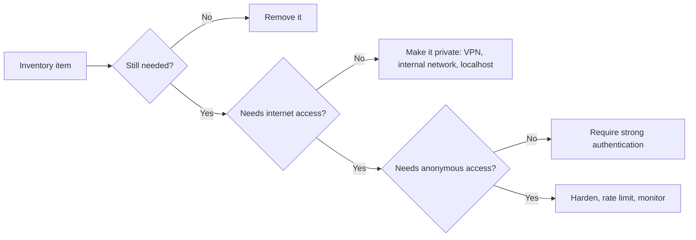

# Attack Surface

## Introduction

Your **attack surface** is the sum of all the places where an attacker can try to get data into or out of your system, or otherwise interact with it. Every web route, open port, API key, third-party package, admin login, employee inbox, and forgotten test server is part of it.

Think of a building. Every door, window, air vent, loading dock, and employee badge is a way in. A building with one guarded entrance is easier to protect than one with forty unlocked side doors, even if every door has a good lock. You cannot remove the front door, because people need to get in, but you can brick up the doors nobody uses and put guards on the ones that remain.

The same logic applies to software:

1. **Know** your attack surface. You cannot defend what you do not know exists.
2. **Reduce** it. Remove what is not needed.
3. **Protect and monitor** what remains.

This page shows how to do all three, with small tools you can run against your own code and machines.

:::warning Only inventory what you own
Every technique on this page is for systems you own or are responsible for. Running port scans or enumeration tools against other people's systems without written permission can be illegal. Practice on your own machine, your own cloud account, or a lab. See [Ethics, Law and Responsible Disclosure](./8-sec-ethics-and-law.mdx).
:::

## The Parts of an Attack Surface

Attack surfaces are usually split into three broad categories:



### Digital

- **Application entry points:** every URL, HTTP method, form field, header, cookie, file upload, WebSocket, GraphQL query, and webhook receiver.
- **Network services:** every listening port, such as SSH, databases, caches, message queues, and admin consoles.
- **Cloud resources:** storage buckets, serverless functions, managed databases, and above all **identities**: users, roles, and access keys.
- **Dependencies:** open-source packages, container base images, CI/CD plugins, and SaaS integrations. Each is code you run but did not write.
- **Secrets:** API keys, tokens, and passwords in code, config files, CI logs, and chat messages.

### Physical

Devices and places: lost laptops, unlocked server rooms, USB ports on kiosks, and printers on the office network.

### Human

People are part of the attack surface. Phishing emails, phone calls to the help desk ("I lost my phone, please reset my MFA"), and fake job candidates all target people rather than code. [Social Engineering and Phishing](../10-sec-offensive-security/8-sec-social-engineering.mdx) covers this side.

## External vs Internal Attack Surface

- The **external** attack surface is what anyone on the internet can reach without credentials. It is where opportunistic attackers and automated bots start, so it usually deserves attention first.
- The **internal** attack surface is what someone can reach once they are inside: after phishing an employee, stealing a token, or compromising one server. A flat internal network where every machine can reach every database turns one small foothold into a full breach.
- The **authenticated** attack surface is what a logged-in user can reach. Many serious bugs, such as one customer reading another customer's invoices, live here.

## Step 1: Inventory Your Application's Entry Points

Start with what you control directly: your own code. Most web frameworks can list their routes. Here is a small Flask app with a few problems that are typical of real projects:

```python
from flask import Flask

app = Flask(__name__)

@app.get("/")
def home():
    return "Welcome"

@app.post("/login")
def login():
    return "login"

@app.get("/api/invoices/<int:invoice_id>")
def get_invoice(invoice_id):
    return {"id": invoice_id}

@app.post("/api/invoices/<int:invoice_id>/pdf")
def render_pdf(invoice_id):
    return "pdf"

@app.get("/debug/env")          # left over from development
def debug_env():
    return "env"

@app.get("/admin/users")
def admin_users():
    return "users"

PUBLIC_OK = {"/", "/login", "/static/<path:filename>"}

print(f"{'METHODS':12} {'PATH':36} NOTE")
for rule in sorted(app.url_map.iter_rules(), key=lambda r: r.rule):
    methods = ",".join(sorted(rule.methods - {"HEAD", "OPTIONS"}))
    note = ""
    if rule.rule.startswith(("/debug", "/admin")):
        note = "REVIEW: should this be public?"
    elif rule.arguments and rule.rule not in PUBLIC_OK:
        note = "takes input: " + ", ".join(sorted(rule.arguments))
    print(f"{methods:12} {rule.rule:36} {note}")
```

Output:

```text
METHODS      PATH                                 NOTE
GET          /                                    
GET          /admin/users                         REVIEW: should this be public?
GET          /api/invoices/<int:invoice_id>       takes input: invoice_id
POST         /api/invoices/<int:invoice_id>/pdf   takes input: invoice_id
GET          /debug/env                           REVIEW: should this be public?
POST         /login                               
GET          /static/<path:filename>              
```

Install Flask with `pip install flask` to run it. Even this tiny inventory raises good questions:

- **`/debug/env`** is a classic leftover that leaks environment variables, often including secrets. Delete it, or register it only when a development flag is set.
- **`/admin/users`** should probably not be reachable from the internet at all, and certainly not without strong authentication.
- **`/api/invoices/<id>`** takes a user-controlled ID. Does it check that the invoice belongs to the logged-in user? That is the most common serious API flaw. See [Broken Object Level Authorization](../7-sec-api-security/2-sec-bola.mdx).
- **The PDF renderer** is a high-risk feature: document generators often fetch URLs or process templates, which can lead to server-side request forgery or injection.

Remember that the route list is only part of the picture. Each route also accepts **query parameters, headers, cookies, and a request body**, and each of those is attacker-controlled input.

## Step 2: Inventory Network Services

Next, find out what is listening on your machines. On Linux, `ss` lists listening sockets:

```bash
# -t TCP, -u UDP, -l listening, -n numeric, -p owning process (needs sudo for others' processes)
sudo ss -tulnp
```

Example output (yours will differ):

```text
Netid State  Recv-Q Send-Q Local Address:Port  Peer Address:Port Process
tcp   LISTEN 0      4096       127.0.0.1:6379       0.0.0.0:*     users:(("redis-server",pid=812,fd=6))
tcp   LISTEN 0      4096         0.0.0.0:5432       0.0.0.0:*     users:(("postgres",pid=901,fd=7))
tcp   LISTEN 0      128          0.0.0.0:22         0.0.0.0:*     users:(("sshd",pid=644,fd=3))
tcp   LISTEN 0      511          0.0.0.0:443        0.0.0.0:*     users:(("nginx",pid=1020,fd=8))
```

The **Local Address** column is the key:

- `127.0.0.1:6379` means Redis listens only on the loopback interface. Only processes on this machine can reach it. Good.
- `0.0.0.0:5432` means PostgreSQL listens on **every** interface. If no firewall blocks it, the database is reachable from the network, and possibly from the internet. That is a finding.
- `0.0.0.0:22` and `0.0.0.0:443` are expected on a web server, but SSH should be restricted by firewall rules or a bastion host. See [SSH Security](../9-sec-system-hardening/2-sec-ssh-security.mdx).

You can also check from the outside, which is what an attacker sees. A tiny Python check against your own machine:

```python
import socket

HOST = "127.0.0.1"  # only check your own machine
PORTS = {22: "ssh", 80: "http", 443: "https", 3306: "mysql",
         5432: "postgres", 6379: "redis", 8080: "http-alt", 9200: "elasticsearch"}

for port, name in PORTS.items():
    with socket.socket(socket.AF_INET, socket.SOCK_STREAM) as s:
        s.settimeout(0.3)
        state = "OPEN" if s.connect_ex((HOST, port)) == 0 else "closed"
    print(f"{port:>5}/tcp {name:14} {state}")
```

Example output (yours will differ):

```text
   22/tcp ssh            OPEN
   80/tcp http           closed
  443/tcp https          OPEN
 3306/tcp mysql          closed
 5432/tcp postgres       OPEN
 6379/tcp redis          OPEN
 8080/tcp http-alt       closed
 9200/tcp elasticsearch  closed
```

Professionals use **Nmap** for this. Scanning your own loopback interface is a safe first experiment:

```bash
nmap -sV -p 1-10000 127.0.0.1
```

`-sV` asks Nmap to identify the service and version on each open port. [Network Scanning with Nmap](../2-sec-network-security/10-sec-network-scanning.mdx) teaches it properly, including how to scan only what you are authorized to scan.

:::tip
A scan from inside the server shows what is listening. A scan from **outside** (for example, from a separate cloud VM you own, against your own public IP) shows what firewalls actually let through. You need both views.
:::

## Step 3: Inventory Everything Else

Routes and ports are the easy part. A real inventory also covers:

| Area | Questions to ask | Where to look |
|------|------------------|---------------|
| Domains and subdomains | Which hostnames point at us? Any old ones pointing at deleted resources? | DNS zone files, certificate transparency logs for your own domains |
| Cloud resources | Which buckets, functions, and databases exist, in which accounts and regions? | Cloud asset inventory tools, CSPM |
| Identities | Which users, roles, and keys exist? Which are unused? | IAM reports, SSO admin console |
| Dependencies | Which packages and versions do we ship? | Lockfiles, SBOMs, SCA tools |
| Third-party SaaS | Which services hold our data or have access tokens? | Finance records, SSO app list |
| Secrets | Where do keys live? Any in code or logs? | Secret scanners, vault audit logs |
| People and process | Who can reset passwords? How is identity verified? | Help desk procedures |

**Certificate transparency** deserves a mention: every publicly trusted TLS certificate is logged publicly. Searching the logs for your own domain (for example on crt.sh) often reveals forgotten subdomains such as `staging-old.example.com`. Attackers use the same data, so you should look first.

Organizations that do this continuously use **attack surface management (ASM)** or **external attack surface management (EASM)** tools, which repeatedly discover internet-facing assets and flag changes. For small teams, a quarterly manual review plus cloud inventory tooling is a reasonable start.

## Step 4: Reduce the Attack Surface

Every item you remove is one less thing to patch, monitor, and defend. Common reductions:



### Remove debug features from production

Vulnerable:

```python
import os
from flask import Flask

app = Flask(__name__)

@app.get("/debug/env")
def debug_env():
    return dict(os.environ)  # leaks every secret in the environment

if __name__ == "__main__":
    app.run(host="0.0.0.0", debug=True)  # debugger reachable from the network
```

Fixed:

```python
import os
from flask import Flask

app = Flask(__name__)

if os.environ.get("APP_ENV") == "development":
    @app.get("/debug/health-details")
    def debug_details():
        return {"env": "development"}  # never return secrets, even in dev

if __name__ == "__main__":
    # Development server only; bind to localhost and keep the debugger off by default.
    app.run(host="127.0.0.1", debug=os.environ.get("FLASK_DEBUG") == "1")
```

The Flask (Werkzeug) interactive debugger allows running arbitrary Python code in the browser. It is protected by a PIN, but it must never be enabled on a reachable server. In production, run the app under a real WSGI server such as Gunicorn behind a reverse proxy.

### Bind internal services to localhost or a private network

For a database that only the app on the same host uses, PostgreSQL's `postgresql.conf` can restrict the listen address:

```text
listen_addresses = 'localhost'
```

In Docker Compose, publish a port only to the loopback interface, or not at all if only other containers need it:

```yaml
services:
  db:
    image: postgres:17
    environment:
      POSTGRES_PASSWORD_FILE: /run/secrets/db_password
    # No "ports:" section: only containers on the same network can reach it.
  admin:
    image: adminer
    ports:
      - "127.0.0.1:8081:8080"   # reachable from this machine only
```

### Restrict admin paths at the proxy

If an admin interface must stay on the same host as the public app, the reverse proxy can limit who reaches it:

```nginx
location /admin/ {
    allow 10.0.0.0/8;      # internal network / VPN range
    deny  all;
    proxy_pass http://app:8000;
}
```

Network restrictions are a useful extra layer, but the admin routes must **still** require authentication and authorization in the application. Never rely on the network alone. That is the idea of [Defense in Depth](./4-sec-defense-in-depth.mdx).

### Other reductions

- Delete unused cloud resources, DNS records, and user accounts.
- Remove unused dependencies, and prefer small base images such as distroless or slim images in containers.
- Turn off unused features in frameworks and servers, such as directory listings, sample apps, and verbose error pages.
- Collect less data. Data you do not store cannot be stolen.

## Real-World Scenario

You join a 40-person company that has run a B2B SaaS product for six years. Nobody is sure what is running. During your first month, you are asked to "reduce our exposure" before an enterprise customer's security review.

**What you do:**

1. **Discover.** You pull every DNS record for the company's domains, search certificate transparency logs for those domains, export the cloud asset inventory from all accounts, and list SSO-connected apps. You find 63 hostnames. The team expected about 20.
2. **Classify.** For each hostname you record the owner, purpose, and whether it holds customer data. Eleven have no known owner. Three point to cloud resources that no longer exist, which is a **subdomain takeover** risk: if someone else claims that cloud resource, they control content on your domain.
3. **Reduce.** You delete the dangling DNS records, shut down two old staging environments with copies of production data, and move an internal metrics dashboard behind the SSO proxy.
4. **Protect what remains.** Public apps get a WAF and rate limiting, and admin panels require SSO with MFA.
5. **Keep it current.** You add a weekly job that compares DNS and cloud inventory to the last known list and opens a ticket for any new internet-facing asset.

### Why this approach

Discovery before protection avoids spending money defending things that should not exist. Removing the old staging environments eliminated risk that no firewall or scanner would have fully addressed. The weekly diff stops the surface from silently growing back.

### When to use it and when not to

Do a full inventory when you join a team, after a merger or acquisition, and before an audit or major launch. Continuous discovery is worth it once you have many teams creating resources independently. For a brand-new two-person project, a simple list in the README and a firewall that defaults to deny may be enough.

### Alternatives and trade-offs

| Approach | Pros | Cons | Best for |
|----------|------|------|----------|
| Manual spreadsheet inventory | Free, builds understanding | Goes stale quickly, misses unknowns | Small, stable environments |
| Cloud-native inventory and config tools | Accurate for that provider, often built in | Blind to other clouds, SaaS, and DNS outside it | Single-cloud teams |
| External attack surface management (EASM) service | Continuous, finds unknown assets the way attackers do | Cost, false positives, needs ownership process | Larger or fast-changing organizations |
| Periodic penetration test | Expert view, validates exposure | Point-in-time, limited scope | Pre-launch and audits |
| Default-deny architecture (private by default) | Prevents accidental exposure in the first place | Requires upfront design and tooling | New platforms and greenfield projects |

## Common Mistakes

- **Only counting the code you wrote.** Dependencies, CI plugins, and SaaS integrations are attack surface too.
- **Forgetting the authenticated surface.** Logged-in users, including free-trial accounts anyone can create, can reach far more than anonymous visitors.
- **Assuming "not linked" means "not found".** Hidden URLs, unlisted subdomains, and obscure ports are found by scanners and by certificate transparency logs.
- **Leaving dangling DNS records.** Records pointing at deleted cloud resources can let someone else serve content on your domain.
- **Binding to `0.0.0.0` by habit.** Bind to `127.0.0.1` or a private interface unless the service truly needs to be reachable from elsewhere.
- **Doing the inventory once.** Attack surfaces grow every sprint. Make discovery repeatable.

## Summary

- The attack surface is every point where an attacker can interact with your system: digital (routes, ports, cloud, dependencies, secrets), physical, and human.
- Distinguish external, internal, and authenticated attack surfaces. Each needs attention.
- Inventory first: list routes from your framework, listening ports with `ss`, and wider assets from DNS, certificate transparency, and cloud inventories.
- Reduce next: remove unused features and resources, make internal services private, and require strong authentication where anonymous access is not needed.
- Protect and monitor what remains, and repeat discovery regularly so the surface does not quietly grow.

## Exercises

1. Run the route-inventory script against a Flask or FastAPI app you have written (for FastAPI, iterate over `app.routes`). Which routes surprised you?
2. Run `sudo ss -tulnp` on your own Linux machine or VM. For each listening service, decide whether it needs to listen on all interfaces.
3. Using the list of input points you made in the exercise on [Cybersecurity Introduction](./0-sec-introduction.mdx), classify each Juice Shop input as anonymous or authenticated.
4. Write a short script that reads a list of hostnames you own from a file and flags any that no longer resolve in DNS. Why might a hostname that still resolves to a deleted resource be even more dangerous?

Related pages:

- [Defense in Depth](./4-sec-defense-in-depth.mdx)
- [Least Privilege and Zero Trust](./5-sec-least-privilege.mdx)
- [Firewalls and Security Groups](../2-sec-network-security/1-sec-firewalls.mdx)
- [Common Cloud Misconfigurations](../8-sec-cloud-and-container/2-sec-cloud-misconfigurations.mdx)

External reading:

- [OWASP Attack Surface Analysis Cheat Sheet](https://cheatsheetseries.owasp.org/cheatsheets/Attack_Surface_Analysis_Cheat_Sheet.html)
- [Flask documentation: debug mode](https://flask.palletsprojects.com/en/stable/debugging/)
- [Nmap reference guide](https://nmap.org/book/man.html)
