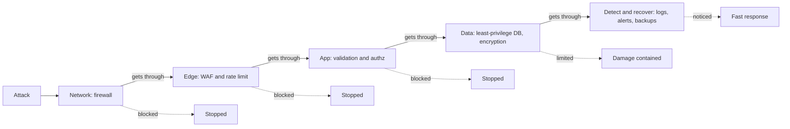
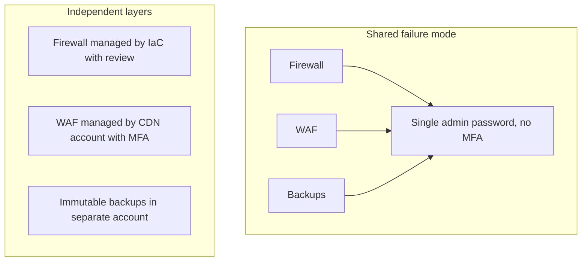

# Defense in Depth

## Introduction

**Defense in depth** means protecting a system with several independent layers of security controls, so that when one layer fails, and eventually one will, another layer stops or limits the damage.

The idea comes from military strategy and from castle design. A medieval castle did not rely on one wall. It had a moat, an outer wall, an inner wall, a gatehouse, guards, and a keep. Attackers who crossed the moat still faced the walls. Attackers who breached a wall were funneled into places the defenders could watch.

Modern safety engineering uses the **Swiss cheese model** for the same idea. Every layer of protection is a slice of cheese with holes in it (weaknesses). One slice always has holes. An incident happens only when the holes in **every** slice line up. Adding independent slices makes that much less likely.

In software, the layers might be:

- A firewall that only exposes ports 80 and 443.
- A web application firewall (WAF) that blocks obvious attack patterns.
- Input validation in the application.
- Parameterized database queries.
- Authorization checks on every object.
- A database account that can only read the tables it needs.
- Encryption of sensitive columns.
- Logging and alerting that notice when something odd happens.
- Backups that let you recover.

None of these is perfect on its own. Together, they make a successful attack much harder and a breach much smaller.

## Why One Control Is Never Enough

Every control fails sometimes:

- **Code has bugs.** A developer forgets the authorization check on one new endpoint.
- **Configuration drifts.** A firewall rule is opened "temporarily" and never closed.
- **People make mistakes.** An employee enters their password on a convincing phishing page.
- **Tools have gaps.** A WAF does not understand your custom JSON format, so a payload slips through.
- **New attacks appear.** A zero-day vulnerability in a library you trust has no patch yet.

If any single one of these failures leads straight to a breach, your system is fragile. Defense in depth turns single points of failure into situations where several independent things must go wrong at once.



## The Layers

A common way to organize layers is from the outside in:

| Layer | Example controls | What it protects against |
|-------|------------------|--------------------------|
| Policies and people | Security training, access reviews, change approval | Mistakes, social engineering, insider misuse |
| Physical | Locked rooms, badge access, disk encryption on laptops | Theft, tampering |
| Perimeter and network | Firewalls, security groups, segmentation, VPN or zero trust access | Direct access to internal services |
| Host | Patching, hardened OS, EDR, minimal packages | Exploitation of the server itself |
| Application | Input validation, output encoding, authentication, authorization, CSRF protection | Injection, XSS, broken access control |
| Data | Encryption, tokenization, least-privilege database accounts, backups | Data theft, tampering, loss |
| Detection and response | Logs, SIEM alerts, incident response plan | Long-running undetected breaches |

Another useful way to think about layers is by **control type**:

- **Preventive** controls stop an attack: firewalls, authentication, parameterized queries.
- **Detective** controls notice an attack: logs, alerts, intrusion detection, file integrity monitoring.
- **Corrective** controls limit damage and recover: backups, automatic key rotation, incident response.
- **Deterrent** controls discourage attackers: warning banners, visible monitoring, legal action.

A strong design has controls of more than one type. A system with ten preventive controls and no detection has no way of knowing when all ten were bypassed.

## Layers in Code: One Endpoint, Several Defenses

Here is a small "get order" function written with a single, weak layer. It builds SQL from user input and has no ownership check.

Vulnerable:

```python
import sqlite3

db = sqlite3.connect(":memory:")
db.executescript("""
CREATE TABLE orders (id INTEGER PRIMARY KEY, customer TEXT, total_cents INTEGER);
INSERT INTO orders VALUES (1, 'alice', 4999), (2, 'bob', 1250), (3, 'alice', 800);
""")

def get_order(current_user: str, raw_id: str):
    # One layer only: the query string is built from user input.
    sql = f"SELECT id, total_cents FROM orders WHERE id = {raw_id}"
    return db.execute(sql).fetchall()

print(get_order("alice", "1"))
print(get_order("alice", "2"))          # bob's order, no ownership check
print(get_order("alice", "1 OR 1=1"))   # injection returns every order
```

Output:

```text
[(1, 4999)]
[(2, 1250)]
[(1, 4999), (2, 1250), (3, 800)]
```

Two separate failures are visible: Alice can read Bob's order by changing the ID (broken access control), and she can read **every** order with a SQL injection payload. Now the same function with four independent layers:

Fixed:

```python
import logging
import re
import sqlite3
import sys

logging.basicConfig(format="%(levelname)s %(message)s", level=logging.INFO, stream=sys.stdout)
log = logging.getLogger("orders")

db = sqlite3.connect(":memory:")
db.executescript("""
CREATE TABLE orders (id INTEGER PRIMARY KEY, customer TEXT, total_cents INTEGER);
INSERT INTO orders VALUES (1, 'alice', 4999), (2, 'bob', 1250), (3, 'alice', 800);
""")

ORDER_ID = re.compile(r"^[0-9]{1,9}$")

def get_order(current_user: str, raw_id: str):
    # Layer 1: input validation -- reject anything that is not a small integer.
    if not ORDER_ID.fullmatch(raw_id):
        log.warning("rejected malformed order id %r from %s", raw_id, current_user)
        return None
    # Layer 2: parameterized query -- data can never become SQL code.
    # Layer 3: authorization -- the query only matches the caller's own orders.
    row = db.execute(
        "SELECT id, total_cents FROM orders WHERE id = ? AND customer = ?",
        (int(raw_id), current_user),
    ).fetchone()
    if row is None:
        # Layer 4: logging -- record denied or missing lookups for detection.
        log.info("order %s not found for %s", raw_id, current_user)
    return row

print(get_order("alice", "1"))
print(get_order("alice", "2"))            # bob's order
print(get_order("alice", "1 OR 1=1"))     # injection attempt
```

Output:

```text
(1, 4999)
INFO order 2 not found for alice
None
WARNING rejected malformed order id '1 OR 1=1' from alice
None
```

Look at how the layers overlap:

- If a future developer removes the regex check, the **parameterized query** still prevents SQL injection.
- If someone rewrites the query and forgets the `customer = ?` clause, the regex still blocks injection, though the access control bug would return. That is why authorization deserves its own tests. See [Broken Access Control](../3-sec-web-security/2-sec-broken-access-control.mdx).
- In both cases, the **logs** give you a chance to notice someone probing order IDs.

Note that the "not found" response for Bob's order is deliberate: returning "forbidden" would confirm that order 2 exists.

### Adding a data-layer defense

The application should connect to the database with an account that can do only what the app needs. In PostgreSQL:

```sql
-- Role used by the web application: read and write orders, nothing else.
CREATE ROLE shop_app LOGIN PASSWORD 'use-a-secret-manager-not-this';
GRANT CONNECT ON DATABASE shop TO shop_app;
GRANT USAGE ON SCHEMA public TO shop_app;
GRANT SELECT, INSERT, UPDATE ON orders TO shop_app;
-- No DELETE, no DROP, no access to the users or payments tables.
```

Now even a successful SQL injection cannot drop tables or read the `users` table. This is [least privilege](./5-sec-least-privilege.mdx) applied as a layer. PostgreSQL also supports **row-level security** policies, which can enforce "customers only see their own rows" inside the database itself, a further layer below the application's `WHERE` clause.

### Adding an edge-layer defense

A WAF in front of the app can block common attack patterns before they reach your code. For example, the open-source **OWASP Core Rule Set (CRS)** runs on engines such as ModSecurity and Coraza, and many CDNs and cloud providers offer managed WAF rules. A WAF is useful, but it is a pattern matcher: it can be bypassed by encodings and formats it does not understand, and it can block legitimate traffic. It complements code fixes. It does not replace them.

### Adding a reverse-proxy layer

Even without a commercial WAF, the reverse proxy in front of your app can add cheap, independent layers. This nginx snippet adds a per-IP rate limit on the login endpoint, a request body size limit, and two common security headers:

```nginx
# In the http block: 10 MB of shared memory to track client IPs, 5 requests/second each
limit_req_zone $binary_remote_addr zone=login:10m rate=5r/s;

server {
    listen 443 ssl;
    server_name shop.example.com;
    # ssl_certificate and ssl_certificate_key lines omitted for brevity

    client_max_body_size 2m;                       # reject oversized request bodies early
    add_header X-Content-Type-Options "nosniff" always;
    add_header Strict-Transport-Security "max-age=31536000" always;

    location = /login {
        limit_req zone=login burst=10 nodelay;     # slows password guessing
        proxy_pass http://127.0.0.1:8000;
    }

    location / {
        proxy_pass http://127.0.0.1:8000;
    }
}
```

Check the configuration with `sudo nginx -t` before reloading. Each directive covers a different failure: the rate limit slows credential attacks even if the app has no lockout logic, the body size limit stops some resource-exhaustion attempts, and the headers reduce browser-side risks. [Security Headers, CORS and CSP](../3-sec-web-security/9-sec-security-headers.mdx) explains the headers in detail.

## Independence Matters

Layers only help if they fail **independently**. Two controls that share a weakness count as one.

Examples of layers that are not really independent:

- Client-side JavaScript validation and server-side validation that both trust a `role` field sent by the browser. One forged request bypasses both.
- A firewall and a WAF both managed by a single admin account without MFA. Steal that one password and both layers fall.
- Backups stored on the same network share as the data, reachable with the same credentials. Ransomware encrypts both.
- Two antivirus products with the same detection engine.

When you add a layer, ask: **what would have to go wrong for this layer to fail, and is that the same thing that makes the other layers fail?**



## Testing Your Layers

A layer you have never tested is an assumption. Write tests that attack each layer **on its own**, so a regression in one layer is caught even while the others still hide it. Using the fixed `get_order` function from above (saved as `orders.py`):

```python
# test_orders.py -- run with: pytest -q
import pytest

from orders import get_order

@pytest.mark.parametrize("payload", ["1 OR 1=1", "1; DROP TABLE orders", "-1", "", "1e3"])
def test_validation_rejects_non_integer_ids(payload):
    assert get_order("alice", payload) is None

def test_owner_can_read_own_order():
    assert get_order("alice", "1") == (1, 4999)

def test_other_customers_orders_are_invisible():
    assert get_order("alice", "2") is None
```

Example output:

```text
.......                                                                  [100%]
7 passed in 0.04s
```

Other layers need their own checks: run a scanner such as OWASP ZAP against staging to confirm the WAF blocks obvious payloads, restore a backup on a schedule, and trigger a test alert to confirm someone is paged. Purple-team exercises, where attackers and defenders work together, test several layers at once. See [Building a Security Testing Strategy](../6-sec-appsec-and-devsecops/9-sec-security-testing-strategy.mdx).

## Defense in Depth Beyond Code

The same thinking applies everywhere:

- **Accounts:** password plus MFA plus anomaly detection on logins plus short session lifetimes.
- **Laptops:** disk encryption plus screen lock plus remote wipe plus EDR.
- **Email:** spam filtering plus link rewriting plus user training plus an easy "report phishing" button.
- **Cloud:** organization-level guardrails plus IAM least privilege plus private networking plus CSPM alerts.
- **Ransomware:** patching plus EDR plus segmentation plus immutable, tested backups.

## Real-World Scenario

Your team maintains a ten-year-old PHP and Python customer portal for an insurance company. A penetration test finds a SQL injection in the policy search endpoint. The fix requires changing a shared query-building module used in forty places. The developers estimate two weeks to fix and test safely. Your manager asks: "Can we just put a WAF rule in front of it instead?"

**Your recommendation: do both, in order.**

1. **Today:** enable a WAF rule (from your CDN's managed rule set, or a custom rule) that blocks SQL injection patterns on the search endpoint. Run it in log-only mode for an hour to check for false positives on real traffic, then switch to blocking. This is a **virtual patch**.
2. **Today:** check the database account the portal uses. It turns out to be an owner-level account. Create a restricted role with only the permissions the portal needs and switch to it. This limits the damage if the WAF is bypassed.
3. **Today:** add an alert on database errors and WAF blocks from the search endpoint, so probing is noticed.
4. **Within two weeks:** fix the query module with parameterized queries, add tests that send injection payloads, and deploy.
5. **After the fix:** keep the WAF rule as an extra layer, but stop treating it as the fix.

### Why this approach

The WAF reduces exposure within hours, while the real fix takes weeks. The database role reduces impact even if the WAF fails. The alert covers both. The code fix removes the root cause. Each layer protects against a different failure: WAF bypass, unexpected code paths, and future regressions.

### When to use it and when not to

Virtual patching with a WAF is a good **temporary** measure when a code fix needs time or when you run third-party software you cannot change. It is a poor **permanent** answer, because attackers routinely find encodings that WAF rules miss, and because the vulnerable code may be reachable by other routes such as internal APIs or batch jobs that never pass through the WAF. When the fix is small and quick to deploy, just fix the code and skip the temporary rule.

### Alternatives and trade-offs

| Approach | Pros | Cons | Best for |
|----------|------|------|----------|
| WAF rule only | Fast, no code change, protects all apps behind it | Bypassable, false positives, does not fix root cause | Emergency virtual patch; software you cannot modify |
| Code fix only | Removes root cause, no runtime cost | Takes time; no protection meanwhile; a single layer | Small, quick fixes |
| Least-privilege DB account | Limits blast radius of many bugs | Does not stop data the app can legitimately read | Every application, always |
| Code fix + WAF + least privilege + alerting | Independent layers; fast and thorough | More components to manage | Internet-facing apps with sensitive data |
| Take the feature offline | Immediate, complete protection | Business impact for users | Actively exploited flaws with no quick mitigation |

## Common Mistakes

- **Treating a perimeter as the only defense.** "It is behind the firewall" stops being true the moment one internal machine is compromised.
- **Stacking layers with the same weakness.** Check that layers fail independently.
- **Using the WAF as a permanent excuse not to fix code.** WAF rules are a safety net, not a repair.
- **Only preventive controls.** Without detection, you will not know when prevention fails. Without recovery, you cannot bounce back.
- **Too many layers that annoy users.** Excessive friction leads people to find workarounds, such as shared accounts or passwords on sticky notes, which removes the layers you added. Balance security with usability.
- **Forgetting to test the layers.** A backup you have never restored and an alert that has never fired are not proven layers.

## Summary

- Defense in depth uses several independent layers of controls, so one failure does not cause a breach. The Swiss cheese model is a good mental picture.
- Layers span people, physical, network, host, application, data, and detection and response.
- Mix control types: preventive, detective, corrective, and deterrent.
- In code, combine validation, parameterized queries, authorization, least-privilege database accounts, and logging. Each one covers a different failure.
- A WAF is a valuable layer and a good temporary virtual patch, but it complements code fixes rather than replacing them.
- Make sure layers fail independently, and test them regularly.

## Exercises

1. Remove the regex check from the fixed `get_order` function and run the injection attempt again. Which layer stops it now? Then remove the `customer = ?` clause instead. What happens?
2. Pick an application you know and list its layers from the table above. Which layer is missing completely? Which two layers share a failure mode?
3. Write the PostgreSQL `GRANT` statements for a read-only reporting role that can only `SELECT` from `orders` and a `products` table.
4. Describe a defense-in-depth design for protecting a company's source code repositories. Include at least one preventive, one detective, and one corrective control.

Related pages:

- [Attack Surface](./3-sec-attack-surface.mdx)
- [Least Privilege and Zero Trust](./5-sec-least-privilege.mdx)
- [SQL Injection](../3-sec-web-security/3-sec-sql-injection.mdx)
- [API Gateways and WAFs](../7-sec-api-security/7-sec-api-gateway-security.mdx)

External reading:

- [OWASP Core Rule Set](https://coreruleset.org/)
- [OWASP SQL Injection Prevention Cheat Sheet](https://cheatsheetseries.owasp.org/cheatsheets/SQL_Injection_Prevention_Cheat_Sheet.html)
- [PostgreSQL documentation: Row Security Policies](https://www.postgresql.org/docs/current/ddl-rowsecurity.html)
