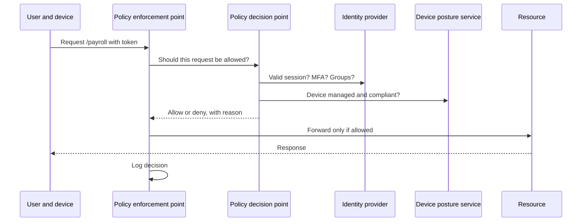
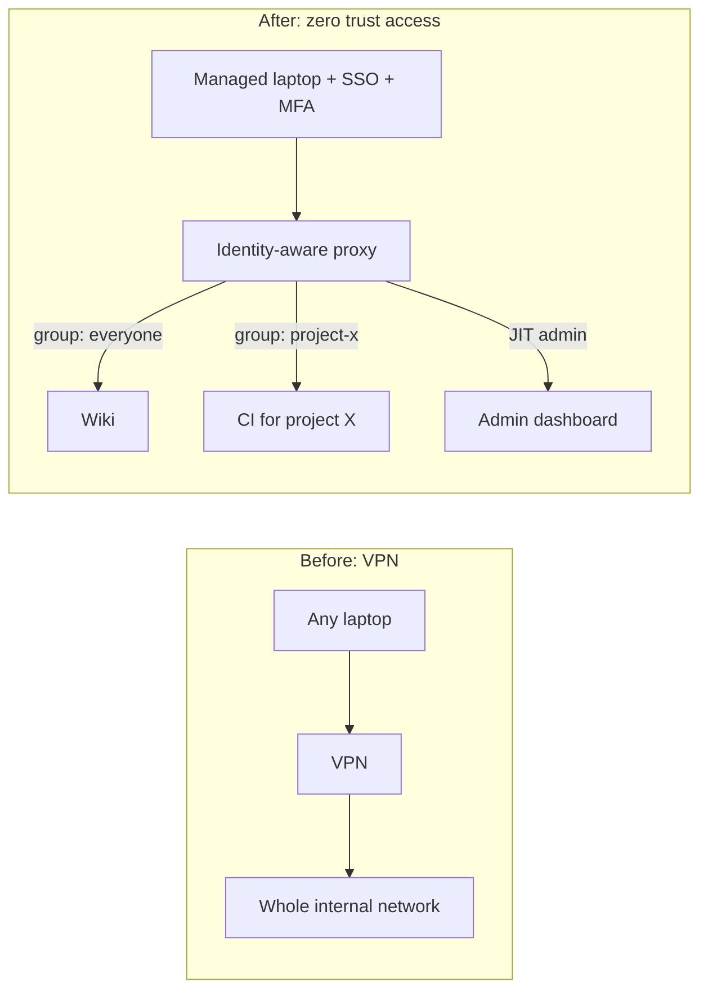

# Least Privilege and Zero Trust

## Introduction

Two ideas sit at the center of modern access control:

- **Least privilege:** every user, program, and service gets only the access it needs to do its job, and only for as long as it needs it. Nothing more.
- **Zero trust:** no user or device is trusted automatically because of *where* it is, such as "on the office network". Every request is checked, every time, based on who is asking, from what device, for what resource.

An analogy: a hotel key card. Your card opens your room, the gym, and the front door, and it stops working at checkout. It does not open other guests' rooms or the kitchen, even though you are "inside the hotel". That is least privilege. And the door checks your card **every time** you open it, instead of assuming that anyone who made it past the lobby must be a guest. That is zero trust.

These ideas matter because most serious breaches involve **too much access**. An attacker who phishes one employee, steals one API key, or compromises one server inherits whatever that identity can reach. Least privilege shrinks what they inherit. Zero trust makes it harder to use stolen access from an unexpected place or device.

## Least Privilege

### Where it applies

Least privilege applies at every level:

| Level | Too much privilege | Least privilege |
|-------|--------------------|-----------------|
| Human users | Every engineer is a production admin | Read-only by default; admin through an approved, time-limited request |
| Applications | Web app connects to the database as the owner | App role can only read and write its own tables |
| Processes | Service runs as `root` | Service runs as a dedicated, unprivileged user |
| Cloud | Lambda function has `AdministratorAccess` | Function can read one bucket prefix and write one queue |
| API tokens | Personal token with full account scope | Token scoped to one repository, read-only, expiring in 30 days |
| Containers | Privileged container with the host filesystem mounted | Non-root user, read-only filesystem, dropped capabilities |

### Related principles

- **Need to know:** access to information only when the job requires it, even for people with a high clearance or senior role.
- **Separation of duties:** no single person can complete a sensitive action alone. The person who writes a payment cannot also approve it, and the developer who writes code cannot also approve and deploy it alone.
- **Just-in-time (JIT) access:** elevated access is granted for a short window when needed, then removed automatically, instead of being held permanently ("standing privilege").
- **Privilege bracketing:** a program raises its privilege for the smallest possible section of code, then drops it.

### Least privilege for a Linux service

Running a web service as `root` means any code execution bug gives the attacker full control of the host. A systemd unit can run it as a dedicated user and add extra sandboxing:

```bash
# Create a system user with no login shell and no home directory
sudo useradd --system --no-create-home --shell /usr/sbin/nologin invoiceapp
```

```ini
# /etc/systemd/system/invoiceapp.service
[Unit]
Description=Invoice web app
After=network.target

[Service]
User=invoiceapp
Group=invoiceapp
ExecStart=/opt/invoiceapp/venv/bin/gunicorn -b 127.0.0.1:8000 app:app
WorkingDirectory=/opt/invoiceapp
# Sandboxing: the service cannot gain new privileges or write outside its data dir
NoNewPrivileges=yes
ProtectSystem=strict
ProtectHome=yes
PrivateTmp=yes
ReadWritePaths=/var/lib/invoiceapp

[Install]
WantedBy=multi-user.target
```

You can ask systemd to rate a unit's exposure:

```bash
systemd-analyze security invoiceapp.service
```

The command prints a list of sandboxing settings and an overall exposure score. Lower is better. [Linux Hardening](../9-sec-system-hardening/0-sec-linux-hardening.mdx) goes further.

### Least privilege in the cloud

Cloud IAM policies are where least privilege matters most, because one over-powered key can reach everything in an account. Compare these two AWS IAM policies for a function that generates PDF invoices.

Vulnerable:

```json
{
  "Version": "2012-10-17",
  "Statement": [
    { "Effect": "Allow", "Action": "s3:*", "Resource": "*" }
  ]
}
```

Fixed:

```json
{
  "Version": "2012-10-17",
  "Statement": [
    {
      "Sid": "ReadTemplates",
      "Effect": "Allow",
      "Action": "s3:GetObject",
      "Resource": "arn:aws:s3:::acme-invoices/templates/*"
    },
    {
      "Sid": "WriteRenderedInvoices",
      "Effect": "Allow",
      "Action": "s3:PutObject",
      "Resource": "arn:aws:s3:::acme-invoices/rendered/*"
    }
  ]
}
```

The first policy lets the function read, overwrite, and delete every object in every bucket in the account, and change bucket policies to make them public. The second lets it read templates and write rendered PDFs, and nothing else. If the function is compromised, the attacker gets very little.

:::tip
Writing tight policies by hand is hard. Most cloud providers can analyze actual usage and suggest a smaller policy, for example IAM Access Analyzer on AWS. Start broader in a sandbox if you must, observe, then tighten before production. [Cloud IAM Security](../8-sec-cloud-and-container/1-sec-cloud-iam.mdx) covers this in depth.
:::

### The cost of least privilege

Least privilege is not free:

- It takes effort to find out what access is really needed.
- Overly tight permissions break things, and people then ask for broad access "to make it work".
- Access requests can slow teams down if approval is manual and slow.

The practical answer is to make the secure path easy: role templates, self-service JIT access with automatic approval for low-risk roles, and regular access reviews that remove unused permissions.

## Zero Trust

### The problem with the castle-and-moat model

Traditional networks used a **perimeter** model: a firewall around the office network, and everything inside trusted. That worked when employees sat in the office and applications ran in the company data center. It fails today because:

- Employees work from home, hotels, and cafes.
- Applications run in multiple clouds and SaaS products.
- Contractors and partners need access to some systems.
- Once an attacker gets inside the perimeter (by phishing one laptop, for example), they can move freely. This is called **lateral movement**.

Here is the perimeter model in code. The app trusts anyone with an internal IP address.

Vulnerable:

```python
from flask import Flask, request, abort

app = Flask(__name__)

# Vulnerable: anyone on the internal network is trusted.
@app.get("/internal/payroll")
def payroll():
    if not request.remote_addr.startswith("10."):
        abort(403)
    return {"rows": 42}

client = app.test_client()
print(client.get("/internal/payroll", environ_base={"REMOTE_ADDR": "10.1.2.3"}).status_code)
print(client.get("/internal/payroll", environ_base={"REMOTE_ADDR": "203.0.113.9"}).status_code)
```

Output:

```text
200
403
```

Any compromised machine on the `10.x` network, including a printer or a phished laptop, can read payroll. There is no record of *who* looked.

### What zero trust means

**NIST SP 800-207, Zero Trust Architecture** (August 2020) is the standard reference. It describes zero trust as moving defenses from static, network-based perimeters to a focus on users, assets, and resources, with no implicit trust granted based on network location or asset ownership. Its tenets can be summarized as:

1. All data sources and computing services are considered resources.
2. All communication is secured regardless of network location.
3. Access to individual resources is granted on a per-session basis.
4. Access is determined by dynamic policy, including the identity of the client, the application, the requesting asset, and other behavioral and environmental attributes.
5. The organization monitors and measures the integrity and security posture of all owned and associated assets.
6. All resource authentication and authorization are dynamic and strictly enforced before access is allowed.
7. The organization collects as much information as possible about assets, network infrastructure, and communications, and uses it to improve its security posture.

Read the [full publication](https://csrc.nist.gov/pubs/sp/800/207/final) for the exact wording.

The often-quoted short version is **"never trust, always verify"**, combined with **"assume breach"**: design as if an attacker is already inside.

### The core architecture

NIST describes a logical architecture with a **policy decision point (PDP)** that decides whether to allow a request, and a **policy enforcement point (PEP)** that sits in front of the resource and carries out the decision.



In practice, the PEP might be an identity-aware proxy, an API gateway, a service mesh sidecar, or a check inside the application. The PDP might be your identity provider plus a policy engine.

### Zero trust in code

Here is the payroll endpoint rewritten so that every request is evaluated on identity, MFA, device posture, and group membership, regardless of the network it comes from. The identity provider and device service are simple dictionaries to keep the example runnable.

Fixed:

```python
from dataclasses import dataclass
from functools import wraps

from flask import Flask, abort, g, request

app = Flask(__name__)

# Stand-ins for an identity provider and a device-management service.
SESSIONS = {
    "tok-alice": {"user": "alice", "groups": {"payroll"}, "mfa": True, "device": "lap-17"},
    "tok-bob":   {"user": "bob",   "groups": {"support"}, "mfa": True, "device": "lap-22"},
    "tok-carol": {"user": "carol", "groups": {"payroll"}, "mfa": False, "device": "lap-31"},
}
DEVICES = {"lap-17": {"managed": True, "disk_encrypted": True},
           "lap-22": {"managed": True, "disk_encrypted": True},
           "lap-31": {"managed": False, "disk_encrypted": False}}

@dataclass
class Decision:
    allow: bool
    reason: str

def decide(session, resource_group: str) -> Decision:
    """Policy decision point: evaluated on every request."""
    if session is None:
        return Decision(False, "no valid session")
    if not session["mfa"]:
        return Decision(False, "MFA required")
    device = DEVICES.get(session["device"], {})
    if not (device.get("managed") and device.get("disk_encrypted")):
        return Decision(False, "device not compliant")
    if resource_group not in session["groups"]:
        return Decision(False, "not in group " + resource_group)
    return Decision(True, "ok")

def zero_trust(resource_group: str):
    def wrap(view):
        @wraps(view)
        def inner(*args, **kwargs):
            token = request.headers.get("Authorization", "").removeprefix("Bearer ")
            session = SESSIONS.get(token)
            d = decide(session, resource_group)
            who = session["user"] if session else "anonymous"
            app.logger.warning("access %s user=%s ip=%s reason=%s",
                               "ALLOW" if d.allow else "DENY", who, request.remote_addr, d.reason)
            if not d.allow:
                abort(403)
            g.user = session["user"]
            return view(*args, **kwargs)
        return inner
    return wrap

@app.get("/internal/payroll")
@zero_trust("payroll")
def payroll():
    return {"viewer": g.user, "rows": 42}

client = app.test_client()
for token in ["tok-alice", "tok-bob", "tok-carol", "stolen-or-missing"]:
    r = client.get("/internal/payroll", headers={"Authorization": f"Bearer {token}"},
                   environ_base={"REMOTE_ADDR": "10.1.2.3"})
    print(token, "->", r.status_code)
```

Output (log lines from `app.logger` go to standard error; timestamps trimmed):

```text
WARNING in app: access ALLOW user=alice ip=10.1.2.3 reason=ok
WARNING in app: access DENY user=bob ip=10.1.2.3 reason=not in group payroll
WARNING in app: access DENY user=carol ip=10.1.2.3 reason=MFA required
WARNING in app: access DENY user=anonymous ip=10.1.2.3 reason=no valid session
tok-alice -> 200
tok-bob -> 403
tok-carol -> 403
stolen-or-missing -> 403
```

Every request comes from an "internal" address, yet only Alice gets in, because she is in the right group, used MFA, and is on a managed, encrypted laptop. Carol is in the right group but fails the MFA check. Every decision is logged with a reason, which is exactly what an investigator needs later.

In production, the token would be a signed session or an OIDC token validated against your identity provider (see [OpenID Connect](../4-sec-authentication/7-sec-oidc.mdx)), and device posture would come from your device management system.

### The CISA Zero Trust Maturity Model

The US Cybersecurity and Infrastructure Security Agency (CISA) published **Zero Trust Maturity Model version 2.0** in April 2023. It organizes zero trust into five **pillars**, each of which can mature from Traditional to Initial, Advanced, and Optimal:

| Pillar | Example capabilities |
|--------|----------------------|
| Identity | Phishing-resistant MFA, centralized identity, continuous risk-based checks |
| Devices | Inventory of all devices, posture checks, endpoint detection |
| Networks | Micro-segmentation, encrypted traffic, no implicit trust between zones |
| Applications and workloads | Per-application access, secure development, continuous authorization |
| Data | Classification, encryption, access tied to data sensitivity |

Three **cross-cutting capabilities** support all pillars: visibility and analytics, automation and orchestration, and governance.

:::note
Zero trust is a strategy and an architecture, not a product. Vendors sell components (identity providers, ZTNA proxies, device management, micro-segmentation), but buying one of them does not make an organization "zero trust". Most organizations move toward it gradually, one application or pillar at a time.
:::

## Real-World Scenario

A 200-person software company gives all staff access to internal tools (wiki, admin dashboards, CI, Grafana) through a VPN. Once connected, a laptop can reach every internal IP address. After a contractor's laptop is infected with malware, the security lead asks how to reduce the blast radius of the next incident.

**Proposed plan:**

1. **Put internal web apps behind an identity-aware proxy (ZTNA).** Each app requires SSO with phishing-resistant MFA and checks device posture. Access is granted per application based on group, not per network.
2. **Apply least privilege to groups.** Contractors get access to the wiki and their project's CI only. Admin dashboards require an on-call or admin group with just-in-time elevation that expires after four hours.
3. **Keep a small VPN for non-web protocols** (for example, a few legacy database tools), restricted to the engineers who need them and segmented so it reaches only those hosts.
4. **Log every access decision** to the SIEM and alert on unusual patterns, such as a user accessing an app for the first time from a new country.



### Why this approach

The infected contractor laptop would now reach only the wiki and one CI project, and only while the device passes posture checks. Stolen passwords alone stop working because of MFA and device checks. Logs show exactly who accessed what.

### When to use it and when not to

Identity-aware access is a strong fit for web applications and SaaS-heavy organizations. It is harder for legacy protocols, old thick-client apps, and operational technology (factory or medical devices) that cannot handle modern authentication. Those may need network segmentation and jump hosts instead. Very small teams with a handful of internal tools can often get most of the benefit simply by putting those tools behind SSO with MFA.

### Alternatives and trade-offs

| Approach | Pros | Cons | Best for |
|----------|------|------|----------|
| Flat VPN to the whole network | Simple, works for every protocol | Huge blast radius, trust based on location | Legacy setups; not recommended as the only control |
| Segmented VPN | Limits reach per group | Rules get complex; still location-based | Non-web protocols |
| Identity-aware proxy / ZTNA | Per-app access, device checks, good logging | Needs SSO maturity, harder for non-HTTP apps | Web apps and SaaS-heavy companies |
| SSO + MFA on each app (no proxy) | Cheap, quick to adopt | No device posture, apps still network-reachable | Small teams |
| Full zero trust program (all pillars) | Strongest, consistent policy | Multi-year effort, cost, change management | Large and regulated organizations |

## Common Mistakes

- **Granting broad access "temporarily".** Temporary access tends to become permanent. Use expiring grants.
- **Shared accounts.** They break least privilege and accountability at the same time. Everyone needs their own identity.
- **Wildcard policies.** `"Action": "*"` and `"Resource": "*"` should be rare and justified.
- **Treating zero trust as a product purchase.** It is an architecture and a long-term program.
- **Forgetting service-to-service traffic.** Zero trust applies to machines too: services should authenticate each other (for example, with mTLS or workload identity), not just trust the internal network.
- **Never reviewing access.** People change roles, and access accumulates ("privilege creep"). Review regularly and remove what is unused.
- **Making the secure path painful.** If getting the right access takes a week, people will share credentials. Automate low-risk approvals.

## Summary

- **Least privilege:** give every user, service, and process the minimum access it needs, for the shortest time. Related ideas are need to know, separation of duties, and just-in-time access.
- Apply it everywhere: Linux service accounts, database roles, cloud IAM policies, API tokens, and containers.
- **Zero trust** removes implicit trust based on network location. Every request is authenticated and authorized using identity, device posture, and context, and every decision is logged.
- NIST SP 800-207 defines the architecture (policy decision and enforcement points). CISA's Zero Trust Maturity Model 2.0 organizes it into five pillars: identity, devices, networks, applications and workloads, and data.
- Zero trust is adopted gradually. Start with SSO and MFA, then per-application access, device posture, and segmentation.

## Exercises

1. Add a "time of day" rule to `decide` so that payroll can only be accessed between 07:00 and 20:00 UTC. Then add a JIT exception for a `payroll-oncall` group.
2. Write an AWS IAM policy that lets a reporting job read from one DynamoDB table and nothing else. Look up the exact action names in the AWS documentation.
3. Run `systemd-analyze security` on a service on your own Linux machine. Pick two settings from the output and explain what they protect against.
4. List every system you can access at work or school. For each one, ask: do I use this access at least once a month? If not, what would it take to remove it?

Related pages:

- [Defense in Depth](./4-sec-defense-in-depth.mdx)
- [Secure Design Principles](./6-sec-security-principles.mdx)
- [RBAC, ABAC and ReBAC](../4-sec-authentication/9-sec-rbac-abac.mdx)
- [Network Segmentation](../2-sec-network-security/2-sec-network-segmentation.mdx)

External reading:

- [NIST SP 800-207: Zero Trust Architecture](https://csrc.nist.gov/pubs/sp/800/207/final)
- [CISA Zero Trust Maturity Model](https://www.cisa.gov/zero-trust-maturity-model)
- [AWS IAM: Apply least-privilege permissions](https://docs.aws.amazon.com/IAM/latest/UserGuide/best-practices.html)
- [systemd.exec: sandboxing options](https://www.freedesktop.org/software/systemd/man/latest/systemd.exec.html)
