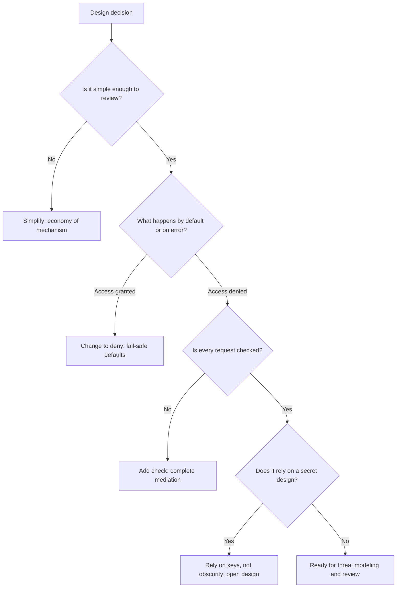

# Secure Design Principles

## Introduction

Most security advice is about specific bugs: SQL injection, XSS, weak passwords. **Secure design principles** sit one level higher. They are rules of thumb for designing systems so that whole families of bugs are less likely, and so that the bugs that do slip through cause less harm.

An analogy from building design: fire codes do not tell you how to put out a specific fire. They say things like "every room needs two exits", "doors on escape routes open outward", and "fire doors close by default". Following those rules does not guarantee there will be no fire, but it makes a disaster far less likely. Secure design principles are the fire code for software.

Many of the principles on this page come from a 1975 paper by Jerome Saltzer and Michael Schroeder, *The Protection of Information in Computer Systems*. Half a century later, they still describe the root cause of most real breaches. This page explains each principle, shows what violating it looks like in code, and ends with a design exercise where several principles work together.

## The Classic Principles at a Glance

| Principle | One-line meaning |
|-----------|------------------|
| Economy of mechanism | Keep the security design as small and simple as possible |
| Fail-safe defaults | Deny by default; access must be explicitly granted |
| Complete mediation | Check authorization on every access, not just the first |
| Open design | Security must not depend on the design being secret |
| Separation of privilege | Require more than one condition or person for sensitive actions |
| Least privilege | Give each part only the access it needs |
| Least common mechanism | Minimize shared components between users |
| Psychological acceptability | Security must be easy enough that people use it correctly |

Modern guides such as the OWASP Developer Guide and CISA's Secure by Design guidance add several more, which this page also covers: minimize attack surface, secure by default, fail securely, do not trust external input or services, defense in depth, and fix the root cause.



## Economy of Mechanism (Keep It Simple)

Complex security code is hard to review, test, and reason about, so it hides bugs. Prefer one well-understood mechanism over several clever ones.

In practice:

- Use **one** authentication system for the whole product, not a different login flow per feature.
- Centralize authorization checks in one module or policy engine, instead of copying `if user.role == ...` into every handler.
- Use standard protocols and well-reviewed libraries (OAuth 2.0, OIDC, TLS, argon2) rather than custom designs.

A good test: can a new team member explain how access control works in your app in five minutes? If not, it is probably too complex to be secure.

## Fail-Safe Defaults (Deny by Default)

Access decisions should be based on **permission**, not exclusion. The default answer is "no", and access must be explicitly granted.

Vulnerable (deny list):

```python
BLOCKED_ROLES = {"suspended", "banned"}

def can_view_reports(role: str) -> bool:
    return role not in BLOCKED_ROLES   # any new or misspelled role gets access
```

Fixed (allow list):

```python
ALLOWED_ROLES = {"analyst", "admin"}

def can_view_reports(role: str) -> bool:
    return role in ALLOWED_ROLES       # unknown roles are denied
```

With the deny list, a new role such as `"trial"`, or a typo such as `"Analyst "`, gets access by accident. With the allow list, a mistake causes a denied request and a support ticket, which is a much better failure.

### Fail securely

A close relative: when something goes wrong, the system should end up in a safe state. A common real-world bug is "failing open" when a dependency such as a policy service, license server, or fraud check is unavailable.

Vulnerable:

```python
class PolicyServiceDown(Exception):
    pass

def check_policy(user: str, action: str) -> bool:
    raise PolicyServiceDown("timeout contacting policy service")

# Vulnerable: fails open
def can_delete_open(user: str) -> bool:
    try:
        return check_policy(user, "delete")
    except Exception:
        return True   # "don't block users when the policy service is flaky"
```

Fixed:

```python
# Fixed: fails closed
def can_delete_closed(user: str) -> bool:
    try:
        return check_policy(user, "delete")
    except PolicyServiceDown:
        return False  # deny, and let monitoring page someone

print("fail-open allows delete:  ", can_delete_open("mallory"))
print("fail-closed allows delete:", can_delete_closed("mallory"))
```

Output:

```text
fail-open allows delete:   True
fail-closed allows delete: False
```

An attacker who can make the policy service slow (for example, by flooding it) can bypass authorization in the fail-open version.

:::note
"Fail closed" is not always the right answer for **availability**-critical or **safety**-critical systems. A hospital door lock should usually fail open in a fire. A spam filter that fails closed would block all email. Decide deliberately per control and document the choice. For authorization of sensitive actions, fail closed is almost always correct.
:::

## Secure by Default

Related to fail-safe defaults, but about **configuration**: the out-of-the-box settings should be the safe ones. Users who do nothing should be protected. Users who need something less safe must opt in, ideally with a warning.

Vulnerable:

```python
from dataclasses import dataclass

@dataclass
class AppConfig:
    debug: bool = True              # leaks stack traces and enables debugger
    session_cookie_secure: bool = False
    allow_signup: bool = True
    cors_allow_origins: str = "*"
```

Fixed:

```python
from dataclasses import dataclass

@dataclass
class AppConfig:
    debug: bool = False             # must be enabled explicitly in development
    session_cookie_secure: bool = True
    allow_signup: bool = False      # turned on deliberately per deployment
    cors_allow_origins: tuple[str, ...] = ()   # no cross-origin access unless listed
```

CISA's **Secure by Design** guidance (first published in 2023 with international partners) pushes software makers in the same direction. It asks them to take ownership of customer security outcomes, embrace radical transparency and accountability, and lead from the top. In practice that means shipping secure defaults, for example MFA on by default, no default passwords, and logging included at no extra cost, instead of handing customers a long hardening guide. [Secure Defaults and Configuration](../5-sec-secure-coding/6-sec-secure-defaults.mdx) goes deeper.

## Complete Mediation

Every access to every resource must be checked for authorization, every time. Do not check once and then trust a cached result, a hidden form field, or the fact that the user "came from" a page that already checked.

Vulnerable:

```python
from flask import Flask, session, abort

app = Flask(__name__)
app.secret_key = "dev-only"

@app.get("/projects/<int:pid>")
def view_project(pid):
    if not user_can_view(session.get("user"), pid):
        abort(404)
    session["checked_project"] = pid          # remember that we checked
    return {"project": pid}

@app.post("/projects/<int:pid>/delete")
def delete_project(pid):
    # Assumes the user must have viewed (and been checked) first.
    if session.get("checked_project") is None:
        abort(400)
    return {"deleted": pid}                    # no check that pid matches, or that user may delete

def user_can_view(user, pid):
    return user == "alice" and pid == 1
```

Fixed:

```python
from flask import Flask, session, abort

app = Flask(__name__)
app.secret_key = "dev-only"

def authorize(user, action: str, pid: int) -> bool:
    perms = {("alice", 1): {"view", "delete"}, ("bob", 1): {"view"}}
    return action in perms.get((user, pid), set())

@app.get("/projects/<int:pid>")
def view_project(pid):
    if not authorize(session.get("user"), "view", pid):
        abort(404)
    return {"project": pid}

@app.post("/projects/<int:pid>/delete")
def delete_project(pid):
    if not authorize(session.get("user"), "delete", pid):   # checked again, for this action
        abort(404)
    return {"deleted": pid}
```

Complete mediation is the principle behind most of [Broken Access Control](../3-sec-web-security/2-sec-broken-access-control.mdx), the number one category in the OWASP Top 10:2025. It also applies to revocation: if you cache permissions or use long-lived tokens, a user who is removed from a project can keep access until the cache or token expires. Keep those lifetimes short.

## Open Design (No Security Through Obscurity)

A system should stay secure even if attackers know exactly how it works. Security should depend on **keys and secrets**, which are easy to change, not on a secret algorithm or hidden URL, which is hard to change once it leaks.

This is also known as **Kerckhoffs's principle** in cryptography: a cipher should be secure even if everything about it except the key is public. That is why you should use published, well-analyzed algorithms such as AES-GCM and never a homemade "scrambling" function.

Examples of obscurity used as the only control:

- An admin panel at `/super-secret-admin-2019` with no authentication.
- An API that "encrypts" IDs with Base64.
- A mobile app with an API key embedded in the binary, assuming nobody will decompile it.

Obscurity is not useless. Hiding version banners or using unpredictable IDs can slow attackers down. It just must never be the **only** layer.

## Separation of Privilege

A sensitive action should require more than one independent condition. Examples:

- **MFA:** a password *and* a device.
- **Two-person rule:** a production database deletion needs approval from a second engineer.
- **Code review:** a change to `main` needs an approving reviewer who is not the author.
- **Key ceremonies:** a root signing key requires several key holders to be present.

This is related to **separation of duties**, discussed in [Least Privilege and Zero Trust](./5-sec-least-privilege.mdx).

## Least Common Mechanism

Minimize components shared between users or between trust levels, because shared components become channels for leaks and interference. Examples:

- A shared cache keyed only by URL can serve one user's private page to another user. Include the user or tenant in the cache key, or do not cache private responses.
- A shared `/tmp` directory between services can leak files. Give each service its own (systemd's `PrivateTmp=yes`).
- In multi-tenant SaaS, a single database with a `tenant_id` column is cheaper but riskier than separate schemas or databases. One forgotten `WHERE tenant_id = ?` leaks data across customers.

## Psychological Acceptability (Usable Security)

If security is too hard to use, people will work around it. A password policy requiring 20 characters, rotation every 30 days, and no repeats produces sticky notes and `Spring2026!` style passwords. Current NIST guidance in SP 800-63B moved away from forced periodic rotation and composition rules for exactly this reason.

Design so the secure path is the easy path:

- Passkeys and password managers instead of complex password rules.
- Single sign-on so people have one strong credential instead of twenty weak ones.
- Clear error messages that explain how to fix a security failure.
- Secure templates and libraries that make the right thing the default for developers.

## More Modern Principles

| Principle | What it means | Learn more |
|-----------|---------------|------------|
| Minimize attack surface | Remove features, ports, and data you do not need | [Attack Surface](./3-sec-attack-surface.mdx) |
| Defense in depth | Layer independent controls | [Defense in Depth](./4-sec-defense-in-depth.mdx) |
| Do not trust input | Validate everything from users, files, and other services | [Input Validation and Output Encoding](../5-sec-secure-coding/1-sec-input-validation.mdx) |
| Do not trust third parties blindly | Verify webhooks, pin dependencies, review integrations | [Software Supply Chain Security](../6-sec-appsec-and-devsecops/5-sec-supply-chain.mdx) |
| Fix the root cause | Fix the class of bug, not just the instance a tester found | [Security Code Review](../5-sec-secure-coding/7-sec-code-review-for-security.mdx) |
| Assume breach | Design so a compromised component cannot reach everything | [Least Privilege and Zero Trust](./5-sec-least-privilege.mdx) |
| Privacy by design | Collect and keep the minimum personal data | [Privacy Engineering](../13-sec-governance/4-sec-privacy-engineering.mdx) |

## Real-World Scenario

Your team builds a document management SaaS. Product wants a "share by link" feature so customers can send a document to someone outside their organization. You are asked to design it.

**Applying the principles:**

- **Fail-safe defaults and least privilege:** new links are **view-only** and **expire after 24 hours** by default. Editing and longer lifetimes are explicit choices.
- **Open design:** the link contains a random token with about 256 bits of entropy from a cryptographically secure generator, not a guessable document ID.
- **Complete mediation:** every request with a link token is checked against the database: does the token exist, is it revoked, has it expired, and is the document still shared?
- **Least common mechanism and defense in depth:** only a **hash** of the token is stored, so a database leak does not reveal working links.
- **Psychological acceptability:** one click to create a link, a clear expiry date in the UI, and one click to revoke.
- **Separation of privilege:** organization admins can disable external sharing entirely.

```python
import hashlib
import secrets
from datetime import datetime, timedelta, timezone

SHARES = {}  # token_hash -> share record (a database table in real life)

def create_share(doc_id: int, owner: str, hours: int = 24) -> str:
    token = secrets.token_urlsafe(32)                 # about 256 bits of randomness
    token_hash = hashlib.sha256(token.encode()).hexdigest()
    SHARES[token_hash] = {
        "doc_id": doc_id,
        "owner": owner,
        "permission": "view",                         # least privilege by default
        "expires": datetime.now(timezone.utc) + timedelta(hours=hours),
        "revoked": False,
    }
    return token  # shown to the owner once; only the hash is stored

def open_share(token: str):
    record = SHARES.get(hashlib.sha256(token.encode()).hexdigest())
    if record is None or record["revoked"]:
        return None
    if datetime.now(timezone.utc) >= record["expires"]:
        return None
    return record["doc_id"], record["permission"]

t = create_share(doc_id=77, owner="alice", hours=24)
print("link token length:", len(t))
print("valid link:", open_share(t))
print("guessed link:", open_share("AAAAAAAAAAAAAAAAAAAAAAAAAAAAAAAAAAAAAAAAAAA"))
SHARES[hashlib.sha256(t.encode()).hexdigest()]["revoked"] = True
print("after revoke:", open_share(t))
```

Output:

```text
link token length: 43
valid link: (77, 'view')
guessed link: None
after revoke: None
```

A plain SHA-256 is fine for hashing a long random token. It would **not** be fine for passwords, which are short and guessable and need a slow hash. See [Password Hashing](../1-sec-cryptography/2-sec-password-hashing.mdx) and [Randomness and Secure Tokens](../1-sec-cryptography/9-sec-randomness.mdx).

### Why this approach

Bearer links are convenient but dangerous: anyone who has the URL has access, and URLs leak through browser history, chat previews, email forwarding, and referrer headers. Short default lifetimes, view-only defaults, revocation, and hashed storage limit the damage when a link leaks, without making the feature hard to use.

### When to use it and when not to

Expiring, revocable bearer links fit casual external sharing of moderately sensitive documents. For highly sensitive documents, such as legal or health records, require the recipient to authenticate (for example, with a one-time code to their email) so access is tied to a person and can be audited. For truly public content, a permanent public URL is simpler and fine.

### Alternatives and trade-offs

| Approach | Pros | Cons | Best for |
|----------|------|------|----------|
| Permanent public link with document ID | Simplest | Guessable, never expires, cannot revoke one recipient | Public content only |
| Random, expiring, revocable bearer link (this design) | Easy for recipients, limits leaks | Anyone with the link has access while valid | Everyday external sharing |
| Link plus email verification code | Ties access to a person, auditable | Extra step for recipients | Sensitive documents |
| Invite recipient as a guest account | Full access control and audit | Heaviest friction, account management | Ongoing collaboration |
| Signed URL from the storage provider | Offloads serving files, built-in expiry | Hard to revoke before expiry, less app-level audit | Large file downloads |

## Common Mistakes

- **Deny lists instead of allow lists.** New values slip through. Default to deny.
- **Failing open on errors.** A timeout should not grant access to a sensitive action.
- **Checking authorization once.** Every request and every action needs its own check.
- **Relying on secret URLs or hidden fields.** Obscurity is a speed bump, not a lock.
- **Insecure defaults with a hardening guide.** Most users never read the guide. Ship the safe setting.
- **Security that fights the user.** Unusable controls get bypassed. Measure friction and fix it.
- **Fixing the instance, not the class.** If a tester finds one missing check, search for every similar handler.

## Summary

- Secure design principles prevent whole families of bugs and limit the damage from the ones that remain.
- Saltzer and Schroeder's principles still apply: economy of mechanism, fail-safe defaults, complete mediation, open design, separation of privilege, least privilege, least common mechanism, and psychological acceptability.
- Modern additions include secure by default, fail securely, minimize attack surface, do not trust input or third parties, assume breach, and fix root causes.
- CISA's Secure by Design guidance asks software makers to own customer security outcomes, for example by shipping secure defaults.
- Real designs combine several principles. The link-sharing example uses safe defaults, random tokens, per-request checks, hashed storage, and easy revocation.

## Exercises

1. Find a deny list in a codebase you know (blocked roles, blocked file extensions, blocked IP addresses). Rewrite it as an allow list. What new failures does the allow list cause, and are they acceptable?
2. Extend `open_share` to log every access, including failures, with the token hash prefix and the result. Which principle does this support?
3. Write down the defaults of a tool or framework you use (for example, a database or web server). Which defaults are insecure? Which ones have changed to safer values in recent versions?
4. Design the "reset password" feature for a web app using at least four principles from this page. Write one sentence per principle explaining how it applies.

Related pages:

- [Least Privilege and Zero Trust](./5-sec-least-privilege.mdx)
- [The Attacker Mindset and Kill Chains](./7-sec-attacker-mindset.mdx)
- [Threat Modeling with STRIDE](../6-sec-appsec-and-devsecops/1-sec-threat-modeling.mdx)
- [Secure Defaults and Configuration](../5-sec-secure-coding/6-sec-secure-defaults.mdx)

External reading:

- [Saltzer and Schroeder, The Protection of Information in Computer Systems (1975)](https://www.cs.virginia.edu/~evans/cs551/saltzer/)
- [CISA Secure by Design](https://www.cisa.gov/securebydesign)
- [OWASP Developer Guide](https://owasp.org/www-project-developer-guide/)
- [NIST SP 800-63B: Authentication and Lifecycle Management](https://pages.nist.gov/800-63-4/sp800-63b.html)
