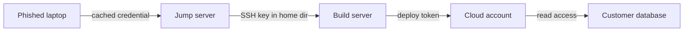
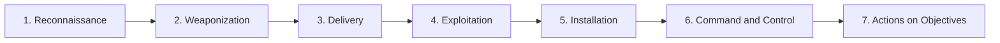

# The Attacker Mindset and Kill Chains

## Introduction

To defend a system well, you need to look at it the way an attacker does. Developers naturally think about how a feature is **supposed** to work. Attackers think about how it **could** be made to work: what happens if this field is negative, if this request is sent twice, if this ID belongs to someone else, if this server can be made to call another server.

That way of thinking is the **attacker mindset**. It is a skill, and like any skill it can be learned and practiced, legally and ethically, to make you a better builder and defender.

Real attacks are also not single events. They are **campaigns** with stages: research the target, get in, establish a foothold, move around, and achieve a goal. Security teams describe these stages with models called **kill chains**. A kill chain is useful to defenders because it shows that an attacker must succeed at **every** stage, while a defender only needs to stop them at **one**.

An analogy: a burglary is not just "breaking in". It is scouting the house, choosing a night, getting past the fence, opening a window, finding the valuables, and getting away without being seen. Every one of those steps is a chance for a dog, a neighbor, a light, or a camera to stop it.

:::warning Learn this to defend
This page explains how attacks are structured so you can **prevent, detect, and respond** to them. Only practice offensive techniques on systems you own or have written permission to test, or on legal practice platforms such as OWASP Juice Shop, TryHackMe, Hack The Box, and PortSwigger Web Security Academy. See [Ethics, Law and Responsible Disclosure](./8-sec-ethics-and-law.mdx).
:::

## How Attackers Think

### They look for the cheapest path

Most attackers are economically rational. They do not break strong encryption. They phish a password, reuse a leaked credential, or find a forgotten server. Your security is often only as strong as your **weakest reachable** component.

### They think in graphs, defenders think in lists

Microsoft security researcher John Lambert summarized a key insight in a widely cited 2015 essay: *"Defenders think in lists. Attackers think in graphs."* Defenders often manage assets as lists: servers, apps, accounts. Attackers see the **connections** between them: this laptop has a cached admin credential, which logs into that server, which has a key to the database.



Each link on its own might be rated "low risk". Together they form a path to the most valuable asset. This is why [least privilege](./5-sec-least-privilege.mdx) and segmentation matter: they cut the edges in the graph.

### They chain small weaknesses

A verbose error message (low), plus a predictable ID (low), plus a missing rate limit (medium), can add up to a mass data leak. Attackers combine findings. When you review a vulnerability report, ask "what could this be **combined** with?"

### They question assumptions

The attacker mindset is mostly about questioning assumptions the builder made:

| Builder's assumption | Attacker's question |
|----------------------|---------------------|
| Users will only send what the form allows | What if I send the request directly with extra fields? |
| The ID in the URL is the user's own | What if I change it to someone else's? |
| This endpoint is only called by our frontend | What if I call it a thousand times a second? |
| The webhook comes from our payment provider | What if I send a fake one? |
| Only admins know this URL | What if I guess it or find it in JavaScript? |
| The file is an image because the extension is `.png` | What if it is not? |

Making a habit of asking these questions during design and code review is one of the most valuable security skills a developer can have. [Threat Modeling with STRIDE](../6-sec-appsec-and-devsecops/1-sec-threat-modeling.mdx) turns this into a structured process.

### They are patient and persistent

Automated attacks never sleep, and targeted attackers may spend weeks inside a network before acting. That is why **detection** matters as much as prevention. The longer an attacker stays undetected (the "dwell time"), the more damage they do.

## The Lockheed Martin Cyber Kill Chain

The **Cyber Kill Chain** was published by Lockheed Martin researchers Eric Hutchins, Michael Cloppert, and Rohan Amin in 2011. It describes an intrusion in seven phases:



| Phase | What the attacker does | Example defensive controls |
|-------|------------------------|----------------------------|
| 1. Reconnaissance | Researches the target: domains, employees, technologies, exposed services | Reduce public exposure, monitor for scanning, limit details in job posts and error pages |
| 2. Weaponization | Prepares the attack, for example pairing an exploit with a payload | Mostly outside your view; threat intelligence about current campaigns |
| 3. Delivery | Sends it: phishing email, malicious link, exploit request to a public app | Email filtering, WAF, user training and an easy way to report phishing |
| 4. Exploitation | Triggers a vulnerability or tricks a user into running code | Patching, secure coding, MFA, application allow-listing |
| 5. Installation | Establishes persistence on the system | EDR, least privilege, monitoring for new services and scheduled tasks |
| 6. Command and Control (C2) | Opens a channel to control the compromised system remotely | Egress filtering, DNS monitoring, network detection |
| 7. Actions on Objectives | Achieves the goal: steal data, encrypt files, sabotage | Data loss prevention, encryption, segmentation, immutable backups, incident response |

The original paper also describes a **courses of action** matrix: for each phase, the defender can try to **detect**, **deny**, **disrupt**, **degrade**, **deceive**, or **destroy**. The key lesson is that an earlier break in the chain is cheaper. Stopping a phishing email (Delivery) costs far less than recovering from ransomware (Actions on Objectives).

### Limitations

The Cyber Kill Chain was designed around malware-based intrusions into corporate networks. It fits less well for:

- **Insider threats**, which skip the early phases.
- **Web application attacks** where "installation" may never happen: an attacker can steal data directly through SQL injection.
- **Cloud and identity attacks**, where a stolen token gives access without any malware.
- **Activity inside the network**, such as lateral movement and privilege escalation, which the model compresses into a few phases.

That is why two other models are widely used alongside it.

## The Unified Kill Chain

The **Unified Kill Chain (UKC)**, developed by Paul Pols (first published in 2017 and later updated), combines the Cyber Kill Chain with MITRE ATT&CK. It has **18 phases** grouped into three stages:

| Stage | Purpose | Example phases |
|-------|---------|----------------|
| In | Get an initial foothold | Reconnaissance, Weaponization, Delivery, Social Engineering, Exploitation, Persistence, Defense Evasion, Command and Control |
| Through | Spread inside the environment | Pivoting, Discovery, Privilege Escalation, Execution, Credential Access, Lateral Movement |
| Out | Achieve the objective | Collection, Exfiltration, Impact, Objectives |

The important improvement is the **"Through"** stage. Real attacks loop: an attacker lands on one machine, discovers credentials, moves to another, escalates privileges, and repeats until they reach what they want. The UKC models that loop explicitly.

## MITRE ATT&CK

**MITRE ATT&CK** (Adversarial Tactics, Techniques, and Common Knowledge) is a free, public knowledge base of real attacker behavior, built from observed incidents. Where kill chains describe phases, ATT&CK goes much deeper:

- **Tactics** are the attacker's goal at a stage: *why* they are doing something (for example, Credential Access).
- **Techniques** are *how* they achieve it (for example, T1110 Brute Force).
- **Sub-techniques** are more specific variations (for example, T1110.003 Password Spraying).
- **Procedures** are specific real-world examples of a group or tool using a technique.

ATT&CK has separate matrices for Enterprise (Windows, macOS, Linux, cloud, containers, and more), Mobile, and ICS (industrial control systems). It is updated regularly. In **version 19** (April 2026), MITRE split the long-standing *Defense Evasion* tactic into two tactics: **Stealth** and **Defense Impairment**. The Enterprise matrix now has 15 tactics:

| # | Tactic | The attacker is trying to... |
|---|--------|------------------------------|
| 1 | Reconnaissance | Gather information to plan the operation |
| 2 | Resource Development | Set up infrastructure, accounts, or tools |
| 3 | Initial Access | Get into your environment |
| 4 | Execution | Run malicious code |
| 5 | Persistence | Keep their foothold across restarts and credential changes |
| 6 | Privilege Escalation | Gain higher-level permissions |
| 7 | Stealth | Avoid being noticed |
| 8 | Defense Impairment | Disable or weaken your security tools and controls |
| 9 | Credential Access | Steal account names and passwords or tokens |
| 10 | Discovery | Learn about your environment |
| 11 | Lateral Movement | Move through your environment |
| 12 | Collection | Gather the data they want |
| 13 | Command and Control | Communicate with compromised systems |
| 14 | Exfiltration | Steal data out of your environment |
| 15 | Impact | Manipulate, interrupt, or destroy systems and data |

:::caution
ATT&CK changes with each release. If you read older material, you will see "Defense Evasion" as a single tactic with ID TA0005. In version 19, TA0005 is the ID of Stealth, and Defense Impairment is the new TA0112. Check the current version and MITRE's transition guidance at [attack.mitre.org](https://attack.mitre.org/) before mapping detections, and pin the ATT&CK version you use in your tooling.
:::

Defenders use ATT&CK to:

- **Describe incidents** in a shared language ("they used T1566 Phishing for initial access").
- **Measure detection coverage**: which techniques can we see, and which are blind spots?
- **Prioritize** based on techniques that threat groups targeting your sector actually use.
- **Plan tests**: red teams and adversary emulation exercises often follow ATT&CK techniques.

[MITRE ATT&CK](../11-sec-defensive-operations/3-sec-mitre-attack.mdx) in section 11 covers hands-on use.

## Mapping Your Defenses to a Kill Chain

A practical exercise for any team is to list your controls and map them to kill chain phases. Gaps jump out immediately.

```python
from collections import defaultdict

# Lockheed Martin Cyber Kill Chain phases, in order.
PHASES = ["Reconnaissance", "Weaponization", "Delivery", "Exploitation",
          "Installation", "Command and Control", "Actions on Objectives"]

# Our detections and preventions, each mapped to a phase (a simplified inventory).
CONTROLS = [
    ("WAF blocks known scanner user agents", "Reconnaissance", "detect"),
    ("Email gateway sandboxes attachments", "Delivery", "deny"),
    ("Phishing report button + training", "Delivery", "detect"),
    ("Patch internet-facing apps within 7 days", "Exploitation", "deny"),
    ("EDR alerts on new scheduled tasks", "Installation", "detect"),
    ("Egress firewall: servers may only reach allow-listed hosts", "Command and Control", "deny"),
    ("Immutable backups", "Actions on Objectives", "recover"),
]

coverage = defaultdict(list)
for name, phase, kind in CONTROLS:
    coverage[phase].append(f"{kind}: {name}")

for phase in PHASES:
    items = coverage.get(phase)
    if not items:
        print(f"[GAP] {phase}")
        continue
    print(f"[{len(items)}]   {phase}")
    for item in items:
        print(f"        - {item}")
```

Output:

```text
[1]   Reconnaissance
        - detect: WAF blocks known scanner user agents
[GAP] Weaponization
[2]   Delivery
        - deny: Email gateway sandboxes attachments
        - detect: Phishing report button + training
[1]   Exploitation
        - deny: Patch internet-facing apps within 7 days
[1]   Installation
        - detect: EDR alerts on new scheduled tasks
[1]   Command and Control
        - deny: Egress firewall: servers may only reach allow-listed hosts
[1]   Actions on Objectives
        - recover: Immutable backups
```

Reading the output like a defender:

- The **Weaponization** gap is expected. It happens on the attacker's own machines, so you can only influence it indirectly through threat intelligence.
- **Actions on Objectives** has only a recovery control. Nothing **detects** data being collected or stolen. Adding alerts on unusual data volumes leaving the network, or on mass reads from the customer table, would be a high-value improvement.
- Several phases have one control each. If that one control fails, there is no backup. That is a [defense in depth](./4-sec-defense-in-depth.mdx) question.

The same exercise with ATT&CK techniques is much more detailed. Tools such as the free **ATT&CK Navigator** let you color techniques by coverage.

## Making Attacks Expensive: The Pyramid of Pain

Not all defensive actions cost the attacker equally. Security researcher David Bianco's **Pyramid of Pain** (2013) ranks the indicators defenders can act on by how much pain it causes an attacker when you block them:

| Level (easy to hard for the attacker to change) | Example | Effect of blocking it |
|-------------------------------------------------|---------|-----------------------|
| Hash values | SHA-256 of a malware file | Trivial: recompile and the hash changes |
| IP addresses | A scanning server's address | Easy: switch to another server or proxy |
| Domain names | A phishing domain | Simple: register a new one |
| Network and host artifacts | A distinctive user agent or registry key | Annoying: they must change their tools |
| Tools | A specific credential-dumping tool | Challenging: they must find or build new tools |
| TTPs | The overall technique, such as password spraying | Tough: they must change how they operate |

The lesson for defenders: blocking a list of bad IP addresses helps a little. Detecting and preventing the **behavior**, such as many failed logins across many accounts, or enforcing MFA so that sprayed passwords are useless, forces the attacker to change their whole approach. This is why ATT&CK focuses on techniques rather than indicators.

## Thinking Like an Attacker in Everyday Development

You do not need to run attack tools to use the attacker mindset. A few habits go a long way:

1. **Abuse cases next to use cases.** For every user story ("as a customer, I can download my invoice"), write an abuse story ("as an attacker, I try to download someone else's invoice"). Turn the abuse story into a test.
2. **Ask "what if this is not true?"** for every assumption in a design document.
3. **Follow the data.** Where does user input go? Into a query, a shell command, a template, a file path, a URL the server fetches? Each destination has its own class of bug.
4. **Look at your system from the outside.** What does an anonymous visitor see in your JavaScript, error pages, response headers, and DNS records?
5. **Practice legally.** Capture-the-flag challenges and labs like Juice Shop build intuition fast. See [Capture the Flag Competitions](../10-sec-offensive-security/9-sec-ctf.mdx).

Here is an abuse case turned into a test for a Flask app, using the test client. The test asserts the *attack fails*:

```python
import pytest
from flask import Flask, abort, request

app = Flask(__name__)
INVOICES = {1: "alice", 2: "bob"}

@app.get("/invoices/<int:invoice_id>")
def get_invoice(invoice_id):
    user = request.headers.get("X-Test-User")   # stand-in for real authentication
    if INVOICES.get(invoice_id) != user:
        abort(404)
    return {"id": invoice_id}

@pytest.fixture
def client():
    return app.test_client()

def test_customer_can_read_own_invoice(client):
    assert client.get("/invoices/1", headers={"X-Test-User": "alice"}).status_code == 200

def test_customer_cannot_read_someone_elses_invoice(client):   # the abuse case
    assert client.get("/invoices/2", headers={"X-Test-User": "alice"}).status_code == 404
```

Run it with `pytest -q`:

```text
..                                                                       [100%]
2 passed in 0.05s
```

## Real-World Scenario

You lead a small security function at a regional logistics company. After a competitor is hit by ransomware, the board asks: "Could that happen to us, and where would we stop it?" You have three weeks and a modest budget.

**Step 1: Use public threat intelligence.** Government advisories (for example, from CISA and national cyber centers) describe how ransomware groups typically operate, with ATT&CK techniques listed. A common pattern: initial access through phishing, stolen VPN credentials, or an unpatched internet-facing system; then credential theft, lateral movement, disabling of backups and security tools, data theft, and finally encryption.

**Step 2: Map your controls to the chain.** You run the mapping exercise above with your real controls. Findings: strong email filtering, but the VPN uses passwords only; no alerting on new admin accounts; backups are on the same domain as the servers and use the same admin credentials.

**Step 3: Break the chain early and late.**

| Phase | Gap | Action |
|-------|-----|--------|
| Initial access | VPN with password only | Enforce MFA on VPN (week 1) |
| Exploitation | Internet-facing systems patched monthly | Patch KEV-listed flaws on internet-facing systems within days |
| Privilege escalation and lateral movement | Shared local admin password | Unique local admin passwords per machine (for example, Windows LAPS) |
| Defense impairment and impact | Backups reachable with domain admin | Move backups to immutable storage in a separate account |
| Actions on objectives | No exfiltration detection | Alert on unusual outbound data volume |

**Step 4: Report in kill chain language.** The board sees a simple picture: "We now have controls at the start, middle, and end of the attack chain, and we can recover even if the middle fails."

### Why this approach

A kill chain turns a vague fear ("ransomware") into a sequence of concrete steps, each with an owner and a control. It also shows where one investment breaks the chain for many attack types: MFA on remote access and immutable backups help against most ransomware campaigns, whatever malware they use.

### When to use it and when not to

Kill chains are excellent for communicating with leadership and for finding gaps across the whole attack lifecycle. They are less useful for day-to-day detection engineering, where ATT&CK's technique-level detail is better. For application security bugs like a single SQL injection, a kill chain adds little. Use secure coding practices and threat modeling instead.

### Alternatives and trade-offs

| Model | Pros | Cons | Best for |
|-------|------|------|----------|
| Lockheed Martin Cyber Kill Chain | Simple, seven phases, easy to explain | Malware and perimeter focused, weak on internal movement | Executive communication, high-level gap analysis |
| Unified Kill Chain | Models the "Through" loop, combines CKC and ATT&CK | Less widely known, 18 phases | Training, red team and incident narratives |
| MITRE ATT&CK | Detailed, evidence-based, shared language, huge community | Large; can become a coverage-chasing checklist | Detection engineering, threat intel, purple teaming |
| STRIDE threat modeling | Design-time, developer-friendly | Not about attacker campaigns | Designing individual systems and features |
| Attack trees | Show alternative paths to a specific goal | Manual, can grow large | Analyzing one high-value asset |

## Common Mistakes

- **Practicing on systems you do not own.** Curiosity is not authorization. Use labs and legal platforms.
- **Thinking only about the entry point.** Many teams invest heavily in preventing initial access and have no visibility once an attacker is inside. Assume breach.
- **Treating ATT&CK coverage as a score to maximize.** Coloring every technique green says nothing about detection quality. Prioritize techniques relevant to your threats and test your detections.
- **Ignoring identity-based attacks.** Many modern intrusions use stolen credentials and tokens with no malware at all.
- **Rating findings in isolation.** Ask what each weakness could be chained with.
- **Using outdated mappings.** Frameworks change. Pin and periodically update the ATT&CK version your tools use.

## Summary

- The attacker mindset means questioning assumptions, looking for the cheapest path, and thinking in graphs of connected weaknesses.
- Attacks are campaigns with stages. Defenders need to break the chain at only one point, and earlier is cheaper.
- The **Cyber Kill Chain** (2011) has seven phases from reconnaissance to actions on objectives.
- The **Unified Kill Chain** adds the "In, Through, Out" structure with 18 phases, modeling movement inside a network.
- **MITRE ATT&CK** catalogs real tactics, techniques, and procedures. Version 19 (April 2026) split Defense Evasion into **Stealth** and **Defense Impairment**, giving 15 Enterprise tactics.
- Map your controls to these models to find gaps, and turn abuse cases into automated tests.

## Exercises

1. Add your own team's controls to the coverage script, using real controls you know of. Which phase has the weakest coverage?
2. Write three abuse cases for a "change email address" feature, then write a pytest test for one of them.
3. Browse the ATT&CK Enterprise matrix and pick one technique under Credential Access. Read its "Detection" and "Mitigations" sections and summarize them in three sentences.
4. Draw an attacker's graph (like the diagram near the top of this page) for a system you know, from a phished laptop to the most valuable data. Which single edge would you cut first?

Related pages:

- [Ethics, Law and Responsible Disclosure](./8-sec-ethics-and-law.mdx)
- [MITRE ATT&CK](../11-sec-defensive-operations/3-sec-mitre-attack.mdx)
- [Threat Hunting](../11-sec-defensive-operations/5-sec-threat-hunting.mdx)
- [Penetration Testing Introduction](../10-sec-offensive-security/0-sec-pentest-introduction.mdx)

External reading:

- [MITRE ATT&CK](https://attack.mitre.org/) and [ATT&CK updates](https://attack.mitre.org/resources/updates/)
- [Lockheed Martin Cyber Kill Chain](https://www.lockheedmartin.com/en-us/capabilities/cyber/cyber-kill-chain.html)
- [The Unified Kill Chain](https://www.unifiedkillchain.com/)
- [CISA #StopRansomware advisories](https://www.cisa.gov/stopransomware)
