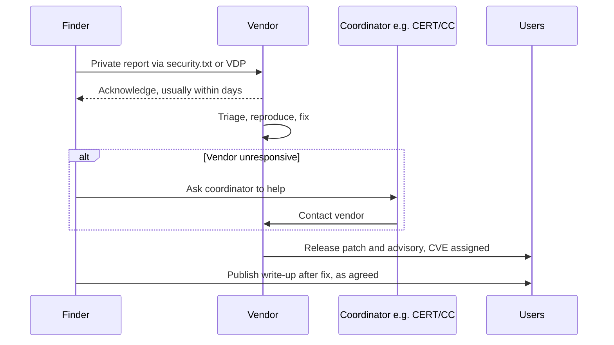

# Ethics, Law and Responsible Disclosure

## Introduction

Security skills are dual-use. The same knowledge that lets you find and fix a SQL injection could be used to steal a database. What separates a security professional from a criminal is not skill. It is **authorization, intent, and conduct**.

This page covers the rules every security learner and practitioner needs to know:

- **Authorization:** you only test systems you own or have explicit written permission to test.
- **The law:** computer misuse laws make unauthorized access a crime, often regardless of intent.
- **Ethics:** do no harm, protect people's data, and be honest.
- **Responsible disclosure:** what to do when you find a vulnerability, and how organizations should receive reports.

An analogy: a locksmith knows how to open locks. Opening your own door, or a customer's door with their permission, is a job. Opening a stranger's door "to show them the lock is weak" is breaking and entering, even if you leave a polite note.

:::warning Not legal advice
This page is general education, not legal advice. Laws differ between countries and change over time. If you are unsure whether an activity is legal, do not do it, and ask a qualified lawyer. Companies that run security testing programs should have their own legal counsel review their policies.
:::

## The Golden Rule: Authorization First

**Only test systems you own or have explicit, written permission to test.** This rule appears on every offensive-technique page in this tutorial, because it is the line between learning and committing a crime.

What counts as authorization:

| Situation | Authorized? |
|-----------|-------------|
| Your own laptop, VM, or home lab | Yes |
| A deliberately vulnerable app you run locally (Juice Shop, DVWA, WebGoat, Metasploitable) | Yes |
| A practice platform within its rules (TryHackMe, Hack The Box, PortSwigger Web Security Academy) | Yes, on the targets they provide |
| A bug bounty program, within its published scope and rules | Yes, only what the program allows |
| A penetration test with a signed contract and scope document | Yes, only within scope and time window |
| Your employer's production systems because you work there | **No**, unless your role and a written approval cover it |
| A website you use every day, "just a quick scan" | **No** |
| A friend's server after they said "sure, go for it" in a chat | Risky. Get it in writing and check who really owns the system (hosting providers and other tenants may be involved) |
| A system that is "obviously insecure" or "publicly accessible" | **No**. Accessible does not mean authorized |

:::tip
Your own cloud account is "yours", but the cloud provider's infrastructure is not. Most major providers publish penetration testing policies that list what customers may test without prior approval, and they forbid things like denial-of-service testing. Read your provider's policy before scanning even your own cloud resources.
:::

### Scope and rules of engagement

Professional testers work from a written **scope** and **rules of engagement (RoE)**. These documents say exactly what may be tested, when, how, and who to call if something goes wrong. A minimal scope file might look like this:

```yaml
engagement: "ACME web app assessment"
client_contact: "security@acme.example"
authorized_by: "Jane Smith, CISO (signed letter of authorization, ref LOA-2026-014)"
window:
  start: "2026-10-12T08:00:00Z"
  end: "2026-10-16T18:00:00Z"
in_scope:
  hosts:
    - "staging.acme.example"
    - "api-staging.acme.example"
  networks:
    - "192.0.2.0/28"
out_of_scope:
  hosts:
    - "www.acme.example"          # production marketing site
    - "payments.acme.example"     # third-party payment provider
  activities:
    - "denial of service"
    - "social engineering of staff"
    - "accessing real customer data beyond proof of concept"
```

Careful testers build scope checks into their tooling, so that a typo cannot send traffic to the wrong target. Here is a small default-deny scope checker:

```python
import ipaddress
import sys
from datetime import datetime, timezone

import yaml  # pip install pyyaml

def load_scope(path):
    with open(path) as f:
        return yaml.safe_load(f)

def in_window(scope, now):
    start = datetime.fromisoformat(scope["window"]["start"].replace("Z", "+00:00"))
    end = datetime.fromisoformat(scope["window"]["end"].replace("Z", "+00:00"))
    return start <= now <= end

def target_allowed(scope, target):
    if target in scope["out_of_scope"]["hosts"]:
        return False, "explicitly out of scope"
    if target in scope["in_scope"]["hosts"]:
        return True, "listed host"
    try:
        ip = ipaddress.ip_address(target)
    except ValueError:
        return False, "host not listed (default deny)"
    for net in scope["in_scope"]["networks"]:
        if ip in ipaddress.ip_network(net):
            return True, f"inside {net}"
    return False, "IP not in any in-scope network"

scope = load_scope(sys.argv[1])
now = datetime(2026, 10, 13, 10, 0, tzinfo=timezone.utc)  # fixed time for a repeatable demo
print("Engagement:", scope["engagement"])
print("Inside testing window:", in_window(scope, now))
for t in ["staging.acme.example", "www.acme.example", "192.0.2.5", "192.0.2.77", "dev.acme.example"]:
    ok, why = target_allowed(scope, t)
    print(f"{'ALLOW' if ok else 'BLOCK':5} {t:24} {why}")
```

Run it with `python scope_check.py scope.yaml`:

```text
Engagement: ACME web app assessment
Inside testing window: True
ALLOW staging.acme.example     listed host
BLOCK www.acme.example         explicitly out of scope
ALLOW 192.0.2.5                inside 192.0.2.0/28
BLOCK 192.0.2.77               IP not in any in-scope network
BLOCK dev.acme.example         host not listed (default deny)
```

Note `dev.acme.example`: it probably belongs to the same company, but it is not listed, so it is blocked. Default deny applies to scope as much as to code. [Penetration Testing Introduction](../10-sec-offensive-security/0-sec-pentest-introduction.mdx) covers engagements in detail.

## The Law

Almost every country has laws against unauthorized access to computer systems. A few important examples:

### United States

- The **Computer Fraud and Abuse Act (CFAA)** makes it a crime to access a computer "without authorization" or to "exceed authorized access". Penalties can include prison and civil lawsuits.
- In *Van Buren v. United States* (2021), the Supreme Court narrowed "exceeds authorized access" to mean entering parts of a system you are not entitled to access, rather than misusing information you are otherwise allowed to see.
- In May 2022 the Department of Justice revised its charging policy to say federal prosecutors should **not** charge **good-faith security research**, defined as accessing a computer solely for good-faith testing, investigation, or correction of a security flaw, in a way designed to avoid harm. This is internal prosecutorial policy. It does not bind state prosecutors, does not stop civil lawsuits, and "good faith" is judged by the facts, not by your claim.
- The **DMCA** (section 1201) restricts circumventing technical protections. The Copyright Office has granted exemptions for good-faith security research, which are reviewed every three years.
- Many US states have their own computer crime laws.

### United Kingdom

The **Computer Misuse Act 1990** criminalizes unauthorized access, unauthorized access with intent to commit further offenses, and unauthorized acts that impair a computer. The UK government has discussed reforming it, including a possible statutory defense for legitimate security research. As of late 2026, check the current status before relying on any new protection.

### European Union

- **Directive 2013/40/EU** on attacks against information systems requires member states to criminalize illegal access, system interference, data interference, and illegal interception. Each country implements it in national law.
- The **Cyber Resilience Act (CRA)** places security duties on manufacturers of products with digital elements. Since **11 September 2026**, manufacturers must report actively exploited vulnerabilities and severe incidents through ENISA's Single Reporting Platform, with an early warning within 24 hours of becoming aware. The CRA's main requirements, including vulnerability handling processes and a coordinated disclosure policy, apply from December 2027. Check the [European Commission's CRA pages](https://digital-strategy.ec.europa.eu/en/policies/cyber-resilience-act) for current guidance.
- **GDPR** applies if you access personal data. Even an authorized tester who copies real customer data unnecessarily can create a data protection problem for their client.

### Common threads

Across jurisdictions, a few things consistently get people into trouble:

- Accessing systems without permission, even if "nothing was damaged".
- Going beyond what is needed to prove a vulnerability: downloading data, pivoting to other systems, keeping access.
- Demanding payment in exchange for not disclosing (this can be treated as extortion).
- Causing outages, even accidentally, through aggressive scanning or exploitation.

## Ethics

The law sets a minimum. Ethics asks more. Professional bodies publish codes of ethics, for example the ISC2 Code of Ethics and the ACM Code of Ethics. Their common themes:

- **Protect society and the people affected.** Users whose data is in a system are stakeholders even though they never signed your contract.
- **Act honorably, honestly, and legally.** Do not exaggerate findings, hide mistakes, or misrepresent your skills.
- **Do no harm.** Prefer the least invasive way to demonstrate a problem.
- **Respect privacy.** If you see personal data during authorized testing, access only what you need, do not keep it, and do not share it.
- **Advance the profession.** Share knowledge responsibly and help others learn safely.

### Grey areas you will meet

| Situation | Ethical response |
|-----------|------------------|
| You notice an exposed database while doing something else | Do not explore it. Note only what you saw, and report it to the owner or a coordinator |
| You find valid credentials in a public code repository | Do not log in with them. Report to the owner (many platforms also have reporting channels) |
| A bug bounty program's scope is unclear | Ask the program before testing |
| Your exploit could expose customer data | Stop at the minimum proof (for example, your own test account or a row count) |
| You find a flaw in your employer's vendor's product | Use your company's process and the vendor's disclosure channel, not social media |

## Coordinated Vulnerability Disclosure

When someone finds a vulnerability, there are three broad options:

- **Non-disclosure:** keep it secret. Users remain at risk.
- **Full disclosure:** publish immediately. Users are at risk until a fix exists, and attackers learn about it at the same time as defenders.
- **Coordinated vulnerability disclosure (CVD)**, often called **responsible disclosure**: report privately to the vendor, give them reasonable time to fix it, then publish details together once users can protect themselves.

CVD is the accepted default in the industry. It is described in international standards **ISO/IEC 29147** (vulnerability disclosure) and **ISO/IEC 30111** (vulnerability handling processes).



### Disclosure deadlines

Finders usually give vendors a deadline before publishing. A widely known example is Google Project Zero, which uses a 90-day disclosure policy with some adjustments. Coordinators such as CERT/CC publish their own policies. Deadlines push vendors to act, but good coordination is flexible when a vendor is clearly working on a hard fix, and faster when a vulnerability is already being exploited.

### Writing a good report

A clear report gets fixed faster. Include:

1. **Summary:** one sentence on what the issue is and its impact.
2. **Affected component and version:** URL, endpoint, product version.
3. **Steps to reproduce:** minimal and exact, using your own test accounts.
4. **Proof of concept:** the smallest demonstration that shows impact without harming real users or data.
5. **Impact:** what an attacker could do, realistically.
6. **Suggested fix** (optional): for example, "check ownership of `invoice_id` before returning it".
7. **Your contact details** and any disclosure timeline you propose.

Do not include real customer data you saw. Describe it instead ("the response contained another user's name and email").

## For Organizations: Make Reporting Easy

If you build software, you **will** receive vulnerability reports. Make it easy to report safely, and you will hear about problems from friendly finders before attackers exploit them.

### Publish a vulnerability disclosure policy (VDP)

A VDP tells finders what is in scope, how to report, what you promise in return (acknowledgment, updates, no legal action for good-faith research), and what is not allowed (denial of service, accessing other users' data, social engineering). Templates are available from CISA (for US federal agencies, but useful for anyone) and the open-source **disclose.io** project, which focuses on **safe harbor** language that protects good-faith researchers.

A **bug bounty** is a VDP that also pays rewards. Start with a VDP first: a bounty program attracts many reports, and you need a working triage process before you can handle them. See [Bug Bounty Programs](../10-sec-offensive-security/10-sec-bug-bounty.mdx).

### Publish security.txt

**RFC 9116** defines `security.txt`, a small text file at `/.well-known/security.txt` that tells finders how to reach you. Two fields are required: **Contact** (one or more) and **Expires** (exactly one, and RFC 9116 recommends less than a year in the future).

```text
Contact: mailto:security@example.com
Contact: https://example.com/security/report
Expires: 2027-06-30T23:59:59Z
Encryption: https://example.com/.well-known/pgp-key.txt
Policy: https://example.com/security/disclosure-policy
Acknowledgments: https://example.com/security/hall-of-fame
Preferred-Languages: en, de
Canonical: https://example.com/.well-known/security.txt
```

A common failure is an `Expires` date that quietly passes. A small check in CI catches that:

```python
import sys
from datetime import datetime, timedelta, timezone

def check_security_txt(text: str, now: datetime) -> list[str]:
    problems, fields = [], {}
    for line in text.splitlines():
        line = line.strip()
        if not line or line.startswith("#"):
            continue
        name, _, value = line.partition(":")
        fields.setdefault(name.strip().lower(), []).append(value.strip())

    if not fields.get("contact"):
        problems.append("missing required Contact field")
    expires = fields.get("expires", [])
    if len(expires) != 1:
        problems.append("must have exactly one Expires field")
    else:
        when = datetime.fromisoformat(expires[0].replace("Z", "+00:00"))
        if when <= now:
            problems.append("Expires is in the past: file is stale")
        elif when - now > timedelta(days=365):
            problems.append("Expires is more than a year away (RFC 9116 recommends less)")
    for c in fields.get("contact", []):
        if not c.startswith(("mailto:", "https://", "tel:")):
            problems.append(f"Contact should be a mailto:, https:// or tel: URI: {c}")
    return problems

now = datetime(2026, 10, 11, tzinfo=timezone.utc)  # fixed date for a repeatable demo
with open(sys.argv[1]) as f:
    issues = check_security_txt(f.read(), now)
print("security.txt OK" if not issues else "\n".join("- " + i for i in issues))
```

Running it against the good file, then against a broken one containing `Contact: security@example.com` and `Expires: 2025-01-01T00:00:00Z`:

```text
security.txt OK
```

```text
- Expires is in the past: file is stale
- Contact should be a mailto:, https:// or tel: URI: security@example.com
```

In production, replace the fixed `now` with `datetime.now(timezone.utc)`. This is a simplified check. It does not validate signatures or every rule in the RFC.

### Handle reports well

- Acknowledge quickly, even if only to say "received, we are looking".
- Triage with the same severity process you use for internal findings.
- Keep the finder informed and agree on a publication date.
- Credit finders who want credit.
- Request a CVE ID for vulnerabilities in products others run, through a CVE Numbering Authority (CNA). Many vendors are their own CNA.
- If you make products sold in the EU, check your CRA reporting duties for actively exploited vulnerabilities.

## Real-World Scenario

You are a developer at a mid-sized company. While using a vendor's SaaS HR portal to check your own payslip, you notice that changing the number in the URL from your employee ID to another number shows a different person's payslip. You did not set out to test anything. What now?

**What you do:**

1. **Stop.** Do not try more IDs, download anything, or check whether it works for other companies. You have already seen enough to know there is a problem, and every further request increases your legal and ethical exposure.
2. **Write down what happened**: the date, the URL pattern (not the other person's data), and the steps.
3. **Tell your own security team**, because the exposed data belongs to your employer's staff, and your company has a contract with the vendor.
4. **Report to the vendor** through their `security.txt`, VDP, or support channel, ideally together with your security team. Use the report structure above.
5. **Agree on a timeline.** If the vendor does not respond after a reasonable period, ask a coordinator such as CERT/CC or your national CSIRT for help rather than going public alone.
6. **Do not post about it** on social media until it is fixed and you have agreed on disclosure.

### Why this approach

It protects the affected people first (the other employees whose payslips are exposed), keeps you on the right side of the law by stopping at accidental discovery, and gives the vendor a fair chance to fix the issue. Involving your employer's security team also matters because there may be contractual and data protection obligations, such as breach notification, that you are not aware of.

### When to use it and when not to

This coordinated path is right for almost every accidental discovery. If you find evidence that a vulnerability is **already being exploited** (for example, data from the system appears for sale), escalate faster, and involve your security team and possibly law enforcement or a national CSIRT. If the system is your own team's, you do not need external disclosure at all. Fix it, check logs for past abuse, and follow your incident process.

### Alternatives and trade-offs

| Approach | Pros | Cons | Best for |
|----------|------|------|----------|
| Ignore it | No effort, no exposure | People's data stays exposed; ethically poor | Never |
| Keep testing to "prove" impact | Stronger evidence | Likely illegal; accesses more personal data | Never without authorization |
| Coordinated disclosure to vendor | Protects users, legally safest, fair to vendor | Takes time; depends on vendor response | Default choice |
| Disclosure through a coordinator (CERT/CC, national CSIRT) | Neutral party, more weight with unresponsive vendors | Slower, coordinator may decline | Unresponsive vendors, multi-vendor issues |
| Immediate full public disclosure | Fast pressure on vendor, warns users | Attackers learn at the same time; legal risk; harms users | Rare cases where a vendor refuses to act and users need to protect themselves |

## Common Mistakes

- **"I was just checking."** Intent rarely helps if you accessed a system without permission. Stay within authorization.
- **Testing beyond scope.** A bug bounty or pentest scope is a legal boundary, not a suggestion.
- **Collecting real data as proof.** Use your own test accounts and the minimum evidence.
- **Threatening vendors or asking for money** in return for silence.
- **Publishing before a fix exists** without a very good reason and a documented attempt to coordinate.
- **Organizations ignoring reports** or responding with legal threats. That drives finders to full disclosure and makes you less safe.
- **Letting security.txt expire** or pointing it at an unmonitored mailbox.

## Summary

- Only test systems you own or have explicit written permission to test. Accessible does not mean authorized.
- Professional testing runs on a written scope and rules of engagement. Build scope checks into your tools and default to deny.
- Computer misuse laws (CFAA in the US, the Computer Misuse Act in the UK, national laws implementing Directive 2013/40/EU) criminalize unauthorized access. The US DOJ's 2022 policy declines to charge good-faith research, but it is not blanket protection.
- The EU Cyber Resilience Act's reporting duties for actively exploited vulnerabilities began on 11 September 2026.
- Coordinated vulnerability disclosure (ISO/IEC 29147 and 30111) is the industry default: report privately, allow time to fix, publish together.
- Organizations should publish a VDP with safe harbor language and a valid `security.txt` (RFC 9116), and handle reports promptly.

## Exercises

1. Extend the scope checker so it also refuses to run outside the testing window, and so it resolves hostnames to IP addresses and checks that the resolved IP is in scope. Why might a hostname that is in scope resolve to an IP that is not?
2. Write a `security.txt` for a project you maintain, run the checker on it, and add the check to a CI pipeline.
3. Read the disclosure policy of a large software vendor or a bug bounty program. List what is out of scope and what safe harbor they promise.
4. Write a vulnerability report for the payslip scenario above using the seven-part structure, without including any real personal data.

Related pages:

- [The Attacker Mindset and Kill Chains](./7-sec-attacker-mindset.mdx)
- [Building a Safe Practice Lab](../10-sec-offensive-security/1-sec-lab-setup.mdx)
- [Bug Bounty Programs](../10-sec-offensive-security/10-sec-bug-bounty.mdx)
- [Compliance: SOC 2, PCI DSS, HIPAA and GDPR](../13-sec-governance/2-sec-compliance.mdx)

External reading:

- [RFC 9116: A File Format to Aid in Security Vulnerability Disclosure](https://www.rfc-editor.org/rfc/rfc9116)
- [US DOJ: Department of Justice Announces New Policy for Charging Cases under the CFAA (2022)](https://www.justice.gov/opa/pr/department-justice-announces-new-policy-charging-cases-under-computer-fraud-and-abuse-act)
- [CISA Vulnerability Disclosure Policy Template](https://www.cisa.gov/vulnerability-disclosure-policy-template)
- [disclose.io](https://disclose.io/)
- [CERT/CC Coordinated Vulnerability Disclosure](https://certcc.github.io/CERT-Guide-to-CVD/)
