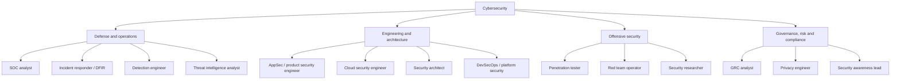
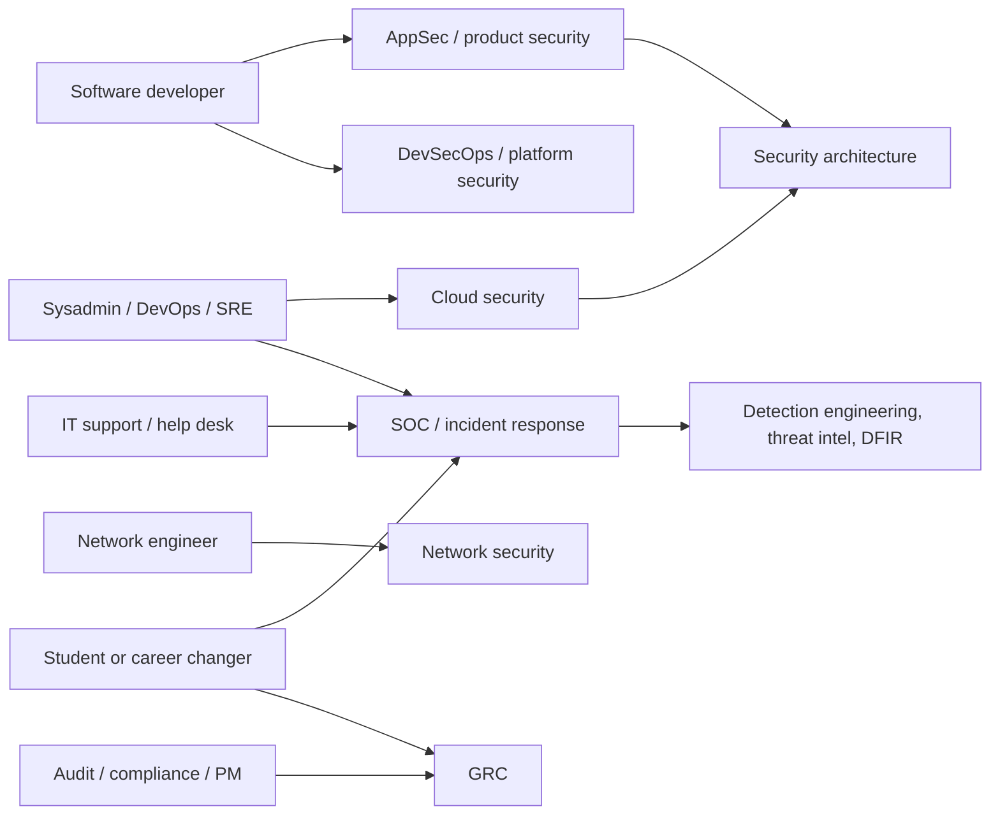

# Cybersecurity Careers and Roles

## Introduction

"Cybersecurity" is not one job. It is a family of very different jobs. A penetration tester spends the day trying to break into systems (with permission). A SOC analyst triages alerts and investigates suspicious activity. An application security engineer reviews code and helps developers fix vulnerabilities. A GRC analyst works with policies, risk registers, and auditors. A cloud security engineer writes infrastructure code and IAM policies. They share fundamentals, but the daily work, the skills, and even the personality fit differ a lot.

An analogy: "medicine" includes surgeons, nurses, radiologists, epidemiologists, and hospital administrators. Nobody says "I want to work in medicine" and stops there. Choosing a role, or at least a direction, makes learning much more focused.

This page maps the main roles, explains the skills each one needs, compares common certifications honestly, and shows practical paths in, especially for developers and IT staff, who often make excellent security professionals.

:::note
Salaries, job market conditions, certification prices, and exam versions change frequently and vary by country. This page avoids specific numbers. Check current job postings in your area and the official certification websites for up-to-date information.
:::

## A Map of Security Roles

### The NICE Framework

The US **NICE Workforce Framework for Cybersecurity** (NIST SP 800-181 Rev. 1) is a common reference for describing security work. Its components (work roles, competency areas, and task, knowledge, and skill statements) are maintained as a separate, versioned dataset that NIST updates. The current component version groups work roles into five categories:

| NICE category | What the work is about | Example roles |
|---------------|------------------------|---------------|
| Oversight and Governance | Leadership, policy, risk, legal, training | Security manager, GRC analyst, privacy officer |
| Design and Development | Building secure systems and software | Security architect, secure software developer, security engineer |
| Implementation and Operation | Running and maintaining systems securely | Systems administrator, network operations, data administrator |
| Protection and Defense | Detecting, analyzing, and responding to threats | SOC analyst, incident responder, vulnerability analyst, threat analyst |
| Investigation | Investigating cybercrime and digital evidence | Forensic analyst, cybercrime investigator |

Check the [NICE Framework Resource Center](https://www.nist.gov/itl/applied-cybersecurity/nice/nice-framework-resource-center) for the current list of work roles. Industry job titles do not map one-to-one to NICE roles, but the framework is useful for understanding what a job description really asks for.

### Common job titles



| Role | What you do day to day | Key skills | Typical background |
|------|------------------------|------------|--------------------|
| SOC analyst | Triage alerts, investigate events, escalate incidents | Networking, OS internals, log analysis, SIEM queries, attack techniques | IT support, sysadmin, networking |
| Incident responder / DFIR | Contain and investigate breaches, collect and analyze evidence | Forensics, memory and disk analysis, calm under pressure | SOC, sysadmin |
| Detection engineer | Write and tune detection rules, measure coverage | Query languages, ATT&CK, scripting, data engineering | SOC, developer |
| Threat intelligence analyst | Track threat actors, turn reports into actions | Research, writing, ATT&CK, context about your industry | SOC, analyst roles, journalism or research |
| AppSec / product security engineer | Threat models, code review, security tooling in CI, developer training | Programming, web and API security, communication | Software developer |
| Cloud security engineer | Secure cloud accounts, IAM, guardrails, IaC scanning | Cloud platforms, IAM, Terraform, containers, scripting | DevOps, SRE, cloud engineer |
| Security architect | Design security into systems and set standards | Broad technical depth, trade-off judgment | Senior engineer |
| Penetration tester | Authorized testing of apps, networks, and cloud; write reports | Web and network attacks, scripting, report writing | Developer, sysadmin, CTF player |
| Red team operator | Simulate real adversaries end to end to test detection and response | Advanced offensive skills, stealth, OPSEC | Experienced pentester |
| GRC analyst | Risk assessments, policies, audits, vendor reviews | Frameworks, risk, writing, stakeholder management | Audit, IT, project management |
| Privacy engineer | Build privacy into products, data mapping, privacy reviews | Data flows, regulations, engineering | Developer, legal or GRC |
| Security manager / CISO | Strategy, budget, team, reporting to leadership | Leadership, risk communication, broad knowledge | Any of the above, after years of experience |

### Which role fits you?

Some honest questions to ask yourself:

- **Do you enjoy building things?** AppSec, cloud security, detection engineering, and security architecture all involve a lot of engineering.
- **Do you enjoy puzzles and breaking things?** Penetration testing and security research suit you, but note that much of the job is careful methodology and report writing.
- **Do you stay calm in a crisis and like investigating?** Incident response and SOC work.
- **Do you like people, process, and writing?** GRC, privacy, and security leadership.
- **Do you want predictable hours?** SOC and incident response often involve shifts or on-call duty. Engineering and GRC roles usually have more regular hours.

## Skills That Matter Across All Roles

Whatever role you aim for, these fundamentals pay off:

1. **Networking:** TCP/IP, DNS, HTTP, TLS, routing, firewalls. See the [Computer Networks tutorial](/docs/fundamental/network) and [Network Security Introduction](../2-sec-network-security/0-sec-network-security-introduction.mdx).
2. **Operating systems:** Linux and Windows users, permissions, processes, services, and logs. See the [Ubuntu tutorial](/docs/os/ubuntu).
3. **Scripting:** Python or PowerShell, plus Bash, to automate analysis and tooling.
4. **Web and cloud basics:** how modern apps are built and deployed.
5. **Security fundamentals:** this section of the tutorial.
6. **Communication:** writing clear reports, explaining risk to non-experts, and persuading teams to fix things. In practice, this is what separates good security professionals from great ones.

### A skills gap check

A simple way to decide what to learn next is to compare your current skills with what a target role needs. Here is a tiny script for that. Edit the sets to match real job postings you are interested in:

```python
ROLE_SKILLS = {
    "SOC analyst": {"networking", "linux", "windows", "log analysis", "siem queries",
                    "incident triage", "attack techniques"},
    "AppSec engineer": {"programming", "web security", "code review", "threat modeling",
                        "sast/dast tools", "ci/cd", "communication"},
    "Cloud security engineer": {"cloud iam", "networking", "infrastructure as code",
                                "containers", "logging", "scripting"},
    "Penetration tester": {"networking", "linux", "web security", "scripting",
                           "attack techniques", "report writing"},
    "GRC analyst": {"risk management", "frameworks", "policy writing", "audit",
                    "communication"},
}

my_skills = {"programming", "web security", "ci/cd", "linux", "scripting",
             "containers", "communication", "networking"}

print(f"{'ROLE':24} {'MATCH':>5}  MISSING")
ranked = sorted(ROLE_SKILLS.items(),
                key=lambda kv: len(kv[1] & my_skills) / len(kv[1]), reverse=True)
for role, needed in ranked:
    pct = 100 * len(needed & my_skills) // len(needed)
    missing = ", ".join(sorted(needed - my_skills)) or "-"
    print(f"{role:24} {pct:>4}%  {missing}")
```

Output:

```text
ROLE                     MATCH  MISSING
Penetration tester         66%  attack techniques, report writing
AppSec engineer            57%  code review, sast/dast tools, threat modeling
Cloud security engineer    50%  cloud iam, infrastructure as code, logging
SOC analyst                28%  attack techniques, incident triage, log analysis, siem queries, windows
GRC analyst                20%  audit, frameworks, policy writing, risk management
```

The percentages are crude, but the **missing** column is a concrete study plan. For this developer, AppSec needs code review, SAST/DAST tools, and threat modeling, all covered in sections 5 and 6 of this tutorial.

## Certifications: An Honest View

Certifications can help you pass resume filters, especially for entry-level and government roles, and they give structure to self-study. They do not replace hands-on skill. Hiring managers for technical roles often value a strong portfolio and practical interview performance more.

| Certification | Issuer | Level | Focus | Notes |
|---------------|--------|-------|-------|-------|
| Certified in Cybersecurity (CC) | ISC2 | Entry | Broad fundamentals | Designed for beginners; check ISC2 for current pricing and any free-access programs |
| Security+ | CompTIA | Entry to early career | Broad fundamentals | Widely requested in job postings and some government roles. CompTIA updates the exam periodically, so check which version is current |
| CySA+ | CompTIA | Intermediate | Security analyst and SOC skills | Practical blue-team focus |
| GIAC certifications (for example GSEC, GCIH) | GIAC / SANS | Intermediate to advanced | Many specialties | Highly regarded, usually expensive with training |
| OSCP | OffSec | Intermediate | Hands-on penetration testing | Practical exam; respected for offensive roles |
| Cloud provider security certifications | AWS, Microsoft, Google | Intermediate | Platform-specific security | Valuable for cloud security roles |
| CISSP | ISC2 | Advanced / management | Broad security management | Requires several years of professional experience for full certification |
| CISM, CISA | ISACA | Advanced | Management and audit | Common in GRC and leadership |

How to decide:

- **Breaking in with no experience?** An entry-level cert (CC or Security+) plus a home lab and portfolio is a common, reasonable combination.
- **Already a developer?** Certifications matter less. Build AppSec skills and evidence instead: secure code reviews, contributions to security tools, and write-ups.
- **Targeting government or defense contractors?** Check the specific certification requirements for those roles. They often list approved certifications by name.
- **Going offensive?** Hands-on practice platforms first, then a practical certification such as OSCP.

:::caution
Certification names, exam versions, prices, and experience requirements change. Always check the issuer's official website before you buy training or book an exam, and be wary of "brain dump" sites that sell real exam questions. Using them violates exam agreements and can get your certification revoked.
:::

## Building a Portfolio

A portfolio shows what you can do. Good portfolio items:

- **Lab write-ups:** for example, how you found and **fixed** each vulnerability in your own copy of OWASP Juice Shop or DVWA. Only publish write-ups where the platform's rules allow it. Some platforms forbid publishing solutions to active challenges.
- **Detection rules:** a GitHub repository of Sigma rules or SIEM queries you wrote and tested against sample logs.
- **Tools and scripts:** a log parser, a scope checker, a CI security scanning setup.
- **Secure project:** a small web app with authentication, authorization, security headers, dependency scanning, and a short threat model in the README. [Project: Building a Secure Login System](../14-sec-projects/0-sec-project-secure-login.mdx) is a good candidate.
- **CTF results and write-ups** for retired challenges.
- **Responsible disclosures:** acknowledged reports through bug bounty programs or VDPs, following each program's rules.
- **Blog posts or talks** explaining a concept clearly.

Always remember the ethics: never include anything gained from unauthorized testing, and never publish real vulnerability details before they are fixed and the owner agrees.

## A Day in the Life

Job titles hide very different days. These sketches are typical, not universal:

| Role | Morning | Afternoon |
|------|---------|-----------|
| SOC analyst | Review overnight alerts; close false positives; escalate a suspicious login from a new country | Investigate an endpoint alert with EDR data; write a ticket summary; suggest a tuning change for a noisy rule |
| AppSec engineer | Review a pull request that changes the payment flow; answer a developer's question about CSRF | Run a threat modeling session for a new feature; triage a SAST finding; update secure coding guidance |
| Cloud security engineer | Review Terraform changes for IAM and network rules; investigate a CSPM alert about a public bucket | Write a guardrail policy that blocks public buckets by default; help a team design workload identity |
| Penetration tester | Confirm scope and test accounts with the client; test authorization on the client's API | Verify findings, capture minimal evidence, and write the report with clear fixes |
| GRC analyst | Update the risk register after a new vendor is onboarded; collect evidence for an audit | Review a policy draft with legal; prepare a quarterly risk summary for leadership |

Notice how much of every role is **writing and communication**: tickets, reports, reviews, and summaries.

## Preparing for Interviews

Security interviews usually combine fundamentals, practical exercises, and judgment questions. Common formats:

- **Fundamentals questions:** "What happens when you type a URL into a browser?", "How does TLS protect a connection?", "What is the difference between authentication and authorization?"
- **Scenario questions:** "You see 500 failed logins for one account in five minutes. What do you do?" Interviewers want structured thinking: gather facts, assess impact, contain, communicate.
- **Hands-on exercises:** reviewing a code snippet for vulnerabilities (AppSec), analyzing a log file (SOC), or reading a cloud policy (cloud security).
- **Behavioral questions:** how you handled disagreement with a team that did not want to fix a finding, or how you explained a risk to a non-technical manager.

A good way to practice scenario questions is to answer them out loud using the incident response phases from [Incident Response Lifecycle](../12-sec-incident-response/0-sec-incident-response-lifecycle.mdx). For code review exercises, practice on the vulnerable and fixed examples throughout this tutorial: cover the fixed version and try to spot the bug yourself.

## Paths Into Security



### From software development

Developers are in a strong position. Product security teams often struggle to find people who understand both code and security. Practical steps:

1. Become your team's security champion: volunteer to review security-sensitive pull requests.
2. Learn the web and API vulnerability classes (sections 3, 5, and 7) and practice them in labs.
3. Add security tooling to your team's CI (section 6).
4. Write a threat model for a feature you build.
5. Ask your AppSec team, if there is one, about internal transfers or rotations.

### From IT operations or DevOps

Your knowledge of how systems really run is valuable for cloud security, hardening, SOC, and incident response roles. Focus on logging, detection, IAM, and infrastructure as code security.

### From non-technical backgrounds

GRC, privacy, and security awareness roles value skills in writing, process, audit, law, and project management. Pair them with technical fundamentals so you can talk credibly with engineers.

### Legal places to practice

| Resource | Type | Good for |
|----------|------|----------|
| OWASP Juice Shop | Self-hosted vulnerable web app | Web and API vulnerabilities, with built-in challenges |
| DVWA and WebGoat | Self-hosted vulnerable apps | Classic web vulnerabilities with explanations |
| Metasploitable | Self-hosted vulnerable VM | Network services and exploitation basics in an isolated lab |
| PortSwigger Web Security Academy | Free online labs | Structured web security learning from beginner to expert |
| TryHackMe | Guided online rooms | Beginners, both offensive and defensive paths |
| Hack The Box | Online machines and challenges | Hands-on offensive practice at many difficulty levels |
| CTF competitions | Timed events | Problem-solving under pressure, teamwork |

Each platform has its own rules. Follow them, and never use techniques learned there against systems outside the platform. [Building a Safe Practice Lab](../10-sec-offensive-security/1-sec-lab-setup.mdx) shows how to set up self-hosted targets safely.

### A home lab on a budget

You do not need expensive hardware. A laptop with 16 GB of RAM can run a small, isolated lab:

```bash
# Run a vulnerable target bound to localhost only
docker run --rm -d --name juice -p 127.0.0.1:3000:3000 bkimminich/juice-shop

# Check it is NOT listening on all interfaces
ss -tln | grep 3000
```

Example output:

```text
LISTEN 0      4096       127.0.0.1:3000       0.0.0.0:*
```

The `127.0.0.1` address confirms only your own machine can reach the target. Add a Linux VM for hardening practice and log collection, and you have enough to work through most of this tutorial. Stop the container with `docker stop juice` when you are done.

### Specializations to explore later

Once you have the fundamentals, security offers deep specialties: malware analysis and reverse engineering, mobile security, hardware and embedded security, operational technology (industrial control systems), cryptography engineering, identity engineering, and AI security. You do not need to choose one early, but it helps to notice which topics you keep coming back to.

### Keep learning

Security changes constantly. Useful habits:

- Follow advisories from CISA and your national cyber security center.
- Read vendor and researcher write-ups of real incidents and vulnerabilities.
- Join local security meetups, OWASP chapters, or conferences (many publish talks online for free).
- Keep practicing in labs and on legal platforms.

## Real-World Scenario

Priya is a backend developer with four years of experience building Python APIs. She enjoys the security parts of her job, such as fixing a vulnerability found in a pentest, and wants to move into security within a year without taking a pay cut or leaving her company.

**Her plan:**

1. **Choose a direction.** The skills gap script shows she is closest to AppSec, and she prefers building to attacking. She targets product security engineering.
2. **Fill gaps with on-the-job work.** She volunteers as the security champion for her team, adds dependency and secret scanning to CI, and writes a STRIDE threat model for a new payments feature.
3. **Practice deliberately.** She works through the server-side topics in PortSwigger Web Security Academy and fixes the corresponding bugs in a copy of a vulnerable training app.
4. **Build evidence.** She writes three internal blog posts about bugs she prevented, and gives a lunch-and-learn on broken access control.
5. **Talk to the security team.** She shares her work with the head of security and asks about a rotation. Six months later, a product security role opens and she is the obvious candidate.

### Why this approach

Priya's development experience is her biggest asset, so the plan builds on it instead of starting over. On-the-job security work creates real evidence that a certification alone cannot provide, and it builds relationships with the people who will make the hiring decision.

### When to use it and when not to

An internal move works best when the company has, or plans to build, a security team. If it does not, the same work still builds a portfolio for external applications. If Priya wanted to become a penetration tester instead, she would need more hands-on offensive practice and probably a practical certification, and an internal move would be less likely unless the company has an internal red team.

### Alternatives and trade-offs

| Path | Pros | Cons | Best for |
|------|------|------|----------|
| Internal transfer via security champion work | Keeps salary and context, builds real evidence | Depends on employer having a security team | Developers and ops staff at mid-to-large companies |
| Certification-first, then apply externally | Structured, recognized by HR filters | Costs money; certs alone rarely win technical interviews | Career changers targeting entry roles |
| Bootcamp | Fast, structured, peer group | Quality varies widely; can be expensive | People who need structure and can verify bootcamp outcomes |
| University degree or master's | Deep foundations, network, some roles require it | Time and cost | Students, research-oriented or government careers |
| CTFs and bug bounties | Practical skill, public track record | Irregular income from bounties; must follow program rules | Aspiring pentesters and researchers |
| Start in a SOC | Exposure to real attacks, many entry roles | Shift work, alert fatigue | IT support staff and career changers |

## Common Mistakes

- **Collecting certifications without hands-on practice.** Interviews for technical roles test what you can do.
- **Skipping fundamentals.** Jumping straight to hacking tools without understanding networking and operating systems leads to shallow skills.
- **Practicing illegally.** Testing systems without permission can end a career before it starts. Use labs and legal platforms.
- **Ignoring communication skills.** Most security work involves persuading others to make changes.
- **Treating "cybersecurity" as one job.** Pick a direction so your learning and applications are focused.
- **Underestimating your current experience.** Developers, sysadmins, auditors, and support staff all bring skills security teams need.

## Summary

- Cybersecurity includes many distinct roles across defense, engineering, offensive security, and governance. The NICE Framework (NIST SP 800-181 Rev. 1, with separately versioned components) is a useful map.
- Fundamentals (networking, operating systems, scripting, and communication) matter for every role.
- Certifications help with filters and structure but do not replace hands-on skill. Check official sources for current versions and prices.
- A portfolio of lab write-ups, detection rules, tools, and secure projects shows what you can do. Keep it legal and ethical.
- Developers and IT staff have strong paths into AppSec, cloud security, and SOC roles by building on existing experience.

## Exercises

1. Edit the skills gap script with skills from three real job postings for a role you are interested in. What are your top three gaps?
2. Pick one role from the table and find two people with that title who write publicly (blogs, talks). Summarize what they actually do day to day.
3. Plan a three-month learning schedule using pages from this tutorial and one legal practice platform. Include one portfolio item you will publish.
4. Write a one-paragraph description of how your current job already involves security. Use it as the start of a resume summary.

Related pages:

- [Cybersecurity Introduction](./0-sec-introduction.mdx)
- [Capture the Flag Competitions](../10-sec-offensive-security/9-sec-ctf.mdx)
- [The Security Operations Center](../11-sec-defensive-operations/0-sec-soc.mdx)
- [Secure Software Development Lifecycle](../6-sec-appsec-and-devsecops/0-sec-sdlc.mdx)

External reading:

- [NICE Framework Resource Center (NIST)](https://www.nist.gov/itl/applied-cybersecurity/nice/nice-framework-resource-center)
- [OWASP local chapters](https://owasp.org/chapters/)
- [PortSwigger Web Security Academy](https://portswigger.net/web-security)
- [CISA Cybersecurity Careers resources](https://www.cisa.gov/careers)
