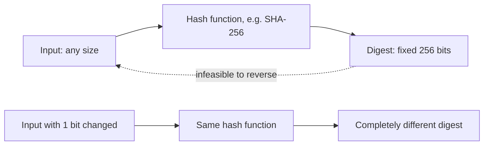

# Hash Functions

## Introduction

A **cryptographic hash function** takes input of any size and produces a short, fixed-size output called a **digest** or **hash**. SHA-256 always produces 256 bits (64 hex characters), whether you feed it one byte or a 4 GB disk image.

Think of it as a fingerprint for data. A fingerprint is small, it identifies the person reliably, and you cannot rebuild the person from it. In the same way:

- The same input always gives the same digest.
- A tiny change to the input gives a completely different digest.
- You cannot work backwards from the digest to the input.
- You cannot find two different inputs that share a digest.

Hashes are everywhere in software: package managers verify downloads with them, Git names every commit by one, Docker identifies image layers by `sha256:` digests, browsers check CDN scripts with Subresource Integrity, and blockchains chain blocks together with them.

This page explains the security properties, which algorithms to use in 2026, and the important cases where a bare hash is the **wrong** tool.

## The Three Security Properties

| Property | Informal meaning | Attack it prevents |
| --- | --- | --- |
| Preimage resistance | Given a digest `h`, you cannot find any input `m` with `hash(m) = h` | Recovering data from its hash |
| Second-preimage resistance | Given an input `m1`, you cannot find a different `m2` with the same digest | Swapping a specific file for a malicious one |
| Collision resistance | You cannot find **any** two inputs with the same digest | Getting two different documents to share one signature |

Collision resistance is the hardest to keep. Because of the **birthday paradox**, finding *some* collision in an n-bit hash takes roughly 2 to the power n/2 attempts, not 2 to the power n. So a 128-bit hash like MD5 offers at most about 64 bits of collision resistance even before any clever attack, which is why modern designs use 256-bit digests or larger.



## The Avalanche Effect

A good hash spreads every input bit across the whole output. Change one letter and about half the output bits flip.

```python
import hashlib

def bits(hex_digest: str) -> str:
    return bin(int(hex_digest, 16))[2:].zfill(len(hex_digest) * 4)

a = hashlib.sha256(b"hello world").hexdigest()
b = hashlib.sha256(b"hello worle").hexdigest()

diff = sum(x != y for x, y in zip(bits(a), bits(b)))
print("hello world ->", a)
print("hello worle ->", b)
print(f"bits changed: {diff} of 256")
```

Output:

```text
hello world -> b94d27b9934d3e08a52e52d7da7dabfac484efe37a5380ee9088f7ace2efcde9
hello worle -> 0fc30e735a0228a31cbbb969988b4f50e02e737f979f091d7d224b765443f5d4
bits changed: 140 of 256
```

About half the bits changed, and there is no visible relationship between the two digests. This is what makes a hash useful for detecting changes: you cannot make a "small" edit that only nudges the digest.

## Choosing an Algorithm

Python's `hashlib` exposes the common algorithms:

```python
import hashlib

data = b"Compile N Run"
for name in ["md5", "sha1", "sha256", "sha512", "sha3_256", "blake2b"]:
    h = hashlib.new(name, data)
    print(f"{name:9} {h.digest_size * 8:4} bits  {h.hexdigest()[:24]}...")
```

Output:

```text
md5        128 bits  5a7d7bc6013a0e028cd8cfb1...
sha1       160 bits  1731b21191c40452e5aa63f4...
sha256     256 bits  c7bef585c479c63801819e9c...
sha512     512 bits  153ad57a694c4c032a4b2ac2...
sha3_256   256 bits  60342f8adabe5187ac7f22e9...
blake2b    512 bits  6e22b45b946fc48da2321537...
```

| Algorithm | Status | Notes |
| --- | --- | --- |
| MD5 | **Broken** | Practical collisions since 2004. Still used as a non-security checksum. Never use for security. |
| SHA-1 | **Broken** | Public collision ("SHAttered") in 2017, chosen-prefix collisions in 2020. NIST has announced it will retire SHA-1 by the end of 2030. |
| SHA-256 / SHA-512 (SHA-2) | Recommended | The default choice. Hardware acceleration on most CPUs. Vulnerable to length extension (see below). |
| SHA-3 (Keccak) | Recommended | Different internal design from SHA-2, so a good backup. Not vulnerable to length extension. |
| BLAKE2b / BLAKE2s | Recommended | Very fast in software, built into `hashlib`, supports a key parameter for MAC use. |
| BLAKE3 | Recommended (third-party) | Extremely fast and parallel. Available through the `blake3` package, not the standard library. |

:::tip Default choice
If nothing else constrains you, use **SHA-256**. It is supported everywhere, it is FIPS-approved, and it has no known practical weaknesses. Use SHA-512 or SHA-3 if a standard asks for them.
:::

### Real collisions are not theoretical

The 2017 SHAttered attack produced two different PDF files with the same SHA-1 hash. The 2020 "SHA-1 is a Shambles" work made chosen-prefix collisions practical, which is the kind attackers need to forge certificates. This is why browsers stopped trusting SHA-1 certificates and why Git's published plan for Git 3.0 makes SHA-256 the default for new repositories.

The lesson for builders is crypto agility: store the algorithm name with every digest, such as `sha256:abc123...`, so you can migrate later.

## Common Uses

### Verifying file integrity

Projects publish a checksum next to each download. After downloading, you compute the hash and compare.

```bash
sha256sum hello.txt
sha256sum hello.txt > hello.txt.sha256
sha256sum -c hello.txt.sha256
echo x >> hello.txt
sha256sum -c hello.txt.sha256
```

Output:

```text
5891b5b522d5df086d0ff0b110fbd9d21bb4fc7163af34d08286a2e846f6be03  hello.txt
hello.txt: OK
hello.txt: FAILED
sha256sum: WARNING: 1 computed checksum did NOT match
```

In Python, hash large files in chunks so you never load the whole file into memory. Since Python 3.11, `hashlib.file_digest` does the chunking for you.

```python
import hashlib
import hmac
from pathlib import Path

def sha256_file(path: Path) -> str:
    """Hash a file of any size without loading it all into memory."""
    with path.open("rb") as f:
        return hashlib.file_digest(f, "sha256").hexdigest()  # Python 3.11+

def verify(path: Path, expected_hex: str) -> bool:
    actual = sha256_file(path)
    # Constant-time compare is a good habit, even for public checksums
    return hmac.compare_digest(actual, expected_hex.strip().lower())

if __name__ == "__main__":
    target = Path("release.tar.gz")
    target.write_bytes(b"pretend this is a release archive\n" * 1000)
    good = sha256_file(target)
    print("published checksum:", good)
    print("verify untouched   :", verify(target, good))

    with target.open("ab") as f:          # simulate corruption or tampering
        f.write(b"!")
    print("verify modified    :", verify(target, good))
```

Output:

```text
published checksum: 75f242195f1c5e0240306cafa79aa9615248144461e6ee161473db13d51916bf
verify untouched   : True
verify modified    : False
```

### Content addressing

Git, Docker/OCI registries, IPFS and many build caches name objects by their hash. If the name matches the content, the content has not changed. Pinning a container image by digest (`nginx@sha256:...`) instead of a tag (`nginx:latest`) is a direct application: a tag can be moved to a different image, a digest cannot.

### Subresource Integrity (SRI)

When a page loads a script from a CDN, an `integrity` attribute tells the browser what hash to expect. If the CDN is compromised and serves a modified file, the browser refuses to run it.

```bash
# Generate an SRI value for a local copy of the script
openssl dgst -sha384 -binary app.js | openssl base64 -A
```

The resulting value goes into the tag as `integrity="sha384-..."` together with `crossorigin="anonymous"`.

### Merkle trees

When you have many items, such as all files in a release or all entries in a log, you can hash them into a **Merkle tree**: hash each item, then hash pairs of hashes, up to a single **root**. Changing any item changes the root. Git commits, Certificate Transparency logs, Sigstore's Rekor log and blockchains all use this idea, and it lets you prove one item is included without sending all the others.

```python
import hashlib

def h(data: bytes) -> bytes:
    return hashlib.sha256(data).digest()

def merkle_root(leaves: list[bytes]) -> str:
    level = [h(b"\x00" + leaf) for leaf in leaves]          # domain-separate leaves
    while len(level) > 1:
        if len(level) % 2:
            level.append(level[-1])                          # duplicate last if odd
        level = [h(b"\x01" + level[i] + level[i + 1]) for i in range(0, len(level), 2)]
    return level[0].hex()

files = [b"index.html", b"app.js", b"style.css", b"logo.svg"]
print("root          :", merkle_root(files)[:32])
files[2] = b"style.css (modified)"
print("after 1 change:", merkle_root(files)[:32])
```

Output:

```text
root          : cc51ae836dc5dc2118db1ea6a2ecc5e8
after 1 change: 7a15d893d7d9a011f456f324fb4e2d1d
```

The `\x00` and `\x01` prefixes separate leaf hashes from internal node hashes. Without them, an attacker can sometimes present an internal node as if it were a leaf. This kind of **domain separation** is a recurring idea in cryptographic design.

### Hashing in JavaScript

Node.js has the same primitives in `node:crypto`:

```javascript
const crypto = require("node:crypto");

const digest = crypto.createHash("sha256").update("hello world").digest("hex");
const mac = crypto.createHmac("sha256", "secret-key").update("hello world").digest("hex");

console.log("sha256:", digest);
console.log("hmac  :", mac.slice(0, 32) + "...");
```

Output:

```text
sha256: b94d27b9934d3e08a52e52d7da7dabfac484efe37a5380ee9088f7ace2efcde9
hmac  : 095d5a21fe6d0646db223fdf3de6436b...
```

The SHA-256 value matches the Python output for `hello world` earlier on this page, as it must. In browsers, use `crypto.subtle.digest("SHA-256", data)`, which returns a Promise.

### Deduplication and lookup keys

Hashes make good keys for caches and deduplication. For security use, such as storing your own randomly generated API keys, see the "fast hash of a random secret" pattern in the [Cryptography Introduction](./0-sec-crypto-introduction.mdx).

## Where a Plain Hash Is Not Enough

### 1. A hash does not prove who sent something

If an attacker can modify a file, they can usually modify the checksum next to it too. A hash only detects **accidental** corruption, or tampering when the expected hash comes from a separate, trusted channel. To prove origin you need a **MAC** or a **digital signature**. See [Digital Signatures and MACs](./5-sec-digital-signatures.mdx).

### 2. Length extension attacks

SHA-256 and SHA-512 use the Merkle–Damgård construction. If you know `sha256(secret + message)` and the length of the secret, you can compute a valid `sha256(secret + message + padding + extra)` **without knowing the secret**. Naive API signing schemes built as `sha256(key + data)` have been broken this way.

Vulnerable:

```python
import hashlib

SECRET = b"server-side-secret"

def sign(data: bytes) -> str:
    # Vulnerable to length extension: do not build MACs this way
    return hashlib.sha256(SECRET + data).hexdigest()
```

Fixed:

```python
import hashlib
import hmac

SECRET = b"server-side-secret"

def sign(data: bytes) -> str:
    # HMAC is designed to be a MAC and is not affected by length extension
    return hmac.new(SECRET, data, hashlib.sha256).hexdigest()

def check(data: bytes, tag: str) -> bool:
    return hmac.compare_digest(sign(data), tag)
```

SHA-3 and BLAKE2 are not vulnerable to length extension, but HMAC is still the standard, interoperable answer.

### 3. Hashing guessable values

Hashes are fast on purpose. A modern GPU can compute billions of SHA-256 hashes per second, so hashing a password, phone number or national ID number does not hide it. An attacker just hashes every candidate value and compares. Passwords need a slow, salted algorithm, covered in [Password Hashing](./2-sec-password-hashing.mdx). For other low-entropy identifiers, use a keyed hash (HMAC with a secret key stored outside the database).

Vulnerable and fixed pseudonymization of a phone number:

```python
import hashlib
import hmac

phone = "+44 7700 900123"

# Vulnerable: there are only ~10^10 phone numbers, so this is easy to reverse
plain = hashlib.sha256(phone.encode()).hexdigest()

# Fixed: keyed hash; without the key the attacker cannot test guesses
PSEUDONYM_KEY = b"load-me-from-a-secrets-manager-32b"
keyed = hmac.new(PSEUDONYM_KEY, phone.encode(), hashlib.sha256).hexdigest()

print("sha256 :", plain[:32])
print("hmac   :", keyed[:32])
```

Output:

```text
sha256 : fc3148c6db01531fef914ed2bc6ba76b
hmac   : bc3beb7e076b7c27b6371ef95cba70cc
```

Anyone can recompute the first value by hashing every possible phone number. The second one is useless without `PSEUDONYM_KEY`. Under privacy laws such as GDPR, both are still personal data (pseudonymized, not anonymized), so treat them accordingly. See [Privacy Engineering](../13-sec-governance/4-sec-privacy-engineering.mdx).

### 4. Non-cryptographic hashes

CRC32, xxHash, MurmurHash and Python's built-in `hash()` are designed for speed in hash tables and error detection. They are not collision resistant against an attacker. Use them for performance, never for security decisions.

## Real-World Scenario

Your team ships a command-line tool. Users install it with a one-line script that downloads a release archive from your GitHub Releases page. After reading about a supply chain incident, your manager asks: "How do users know the archive has not been tampered with?"

### Walking through it

**Step 1: Publish checksums.** Add a `SHA256SUMS` file to each release and have the installer verify it with `sha256sum -c`. This catches corrupted downloads and a compromised mirror that serves a different archive.

**Step 2: Recognize the gap.** If an attacker compromises the release page itself, they replace both the archive and `SHA256SUMS`. A checksum from the same place as the file proves only that the two match each other.

**Step 3: Add a signature.** Sign `SHA256SUMS` (or the archive) with a key the attacker does not control. Today the common approaches are Sigstore/cosign keyless signing tied to your CI identity, or a long-lived GPG or minisign key whose public half users obtain separately. Signing is covered in [Digital Signatures and MACs](./5-sec-digital-signatures.mdx) and in [SBOMs, Signing and SLSA](../6-sec-appsec-and-devsecops/6-sec-sbom-and-signing.mdx).

**Step 4: Pin in automation.** In your own CI pipelines and Dockerfiles, pin third-party downloads and base images by digest so a moved tag or replaced file fails the build.

### Why this approach

Hashes are cheap and universal, so they belong in every release. But the integrity guarantee is only as strong as the channel the expected hash came from. Signatures move trust from "the download page" to "whoever holds the signing key or identity".

### When to use it and when not to

- Use checksums alone for internal artifacts on trusted storage, and to detect corruption.
- Do not rely on checksums alone when the attacker could change both the file and its checksum.
- Do not invent a custom "secret hash" scheme for authenticity. Use HMAC or signatures.

### Alternatives and trade-offs

| Approach | Pros | Cons | Best for |
| --- | --- | --- | --- |
| Checksum file only | Trivial to produce and verify | No protection if release page is compromised | Detecting corruption, internal mirrors |
| Checksum plus GPG or minisign signature | Strong authenticity, works offline | Users must obtain and trust your public key, key can leak | Long-standing open source projects |
| Sigstore / cosign keyless | No long-lived key, public transparency log | Requires online verification and tooling | CI-built releases, container images |
| Digest pinning in consumers | Blocks silent replacement | Manual updates when versions change | Dockerfiles, CI actions, lockfiles |
| Package manager with lockfile hashes | Automatic for users | Only covers that ecosystem | Libraries on PyPI, npm and similar |

## Best Practices

- Default to SHA-256. Use SHA-3 or BLAKE2 when you have a reason.
- Never use MD5 or SHA-1 for anything security-related, including signatures, certificates and integrity checks against attackers.
- Prefix stored digests with the algorithm name so you can migrate later.
- Use HMAC, not `hash(key + data)`, when a secret is involved.
- Use a slow password hash for passwords and a keyed hash for low-entropy identifiers.
- Get expected hashes over a channel the attacker cannot control, or sign them.
- Hash files in chunks, or with `hashlib.file_digest`, to handle large files.

## Summary

- A cryptographic hash maps any input to a fixed-size digest and resists preimage, second-preimage and collision attacks.
- The avalanche effect means a one-bit change flips about half the output.
- SHA-256 is the safe default. MD5 and SHA-1 are broken for security.
- Hashes detect change but do not prove origin. Use HMAC or signatures for authenticity.
- Fast hashes are wrong for passwords and other guessable inputs.

## Further Learning

### Exercises

1. Write a script that hashes every file in a directory and saves a `manifest.json` of `path: "sha256:..."`. Write a second script that reports any file whose digest has changed.
2. Using the vulnerable `sign()` function above, explain in your own words why an attacker who knows one valid `(data, tag)` pair might extend `data`. Then confirm the HMAC version rejects a modified message.
3. Pin one base image in a Dockerfile you own by digest. Use `docker buildx imagetools inspect` or your registry's UI to find the digest.
4. Generate an SRI value for a small JavaScript file and add it to an HTML page. Change one byte of the script and observe the browser console error.

### Related pages

- [Password Hashing](./2-sec-password-hashing.mdx) explains why passwords need a different kind of hash.
- [Digital Signatures and MACs](./5-sec-digital-signatures.mdx) covers proving who produced data.
- [Software Supply Chain Security](../6-sec-appsec-and-devsecops/5-sec-supply-chain.mdx) applies hashing and signing to dependencies and builds.
