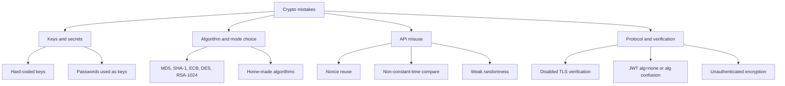

# Common Cryptography Mistakes

## Introduction

OWASP's Top 10 for 2025 lists **A04: Cryptographic Failures** as one of the most common causes of serious web application weaknesses. Yet almost none of these failures come from someone breaking AES or SHA-256. They come from developers using good primitives in the wrong way: a key in the source code, a reused nonce, a disabled certificate check, a hash where a MAC was needed.

This page is a field guide to those mistakes. Each entry shows the bug, why it matters, and the fix. Use it as a checklist when you write or review code that touches cryptography, and as a summary of the earlier pages in this section.

Think of it like a pilot's checklist. Pilots know how to fly. The checklist exists because experienced people still forget the same few things under pressure.

:::note Practice safely
Several examples below show how a weakness is exploited, so you understand why the fix matters. They only attack data the example itself creates, on your own machine. Test real systems only if you own them or have written permission. See [Ethics, Law and Responsible Disclosure](../0-sec-fundamentals/8-sec-ethics-and-law.mdx).
:::

## A Map of Where Things Go Wrong



## 1. Hard-Coded Keys and Secrets

Vulnerable:

```python
from cryptography.fernet import Fernet

# Anyone with the repo, a container image, or a decompiled app has this key.
FERNET_KEY = b"1sKk7qD5i0uYc0Gm3cXyZ2b8kQe9Yv4m6xW2pL0aB1c="
cipher = Fernet(FERNET_KEY)
```

Fixed:

```python
import os

from cryptography.fernet import Fernet

# Injected at runtime from a secrets manager or KMS-backed store.
cipher = Fernet(os.environ["FERNET_KEY"].encode())
```

Better still, keep the root key inside a KMS and use envelope encryption, as shown in [Key Management](./8-sec-key-management.mdx). Once a key has been committed to Git, treat it as public, even after you delete it from history.

## 2. Broken or Inappropriate Algorithms

| Instead of | Use |
| --- | --- |
| MD5, SHA-1 for integrity or signatures | SHA-256, SHA-3, BLAKE2 |
| MD5, SHA-256 for passwords | Argon2id, scrypt, bcrypt |
| DES, 3DES, RC4, Blowfish | AES-256-GCM, ChaCha20-Poly1305 |
| AES-ECB, AES-CBC without MAC | AES-GCM or another AEAD |
| RSA-1024, RSA PKCS#1 v1.5 encryption | RSA-3072 OAEP, or X25519/HPKE |
| Custom XOR "encryption" | A standard AEAD through a high-level API |

Some libraries help you here. The `cryptography` package has been moving legacy ciphers such as TripleDES, Blowfish and CAST5 into a separate `decrepit` module and removing them from the main API, so old code may break on upgrade. That break is a useful signal.

Details: [Hash Functions](./1-sec-hashing.mdx), [Password Hashing](./2-sec-password-hashing.mdx), [Symmetric Encryption](./3-sec-symmetric-encryption.mdx).

## 3. Nonce Reuse

AES-GCM and ChaCha20-Poly1305 turn the key and nonce into a keystream that is XORed with the plaintext. Reusing a nonce with the same key reuses the keystream.

```python
from cryptography.hazmat.primitives.ciphers.aead import AESGCM

key = AESGCM.generate_key(bit_length=256)
aes = AESGCM(key)
FIXED_NONCE = b"\x00" * 12                       # the bug

p1 = b"salary=052000;name=alice"
p2 = b"salary=310000;name=carol"
c1 = aes.encrypt(FIXED_NONCE, p1, None)[:-16]    # drop tags for clarity
c2 = aes.encrypt(FIXED_NONCE, p2, None)[:-16]

xor_ct = bytes(a ^ b for a, b in zip(c1, c2))
xor_pt = bytes(a ^ b for a, b in zip(p1, p2))
print("C1 xor C2 == P1 xor P2:", xor_ct == xor_pt)

# An attacker who knows (or guesses) p1 recovers p2 without the key
recovered = bytes(a ^ b for a, b in zip(xor_ct, p1))
print("recovered p2:", recovered)
```

Output:

```text
C1 xor C2 == P1 xor P2: True
recovered p2: b'salary=310000;name=carol'
```

With GCM, nonce reuse also leaks material that lets an attacker forge authentication tags. Fix: generate a fresh `os.urandom(12)` per message, rotate keys before the usage limit, or use AES-GCM-SIV where uniqueness is hard to guarantee.

## 4. Unauthenticated Encryption

Encryption without integrity lets attackers modify data they cannot read, and opens padding-oracle attacks. The [Symmetric Encryption](./3-sec-symmetric-encryption.mdx) page shows a CBC cookie changed from `role=user` to `role=root` without the key.

Fix: use an AEAD (AES-GCM, ChaCha20-Poly1305) or Fernet, and never return different errors for "bad padding" and "bad MAC".

## 5. Using a Password Directly as a Key

Vulnerable:

```python
import base64
import hashlib

from cryptography.fernet import Fernet

password = b"correct horse battery staple"
# One fast, unsalted hash: attackers can test billions of guesses per second
key = base64.urlsafe_b64encode(hashlib.sha256(password).digest())
cipher = Fernet(key)
```

Fixed:

```python
import base64
import os

from cryptography.fernet import Fernet
from cryptography.hazmat.primitives.kdf.scrypt import Scrypt

password = b"correct horse battery staple"

# Memory-hard KDF with a random salt stored next to the ciphertext
salt = os.urandom(16)
kdf = Scrypt(salt=salt, length=32, n=2**17, r=8, p=1)
strong_key = base64.urlsafe_b64encode(kdf.derive(password))

token = Fernet(strong_key).encrypt(b"diary entry")
print("salt + token stored:", (salt.hex() + ":" + token.decode())[:60], "...")
```

Example output:

```text
salt + token stored: 2071bbf266a07eb8f5d17959df7c10f9:gAAAAABqy2vahrM_DTrfTvRPMbc ...
```

Argon2id (via `argon2-cffi`'s low-level `hash_secret_raw`) is an equally good choice. For server-side encryption, prefer random keys from a KMS over password-derived keys.

## 6. Weak Randomness

`random`, `Math.random()` and `java.util.Random` are predictable. Use `secrets`, `crypto.randomBytes` or `SecureRandom`. Details and examples are in [Randomness and Secure Tokens](./9-sec-randomness.mdx).

## 7. Non-Constant-Time Comparison

Vulnerable:

```python
def check_signature(expected: str, received: str) -> bool:
    return expected == received      # may stop at the first differing byte
```

Fixed:

```python
import hmac

def check_signature(expected: str, received: str) -> bool:
    return hmac.compare_digest(expected, received)
```

Timing differences are small and noisy over a network, but attackers can average many requests, and the fix costs nothing. Library verification functions such as `PasswordHasher.verify` and `Ed25519PublicKey.verify` already do this correctly.

## 8. Skipping Verification

Cryptographic checks only help if they are actually enforced. Two classic examples:

### Disabled TLS verification

```python
import requests

requests.get("https://api.internal.example", verify=False, timeout=5)   # Vulnerable
requests.get("https://api.internal.example", verify="/etc/ssl/certs/internal-root.pem", timeout=5)  # Fixed
```

See [TLS and HTTPS](./7-sec-tls.mdx).

### JWT `alg=none` and algorithm confusion

JWT headers say which algorithm was used. If the server believes the header, an attacker can claim `"alg": "none"` (no signature) or switch an RS256 token to HS256 and use the server's **public** key as the HMAC secret.

```python
import jwt  # PyJWT

SECRET = "change-me-to-32+-random-bytes-from-a-vault"
token = jwt.encode({"sub": "42", "role": "user"}, SECRET, algorithm="HS256")

# Attacker forges a token with alg=none and role=admin
forged = jwt.encode({"sub": "42", "role": "admin"}, None, algorithm="none")

# Vulnerable: signature verification switched off
claims = jwt.decode(forged, options={"verify_signature": False})
print("vulnerable accepts:", claims)

# Fixed: verify, and pin the algorithm list on the server side
try:
    jwt.decode(forged, SECRET, algorithms=["HS256"])
except jwt.InvalidTokenError as exc:
    print("fixed rejects     :", type(exc).__name__)
print("fixed accepts real:", jwt.decode(token, SECRET, algorithms=["HS256"]))
```

Output:

```text
vulnerable accepts: {'sub': '42', 'role': 'admin'}
fixed rejects     : InvalidAlgorithmError
fixed accepts real: {'sub': '42', 'role': 'user'}
```

PyJWT requires the `algorithms` argument when verifying, which blocks most confusion attacks, but `verify_signature: False` still turns all protection off. Full JWT guidance is in [JSON Web Tokens](../4-sec-authentication/5-sec-jwt.mdx).

## 9. Confusing Hashes, MACs, Encryption and Encoding

| Mistake | What goes wrong | Use instead |
| --- | --- | --- |
| Base64 or hex "to hide" data | Anyone can decode it | Encryption |
| `sha256(data)` to prove origin | Attacker recomputes it | HMAC or signature |
| `sha256(key + data)` as a MAC | Length extension attacks | HMAC |
| Encrypting passwords | Key leak reveals all passwords | Password hashing |
| Encryption to guarantee integrity | Unauthenticated modes allow tampering | AEAD |
| Signature where secrecy is needed | Signed data is still readable | Encrypt (and sign if needed) |

## 10. Swallowing Crypto Errors

Vulnerable:

```python
from cryptography.fernet import Fernet, InvalidToken

def load_settings(cipher: Fernet, blob: bytes) -> bytes:
    try:
        return cipher.decrypt(blob)
    except InvalidToken:
        return blob        # "fallback" to treating the data as plaintext
```

A fallback like this lets an attacker bypass encryption entirely by supplying plaintext. Fixed: treat `InvalidToken`, `InvalidTag` and `InvalidSignature` as hard failures, log them as security events, and return a generic error to the caller. See [Secure Error Handling and Logging](../5-sec-secure-coding/2-sec-error-handling-and-logging.mdx).

## 11. No Versioning or Inventory

Ciphertexts, hashes and tokens without an algorithm or key identifier cannot be migrated safely. Prefix them (`v1.<key_id>.`, `$argon2id$...`, `sha256:...`) and keep an inventory of where each algorithm and key is used. This **crypto agility** becomes essential for the [post-quantum transition](./11-sec-post-quantum.mdx).

## 12. Rolling Your Own

The most dangerous sentence in crypto code review is "I wrote a small helper". Custom protocols, custom padding, home-made key derivation and hand-written ECDSA have all produced real breaks. Prefer, in order:

1. A standard protocol (TLS, SSH, WireGuard, age, HPKE, JOSE via a reviewed library).
2. A high-level library API (Fernet, libsodium `secretbox`, Google Tink, the AWS Encryption SDK).
3. Low-level "hazmat" primitives, only with review by someone experienced.

## Finding These Mistakes Automatically

Static analysis tools catch many of these patterns. [Bandit](https://bandit.readthedocs.io/) is a Python security linter:

```python
import hashlib
import random

import requests
from cryptography.hazmat.primitives.asymmetric import rsa

SECRET_KEY = "sup3r-s3cret-key-123"                        # hard-coded secret

def password_hash(pw: str) -> str:
    return hashlib.md5(pw.encode()).hexdigest()             # weak hash

def reset_code() -> str:
    return str(random.randint(100000, 999999))              # non-CSPRNG

def fetch_profile(url: str) -> dict:
    return requests.get(url, verify=False, timeout=5).json()  # no TLS verification

def make_key():
    return rsa.generate_private_key(public_exponent=65537, key_size=1024)  # weak key
```

```bash
pip install bandit
bandit -q crypto_smells.py
```

Example output (trimmed to the issue lines):

```text
>> Issue: [B105:hardcoded_password_string] Possible hardcoded password: 'sup3r-s3cret-key-123'
   Location: ./crypto_smells.py:7:13
>> Issue: [B324:hashlib] Use of weak MD5 hash for security. Consider usedforsecurity=False
   Location: ./crypto_smells.py:10:11
>> Issue: [B311:blacklist] Standard pseudo-random generators are not suitable for security/cryptographic purposes.
   Location: ./crypto_smells.py:13:15
>> Issue: [B501:request_with_no_cert_validation] Call to requests with verify=False disabling SSL certificate checks, security issue.
   Location: ./crypto_smells.py:16:11
>> Issue: [B505:weak_cryptographic_key] RSA key sizes below 2048 bits are considered breakable.
   Location: ./crypto_smells.py:19:11
```

Semgrep, CodeQL and SonarQube have similar rules for many languages, and secret scanners such as Gitleaks and GitHub secret scanning catch committed keys. Tools miss logic errors like nonce reuse across services or a skipped verification path, so pair them with human review. See [Static Analysis (SAST)](../6-sec-appsec-and-devsecops/2-sec-sast.mdx) and [Security Code Review](../5-sec-secure-coding/7-sec-code-review-for-security.mdx).

## Real-World Scenario

You are asked to review a pull request that adds "encrypted share links" to a document app. The PR uses AES-CBC with a key from `settings.py`, a fixed IV, base64-encodes the result into the URL, and on decryption failure falls back to treating the parameter as a plain document ID.

### Walking through it

Using the catalogue above, the review finds five problems: a hard-coded key (1), no authentication (4), a fixed IV (3), a plaintext fallback (10), and encryption used where the real requirement is **unforgeable links**, not secret IDs (9).

The fix is to step back and ask what the feature needs. A share link must be **unforgeable and expiring**. It does not need to hide the document ID. That is a MAC problem, not an encryption problem. The redesigned link is `/share/{doc_id}?exp={timestamp}&sig={hmac}`, where `sig` is HMAC-SHA256 over `doc_id|exp|permission` with a key from the secrets manager, verified with `hmac.compare_digest`, and the server still checks that sharing is enabled for that document. Alternatively, store a random token in a `shares` table, which also makes links revocable.

### Why this approach

The original design used complex machinery (encryption) to solve the wrong problem, and got the details wrong. The simpler primitive that matches the requirement is easier to get right and easier to review.

### When to use it and when not to

- Use a signed URL when links must be stateless and short-lived.
- Use a stored random token when links must be revocable or auditable.
- Use encryption only when the URL truly must hide data, and then use an AEAD with a random nonce.

### Alternatives and trade-offs

| Approach | Pros | Cons | Best for |
| --- | --- | --- | --- |
| HMAC-signed URL with expiry | Stateless, simple, unforgeable | Cannot revoke a single link early without extra state | Temporary download links |
| Random token stored in DB | Revocable, auditable, simple | DB lookup per request | Long-lived share links |
| AEAD-encrypted parameters | Hides contents and prevents tampering | Overkill if secrecy is not needed, longer URLs | URLs carrying sensitive data |
| Cloud provider signed URLs | Managed, offloads serving | Tied to that storage provider | Files in S3, GCS or Azure Blob |

## Crypto Review Checklist

- Are all keys and secrets loaded from a secrets manager or KMS, never from code?
- Are only current algorithms used (SHA-256+, AEAD, Argon2id, Ed25519, X25519, RSA 3072+)?
- Is every nonce unique per key, and is there a key usage limit?
- Is every ciphertext authenticated?
- Are passwords hashed with a slow KDF, and password-derived keys derived with a salt?
- Does all randomness come from a CSPRNG?
- Are MACs and tokens compared in constant time?
- Is TLS verification enabled everywhere, and are JWT algorithms pinned?
- Are crypto errors treated as hard failures?
- Do stored values carry algorithm and key version identifiers?

## Summary

- Real crypto failures are almost always misuse: exposed keys, weak or wrong primitives, nonce reuse, missing integrity, skipped verification, and weak randomness.
- Match the primitive to the requirement before writing code. Many "encryption" features really need a MAC or a random token.
- Prefer standard protocols and high-level APIs, treat crypto errors as fatal, and version everything.
- Combine static analysis and secret scanning with focused human review using a checklist.

## Further Learning

### Exercises

1. Run Bandit (or Semgrep with its Python security rules) on a project you maintain. Triage every crypto-related finding as true positive, false positive or accepted risk.
2. Implement the HMAC-signed share link from the scenario in Flask, including expiry and a permission field. Write tests for tampered `doc_id`, tampered `exp` and an expired link.
3. Take the nonce reuse demo and explain in two sentences why a random 96-bit nonce is safe for millions of messages but a timestamp-based nonce might not be.
4. Practise spotting these bugs safely in deliberately vulnerable apps such as OWASP Juice Shop or the JWT labs in PortSwigger Web Security Academy, running Juice Shop locally and the labs on PortSwigger's own platform.

### Related pages

- [OWASP Top 10](../3-sec-web-security/1-sec-owasp-top-10.mdx) for where cryptographic failures sit among web risks.
- [Security Code Review](../5-sec-secure-coding/7-sec-code-review-for-security.mdx) for running effective reviews.
- [Post-Quantum Cryptography](./11-sec-post-quantum.mdx) for why crypto agility matters next.
