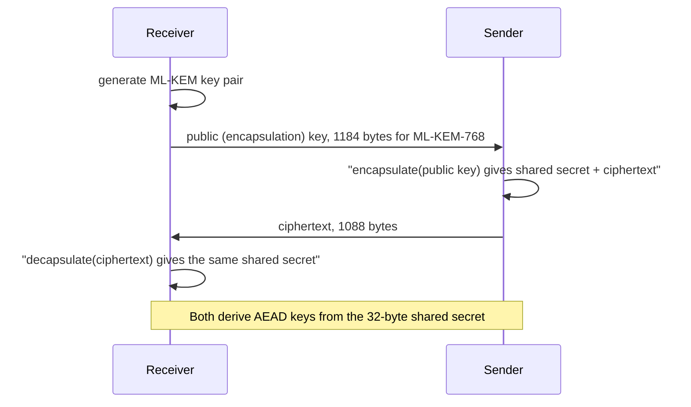
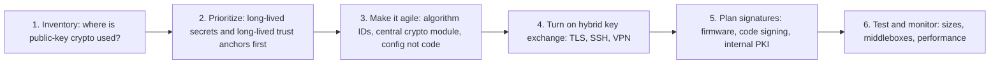

# Post-Quantum Cryptography

## Introduction

Almost all public-key cryptography in use today, including RSA, Diffie-Hellman, ECDH (X25519, P-256) and ECDSA/Ed25519 signatures, relies on two math problems: factoring large numbers and computing discrete logarithms. A large enough **quantum computer** running **Shor's algorithm** could solve both efficiently, breaking every one of these algorithms.

No such computer exists yet, and estimates of when one might arrive vary widely. So why should developers care now?

- **Harvest now, decrypt later.** An adversary can record encrypted traffic today and decrypt it once a quantum computer exists. Data that must stay secret for 10 or more years (health records, government data, trade secrets, long-lived keys) is already at risk.
- **Migrations take a long time.** Replacing cryptography across protocols, libraries, hardware, certificates and partner integrations takes many years. The move from SHA-1 to SHA-256 took over a decade.
- **The standards are ready.** NIST published its first post-quantum standards in 2024, and browsers, CDNs, OpenSSL and OpenSSH already use post-quantum key exchange by default.

Think of it like knowing that the locks on your building will become pickable in some unknown future year, and that some burglars are already photographing your keys so they can copy them later. You do not panic, but you start changing locks now, beginning with the rooms that hold the most valuable things.

**Post-quantum cryptography (PQC)** means new classical algorithms that run on today's computers but are believed to resist quantum attacks. It is different from "quantum cryptography" such as quantum key distribution, which needs special hardware.

## What Quantum Computers Break

| Primitive | Examples | Quantum impact | Action |
| --- | --- | --- | --- |
| Public-key encryption and key exchange | RSA, DH, ECDH, X25519 | **Broken** by Shor's algorithm | Move to ML-KEM, usually in hybrid mode |
| Digital signatures | RSA, ECDSA, Ed25519 | **Broken** by Shor's algorithm | Move to ML-DSA, SLH-DSA (later FN-DSA) |
| Symmetric encryption | AES-128, AES-256, ChaCha20 | Weakened by Grover's algorithm (roughly halves effective key bits) | Prefer 256-bit keys for long-term data |
| Hash functions | SHA-256, SHA-3 | Modestly weakened | SHA-256 and larger remain fine |
| Password hashing | Argon2id, bcrypt | Little change | No action needed |

The good news: the parts of your system that use [symmetric encryption](./3-sec-symmetric-encryption.mdx) and [hashing](./1-sec-hashing.mdx) need little or no change. The work is concentrated in key exchange, public-key encryption and signatures.

## The NIST Standards

NIST ran an open competition from 2016 and published the first three standards in August 2024:

| Standard | Algorithm | Based on | Use |
| --- | --- | --- | --- |
| FIPS 203 | **ML-KEM** (from CRYSTALS-Kyber) | Module lattices | Key encapsulation (replaces ECDH/RSA key transport) |
| FIPS 204 | **ML-DSA** (from CRYSTALS-Dilithium) | Module lattices | General-purpose signatures |
| FIPS 205 | **SLH-DSA** (from SPHINCS+) | Hash functions only | Conservative signatures, slower and larger |

More are on the way:

- **FN-DSA** (from FALCON), a lattice signature scheme with smaller signatures, is being standardized as FIPS 206. At the time of writing it was still in draft.
- **HQC**, a code-based key encapsulation mechanism, was selected in March 2025 as a backup to ML-KEM that relies on different mathematics. NIST expected a draft standard about a year later and a final standard around 2027.

NIST's draft transition guidance, **NIST IR 8547**, proposes deprecating quantum-vulnerable algorithms such as RSA and elliptic-curve cryptography after 2030 and disallowing them after 2035 for US federal systems. It was still a draft when this page was written, and other governments publish their own timelines, so check [NIST's PQC project page](https://csrc.nist.gov/projects/post-quantum-cryptography) for the current status.

### KEMs instead of key exchange

ML-KEM is a **Key Encapsulation Mechanism**, which works slightly differently from Diffie-Hellman:



Instead of both sides contributing a key share, the sender generates a random secret and "wraps" it to the receiver's public key. Protocols like TLS 1.3 adapt to this easily.

## Trying It in Python

The `cryptography` package added ML-KEM and ML-DSA in version 47.0.0 (April 2026). The prebuilt wheels support them. If you build against a system OpenSSL, you need OpenSSL 3.5 or later. These modules live under `hazmat`, so in production prefer protocols and libraries that use them for you.

```bash
pip install "cryptography>=48"
```

```python
from cryptography.hazmat.primitives.asymmetric import ed25519, x25519
from cryptography.hazmat.primitives.asymmetric.mldsa import MLDSA65PrivateKey
from cryptography.hazmat.primitives.asymmetric.mlkem import MLKEM768PrivateKey

msg = b"release manifest v2.4.0"

# Key establishment: classical vs post-quantum
x = x25519.X25519PrivateKey.generate()
k = MLKEM768PrivateKey.generate()
shared, ciphertext = k.public_key().encapsulate()      # sender side
assert k.decapsulate(ciphertext) == shared              # receiver side
print(f"{'X25519 public key':24}{len(x.public_key().public_bytes_raw()):6} bytes")
print(f"{'ML-KEM-768 public key':24}{len(k.public_key().public_bytes_raw()):6} bytes")
print(f"{'ML-KEM-768 ciphertext':24}{len(ciphertext):6} bytes")
print(f"{'ML-KEM-768 shared secret':24}{len(shared):6} bytes")

# Signatures: classical vs post-quantum
e = ed25519.Ed25519PrivateKey.generate()
d = MLDSA65PrivateKey.generate()
sig_e, sig_d = e.sign(msg), d.sign(msg, context=b"releases-v1")
d.public_key().verify(sig_d, msg, context=b"releases-v1")   # raises if invalid
print(f"{'Ed25519 signature':24}{len(sig_e):6} bytes")
print(f"{'ML-DSA-65 public key':24}{len(d.public_key().public_bytes_raw()):6} bytes")
print(f"{'ML-DSA-65 signature':24}{len(sig_d):6} bytes")
```

Output:

```text
X25519 public key           32 bytes
ML-KEM-768 public key     1184 bytes
ML-KEM-768 ciphertext     1088 bytes
ML-KEM-768 shared secret    32 bytes
Ed25519 signature           64 bytes
ML-DSA-65 public key      1952 bytes
ML-DSA-65 signature       3309 bytes
```

The main practical cost of PQC is **size**. ML-KEM keys and ciphertexts are about 35 times larger than X25519's, and ML-DSA signatures are about 50 times larger than Ed25519's. Performance is generally competitive with classical algorithms. Size matters for TLS handshakes, certificates (a chain contains several signatures and public keys), constrained IoT devices, and anything stored per-record.

The `context` argument to ML-DSA is a short domain-separation string. Signatures made with one context will not verify under another, which prevents a signature from one protocol being replayed in another.

### On the command line

OpenSSL 3.5 includes ML-KEM, ML-DSA and SLH-DSA:

```bash
openssl genpkey -algorithm ML-DSA-65 -out mldsa.pem
openssl pkey -in mldsa.pem -pubout -out mldsa.pub
echo "hello" > m.txt
openssl pkeyutl -sign -inkey mldsa.pem -in m.txt -out m.sig
openssl pkeyutl -verify -pubin -inkey mldsa.pub -in m.txt -sigfile m.sig
```

Output:

```text
Signature Verified Successfully
```

## Hybrid Cryptography

ML-KEM and ML-DSA are newer and have had less real-world analysis than X25519 or ECDSA. Implementation bugs are also more likely in young code. The common answer is **hybrid** cryptography: combine a classical and a post-quantum algorithm so the result is secure as long as **either** one holds.

### Hybrid key exchange is already deployed

- **TLS:** The `X25519MLKEM768` group combines X25519 and ML-KEM-768. Chrome, Edge and Firefox use it by default, major CDNs support it, and OpenSSL 3.5 includes it. You can see it negotiated with `openssl s_client -brief` in [TLS and HTTPS](./7-sec-tls.mdx).
- **SSH:** OpenSSH 10.0 (April 2025) made `mlkem768x25519-sha256` its default key exchange.

```bash
ssh -Q kex | grep -E "mlkem|sntrup"
```

Example output (OpenSSH 10.2):

```text
sntrup761x25519-sha512
sntrup761x25519-sha512@openssh.com
mlkem768x25519-sha256
```

### Hybrid encryption with HPKE

The `cryptography` package's HPKE module offers `KEM.MLKEM768_X25519`, the hybrid construction also known as X-Wing:

```python
from cryptography.hazmat.primitives.asymmetric import x25519
from cryptography.hazmat.primitives.asymmetric.mlkem import MLKEM768PrivateKey
from cryptography.hazmat.primitives.hpke import AEAD, KDF, KEM, Suite, MLKEM768X25519PrivateKey

classic = Suite(KEM.X25519, KDF.HKDF_SHA256, AEAD.AES_256_GCM)
hybrid = Suite(KEM.MLKEM768_X25519, KDF.HKDF_SHA256, AEAD.AES_256_GCM)

c_priv = x25519.X25519PrivateKey.generate()
h_priv = MLKEM768X25519PrivateKey(MLKEM768PrivateKey.generate(), x25519.X25519PrivateKey.generate())

message = b"backup-2026-10-11.tar.zst data key"
c_ct = classic.encrypt(message, c_priv.public_key(), info=b"backups-v2")
h_ct = hybrid.encrypt(message, h_priv.public_key(), info=b"backups-v2")

print("classic X25519 sealed :", len(c_ct), "bytes")
print("hybrid X-Wing sealed  :", len(h_ct), "bytes")
print("hybrid round trip ok  :", hybrid.decrypt(h_ct, h_priv, info=b"backups-v2") == message)
```

Output:

```text
classic X25519 sealed : 82 bytes
hybrid X-Wing sealed  : 1170 bytes
hybrid round trip ok  : True
```

The 1,088 extra bytes buy protection against harvest-now-decrypt-later for whatever this key protects.

### Signatures are the harder half

Key exchange protects **confidentiality** against future attackers, so it is urgent because of harvesting. Signatures protect **authenticity** at the moment of verification, so a future quantum computer cannot retroactively forge a signature you already checked. That makes signature migration less urgent for short-lived uses like TLS handshakes, but important for long-lived trust anchors: root CA keys, firmware signing keys, and code signing keys that devices will trust for 10 to 20 years.

Signature migration is also harder because of size and ecosystem: certificates, CAs, browsers, HSMs and validation libraries all need to support the new algorithms. Libraries are getting there. The `cryptography` package can now sign and verify X.509 certificates with ML-DSA, and AWS KMS supports ML-DSA signing keys, but public web PKI with post-quantum certificates is still being worked out.

## Planning a Migration



1. **Inventory.** List every place that uses RSA, DH or ECC: TLS endpoints and clients, SSH, VPNs, code signing, JWT keys, internal PKI, HSMs, encrypted backups, partner integrations and vendor products. Many teams discover this is the hardest step.
2. **Prioritize by data lifetime.** Data that must stay confidential long-term and keys that must be trusted long-term come first.
3. **Build crypto agility.** Version identifiers on ciphertexts and signatures, crypto calls behind one module, algorithms in configuration. See [Common Cryptography Mistakes](./10-sec-crypto-mistakes.mdx).
4. **Enable hybrid key exchange** wherever your stack supports it. For many teams this is mostly a matter of upgrading OpenSSL, OpenSSH, load balancers and CDNs.
5. **Plan signature migration** with vendors and HSM providers, starting with long-lived roots.
6. **Test.** Larger handshakes have broken some middleboxes, TLS inspection appliances and old clients that reject unfamiliar groups or large ClientHello messages. Roll out gradually and monitor errors.

### Starting the inventory

A small script can classify the certificates you already have on disk, for example everything under `/etc/ssl/private-ca/` or exported from your load balancers:

```python
import sys
from pathlib import Path

from cryptography import x509
from cryptography.hazmat.primitives.asymmetric import ec, ed25519, rsa

def describe(key) -> tuple[str, str]:
    if isinstance(key, rsa.RSAPublicKey):
        return f"RSA-{key.key_size}", "quantum-vulnerable"
    if isinstance(key, ec.EllipticCurvePublicKey):
        return f"ECDSA {key.curve.name}", "quantum-vulnerable"
    if isinstance(key, ed25519.Ed25519PublicKey):
        return "Ed25519", "quantum-vulnerable"
    name = type(key).__name__.replace("PublicKey", "")
    return name, "post-quantum" if "MLDSA" in name or "SLHDSA" in name else "review"

for pem in sorted(Path(sys.argv[1]).glob("*.pem")):
    cert = x509.load_pem_x509_certificate(pem.read_bytes())
    algo, status = describe(cert.public_key())
    print(f"{pem.name:18} {algo:18} expires {cert.not_valid_after_utc.date()}  {status}")
```

Example output, for a test directory containing an RSA, an ECDSA and an ML-DSA certificate (the last one created with `openssl req -x509 -newkey ML-DSA-65 ...`):

```text
legacy-api.pem     RSA-2048           expires 2027-10-11  quantum-vulnerable
pq-test.pem        MLDSA65            expires 2026-11-10  post-quantum
web.pem            ECDSA secp256r1    expires 2027-01-09  quantum-vulnerable
```

Loading ML-DSA certificates needs a recent `cryptography` release (ML-DSA X.509 support arrived in 49.0.0). Extend the same idea to SSH host keys (`ssh-keygen -lf`), JWT signing keys, code-signing keys and KMS key specs, and record the results in your [key inventory](./8-sec-key-management.mdx).

### Checking your own stack

```bash
openssl version                       # 3.5+ includes ML-KEM, ML-DSA, SLH-DSA
openssl list -kem-algorithms | grep -i mlkem
ssh -V                                # OpenSSH 10.0+ defaults to mlkem768x25519-sha256
nginx -V 2>&1 | grep -o "OpenSSL [0-9.]*"   # which OpenSSL nginx was built with
```

If your servers are on an older long-term-support distribution, the OpenSSL and OpenSSH versions may lag behind. Hybrid key exchange then usually arrives with the next OS upgrade, or through a CDN or load balancer that terminates TLS in front of you.

## Real-World Scenario

You work at a health-tech company. Patient records must stay confidential for decades. Your stack: a CDN in front of web apps, internal gRPC services with mTLS from a private CA, nightly encrypted backups whose data keys are wrapped with RSA-OAEP to an offline recovery key, and firmware updates for bedside devices signed with ECDSA. Leadership asks, "What should we do about quantum, and in what order?"

### Walking through it

1. **Backups (highest priority).** They are long-lived and could be copied today. Switch the data key wrapping from RSA-OAEP to hybrid HPKE (`MLKEM768_X25519`) for new backups, and re-wrap the data keys of existing backups you must keep. The AES-256-GCM bulk encryption stays.
2. **Public traffic.** Enable `X25519MLKEM768` at the CDN and origin (often a setting or an OpenSSL upgrade). Browsers already offer it.
3. **Internal mTLS.** Upgrade service TLS libraries to versions supporting hybrid groups. Certificates can stay ECDSA for now.
4. **Firmware signing.** Devices in the field will trust the signing key for 15 years. Work with the device vendor on a dual-signature scheme (ECDSA plus ML-DSA or SLH-DSA) so new firmware can carry both, and plan the bootloader update that enables it.
5. **Inventory and agility work** runs in parallel so the next change is cheaper.

### Why this approach

It follows risk, not hype. Confidentiality of long-lived data is threatened today by harvesting, so key establishment comes first. Signatures for long-lived trust anchors come next because device lifecycles are long. Short-lived signatures can wait for the ecosystem.

### When to use it and when not to

- Use hybrid PQC key exchange now anywhere your libraries support it. The cost is mostly bandwidth.
- Do not deploy pure post-quantum algorithms (without a classical partner) for general use unless a regulation requires it, because the new algorithms have had less scrutiny.
- Do not implement PQC primitives yourself or pick unstandardized algorithms. Use maintained libraries and standard protocol integrations.

### Alternatives and trade-offs

| Approach | Pros | Cons | Best for |
| --- | --- | --- | --- |
| Wait and watch | No effort now | Harvested data exposed later, rushed migration | Short-lived, low-value data only |
| Hybrid key exchange (X25519MLKEM768) | Protects against harvesting, safe if either part holds | Larger handshakes, some middlebox issues | TLS, SSH, VPN today |
| Pure ML-KEM | Simpler, smaller than hybrid | Relies entirely on newer math | Compliance-driven environments |
| Dual or composite signatures | Gradual migration of trust anchors | Larger artifacts, ecosystem support still maturing | Firmware, code signing, private PKI |
| SLH-DSA for roots | Security rests only on hash functions | Large, slow signatures | Rarely used, long-lived root keys |

## Common Mistakes

- **Assuming AES and SHA-256 must be replaced.** They stay. Use 256-bit symmetric keys for long-term data.
- **Starting with signatures and ignoring key exchange**, when harvesting makes confidentiality the urgent problem.
- **Forgetting third parties**: CDNs, load balancers, HSMs, VPN appliances and SaaS vendors all need a PQC story.
- **Breaking clients with large handshakes** by rolling out to everyone at once. Stage the rollout and watch error rates.
- **Hard-coding algorithms**, which turns every future change into a code change.
- **Mixing up PQC and quantum key distribution.** QKD needs special hardware and is not what NIST standardized.

## Frequently Asked Questions

**Do I need to change my password hashing?**
No. Argon2id, scrypt and bcrypt are not meaningfully affected. Keep following [Password Hashing](./2-sec-password-hashing.mdx).

**Is AES-128 still safe?**
Grover's algorithm in theory halves the effective key strength, and running it at scale would be extremely expensive. Many guidelines still accept AES-128, but AES-256 is the conservative choice for data that must stay secret for decades, and it costs little extra.

**Should I wait for "quantum-safe" certificates before doing anything?**
No. Key exchange is the urgent part and is already available through hybrid TLS and SSH. Certificate and signature migration can follow as the ecosystem matures.

**Are hybrid schemes slower?**
Computation is fast. The main cost is a few extra kilobytes per handshake, which matters most on constrained networks and devices.

**Can I use ML-KEM to encrypt data directly?**
No. Like any KEM, it produces a shared secret. Use that secret (through a KDF) as a key for AES-GCM or ChaCha20-Poly1305, as HPKE does for you.

**Which parameter set should I pick?**
ML-KEM-768 and ML-DSA-65 are the common general-purpose choices and the ones used in today's hybrid TLS and SSH defaults. Higher levels (ML-KEM-1024, ML-DSA-87) exist for high-assurance profiles such as the US NSA's CNSA 2.0 suite.

## Summary

- Shor's algorithm on a large quantum computer would break RSA, DH and elliptic-curve cryptography. Symmetric crypto and hashes are only modestly affected.
- Harvest-now-decrypt-later makes post-quantum key establishment urgent for long-lived secrets.
- NIST standardized ML-KEM (FIPS 203), ML-DSA (FIPS 204) and SLH-DSA (FIPS 205) in 2024, with FN-DSA and HQC to follow. Draft guidance targets deprecation of RSA and ECC after 2030.
- Hybrid key exchange (`X25519MLKEM768` in TLS, `mlkem768x25519-sha256` in OpenSSH) is already the default in major browsers and tools.
- PQC's main cost is size. Plan with an inventory, prioritize by data and key lifetime, build crypto agility, and roll out gradually.

## Further Learning

### Exercises

1. Run `openssl s_client -brief` against five services you depend on and note which negotiate `X25519MLKEM768`. Do the same with `ssh -v` to a server you administer and find the `kex: algorithm:` line.
2. Measure how long 1,000 ML-KEM-768 encapsulations and decapsulations take compared with 1,000 X25519 exchanges in Python.
3. Write a crypto inventory for one application: list each use of public-key cryptography, the algorithm, the key lifetime, the data lifetime, and a migration priority from 1 to 3.
4. Modify the backup example from [Key Management](./8-sec-key-management.mdx) to wrap data keys with hybrid HPKE instead of the fake KMS.
5. Generate an ML-DSA-65 self-signed certificate with OpenSSL 3.5 and an ECDSA P-256 one. Compare the PEM file sizes and explain what that means for a TLS handshake that sends a chain of three certificates.

:::tip Keep watching the standards
Post-quantum standards and deadlines are still moving. Check NIST's project page, your library changelogs and your cloud provider's announcements at least once a year, and update your inventory when something changes.
:::

### Related pages

- [Asymmetric Encryption](./4-sec-asymmetric-encryption.mdx) for the classical algorithms being replaced.
- [TLS and HTTPS](./7-sec-tls.mdx) for hybrid key exchange in practice.
- [Risk Management](../13-sec-governance/0-sec-risk-management.mdx) for prioritizing long-term risks like this one.
- [Cryptography Introduction](./0-sec-crypto-introduction.mdx) to review the whole section.
