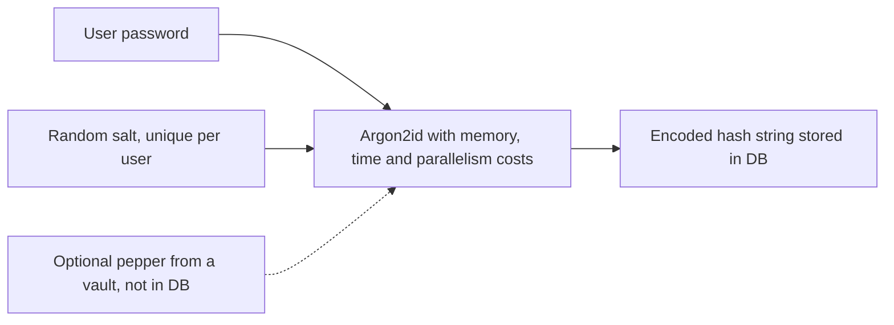

# Password Hashing

## Introduction

Sooner or later, many databases leak: through SQL injection, a stolen backup, a misconfigured storage bucket or an insider. When that happens, the question is not "were we breached?" but "what can the attacker do with what they took?"

If your users table holds plain passwords, the attacker can log in as everyone immediately, and because people reuse passwords, also into their email and bank accounts. If it holds **properly hashed** passwords, the attacker has to guess each password one by one, at a cost you control.

Password hashing is the art of making those guesses **expensive**. It is different from the general-purpose hashing in [Hash Functions](./1-sec-hashing.mdx):

- General hashes (SHA-256) are designed to be **fast**.
- Password hashes (Argon2id, scrypt, bcrypt) are designed to be **slow and memory-hungry**, and tunable so you can make them slower as hardware improves.

An analogy: a fast hash is a turnstile that lets a crowd through in seconds. A password hash is an airport security line. A legitimate traveller (one login) barely notices the delay, but an attacker trying a billion guesses would need lifetimes.

## Why Fast Hashes Fail

Passwords chosen by humans come from a small, predictable space: dictionary words, names, years and a trailing `!`. Attackers use leaked password lists and rule-based mutations, and they run them on GPUs.

Let's measure the difference on an ordinary laptop:

```python
import hashlib
import time

from argon2 import PasswordHasher   # pip install argon2-cffi

password = "Summer2026!"
ph = PasswordHasher()

start = time.perf_counter()
for _ in range(100_000):
    hashlib.sha256(password.encode()).hexdigest()
fast = (time.perf_counter() - start) / 100_000

start = time.perf_counter()
for _ in range(10):
    ph.hash(password)
slow = (time.perf_counter() - start) / 10

print(f"SHA-256 : {fast * 1e6:8.2f} microseconds per hash")
print(f"Argon2id: {slow * 1e3:8.2f} milliseconds per hash")
print(f"Argon2id is roughly {slow / fast:,.0f}x slower")
```

Example output (varies by machine):

```text
SHA-256 : 0.27 microseconds per hash
Argon2id: 35.88 milliseconds per hash
Argon2id is roughly 134,170x slower
```

A few tens of milliseconds is nothing for one login. For an attacker, it is the difference between cracking most of a leaked database in an afternoon and cracking only the weakest passwords. Argon2id also needs a large block of memory per guess (64 MiB with these defaults), which blunts the advantage of GPUs and custom hardware that have lots of cores but little memory per core.

## Salt, Work Factor and Pepper



### Salt

A **salt** is a random value, unique per password, stored next to the hash. It ensures:

- Two users with the same password get different hashes.
- Precomputed tables ("rainbow tables") are useless, because the attacker would need a table per salt.
- An attacker must attack each hash separately.

Modern libraries generate the salt for you and embed it in the output string. You should not manage salts yourself.

### Work factor

The cost parameters control how slow the hash is. For Argon2id there are three: memory (`m`), iterations (`t`) and parallelism (`p`). Store them with the hash so you can raise them later without breaking old logins.

### Pepper

A **pepper** is a secret shared by all passwords and stored **outside** the database, for example in a secrets manager or HSM. If only the database leaks, the attacker cannot test any guesses at all. Peppers are defense in depth, not a substitute for a slow hash, and they add operational burden: if you lose or rotate the pepper, users must reset their passwords.

## Choosing an Algorithm

These recommendations follow the [OWASP Password Storage Cheat Sheet](https://cheatsheetseries.owasp.org/cheatsheets/Password_Storage_Cheat_Sheet.html). Minimums may be raised over time, so check the source.

| Algorithm | When to use | OWASP minimum guidance |
| --- | --- | --- |
| **Argon2id** | First choice for new systems | 19 MiB memory, 2 iterations, parallelism 1 (or equivalent trade-offs) |
| scrypt | When Argon2id is not available | N=2^17 (128 MiB), r=8, p=1 |
| bcrypt | Legacy systems, wide framework support | Cost 10 or more, passwords limited to 72 bytes |
| PBKDF2-HMAC-SHA256 | When FIPS-140 compliance is required | 600,000 iterations |

The `argon2-cffi` library's defaults (64 MiB, 3 iterations, 4 lanes, following the RFC 9106 low-memory profile) are well above the OWASP minimum. Tune them so a hash takes a few tens to a few hundreds of milliseconds on your production servers, and remember that every concurrent login uses that much memory.

Benchmark on hardware that matches production before you choose:

```python
import time

from argon2 import PasswordHasher

CANDIDATES = [
    (19 * 1024, 2, 1),    # OWASP minimum: 19 MiB, t=2, p=1
    (46 * 1024, 1, 1),    # OWASP equivalent: 46 MiB, t=1, p=1
    (64 * 1024, 3, 4),    # argon2-cffi default (RFC 9106 low-memory)
    (256 * 1024, 3, 4),   # heavier
]

for memory_kib, time_cost, parallelism in CANDIDATES:
    ph = PasswordHasher(memory_cost=memory_kib, time_cost=time_cost, parallelism=parallelism)
    start = time.perf_counter()
    for _ in range(5):
        ph.hash("benchmark-password")
    ms = (time.perf_counter() - start) / 5 * 1000
    print(f"m={memory_kib // 1024:>3} MiB t={time_cost} p={parallelism}: {ms:6.1f} ms")
```

Example output (laptop, varies by machine):

```text
m= 19 MiB t=2 p=1:   16.5 ms
m= 46 MiB t=1 p=1:   32.9 ms
m= 64 MiB t=3 p=4:   36.5 ms
m=256 MiB t=3 p=4:  173.6 ms
```

Then do the capacity math. If your service handles a peak of 50 logins per second at 64 MiB each, a few gigabytes of RAM can be in use for hashing alone. Rate-limit the login endpoint so attackers cannot use your password hash as a denial-of-service lever.

## Vulnerable vs Fixed Storage

Vulnerable:

```python
import hashlib

def store_password(password: str) -> str:
    # Fast, unsalted hash: identical passwords give identical hashes,
    # and GPUs can try billions of guesses per second.
    return hashlib.md5(password.encode()).hexdigest()

def check_password(stored: str, attempt: str) -> bool:
    return hashlib.md5(attempt.encode()).hexdigest() == stored
```

Fixed, using Argon2id with automatic rehashing:

```python
from argon2 import PasswordHasher
from argon2.exceptions import InvalidHashError, VerificationError, VerifyMismatchError

ph = PasswordHasher()  # Argon2id, RFC 9106 low-memory profile by default

def register(password: str) -> str:
    return ph.hash(password)

def login(stored_hash: str, attempt: str) -> tuple[bool, str]:
    """Return (ok, hash_to_store). The hash may be upgraded on success."""
    try:
        ph.verify(stored_hash, attempt)
    except VerifyMismatchError:
        return False, stored_hash
    except (VerificationError, InvalidHashError):
        return False, stored_hash
    if ph.check_needs_rehash(stored_hash):
        return True, ph.hash(attempt)   # parameters changed: upgrade now
    return True, stored_hash

stored = register("correct horse battery staple")
print(stored)
print(register("correct horse battery staple"))   # same password, new salt
print(login(stored, "correct horse battery staple")[0])
print(login(stored, "Correct horse battery staple")[0])
```

Example output:

```text
$argon2id$v=19$m=65536,t=3,p=4$sfiZEH8RiQKnocZp7XMrKw$2duiU4MozRR1i0JSlz0+QAsSsVC9aHSStmRn1ZqFEXU
$argon2id$v=19$m=65536,t=3,p=4$5DvMwDRGrlZ3GkEOKasQBA$0EzwH+tZD5AymvHb18Wi5AMw09z+O9KHYC4Qfq2otE4
True
False
```

Read the encoded string from left to right: algorithm (`argon2id`), version (`v=19`), parameters (`m=65536,t=3,p=4`), the base64 salt, then the hash. Everything needed to verify the password later is in that one column. `check_needs_rehash` compares the stored parameters with your current settings, so raising the cost in your config upgrades users silently as they log in.

### bcrypt

bcrypt remains common in frameworks such as Spring Security, Rails and Laravel. Use the `bcrypt` package in Python:

```python
import bcrypt

password = "correct horse battery staple".encode()
hashed = bcrypt.hashpw(password, bcrypt.gensalt(rounds=12))
print(hashed.decode())
print(bcrypt.checkpw(password, hashed))

try:
    bcrypt.hashpw(b"a" * 73, bcrypt.gensalt())
except ValueError as exc:
    print("ValueError:", exc)
```

Output:

```text
$2b$12$jpMEE1sdJYR7Jeo54uw6ue9/twZix1ZoWr5X0qob.K5ZDeLjWGssa
True
ValueError: password cannot be longer than 72 bytes, truncate manually if necessary (e.g. my_password[:72])
```

:::caution The 72-byte limit
bcrypt only uses the first 72 bytes of input. Older versions of the Python `bcrypt` package silently truncated longer input. Version 5.0 raises `ValueError` instead. Multi-byte UTF-8 characters count as several bytes, so a long passphrase in some languages can hit the limit sooner than you expect. If you need to pre-hash, follow OWASP and use an HMAC keyed with a pepper, not a bare SHA-256, to avoid "password shucking" attacks.
:::

### Adding a pepper

```python
import hashlib
import hmac
import os

from argon2 import PasswordHasher

ph = PasswordHasher()
PEPPER = os.environ.get("PASSWORD_PEPPER", "dev-only-pepper").encode()  # from a vault in production

def peppered(password: str) -> str:
    return hmac.new(PEPPER, password.encode(), hashlib.sha256).hexdigest()

stored = ph.hash(peppered("correct horse battery staple"))
print(ph.verify(stored, peppered("correct horse battery staple")))
```

Output:

```text
True
```

Keep the pepper in a secrets manager and never in the same database. Record in your schema which pepper version each hash used, so you can rotate it for new hashes.

## Password Policy Goes with the Hash

Hashing protects stored passwords. Policy decides how guessable they are. NIST's current digital identity guideline, [SP 800-63B-4](https://pages.nist.gov/800-63-4/sp800-63b.html) (final version published in 2025), moved away from complexity rules. Highlights (check the official text for exact wording):

- Require a minimum length of 15 characters when the password is the only factor, and 8 when it is part of multi-factor authentication.
- Allow long passwords (at least 64 characters), spaces and Unicode.
- Do not impose composition rules such as "one uppercase, one digit, one symbol".
- Do not force periodic password changes. Require a change when there is evidence of compromise.
- Check new passwords against a blocklist of breached and common passwords.

Implementation details such as login rate limiting, breached-password checks and MFA are covered in [Secure Password Authentication](../4-sec-authentication/1-sec-password-authentication.mdx) and [Multi-Factor Authentication](../4-sec-authentication/2-sec-mfa.mdx).

## Real-World Scenario

You inherit an e-commerce site with 400,000 customer accounts. The `users.password` column holds unsalted MD5 hashes from 2014. The company wants to move to Argon2id **without forcing everyone to reset their password**.

### Walking through it

There are two classic options:

1. **Rehash on login.** When a user logs in, check the MD5, then replace it with Argon2id. Simple, but users who never log in keep weak MD5 hashes indefinitely, and those are exactly the hashes that leak in a future breach.
2. **Wrap now, upgrade on login.** Run a one-off job that replaces every MD5 value with `Argon2id(md5_hex)`. All hashes are protected immediately. At each login, verify through the wrapper and then store a direct Argon2id hash.

Option 2 is what OWASP recommends for legacy hashes:

```python
import hashlib

from argon2 import PasswordHasher
from argon2.exceptions import VerifyMismatchError

ph = PasswordHasher()

# --- One-off batch job: wrap every legacy MD5 hash in Argon2id ---
def wrap_legacy(md5_hex: str) -> str:
    return "wrapped-md5:" + ph.hash(md5_hex)

# --- Login path: handles wrapped and modern hashes ---
def verify_and_upgrade(stored: str, attempt: str) -> tuple[bool, str]:
    if stored.startswith("wrapped-md5:"):
        inner = hashlib.md5(attempt.encode()).hexdigest()
        try:
            ph.verify(stored.removeprefix("wrapped-md5:"), inner)
        except VerifyMismatchError:
            return False, stored
        return True, ph.hash(attempt)          # replace with a direct hash
    try:
        ph.verify(stored, attempt)
    except VerifyMismatchError:
        return False, stored
    return True, stored

legacy = hashlib.md5(b"hunter22hunter22").hexdigest()
row = wrap_legacy(legacy)
print("after batch job :", row[:45], "...")
ok, row = verify_and_upgrade(row, "hunter22hunter22")
print("login ok        :", ok)
print("after login     :", row[:45], "...")
```

Example output:

```text
after batch job : wrapped-md5:$argon2id$v=19$m=65536,t=3,p=4$Ii ...
login ok        : True
after login     : $argon2id$v=19$m=65536,t=3,p=4$uXjMvEuMeIcvT/ ...
```

Practical notes for the rollout:

- The batch job is CPU and memory heavy. Run it in batches on worker machines, not on the web servers, and budget the time (400,000 rows at about 40 ms each is several CPU-hours).
- Delete old database backups that still contain raw MD5 values, or they remain a leak waiting to happen.
- After 12 to 18 months, consider forcing a reset for accounts still on wrapped hashes and expiring long-dormant accounts.

### Why this approach

Wrapping closes the exposure for every account on day one, while the upgrade on login removes the dependence on MD5 over time. No user notices anything.

### When to use it and when not to

- Use wrapping whenever the legacy hash is weak (MD5, SHA-1, unsalted SHA-256).
- If the legacy hash is already bcrypt with a reasonable cost, plain rehash-on-login is usually enough.
- If you suspect the old database has **already leaked**, wrapping is not enough: force a reset and notify users.

### Alternatives and trade-offs

| Approach | Pros | Cons | Best for |
| --- | --- | --- | --- |
| Rehash on login only | Simplest code | Dormant accounts stay weak indefinitely | Legacy hash already reasonably strong |
| Wrap now, upgrade on login | Immediate protection, invisible to users | Extra code path, one-off batch cost | Weak legacy hashes, no known breach |
| Forced reset for everyone | Cleanest end state | Support load, user churn | Known or suspected breach |
| Move to passkeys or SSO | Removes passwords entirely | Large project, user education | Long-term strategy, see [Passkeys and WebAuthn](../4-sec-authentication/3-sec-passkeys.mdx) |

## Common Mistakes

- **Using a general hash.** SHA-256, even with a salt, is far too fast for passwords.
- **Encrypting passwords.** Encryption is reversible. Anyone with the key gets every password. Hash instead.
- **Rolling your own salt and format.** Use the library's encoded output string.
- **Comparing with `==` on hand-built hashes.** Library `verify` functions do the comparison correctly.
- **Setting the cost too high.** A login that takes two seconds and 1 GiB of RAM becomes a denial-of-service vector. Benchmark and pick a sensible budget.
- **Logging passwords.** Make sure request logging, error trackers and debug output never capture the password field.
- **Forgetting other secrets.** Password reset tokens and "remember me" tokens also need hashing in the database. Because they are random, a fast SHA-256 is fine for those (see [Randomness and Secure Tokens](./9-sec-randomness.mdx)).

## Summary

- Password hashes must be slow, salted and tunable. Use Argon2id for new systems, scrypt or bcrypt if needed, PBKDF2 for FIPS environments.
- Libraries generate salts and store parameters in one encoded string. Use `check_needs_rehash` to raise costs over time.
- Peppers add defense in depth if the secret is stored outside the database.
- Migrate weak legacy hashes by wrapping them immediately and upgrading on login.
- Pair hashing with sensible policy: long passwords, breach blocklists, no forced rotation, and MFA.

## Further Learning

### Exercises

1. Benchmark `PasswordHasher` with three settings (16 MiB, 64 MiB, 256 MiB memory). Pick one that keeps a single hash under 100 ms on your machine, and estimate the peak memory if 50 users log in at once.
2. Build a small Flask `/register` and `/login` pair using the `login()` function above. Change `PasswordHasher(time_cost=4)` and confirm existing users get rehashed when they log in.
3. Extend the migration example to support a second legacy format, unsalted SHA-1, using a different prefix.
4. Download a breached-password list such as the one used by the "Have I Been Pwned" Pwned Passwords API (k-anonymity range queries) and reject matching passwords at registration.

### Related pages

- [Hash Functions](./1-sec-hashing.mdx) for general-purpose hashing.
- [Secure Password Authentication](../4-sec-authentication/1-sec-password-authentication.mdx) for the full login flow.
- [Password Attacks and Defenses](../10-sec-offensive-security/7-sec-password-attacks.mdx) for how cracking works and how to detect it.
