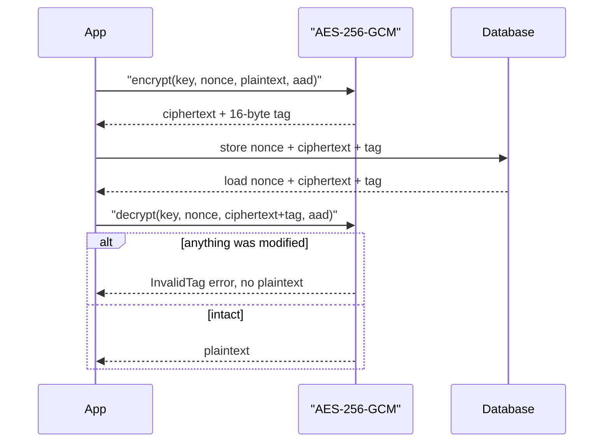

# Symmetric Encryption

## Introduction

**Symmetric encryption** uses one secret key both to lock (encrypt) and to unlock (decrypt) data. It is the workhorse of cryptography. TLS traffic, encrypted disks, database encryption at rest, password managers, and encrypted backups all rely on it, because it is fast: modern CPUs have AES instructions that encrypt gigabytes per second.

The analogy is a house key. Anyone with a copy can open the door, so the whole security of the system comes down to who holds copies. Symmetric encryption is easy to get **almost** right, and the mistakes are subtle. This page focuses on doing it properly:

- Which algorithm to use (AES or ChaCha20).
- Why the "mode" matters as much as the algorithm.
- Why modern code uses **authenticated encryption (AEAD)**.
- How to handle nonces and associated data.

Sharing the key in the first place is a separate problem, solved by [Asymmetric Encryption](./4-sec-asymmetric-encryption.mdx) and [Key Management](./8-sec-key-management.mdx).

## Building Blocks

### Block ciphers and stream ciphers

- **AES** (Advanced Encryption Standard) is a **block cipher**. It encrypts exactly 16 bytes at a time with a 128-, 192- or 256-bit key. On its own it can only scramble one block. A **mode of operation** turns it into something that encrypts messages of any length.
- **ChaCha20** is a **stream cipher**. It generates a pseudorandom keystream from a key and nonce, then XORs it with the data. It is fast in software, which makes it popular on phones and devices without AES hardware.

Both are considered secure in 2026. The way you use them is what decides whether your system is secure.

### Modes of operation

| Mode | What it does | Verdict |
| --- | --- | --- |
| ECB | Encrypts each block independently | **Never use.** Identical blocks give identical ciphertext. |
| CBC | Chains each block to the previous one, needs a random IV | Legacy. Needs a separate MAC, and padding oracles are a classic attack. |
| CTR | Turns AES into a stream cipher with a counter | Confidentiality only. Needs a separate MAC. |
| GCM | CTR mode plus a built-in authentication tag | **Recommended** AEAD. Never reuse a nonce. |
| GCM-SIV | Like GCM but tolerates accidental nonce reuse better | Good choice when nonce uniqueness is hard to guarantee. |

## Why ECB Fails

ECB encrypts every 16-byte block separately with the same key. Patterns in the plaintext survive into the ciphertext. The famous illustration is the "ECB penguin": an image encrypted with ECB still shows the penguin's outline.

```python
import os

from cryptography.hazmat.primitives.ciphers import Cipher, algorithms, modes

key = os.urandom(32)
plaintext = b"ATTACK AT DAWN!!" * 3          # three identical 16-byte blocks

ecb = Cipher(algorithms.AES(key), modes.ECB()).encryptor()
ct = ecb.update(plaintext) + ecb.finalize()

for i in range(0, len(ct), 16):
    print(f"block {i // 16}: {ct[i:i + 16].hex()}")
```

Example output (values change with the key):

```text
block 0: 209deddda6375dc787ee9150e8170a88
block 1: 209deddda6375dc787ee9150e8170a88
block 2: 209deddda6375dc787ee9150e8170a88
```

An observer cannot read the message, but they can see that the three blocks are the same. In a database, that can be enough to tell which users have the same salary or diagnosis.

## Why Confidentiality Is Not Enough

Encryption without integrity lets an attacker **change** data they cannot read. With CBC mode, flipping a bit in the IV flips the same bit in the first plaintext block. If the attacker knows the format of the message, they can make precise edits.

Vulnerable:

```python
import os

from cryptography.hazmat.primitives import padding
from cryptography.hazmat.primitives.ciphers import Cipher, algorithms, modes

KEY = os.urandom(32)

# Vulnerable: AES-CBC with no MAC. Confidential, but NOT tamper-evident.
def cbc_encrypt(pt: bytes) -> bytes:
    iv = os.urandom(16)
    padder = padding.PKCS7(128).padder()
    data = padder.update(pt) + padder.finalize()
    enc = Cipher(algorithms.AES(KEY), modes.CBC(iv)).encryptor()
    return iv + enc.update(data) + enc.finalize()

def cbc_decrypt(blob: bytes) -> bytes:
    iv, ct = blob[:16], blob[16:]
    dec = Cipher(algorithms.AES(KEY), modes.CBC(iv)).decryptor()
    data = dec.update(ct) + dec.finalize()
    unpadder = padding.PKCS7(128).unpadder()
    return unpadder.update(data) + unpadder.finalize()

cookie = bytearray(cbc_encrypt(b"role=user;id=42"))

# The attacker knows the format but NOT the key.
# XOR-ing the IV flips the same bits in the first plaintext block.
for i, (old, new) in enumerate(zip(b"user", b"root")):
    cookie[5 + i] ^= old ^ new

print(cbc_decrypt(bytes(cookie)))
```

Output:

```text
b'role=root;id=42'
```

The attacker never learned the key, yet promoted themselves to `root`. Unauthenticated CBC also enables **padding oracle** attacks, where an error message like "bad padding" leaks enough to decrypt the whole message. Both problems disappear with authenticated encryption.

## Authenticated Encryption (AEAD)

**AEAD** (Authenticated Encryption with Associated Data) does three things in one call:

1. Encrypts the plaintext.
2. Computes an authentication **tag** over the ciphertext.
3. Also authenticates optional **associated data** (AAD) that is not encrypted, such as a record ID or header.

On decryption, if anything changed (ciphertext, tag, nonce, AAD or key), it raises an error and returns **nothing**. The standard AEAD algorithms are AES-GCM and ChaCha20-Poly1305.



Fixed, with AES-256-GCM from the `cryptography` package:

```python
import os

from cryptography.exceptions import InvalidTag
from cryptography.hazmat.primitives.ciphers.aead import AESGCM

key = AESGCM.generate_key(bit_length=256)
aesgcm = AESGCM(key)

def encrypt(plaintext: bytes, aad: bytes) -> bytes:
    nonce = os.urandom(12)                       # 96-bit nonce, new every time
    return nonce + aesgcm.encrypt(nonce, plaintext, aad)

def decrypt(blob: bytes, aad: bytes) -> bytes:
    nonce, ciphertext = blob[:12], blob[12:]
    return aesgcm.decrypt(nonce, ciphertext, aad)

blob = encrypt(b"4111-1111-1111-1111", aad=b"customer:1001")
print("stored bytes :", len(blob), "(12 nonce + 19 data + 16 tag)")
print("decrypted    :", decrypt(blob, aad=b"customer:1001"))

# Same plaintext, different ciphertext each time
print("same twice?  :", encrypt(b"hi", b"x") == encrypt(b"hi", b"x"))

# Tamper with one byte
bad = bytearray(blob)
bad[20] ^= 0x01
for label, data, aad in [("flipped bit ", bytes(bad), b"customer:1001"),
                         ("wrong AAD   ", blob, b"customer:1002")]:
    try:
        decrypt(data, aad)
    except InvalidTag:
        print(label, ": InvalidTag")
```

Output:

```text
stored bytes : 47 (12 nonce + 19 data + 16 tag)
decrypted    : b'4111-1111-1111-1111'
same twice?  : False
flipped bit  : InvalidTag
wrong AAD    : InvalidTag
```

### Nonces: the one rule you must not break

A **nonce** ("number used once") makes each encryption unique. The nonce is not secret, so you store it next to the ciphertext. But with AES-GCM and ChaCha20-Poly1305:

:::warning Never reuse a nonce with the same key
Reusing a nonce under one key lets an attacker XOR two ciphertexts to learn the XOR of the plaintexts, and with GCM it can also let them forge messages. The `cryptography` docs put it bluntly: never reuse a nonce with a key.
:::

Practical guidance:

- Generate a fresh random 12-byte nonce with `os.urandom(12)` for every message.
- With random 96-bit nonces, NIST SP 800-38D limits a single key to about 2 to the power 32 encryptions. Rotate keys well before that in high-volume systems.
- If you cannot guarantee unique nonces (for example many independent devices sharing a key), use **AES-GCM-SIV**, which degrades more gracefully on reuse, or use a library that manages nonces for you.

### Associated data: binding ciphertext to context

The AAD in the example (`customer:1001`) is not encrypted, but it is authenticated. If an attacker copies customer 1001's encrypted card number into customer 1002's row, decryption fails because the AAD no longer matches. This blocks a whole class of "swap the ciphertext" attacks.

### ChaCha20-Poly1305 and AES-GCM-SIV

The API is the same shape for the other AEADs:

```python
import os

from cryptography.hazmat.primitives.ciphers.aead import AESGCMSIV, ChaCha20Poly1305

key = ChaCha20Poly1305.generate_key()
chacha = ChaCha20Poly1305(key)
nonce = os.urandom(12)
ct = chacha.encrypt(nonce, b"hello", b"header")
print("ChaCha20-Poly1305:", chacha.decrypt(nonce, ct, b"header"))

siv = AESGCMSIV(AESGCMSIV.generate_key(bit_length=256))
nonce = os.urandom(12)
print("AES-GCM-SIV      :", siv.decrypt(nonce, siv.encrypt(nonce, b"hello", None), None))
```

Output:

```text
ChaCha20-Poly1305: b'hello'
AES-GCM-SIV      : b'hello'
```

`AESGCMSIV` requires `cryptography` 42.0 or newer and an OpenSSL build that supports it.

### Fernet: the easy button

If you just need "encrypt this blob with a key" in Python, use **Fernet** (shown in the [Cryptography Introduction](./0-sec-crypto-introduction.mdx)). It combines AES-128-CBC with HMAC-SHA256, handles IVs and timestamps for you, and produces a URL-safe token. It is a good high-level default. Use the AEAD classes directly when you need AAD, AES-256, smaller overhead, or interoperability with other languages.

### On the command line

`openssl enc` does not offer authenticated encryption for files and is easy to misuse. For encrypting files by hand, prefer a modern tool such as [age](https://github.com/FiloSottile/age) or GnuPG.

## Real-World Scenario

Your team runs a B2B SaaS app. A new enterprise customer requires that customer emails and phone numbers be **encrypted at the application level**, so that a database administrator or a stolen database backup does not reveal them. Support staff must still be able to look up a customer by exact email address.

### Walking through it

1. **Encrypt each field with AES-256-GCM**, using the table, row ID and column name as AAD so ciphertexts cannot be moved between rows.
2. **Version the format** and include a key ID so you can rotate keys and change algorithms later.
3. **Add a blind index** for lookups: an HMAC of the normalized email with a separate key. Equality search works, but the index alone does not reveal the email.
4. **Fetch keys from a KMS** at startup (see [Key Management](./8-sec-key-management.mdx)). The example keeps them in memory for clarity.

```python
import base64
import hashlib
import hmac
import os

from cryptography.hazmat.primitives.ciphers.aead import AESGCM

# In production these come from a KMS or secrets manager, never from code.
KEYS = {1: AESGCM.generate_key(bit_length=256)}   # key id -> key
CURRENT_KEY_ID = 1
INDEX_KEY = os.urandom(32)                         # separate key for lookups

def encrypt_field(value: str, table: str, row_id: int, column: str) -> str:
    aad = f"{table}:{row_id}:{column}".encode()
    nonce = os.urandom(12)
    ct = AESGCM(KEYS[CURRENT_KEY_ID]).encrypt(nonce, value.encode(), aad)
    # Format: v1.<key id>.<base64(nonce + ciphertext + tag)>
    return f"v1.{CURRENT_KEY_ID}." + base64.urlsafe_b64encode(nonce + ct).decode()

def decrypt_field(stored: str, table: str, row_id: int, column: str) -> str:
    version, key_id, payload = stored.split(".", 2)
    if version != "v1":
        raise ValueError("unknown format")
    raw = base64.urlsafe_b64decode(payload)
    aad = f"{table}:{row_id}:{column}".encode()
    return AESGCM(KEYS[int(key_id)]).decrypt(raw[:12], raw[12:], aad).decode()

def blind_index(value: str) -> str:
    """Deterministic keyed hash so we can find a row by exact email."""
    normalized = value.strip().lower().encode()
    return hmac.new(INDEX_KEY, normalized, hashlib.sha256).hexdigest()

row = {
    "id": 1001,
    "email_enc": encrypt_field("ana@example.com", "customers", 1001, "email"),
    "email_idx": blind_index("ana@example.com"),
}
print(row["email_enc"][:40], "...")
print(decrypt_field(row["email_enc"], "customers", 1001, "email"))
print(row["email_idx"] == blind_index("  ANA@example.com "))

try:  # copy Ana's ciphertext into another customer's row
    decrypt_field(row["email_enc"], "customers", 2002, "email")
except Exception as exc:
    print("moved to row 2002:", type(exc).__name__)
```

Example output:

```text
v1.1.2MSGQ7PkQNge-WF4iRr9OUz0p5RNxUbaUTn ...
ana@example.com
True
moved to row 2002: InvalidTag
```

A lookup becomes `SELECT ... WHERE email_idx = :idx`, followed by decrypting the matching row.

### Why this approach

Database-level encryption (TDE, encrypted disks) protects against stolen disks and backups, but any query returns plaintext. Application-level AEAD keeps the data encrypted everywhere outside the app process, so a SQL injection or a curious DBA sees only ciphertext. AAD and versioning cover the subtle attacks and future migrations.

### When to use it and when not to

- Use field-level encryption for a small number of high-value fields: government IDs, health data, contact details under strict contracts.
- Avoid it for fields you need to sort, range-query or full-text search. Blind indexes only support exact matches, and they leak which rows share a value.
- Do not treat it as a replacement for access control. The app can still decrypt everything, so a broken authorization check still leaks data (see [Broken Access Control](../3-sec-web-security/2-sec-broken-access-control.mdx)).

### Alternatives and trade-offs

| Approach | Pros | Cons | Best for |
| --- | --- | --- | --- |
| Disk or volume encryption | Transparent, no code changes | Data is plaintext to anyone who can query | Baseline for every system |
| Database TDE | Protects files and backups | DBAs and SQL injection still see plaintext | Compliance baseline |
| App-level AEAD per field | Strong isolation, AAD binding | No range queries, key management work | A few high-value fields |
| Deterministic encryption (e.g. AES-SIV) | Equality search on ciphertext | Leaks equal values, frequency analysis | Joins on encrypted IDs |
| Tokenization service or vault | Sensitive data leaves your DB entirely | Extra service, latency, cost | Card numbers, regulated identifiers |

## Common Mistakes

- **Using ECB mode**, sometimes by accident when a library's default is ECB (some Java examples use `Cipher.getInstance("AES")`, which defaults to ECB with common providers). Always name the mode explicitly.
- **Reusing nonces**, for example a constant nonce, a nonce derived from a timestamp, or a counter that resets on restart.
- **Encrypting without authentication** (raw CBC or CTR). Use AEAD.
- **Decrypting and then checking** the MAC separately in custom code, which opens timing and oracle attacks. Let the AEAD do it.
- **Leaking detailed errors** such as "padding invalid" vs "MAC invalid". Return one generic failure.
- **Using a password directly as a key.** Derive keys from passwords with a KDF such as Argon2id or scrypt, or better, use random keys.
- **Keeping the key next to the data**, such as in the same database or the same Git repository.

## Summary

- Symmetric encryption uses one shared key and is fast enough for bulk data.
- Use AES-256-GCM or ChaCha20-Poly1305. Avoid ECB, and avoid CBC or CTR without a MAC.
- AEAD gives confidentiality and integrity together, and authenticates extra context through associated data.
- Never reuse a nonce with the same key. Use random 96-bit nonces and rotate keys in high-volume systems, or use AES-GCM-SIV.
- Version your ciphertext format and record key IDs to make rotation and algorithm changes possible.

## Further Learning

### Exercises

1. Encrypt a small BMP image with ECB and with GCM (keep the header bytes in the clear) and view both. Can you see the outline in the ECB version?
2. Modify the field-encryption example to support a second key ID. Encrypt with key 2 while still decrypting old rows with key 1, then write a script that re-encrypts all rows to key 2.
3. Write a test that deliberately reuses a nonce with AES-GCM, then XOR the two ciphertexts and compare with the XOR of the two plaintexts. What does an attacker learn?
4. Replace Fernet with `AESGCM` in a small Flask app that stores encrypted notes, using the note ID as AAD.

### Related pages

- [Asymmetric Encryption](./4-sec-asymmetric-encryption.mdx) explains how two parties agree on a symmetric key.
- [Key Management](./8-sec-key-management.mdx) covers storing and rotating keys with a KMS.
- [Common Cryptography Mistakes](./10-sec-crypto-mistakes.mdx) collects more pitfalls.
- [Securing Cloud Storage](../8-sec-cloud-and-container/3-sec-cloud-storage-security.mdx) applies encryption at rest in the cloud.
