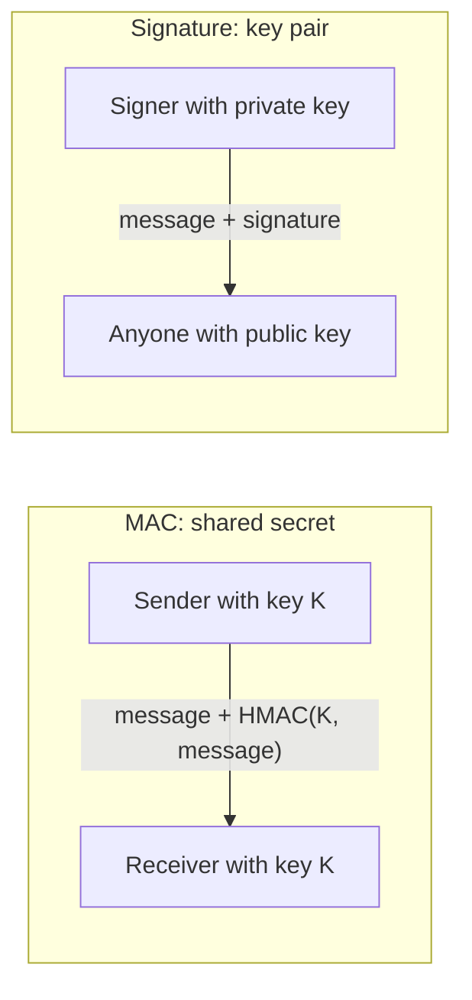

# Digital Signatures and MACs

## Introduction

Encryption hides data. Very often, though, you do not need to hide anything. You need to **trust** it:

- Did this webhook really come from the payment provider, or did someone forge an "order paid" event?
- Is this software update really from the vendor?
- Has anyone changed this session cookie, invoice or audit log entry?

Two primitives answer these questions:

- A **MAC** (Message Authentication Code) uses a **shared secret key**. Whoever holds the key can create a tag, and whoever holds the key can check it.
- A **digital signature** uses a **key pair**. Only the private key holder can sign, but anyone with the public key can verify.

The analogy: a MAC is like a secret handshake between two friends. It proves to your friend that the message came from you, but your friend knows the handshake too, so they could fake a message "from you" to a third person. A signature is like a handwritten signature that everyone can compare against a sample on file, but only you can produce.

## MAC vs Signature at a Glance

| Property | MAC (e.g. HMAC-SHA256) | Signature (e.g. Ed25519) |
| --- | --- | --- |
| Keys | One shared secret | Private key signs, public key verifies |
| Who can verify | Only parties holding the secret | Anyone with the public key |
| Who can forge | Anyone holding the secret, including the verifier | Only the private key holder |
| Non-repudiation | No | Yes |
| Speed and size | Very fast, 32-byte tag | Slower, 64 to 384+ byte signature |
| Typical uses | Webhooks, session cookies, API request signing between two parties, JWT HS256 | Software releases, certificates, JWT RS256/ES256/EdDSA, Git commits, documents |



## HMAC

HMAC turns any hash function into a MAC. It is defined in RFC 2104 and is the standard choice. As explained in [Hash Functions](./1-sec-hashing.mdx), do not build a MAC as `sha256(key + message)`, which is vulnerable to length extension.

The most common real-world use of HMAC for developers is **webhook verification**. Providers such as Stripe and GitHub sign each webhook body with a shared secret and send the result in a header (`Stripe-Signature: t=...,v1=...` or `X-Hub-Signature-256: sha256=...`). Your endpoint recomputes the HMAC and compares.

### Vulnerable webhook handler

```python
import hashlib
import hmac
import json

from flask import Flask, abort, request

app = Flask(__name__)
SECRET = b"whsec_dev_only"

@app.post("/webhooks/payments")
def payments_webhook():
    # Problem 1: re-serializing JSON changes the bytes, so this either
    # breaks or tempts developers to "fix" it by skipping verification.
    body = json.dumps(request.json).encode()
    expected = hmac.new(SECRET, body, hashlib.sha256).hexdigest()
    # Problem 2: == is not constant-time and leaks timing information.
    # Problem 3: no timestamp, so a captured request can be replayed forever.
    if expected != request.headers.get("X-Signature"):
        abort(401)
    return {"status": "ok"}
```

### Fixed webhook handler

```python
import hashlib
import hmac
import os
import time

from flask import Flask, abort, request

app = Flask(__name__)
WEBHOOK_SECRET = os.environ.get("WEBHOOK_SECRET", "whsec_dev_only").encode()
TOLERANCE_SECONDS = 300
seen_ids: set[str] = set()          # use Redis or a DB table in production

def expected_signature(timestamp: str, body: bytes) -> str:
    signed = timestamp.encode() + b"." + body
    return hmac.new(WEBHOOK_SECRET, signed, hashlib.sha256).hexdigest()

@app.post("/webhooks/payments")
def payments_webhook():
    header = request.headers.get("X-Signature", "")
    parts = dict(p.split("=", 1) for p in header.split(",") if "=" in p)
    timestamp, received = parts.get("t", ""), parts.get("v1", "")

    # 1. Reject stale or future timestamps to limit replay
    if not timestamp.isdigit() or abs(time.time() - int(timestamp)) > TOLERANCE_SECONDS:
        abort(400)

    # 2. Verify over the RAW bytes, in constant time
    body = request.get_data()                      # raw body, not request.json
    if not hmac.compare_digest(expected_signature(timestamp, body), received):
        abort(401)

    # 3. Deduplicate by event id (signature is valid, but it may be a replay)
    event = request.get_json()
    if event["id"] in seen_ids:
        return {"status": "duplicate"}, 200
    seen_ids.add(event["id"])
    return {"status": "ok"}, 200

if __name__ == "__main__":
    client = app.test_client()
    body = b'{"id": "evt_1", "type": "payment.succeeded", "amount": 4200}'
    ts = str(int(time.time()))
    good = f"t={ts},v1={expected_signature(ts, body)}"
    hdrs = {"Content-Type": "application/json"}
    print("valid     :", client.post("/webhooks/payments", data=body, headers={**hdrs, "X-Signature": good}).status_code)
    print("replayed  :", client.post("/webhooks/payments", data=body, headers={**hdrs, "X-Signature": good}).json)
    forged = body.replace(b"4200", b"1")
    print("modified  :", client.post("/webhooks/payments", data=forged, headers={**hdrs, "X-Signature": good}).status_code)
    old = str(int(time.time()) - 3600)
    stale = f"t={old},v1={expected_signature(old, body)}"
    print("stale     :", client.post("/webhooks/payments", data=body, headers={**hdrs, "X-Signature": stale}).status_code)
```

Output:

```text
valid     : 200
replayed  : {'status': 'duplicate'}
modified  : 401
stale     : 400
```

The fixes:

- **Raw bytes.** Sign and verify the exact bytes on the wire. Parsing and re-serializing JSON can reorder keys or change whitespace.
- **Constant-time comparison.** `hmac.compare_digest` takes the same time whether the first byte or the last byte differs, so an attacker cannot guess a valid tag byte by byte from response timings.
- **Timestamp in the signed data** plus a tolerance window, and **event ID deduplication**, defend against replay.

### The same handler in Node.js

In Express, the most common bug is letting `express.json()` parse the body before verification. Use `express.raw()` on the webhook route, and compare with `crypto.timingSafeEqual`, which requires buffers of equal length:

```javascript
const crypto = require("node:crypto");
const express = require("express");

const app = express();
const SECRET = process.env.WEBHOOK_SECRET || "whsec_dev_only";

// express.raw keeps the exact bytes; do NOT use express.json() on this route
app.post("/webhooks/payments", express.raw({ type: "application/json" }), (req, res) => {
  const header = req.get("X-Signature") || "";
  const parts = Object.fromEntries(header.split(",").map((p) => p.split("=", 2)));
  const ts = Number(parts.t);
  if (!Number.isInteger(ts) || Math.abs(Date.now() / 1000 - ts) > 300) {
    return res.sendStatus(400);
  }
  const expected = crypto
    .createHmac("sha256", SECRET)
    .update(`${parts.t}.`)
    .update(req.body)                       // Buffer with the raw body
    .digest();
  const received = Buffer.from(parts.v1 || "", "hex");
  if (received.length !== expected.length || !crypto.timingSafeEqual(received, expected)) {
    return res.sendStatus(401);
  }
  const event = JSON.parse(req.body.toString("utf8"));
  res.json({ status: "ok", id: event.id });
});

app.listen(3000);
```

When the provider offers an official SDK verification function, prefer it, because it matches their exact format.

### Why raw bytes matter: canonicalization

Two JSON documents can mean the same thing and still be different bytes:

```python
import hashlib
import hmac
import json

KEY = b"shared-secret"
a = json.dumps({"amount": 4200, "currency": "EUR"})
b = json.dumps({"currency": "EUR", "amount": 4200})        # same meaning, different bytes

sig = lambda s: hmac.new(KEY, s.encode(), hashlib.sha256).hexdigest()[:16]
print("a:", a, sig(a))
print("b:", b, sig(b))

canon = lambda obj: json.dumps(obj, sort_keys=True, separators=(",", ":"), ensure_ascii=False)
print("canonical:", canon(json.loads(a)) == canon(json.loads(b)))
```

Output:

```text
a: {"amount": 4200, "currency": "EUR"} ef9af6f8d79de490
b: {"currency": "EUR", "amount": 4200} 5f2040e26e0bb89d
canonical: True
```

MACs and signatures work on bytes, not meaning. Either sign and verify the exact bytes that travel over the wire (the simplest and most robust option), or agree on a strict canonical form such as RFC 8785 (JSON Canonicalization Scheme). Problems in canonicalization have caused real signature bypasses in XML signature (SAML) implementations, where the verifier and the application interpreted the document differently. The [Webhook Security](../7-sec-api-security/6-sec-webhook-security.mdx) page covers the rest of webhook hardening.

## Digital Signatures

A signature scheme has three operations: generate a key pair, **sign** with the private key, and **verify** with the public key. Verification answers two questions at once: was this produced by the holder of the private key, and has it changed since?

### Ed25519

Ed25519 is the modern default for new designs. It is fast, its signatures are a fixed 64 bytes, and it is **deterministic**: it does not need a random number per signature, which removes a whole class of catastrophic bugs.

```python
from cryptography.exceptions import InvalidSignature
from cryptography.hazmat.primitives.asymmetric.ed25519 import Ed25519PrivateKey

# The release manager generates a key pair once
signing_key = Ed25519PrivateKey.generate()
verify_key = signing_key.public_key()          # published to users

manifest = b"mytool-2.4.0-linux-amd64.tar.gz sha256:75f24219...16bf\n"
signature = signing_key.sign(manifest)
print("signature bytes:", len(signature))

def is_authentic(data: bytes, sig: bytes) -> bool:
    try:
        verify_key.verify(sig, data)
        return True
    except InvalidSignature:
        return False

print("original  :", is_authentic(manifest, signature))
print("tampered  :", is_authentic(manifest.replace(b"2.4.0", b"2.4.1"), signature))
```

Output:

```text
signature bytes: 64
original  : True
tampered  : False
```

### ECDSA and RSA-PSS

You will meet these in certificates, cloud KMS services, hardware tokens and compliance-driven environments.

```python
from cryptography.hazmat.primitives import hashes
from cryptography.hazmat.primitives.asymmetric import ec, padding, rsa

data = b"invoice #2026-0042 total=199.00 EUR"

# ECDSA on P-256 (common in TLS certificates, WebAuthn, cloud KMS)
ec_key = ec.generate_private_key(ec.SECP256R1())
ec_sig = ec_key.sign(data, ec.ECDSA(hashes.SHA256()))
ec_key.public_key().verify(ec_sig, data, ec.ECDSA(hashes.SHA256()))
print("ECDSA P-256 signature bytes:", len(ec_sig), "(DER, length varies)")

# RSA-PSS (preferred RSA signature padding for new designs)
rsa_key = rsa.generate_private_key(public_exponent=65537, key_size=3072)
pss = padding.PSS(mgf=padding.MGF1(hashes.SHA256()), salt_length=padding.PSS.MAX_LENGTH)
rsa_sig = rsa_key.sign(data, pss, hashes.SHA256())
rsa_key.public_key().verify(rsa_sig, data, pss, hashes.SHA256())
print("RSA-3072 PSS signature bytes:", len(rsa_sig))
```

Example output:

```text
ECDSA P-256 signature bytes: 72 (DER, length varies)
RSA-3072 PSS signature bytes: 384
```

| Algorithm | Signature size | Notes |
| --- | --- | --- |
| Ed25519 | 64 bytes | Deterministic, simple API, the best default when you control both ends |
| ECDSA P-256 | about 64 to 72 bytes | Widely required (TLS, FIPS, WebAuthn). Needs a perfect random nonce per signature, or a deterministic variant (RFC 6979) |
| RSA-PSS 3072 | 384 bytes | Good when RSA is required. Prefer PSS over PKCS#1 v1.5 for new signatures |
| ML-DSA-65 | 3309 bytes | Post-quantum (FIPS 204). Much larger, see [Post-Quantum Cryptography](./11-sec-post-quantum.mdx) |

:::warning ECDSA nonce reuse
ECDSA needs a unique, unpredictable secret value for every signature. Reusing it even once reveals the private key. That is exactly how the Sony PlayStation 3 signing key was recovered in 2010. Libraries such as `cryptography` handle this for you. Never implement ECDSA yourself.
:::

## Signatures in Everyday Engineering

You will rarely call `sign()` directly. More often you will configure a system that signs for you:

- **TLS certificates** are signed by a certificate authority. See [PKI and Certificates](./6-sec-pki-and-certificates.mdx).
- **JWTs** are signed with HMAC (`HS256`) or a key pair (`RS256`, `ES256`, `EdDSA`). See [JSON Web Tokens](../4-sec-authentication/5-sec-jwt.mdx).
- **Git commits and tags** can be signed with GPG, SSH keys or Sigstore's gitsign.
- **Container images and release artifacts** are signed with Sigstore cosign. See [SBOMs, Signing and SLSA](../6-sec-appsec-and-devsecops/6-sec-sbom-and-signing.mdx).
- **Package managers** (apt, rpm, npm provenance, PyPI attestations) verify signatures before installing.

### What a signature does not tell you

A valid signature says "the holder of this private key signed these bytes". It does not say:

- **Who** that holder is. You need a trusted way to link the public key to an identity, which is what PKI and Sigstore provide.
- **When** it was signed, unless a timestamp is part of the signed data or a trusted timestamp service is used.
- **What the bytes mean.** If your verifier checks the signature on one field but reads another, the signature protects nothing. Verify first, then parse only the verified bytes.

## Real-World Scenario

Your company runs a B2B platform that sends webhooks to about 3,000 customer endpoints. Today each customer gets a unique HMAC secret. Two problems have come up: customers keep leaking their secrets in public GitHub repos, and a large customer wants to forward your webhooks through their own internal message bus to several teams, each of which must verify them independently.

### Walking through it

**Option A: keep HMAC, improve hygiene.** Support two active secrets per endpoint so customers can rotate without downtime, scan GitHub for your secret prefix (for example through GitHub's secret scanning partner program), and document constant-time verification. This keeps the simple, fast scheme everyone already supports.

**Option B: add asymmetric signatures.** Sign each webhook with an Ed25519 key that you own. Publish the public keys at a well-known URL with key IDs, include the key ID and a timestamp in the signed header, and let customers verify with the public key. Nothing secret lives on the customer side, so there is nothing for them to leak, and any internal team can verify without being able to forge.

Many providers end up offering both: HMAC for simplicity and a signature scheme for customers who need it. The emerging [Standard Webhooks](https://www.standardwebhooks.com/) specification describes both styles.

### Why this approach

The real problem is **key distribution**. With HMAC, every verifier holds a secret that can also forge messages. Signatures separate the power to create from the power to check. That matters as soon as more than two parties are involved or verifiers are hard to trust with secrets.

### When to use it and when not to

- Use HMAC when exactly two parties talk, both are trusted to hold the secret, and speed or simplicity matter.
- Use signatures when many parties verify, when verifiers should not be able to forge, or when you need non-repudiation.
- Do not use signatures to hide data. A signed message is still readable. Encrypt as well if needed.

### Alternatives and trade-offs

| Approach | Pros | Cons | Best for |
| --- | --- | --- | --- |
| HMAC per customer | Fast, tiny, easy in every language | Verifier can forge, secrets leak, rotation is per customer | Most webhook providers, two-party APIs |
| Ed25519 signatures with published keys | No secret on verifier side, fan-out friendly | Key publication and rotation, more client code | Large platforms, regulated customers |
| Mutual TLS to customer endpoint | Authenticates the connection itself | Certificate management for every endpoint, breaks with proxies | High-assurance B2B links |
| IP allowlisting only | Simple | Not cryptographic, IPs change, shared cloud ranges | Extra layer, never alone |

## Common Mistakes

- **Comparing tags with `==`.** Use `hmac.compare_digest` or the library's verify function.
- **Verifying parsed data instead of raw bytes.** Keep the raw body for verification.
- **No replay protection.** Include a timestamp or nonce in the signed data and track processed IDs.
- **Accepting the algorithm from the message.** The classic JWT bug is trusting a header that says `"alg": "none"` or switching from RS256 to HS256 with the public key as the HMAC secret. Pin the expected algorithm on the server.
- **Signing with the wrong key type for the job.** Keep signing keys separate from encryption keys.
- **Storing private signing keys in CI variables or on developer laptops** without protection. Use a KMS, HSM or keyless signing such as Sigstore.
- **Using the hash alone as proof of origin.** A hash proves nothing about who produced data.

## Summary

- MACs (HMAC) use a shared secret and prove a message came from a key holder. Signatures use a key pair and let anyone verify while only one party can sign.
- Verify webhooks over raw bytes, with constant-time comparison, timestamps and replay protection.
- Ed25519 is the best default signature algorithm. Use ECDSA P-256 or RSA-PSS when compatibility or compliance requires them.
- Signatures prove key possession, not identity. PKI, Sigstore or published key lists connect keys to identities.
- Choose between MAC and signature based on how many parties verify and whether verifiers should be able to forge.

## Further Learning

### Exercises

1. Extend the fixed webhook handler to accept two secrets at once (current and previous) so a secret can be rotated without dropping events.
2. Write a `sign_release.py` and `verify_release.py` pair using Ed25519. Store the public key in PEM format and the signature as base64 in a `.sig` file.
3. Use `timeit` to compare how long HMAC-SHA256, Ed25519 and RSA-3072 PSS take to sign and verify 10,000 small messages.
4. Look up how GitHub signs webhooks (`X-Hub-Signature-256`) and write a verifier for it.

### Related pages

- [PKI and Certificates](./6-sec-pki-and-certificates.mdx) shows how signatures link public keys to identities.
- [JSON Web Tokens](../4-sec-authentication/5-sec-jwt.mdx) applies MACs and signatures to authentication tokens.
- [Webhook Security](../7-sec-api-security/6-sec-webhook-security.mdx) covers end-to-end webhook hardening.
