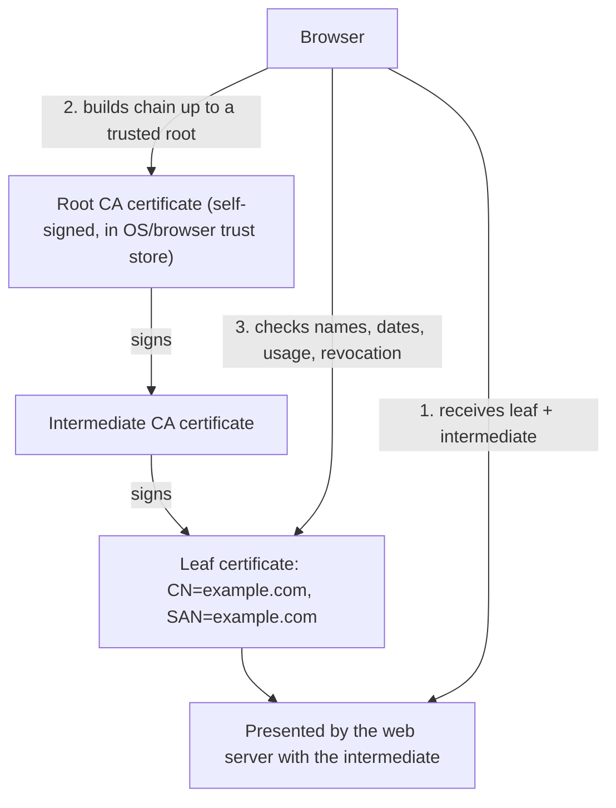

# PKI and Certificates

## Introduction

Public-key cryptography has a weak spot. When your browser receives a public key that claims to belong to `bank.example`, how does it know the key is not an attacker's? [Key exchange](./4-sec-asymmetric-encryption.mdx) without authentication is open to man-in-the-middle attacks, and a [signature](./5-sec-digital-signatures.mdx) only proves possession of some private key.

**Public Key Infrastructure (PKI)** is the system that binds public keys to identities. Its central object is the **certificate**: a document that says "this public key belongs to `bank.example`", signed by a **Certificate Authority (CA)** that your device already trusts.

An analogy is a passport. You trust a stranger's passport not because you know the stranger, but because you trust the government that issued it, and you can check its security features. A certificate is a passport for a key, and the CA is the issuing government.

This page explains how certificates and chains work, how to inspect them, why their lifetimes are shrinking fast, how revocation and Certificate Transparency work, and when to run your own private CA.

## What Is in a Certificate

Certificates use the **X.509** format. The important fields are:

| Field | Meaning |
| --- | --- |
| Subject | Who the certificate is for (for TLS, often just a `CN`) |
| Subject Alternative Name (SAN) | The DNS names or IPs the certificate is valid for. Browsers check this, not the CN |
| Issuer | The CA that signed it |
| Validity (`notBefore`, `notAfter`) | The time window when it is valid |
| Public key | The key being certified, with its algorithm |
| Key Usage / Extended Key Usage | What the key may be used for, such as `serverAuth` or `clientAuth` |
| Basic Constraints | Whether this certificate may itself sign other certificates (`CA:TRUE`) |
| Signature | The issuer's signature over all of the above |

## The Chain of Trust

Browsers and operating systems ship a **trust store** of about a hundred or more root CA certificates. Root keys are extremely valuable, so they are kept offline. Day-to-day issuance is done by **intermediate CAs** whose certificates are signed by a root.



When a client validates a server certificate it checks that:

1. Each certificate in the chain is signed by the next one up, ending at a root in its trust store.
2. The current time is within every certificate's validity window.
3. The hostname matches a SAN entry in the leaf.
4. Key usage allows server authentication.
5. Optionally, nothing in the chain is revoked, and the certificate appears in Certificate Transparency logs (Chrome and Safari require this for public certificates).

### Inspecting a real chain

```bash
openssl s_client -connect example.com:443 -servername example.com < /dev/null 2>/dev/null \
  | sed -n '/Certificate chain/,/---/p'
```

Example output (the issuer and dates depend on when you run it):

```text
Certificate chain
 0 s:CN=example.com
   i:C=US, O=SSL Corporation, CN=Cloudflare TLS Issuing ECC CA 3
   a:PKEY: EC, (prime256v1); sigalg: ecdsa-with-SHA256
   v:NotBefore: Sep 26 22:49:11 2026 GMT; NotAfter: Dec 25 22:56:35 2026 GMT
 1 s:C=US, O=SSL Corporation, CN=Cloudflare TLS Issuing ECC CA 3
   i:C=US, O=SSL Corporation, CN=SSL.com TLS Transit ECC CA R2
   a:PKEY: EC, (prime256v1); sigalg: ecdsa-with-SHA384
   v:NotBefore: May 29 19:49:45 2025 GMT; NotAfter: May 27 19:49:44 2035 GMT
```

Certificate `0` is the leaf, issued by certificate `1`, the intermediate. Notice the leaf is valid for about 90 days while the intermediate lasts ten years.

To see the details of the leaf:

```bash
openssl s_client -connect example.com:443 -servername example.com < /dev/null 2>/dev/null \
  | openssl x509 -noout -subject -issuer -dates -ext subjectAltName
```

Example output:

```text
subject=CN=example.com
issuer=C=US, O=SSL Corporation, CN=Cloudflare TLS Issuing ECC CA 3
notBefore=Sep 26 22:49:11 2026 GMT
notAfter=Dec 25 22:56:35 2026 GMT
X509v3 Subject Alternative Name:
    DNS:example.com, DNS:*.example.com
```

A very common production bug is a server that sends only the leaf, not the intermediate. Desktop browsers may hide the problem by caching or fetching intermediates, while API clients, mobile apps and `curl` fail with "unable to get local issuer certificate". Always configure the **full chain** (leaf followed by intermediates).

## Certificate Types and Validation Levels

| Type | What the CA checks | Notes |
| --- | --- | --- |
| Domain Validated (DV) | You control the domain (HTTP file, DNS record or TLS-ALPN challenge) | Automated and often free (Let's Encrypt). Fine for nearly all sites |
| Organization Validated (OV) | Domain plus organization details | Browsers show no visible difference from DV |
| Extended Validation (EV) | Stricter organization checks | Browsers removed the special green bar years ago |
| Wildcard (`*.example.com`) | Covers one level of subdomains | Convenient, but one leaked key affects every subdomain |

## Certificate Lifetimes Are Shrinking

Short lifetimes limit the damage from a stolen key or a mis-issued certificate, because the certificate expires soon anyway. In 2025 the CA/Browser Forum approved ballot SC-081, which steps down the maximum lifetime of public TLS certificates:

| From (March 15) | Maximum validity |
| --- | --- |
| Before 2026 | 398 days |
| 2026 | 200 days |
| 2027 | 100 days |
| 2029 | 47 days |

Domain validation reuse periods shrink on a similar schedule. Some CAs applied the limits a little early. Check the [CA/Browser Forum](https://cabforum.org/) and your CA's announcements for the exact rules.

:::tip Automate or suffer
With 47-day certificates, manual renewal is no longer realistic. Use the **ACME** protocol (RFC 8555) through Certbot, Caddy's built-in ACME client, cert-manager on Kubernetes, or your cloud load balancer's managed certificates. Monitor expiry as a backup.
:::

Let's Encrypt already issues 90-day certificates by default and has offered optional six-day "short-lived" certificates since 2025.

A minimal Certbot run on an Ubuntu server with nginx looks like this (run only on a server and domain you control):

```bash
sudo apt install certbot python3-certbot-nginx
sudo certbot --nginx -d example.com -d www.example.com
sudo certbot renew --dry-run      # confirm automatic renewal works
```

### Certificate signing requests

When you are not using ACME (for example with a commercial CA or an internal CA that takes manual requests), you generate a key pair yourself and send the CA a **Certificate Signing Request (CSR)**. The CSR contains your public key and requested names, signed with your private key to prove you hold it. The private key never leaves your server.

```bash
openssl req -new -newkey ec -pkeyopt ec_paramgen_curve:P-256 -nodes \
  -keyout api.key -out api.csr \
  -subj "/CN=api.example.com" \
  -addext "subjectAltName=DNS:api.example.com,DNS:www.api.example.com"

openssl req -in api.csr -noout -subject -verify
openssl req -in api.csr -noout -text | grep -A1 "Alternative"
```

Output:

```text
Certificate request self-signature verify OK
subject=CN=api.example.com
                X509v3 Subject Alternative Name:
                    DNS:api.example.com, DNS:www.api.example.com
```

`-nodes` leaves the key file unencrypted so a web server can start without a passphrase. Protect it with file permissions (`chmod 600`, owned by the service user) or keep it in an HSM or cloud certificate manager instead.

### Monitoring expiry

Even with automation, monitor expiry independently. Renewal jobs fail silently more often than you would expect.

```python
import datetime as dt
import socket
import ssl

HOSTS = ["example.com", "www.python.org"]      # replace with hosts you own
WARN_DAYS = 21

def days_left(host: str, port: int = 443) -> int:
    ctx = ssl.create_default_context()
    with socket.create_connection((host, port), timeout=10) as sock:
        with ctx.wrap_socket(sock, server_hostname=host) as tls:
            not_after = tls.getpeercert()["notAfter"]
    expires = dt.datetime.fromtimestamp(ssl.cert_time_to_seconds(not_after), dt.timezone.utc)
    return (expires - dt.datetime.now(dt.timezone.utc)).days

for host in HOSTS:
    try:
        left = days_left(host)
        status = "WARN" if left < WARN_DAYS else "ok"
        print(f"{status:4} {host:20} {left:4} days left")
    except (ssl.SSLError, OSError) as exc:
        print(f"FAIL {host:20} {exc}")
```

Example output:

```text
ok   example.com            75 days left
ok   www.python.org        126 days left
```

As lifetimes shrink toward 47 days, set the warning threshold to about a third of the certificate lifetime, and alert on renewal **failures**, not just on approaching expiry.

## Revocation

If a private key leaks before the certificate expires, the CA can **revoke** it. There are two mechanisms:

- **CRLs** (Certificate Revocation Lists): the CA publishes a signed list of revoked serial numbers.
- **OCSP** (Online Certificate Status Protocol): the client asks the CA about one certificate. This leaks browsing history to the CA and adds latency, so it was often "soft-fail" and ignored on network errors.

The industry is moving away from OCSP. Let's Encrypt stopped including OCSP URLs in its certificates in 2025 and switched to CRLs only, and browsers rely on their own aggregated revocation lists (such as Firefox's CRLite and Chrome's CRLSets). In practice, **short lifetimes are becoming the main revocation strategy**.

## Certificate Transparency

Certificate Transparency (CT) requires public CAs to log every certificate they issue in append-only public logs. Browsers reject public certificates that lack proof of logging (Signed Certificate Timestamps).

For defenders, CT is a free monitoring tool: you can search the logs for certificates issued for your domains and spot any you did not request.

```bash
# Query crt.sh for certificates issued for a domain you own (JSON output)
curl -s "https://crt.sh/?q=example.com&output=json" | python3 -m json.tool | head -20
```

Many teams also set **CAA DNS records** that list which CAs may issue for their domain, for example `example.com. CAA 0 issue "letsencrypt.org"`.

## Private PKI

Public CAs only issue for public domain names. For internal services, service-to-service **mutual TLS (mTLS)**, VPN clients or IoT devices, you run a **private CA**. Clients trust it because you install its root certificate.

The example below builds a tiny private CA with the `cryptography` package, issues a 30-day leaf certificate, and verifies the chain the way a TLS client would.

```python
import datetime as dt

from cryptography import x509
from cryptography.hazmat.primitives import hashes
from cryptography.hazmat.primitives.asymmetric import ec
from cryptography.x509.oid import ExtendedKeyUsageOID, NameOID
from cryptography.x509.verification import PolicyBuilder, Store, VerificationError

now = dt.datetime.now(dt.timezone.utc)

def name(cn: str) -> x509.Name:
    return x509.Name([x509.NameAttribute(NameOID.ORGANIZATION_NAME, "Acme Internal"),
                      x509.NameAttribute(NameOID.COMMON_NAME, cn)])

# 1. Root CA: self-signed, long-lived, kept offline in real life
root_key = ec.generate_private_key(ec.SECP384R1())
root_cert = (
    x509.CertificateBuilder()
    .subject_name(name("Acme Internal Root CA"))
    .issuer_name(name("Acme Internal Root CA"))
    .public_key(root_key.public_key())
    .serial_number(x509.random_serial_number())
    .not_valid_before(now)
    .not_valid_after(now + dt.timedelta(days=3650))
    .add_extension(x509.BasicConstraints(ca=True, path_length=None), critical=True)
    .add_extension(x509.KeyUsage(digital_signature=False, content_commitment=False,
                                 key_encipherment=False, data_encipherment=False,
                                 key_agreement=False, key_cert_sign=True, crl_sign=True,
                                 encipher_only=False, decipher_only=False), critical=True)
    .add_extension(x509.SubjectKeyIdentifier.from_public_key(root_key.public_key()), critical=False)
    .sign(root_key, hashes.SHA384())
)

# 2. Leaf certificate for a service, short-lived, signed by the root
leaf_key = ec.generate_private_key(ec.SECP256R1())
leaf_cert = (
    x509.CertificateBuilder()
    .subject_name(name("billing.internal.acme"))
    .issuer_name(root_cert.subject)
    .public_key(leaf_key.public_key())
    .serial_number(x509.random_serial_number())
    .not_valid_before(now)
    .not_valid_after(now + dt.timedelta(days=30))
    .add_extension(x509.SubjectAlternativeName([x509.DNSName("billing.internal.acme")]), critical=False)
    .add_extension(x509.BasicConstraints(ca=False, path_length=None), critical=True)
    .add_extension(x509.ExtendedKeyUsage([ExtendedKeyUsageOID.SERVER_AUTH]), critical=False)
    .add_extension(x509.AuthorityKeyIdentifier.from_issuer_public_key(root_key.public_key()), critical=False)
    .sign(root_key, hashes.SHA256())
)

print("leaf subject :", leaf_cert.subject.rfc4514_string())
print("leaf issuer  :", leaf_cert.issuer.rfc4514_string())
print("valid until  :", leaf_cert.not_valid_after_utc.date())
print("SANs         :", leaf_cert.extensions.get_extension_for_class(
    x509.SubjectAlternativeName).value.get_values_for_type(x509.DNSName))

# 3. Verify the chain the way a TLS client would
store = Store([root_cert])
verifier = PolicyBuilder().store(store).build_server_verifier(x509.DNSName("billing.internal.acme"))
chain = verifier.verify(leaf_cert, [])
print("chain length :", len(chain))

wrong_name = PolicyBuilder().store(store).build_server_verifier(x509.DNSName("evil.example"))
try:
    wrong_name.verify(leaf_cert, [])
except VerificationError:
    print("wrong host   : VerificationError")
```

Example output:

```text
leaf subject : CN=billing.internal.acme,O=Acme Internal
leaf issuer  : CN=Acme Internal Root CA,O=Acme Internal
valid until  : 2026-11-10
SANs         : ['billing.internal.acme']
chain length : 2
wrong host   : VerificationError
```

This is great for learning and tests. In production, do not hand-roll a CA in application code. Use purpose-built tools that handle key protection, issuance policy, audit logs, CRLs and automation, such as `step-ca` (Smallstep), HashiCorp Vault's PKI engine, AWS Private CA, Google Certificate Authority Service, or a service mesh (Istio, Linkerd) that issues workload certificates automatically.

:::note Public certificates and client authentication
Chrome's root program is removing the `clientAuth` extended key usage from public TLS certificates, with CAs phasing it out during 2026 and 2027. If you use mTLS between organizations or for workloads, plan on a private CA (or a dedicated client-auth hierarchy) rather than public web certificates.
:::

## Real-World Scenario

Your platform team runs 60 microservices on Kubernetes. An audit finds that internal traffic is plain HTTP, and the compliance team wants all service-to-service traffic encrypted and authenticated. One engineer suggests buying a wildcard public certificate for `*.internal.example.com` and loading it into every service.

### Walking through it

The wildcard idea has three problems. Every service would share **one private key**, so compromising any pod compromises all. It does not authenticate **clients**, so any pod could call any service. And public certificates now need renewal every few months, which means 60 manual redeployments.

A better design:

1. Run a **private CA** whose root key is offline or in an HSM, with an intermediate in `cert-manager` or a service mesh.
2. Give every workload its **own** short-lived certificate (hours to days), issued automatically based on its Kubernetes service account identity (the SPIFFE ID pattern).
3. Enforce **mTLS**: both client and server present certificates, and authorization policies say which service may call which.
4. Keep public certificates only on the public ingress, issued through ACME.

### Why this approach

Per-workload identities limit the blast radius of a compromised pod, short lifetimes make revocation mostly unnecessary, and automation removes the outage risk of expired certificates.

### When to use it and when not to

- Use a mesh or `cert-manager` with a private CA once you have more than a handful of internal services.
- For two or three services, a simpler `step-ca` setup or cloud-managed private CA may be enough.
- Do not run your own CA for public websites. Browsers will not trust it. Use a public CA with ACME.

### Alternatives and trade-offs

| Approach | Pros | Cons | Best for |
| --- | --- | --- | --- |
| Shared wildcard public certificate | Quick to set up | One key everywhere, no client auth, manual renewal | Nothing internal, avoid |
| Service mesh (Istio, Linkerd) with built-in CA | Automatic mTLS and rotation, policy | Operational complexity, resource overhead | Many services on Kubernetes |
| cert-manager plus private issuer | Flexible, Kubernetes-native | You build mTLS policy yourself | Teams wanting control without a full mesh |
| Cloud private CA service | Managed key protection and audit | Cost per CA and certificate, cloud lock-in | Regulated environments |
| Plain HTTP in a private network | Zero effort | No defense against lateral movement | Never for sensitive data, see [Least Privilege and Zero Trust](../0-sec-fundamentals/5-sec-least-privilege.mdx) |

## Common Mistakes

- **Serving an incomplete chain.** Always deploy leaf plus intermediates, and test with `openssl s_client` or an online TLS checker.
- **Disabling verification** (`verify=False` in `requests`, `curl -k`, `NODE_TLS_REJECT_UNAUTHORIZED=0`) to "fix" an error. This removes all protection against interception. Fix the trust store or chain instead.
- **Forgetting renewal.** Expired certificates have caused many high-profile outages. Automate and monitor.
- **Relying on the CN.** Clients match SANs. A certificate without the right SAN fails in modern clients.
- **Keeping CA keys online on ordinary servers.** Protect root keys offline or in an HSM, and issue from intermediates.
- **Pinning leaf certificates in mobile apps** without a backup plan. When the certificate rotates (now every few months), the app breaks. Pin to a CA or public key set, with backups, or avoid pinning.
- **Ignoring CT logs.** Monitor them for unexpected certificates for your domains.

## Summary

- A certificate binds a public key to a name and is signed by a CA. Clients build a chain from the leaf through intermediates to a trusted root.
- Clients check signatures, validity dates, SAN hostnames and key usage, and optionally revocation and CT.
- Public certificate lifetimes are dropping to 200 days in 2026, 100 days in 2027 and 47 days in 2029, so automate with ACME.
- Revocation is shifting from OCSP to CRLs and short-lived certificates. CT logs let you monitor issuance for your domains.
- Use a private CA, ideally through a mesh, cert-manager or managed service, for internal mTLS. Never disable certificate verification.

## Further Learning

### Exercises

1. Run the private CA example, then save the root and leaf as PEM files and use `openssl verify -CAfile root.pem leaf.pem` to verify the chain from the command line.
2. Extend the example with an intermediate CA between the root and leaf. Pass the intermediate in the `verify` call's second argument.
3. Search crt.sh for a domain you own or your employer's domain. Count how many certificates were issued in the last year and which CAs issued them.
4. Write a small script that connects to a list of your own hostnames and alerts if any certificate expires within 21 days.

### Related pages

- [TLS and HTTPS](./7-sec-tls.mdx) shows certificates in action during the handshake.
- [Key Management](./8-sec-key-management.mdx) covers protecting CA and server private keys.
- [Kubernetes Security](../8-sec-cloud-and-container/5-sec-kubernetes-security.mdx) covers service mesh and workload identity.
