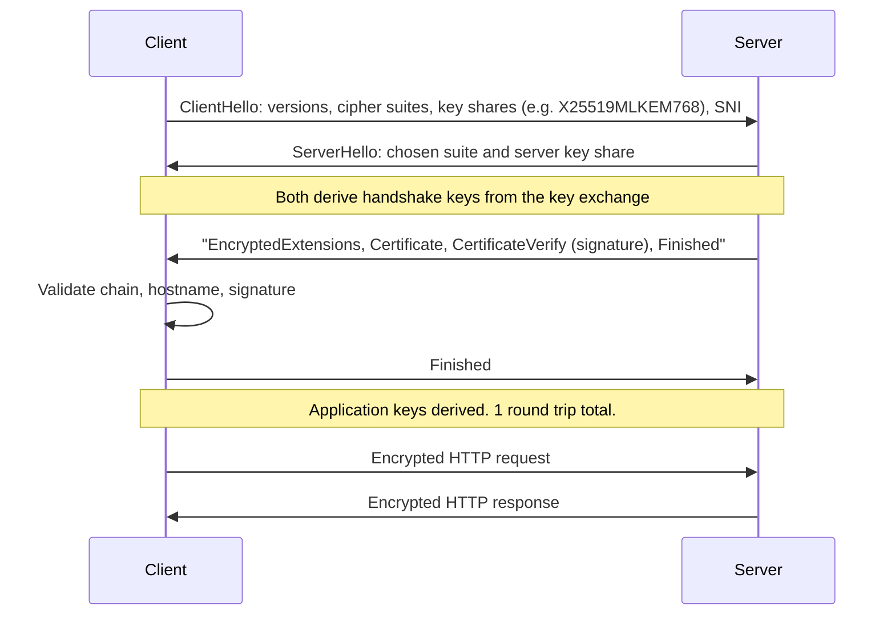

# TLS and HTTPS

## Introduction

**TLS** (Transport Layer Security) is the protocol behind the padlock in your browser. HTTPS is simply HTTP sent inside a TLS connection. TLS also protects email transport (SMTP, IMAP), database connections, gRPC, MQTT, and most API calls your services make.

TLS is where the previous pages come together:

- [Key exchange](./4-sec-asymmetric-encryption.mdx) (X25519, or hybrid X25519 plus ML-KEM) agrees on fresh session keys.
- [Certificates](./6-sec-pki-and-certificates.mdx) and [signatures](./5-sec-digital-signatures.mdx) prove the server's identity.
- [Authenticated encryption](./3-sec-symmetric-encryption.mdx) (AES-GCM or ChaCha20-Poly1305) protects every byte afterwards.

If you think of a TLS connection as a phone call, the handshake is the part where both sides confirm who they are and agree on a code language, and the record layer is the actual conversation in that code.

As a developer you rarely implement TLS, but you constantly **configure** and **use** it. Most TLS security incidents come from configuration and client code: old protocol versions, disabled certificate checks, missing HSTS, or plaintext hops behind a load balancer. This page focuses on those.

For the networking background, see the [Computer Networks tutorial](/docs/fundamental/network).

## What TLS Guarantees

| Guarantee | How |
| --- | --- |
| Confidentiality | AEAD encryption of all application data |
| Integrity | AEAD tags on every record, so changes are detected |
| Server authentication | Certificate chain to a trusted root, plus a handshake signature with the server's private key |
| Client authentication (optional) | Client certificate in mutual TLS |
| Forward secrecy | Ephemeral key exchange, so a stolen server key cannot decrypt past sessions |

What TLS does **not** hide: the IP addresses, roughly how much data is sent and when, and (unless Encrypted Client Hello is used) the hostname in the Server Name Indication field. It also protects data only **in transit**. Once it arrives, it is plaintext in your app, logs and database.

## Protocol Versions

| Version | Status |
| --- | --- |
| SSL 2.0, SSL 3.0 | Broken, disabled everywhere |
| TLS 1.0, TLS 1.1 | Formally deprecated by RFC 8996 (2021), disabled in all major browsers |
| TLS 1.2 | Still acceptable with AEAD cipher suites and ECDHE key exchange |
| TLS 1.3 | Current version (RFC 8446). Faster and simpler, with only secure options |

TLS 1.3 removed a long list of legacy features that caused real attacks: static RSA key exchange (no forward secrecy), CBC-mode cipher suites (padding oracles such as Lucky13), RC4, SHA-1 in signatures, compression (CRIME) and renegotiation. A TLS 1.3 connection has only five possible cipher suites, and all of them are AEAD.

## The TLS 1.3 Handshake



Key points:

- **One round trip.** The client guesses the key exchange group and sends its key share immediately, so the handshake completes in one round trip (TLS 1.2 needed two).
- **The certificate is encrypted**, unlike in TLS 1.2, so passive observers cannot see which certificate the server presented.
- **CertificateVerify** is a signature over the handshake transcript with the server's private key. It proves the server holds the key for the certificate, which defeats man-in-the-middle attacks.
- **0-RTT resumption** lets a returning client send data in its very first flight. That data can be **replayed** by an attacker, so only allow it for idempotent requests such as `GET`, or leave it disabled.

### Inspecting a connection

```bash
openssl s_client -connect example.com:443 -servername example.com -brief < /dev/null
```

Example output (with OpenSSL 3.5):

```text
CONNECTION ESTABLISHED
Protocol version: TLSv1.3
Ciphersuite: TLS_AES_256_GCM_SHA384
Peer certificate: CN=example.com
Hash used: SHA256
Signature type: ecdsa_secp256r1_sha256
Verification: OK
Negotiated TLS1.3 group: X25519MLKEM768
DONE
```

The last line is notable. `X25519MLKEM768` is a **hybrid post-quantum** key exchange: it combines classical X25519 with ML-KEM-768 so the session stays secure even if one of the two is broken. Chrome, Edge and Firefox enable it by default, as do major CDNs, and OpenSSL 3.5 added built-in support. See [Post-Quantum Cryptography](./11-sec-post-quantum.mdx).

From Python, the standard `ssl` module gives you the same view:

```python
import socket
import ssl

host = "example.com"
context = ssl.create_default_context()           # verifies chain + hostname
context.minimum_version = ssl.TLSVersion.TLSv1_2

with socket.create_connection((host, 443), timeout=10) as sock:
    with context.wrap_socket(sock, server_hostname=host) as tls:
        print("protocol :", tls.version())
        print("cipher   :", tls.cipher()[0])
        cert = tls.getpeercert()
        print("subject  :", dict(x[0] for x in cert["subject"]))
        print("expires  :", cert["notAfter"])
```

Example output:

```text
protocol : TLSv1.3
cipher   : TLS_AES_256_GCM_SHA384
subject  : {'commonName': 'example.com'}
expires  : Dec 25 22:56:35 2026 GMT
```

## Configuring a Server: nginx

The community-maintained successor to Mozilla's Server Side TLS guidelines, [TLSRef](https://docs.tlsref.org/), publishes "modern" (TLS 1.3 only) and "intermediate" (TLS 1.2 and 1.3) profiles. Intermediate is the recommended choice for most public sites. The configuration below follows it. Check the current guidance or use the [Mozilla SSL Configuration Generator](https://ssl-config.mozilla.org/) for your exact nginx and OpenSSL versions, because recommendations change.

```nginx
# Redirect all plain HTTP to HTTPS
server {
    listen 80;
    listen [::]:80;
    server_name example.com www.example.com;
    return 301 https://$host$request_uri;
}

server {
    listen 443 ssl;
    listen [::]:443 ssl;
    http2 on;                                   # nginx 1.25.1+
    server_name example.com www.example.com;

    # Full chain: leaf certificate followed by intermediates
    ssl_certificate     /etc/letsencrypt/live/example.com/fullchain.pem;
    ssl_certificate_key /etc/letsencrypt/live/example.com/privkey.pem;

    # Intermediate profile: TLS 1.2 and 1.3 only
    ssl_protocols TLSv1.2 TLSv1.3;
    # Hybrid PQ group first (needs nginx built against OpenSSL 3.5+)
    ssl_ecdh_curve X25519MLKEM768:X25519:prime256v1:secp384r1;
    ssl_ciphers ECDHE-ECDSA-AES128-GCM-SHA256:ECDHE-RSA-AES128-GCM-SHA256:ECDHE-ECDSA-AES256-GCM-SHA384:ECDHE-RSA-AES256-GCM-SHA384:ECDHE-ECDSA-CHACHA20-POLY1305:ECDHE-RSA-CHACHA20-POLY1305;
    ssl_prefer_server_ciphers off;

    ssl_session_timeout 1d;
    ssl_session_cache shared:TLS:10m;
    ssl_session_tickets off;

    # HSTS: browsers will only use HTTPS for this host for 2 years
    add_header Strict-Transport-Security "max-age=63072000; includeSubDomains" always;

    location / {
        proxy_pass http://127.0.0.1:8000;
        proxy_set_header Host $host;
        proxy_set_header X-Forwarded-Proto https;
    }
}
```

After editing, run `sudo nginx -t` to validate the file and `sudo systemctl reload nginx` to apply it. If your OpenSSL is older than 3.5, remove `X25519MLKEM768` from `ssl_ecdh_curve` or nginx will refuse to start.

### HSTS

Without HSTS, a user who types `example.com` makes a first request over plain HTTP. An attacker on the same Wi-Fi can intercept that request and keep the user on HTTP (an "SSL stripping" attack). The `Strict-Transport-Security` header tells the browser to use HTTPS for this host for `max-age` seconds, with no plaintext attempt.

- Start with a short `max-age` (such as 300) while testing, then raise it.
- Add `includeSubDomains` only when **every** subdomain supports HTTPS.
- The `preload` directive plus submission to the browser preload list protects even the very first visit, but removal is slow. Treat it as a long-term commitment.

Other security headers are covered in [Security Headers, CORS and CSP](../3-sec-web-security/9-sec-security-headers.mdx).

## Client-Side Mistakes

Servers usually get attention. Clients are where certificate validation is most often switched off "temporarily" and never switched back on.

Vulnerable:

```python
import requests

# Disables certificate AND hostname verification: any attacker on the
# network path can impersonate the API and read or alter all traffic.
resp = requests.get("https://internal-api.example.com/v1/users", verify=False, timeout=10)
```

```javascript
// Node.js: the same mistake
const https = require("node:https");
const agent = new https.Agent({ rejectUnauthorized: false });
```

Fixed:

```python
import requests

# Trust your organization's private CA explicitly instead of trusting nothing.
resp = requests.get(
    "https://internal-api.example.com/v1/users",
    verify="/etc/ssl/certs/acme-internal-root.pem",
    timeout=10,
)
resp.raise_for_status()
```

```javascript
const fs = require("node:fs");
const https = require("node:https");

const agent = new https.Agent({
  ca: fs.readFileSync("/etc/ssl/certs/acme-internal-root.pem"),
  minVersion: "TLSv1.2",
});
```

Verification failures are signals, not obstacles. The Python example below connects to a public test host whose certificate deliberately does not match its name:

```python
import socket
import ssl

host = "wrong.host.badssl.com"
ctx = ssl.create_default_context()
try:
    with socket.create_connection((host, 443), timeout=10) as s:
        with ctx.wrap_socket(s, server_hostname=host) as t:
            print(t.version())
except ssl.SSLCertVerificationError as e:
    print("SSLCertVerificationError:", e.verify_message)
```

Output:

```text
SSLCertVerificationError: Hostname mismatch, certificate is not valid for 'wrong.host.badssl.com'.
```

That is exactly the error a man-in-the-middle would trigger. Code that suppresses it cannot tell the difference.

## TLS Beyond HTTP

Databases, caches and message brokers often default to **unencrypted** connections, or to TLS **without** certificate verification. Check the setting name for each client, because "TLS enabled" and "TLS verified" are different things.

```python
import ssl

import psycopg   # pip install "psycopg[binary]"
import redis     # pip install redis

# PostgreSQL: verify-full checks the chain AND that the hostname matches
conn = psycopg.connect(
    "host=db.internal.example dbname=app user=app_user "
    "sslmode=verify-full sslrootcert=/etc/ssl/certs/acme-internal-root.pem"
)

# Redis over TLS: the rediss:// scheme enables TLS
cache = redis.Redis.from_url(
    "rediss://cache.internal.example:6380/0",
    ssl_ca_certs="/etc/ssl/certs/acme-internal-root.pem",
    ssl_cert_reqs="required",
)

# Mutual TLS client: present our own certificate as well as verifying the server
ctx = ssl.create_default_context(cafile="/etc/ssl/certs/acme-internal-root.pem")
ctx.load_cert_chain(certfile="/etc/app/tls/client.crt", keyfile="/etc/app/tls/client.key")
ctx.minimum_version = ssl.TLSVersion.TLSv1_2
```

| Client setting | Encrypts | Verifies server identity |
| --- | --- | --- |
| PostgreSQL `sslmode=require` | Yes | **No** |
| PostgreSQL `sslmode=verify-ca` | Yes | Chain only, not hostname |
| PostgreSQL `sslmode=verify-full` | Yes | Chain and hostname |
| MySQL `--ssl-mode=REQUIRED` | Yes | **No** |
| MySQL `--ssl-mode=VERIFY_IDENTITY` | Yes | Chain and hostname |

Managed cloud databases publish CA bundles for exactly this purpose. Download them from the provider's documentation and pin them in your configuration.

## Testing Your Own Configuration

Scan only hosts you own or are authorized to test.

```bash
# Which protocol versions does the server accept?
for v in tls1 tls1_1 tls1_2 tls1_3; do
  if openssl s_client -connect example.com:443 -servername example.com -"$v" < /dev/null > /dev/null 2>&1; then
    echo "$v: accepted"
  else
    echo "$v: rejected"
  fi
done

# Is HSTS present?
curl -sI https://example.com | grep -i strict-transport-security

# Full report with testssl.sh (https://testssl.sh)
./testssl.sh --quiet example.com
```

Add these checks to CI or a scheduled job so a configuration regression (for example, a new load balancer that re-enables TLS 1.0) is caught quickly.

## Real-World Scenario

Your e-commerce app runs behind a cloud load balancer that terminates HTTPS, then forwards plain HTTP to application containers in a private subnet. A new payment-card compliance review asks whether cardholder data is encrypted "across open, public networks" and whether internal traffic should also be encrypted.

### Walking through it

There are three common patterns for where TLS ends:

1. **Edge termination.** TLS ends at the load balancer. Inside the VPC, traffic is plain HTTP. Simple and fast, but anyone who gains a foothold inside the network can sniff traffic.
2. **Re-encryption.** The load balancer terminates the public certificate, inspects or routes the request, and opens a **new** TLS connection to the backend using an internal certificate. The load balancer can still apply WAF rules and routing.
3. **Passthrough.** The load balancer forwards raw TCP and the application terminates TLS itself. End-to-end, but the load balancer cannot inspect HTTP, and every app must manage public certificates.

For the payment flow, you choose **re-encryption**: public certificates managed by the cloud provider at the edge, internal certificates from a private CA (or mesh mTLS) on the backends, TLS 1.2+ everywhere, and HSTS on the public domain.

### Why this approach

It keeps the operational benefits of edge termination (managed certificates, WAF, HTTP routing) while removing plaintext hops that a compromised internal host could sniff. It also aligns with a [zero trust](../0-sec-fundamentals/5-sec-least-privilege.mdx) stance: the internal network is not treated as safe.

### When to use it and when not to

- Use re-encryption or mTLS for sensitive data, regulated workloads, and multi-tenant or shared networks.
- Edge termination alone may be acceptable for low-sensitivity, public content inside a tightly controlled network, if your risk assessment allows it.
- Passthrough suits protocols the load balancer cannot understand, or when you need true end-to-end client certificate authentication.

### Alternatives and trade-offs

| Approach | Pros | Cons | Best for |
| --- | --- | --- | --- |
| Edge termination only | Simplest, cheapest, LB can inspect traffic | Plaintext inside network | Low-risk internal apps |
| Edge plus re-encryption | Encrypted hops, LB features kept | Two certificate sets, slight latency | Most production web apps |
| TLS passthrough | True end-to-end, client certs reach app | No L7 routing or WAF at LB, app manages certs | Non-HTTP protocols, strict E2E needs |
| Service mesh mTLS | Automatic per-workload identity and encryption | Operational complexity | Large microservice estates |

## Best Practices

- Support TLS 1.2 and 1.3 only. Prefer TLS 1.3 everywhere you control both ends.
- Use ECDSA P-256 or RSA-2048+ certificates, served with the full chain, renewed automatically through ACME.
- Enable hybrid post-quantum key exchange where your stack supports it.
- Redirect HTTP to HTTPS and send HSTS.
- Never disable certificate verification in clients. Add the correct CA instead.
- Keep 0-RTT off unless you understand replay risks.
- Test with `openssl s_client`, `testssl.sh` or an online scanner against **your own** hosts, and re-test after changes.
- Encrypt internal hops for sensitive data, not just the public edge.

## Summary

- TLS provides confidentiality, integrity, server authentication and forward secrecy for data in transit.
- TLS 1.3 is faster (one round trip), encrypts the certificate and allows only AEAD cipher suites. TLS 1.0 and 1.1 are deprecated.
- Browsers and major servers now negotiate hybrid post-quantum key exchange (`X25519MLKEM768`) by default where both sides support it.
- Configure servers from a maintained profile, enable HSTS, and automate certificates.
- The most dangerous TLS bug in application code is turning off certificate verification.

## Further Learning

### Exercises

1. Run `openssl s_client -brief` against three sites you use daily. Record the protocol version, cipher suite and key exchange group for each.
2. Set up nginx locally with a certificate from the private CA you built in [PKI and Certificates](./6-sec-pki-and-certificates.mdx). Connect with `curl --cacert root.pem` and then without it, and compare the errors.
3. Run `testssl.sh` against a server you own and fix one finding.
4. Search one of your codebases for `verify=False`, `rejectUnauthorized`, `InsecureSkipVerify` and `-k`/`--insecure`. Replace each with proper CA configuration.

### Related pages

- [PKI and Certificates](./6-sec-pki-and-certificates.mdx) for chains, ACME and private CAs.
- [VPNs and Secure Tunnels](../2-sec-network-security/3-sec-vpn.mdx) for other encrypted transports.
- [Packet Analysis with Wireshark and tcpdump](../2-sec-network-security/9-sec-packet-analysis.mdx) to see what TLS hides and what it does not.
