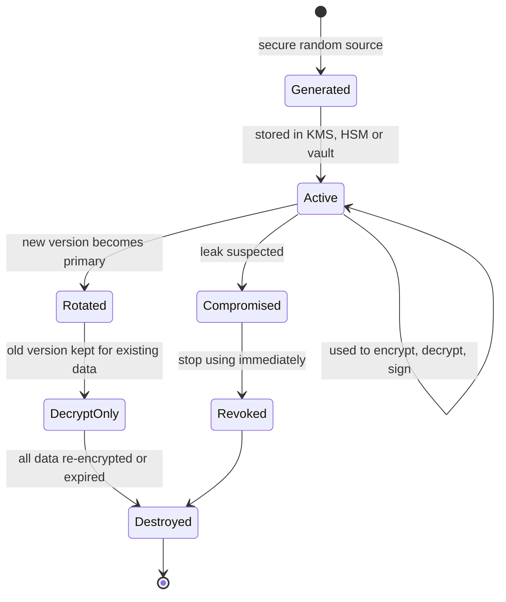
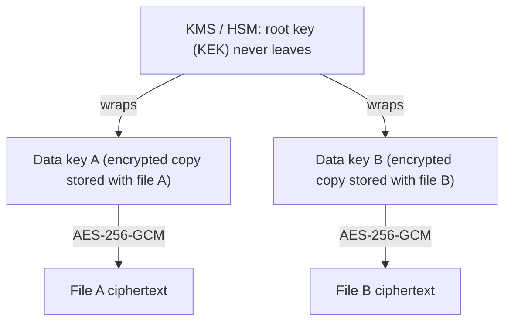

# Key Management

## Introduction

Strong algorithms are the easy part of cryptography. AES-256-GCM has no practical attack, yet encrypted data leaks all the time, because the **key** was stored next to the data, committed to Git, pasted into a chat, baked into a container image, or copied to every developer's laptop.

A useful rule: **encryption turns a big secret (your data) into a small secret (your key).** It does not make the secret go away. Key management is the discipline of protecting that small secret through its whole life.

An analogy is a bank. The vault door (the algorithm) is very strong, but the real security work is about who holds the keys, where spare keys are kept, how keys are changed when an employee leaves, and what happens if a key is lost. Key management is that work for your systems.

This page covers the key lifecycle, key hierarchies and envelope encryption, the main tools (cloud KMS, HSMs, HashiCorp Vault), rotation, and how to respond when a key leaks. Application secrets in general (API tokens, database passwords) are covered in [Secrets Management in Code](../5-sec-secure-coding/3-sec-secrets-in-code.mdx).

## The Key Lifecycle

Every key goes through the same stages. Each stage has its own failure modes.



| Stage | Good practice | Typical failure |
| --- | --- | --- |
| Generation | Cryptographically secure randomness, ideally inside a KMS or HSM | Keys derived from passwords or `random` |
| Storage | Dedicated key store with access control and audit logs | Keys in source code, `.env` files in Git, container images |
| Distribution | Workloads fetch keys at runtime using their identity | Keys emailed or pasted in chat |
| Use | Least privilege: each service can use only its keys, only for its purpose | One key shared by every service |
| Rotation | Scheduled and on-demand, with versioned keys | Rotation never tested, so nobody dares do it |
| Destruction | Deliberate, after data is migrated or expired | Deleting a key that still protects backups |

NIST [SP 800-57 Part 1](https://csrc.nist.gov/pubs/sp/800/57/pt1/r5/final) is the standard reference for key management recommendations, including how long keys should be used ("cryptoperiods").

## Key Hierarchies and Envelope Encryption

Large systems do not encrypt data directly with a master key. They use a **hierarchy**:

- A **root key** or **key encryption key (KEK)** lives inside a KMS or HSM and never leaves it.
- **Data encryption keys (DEKs)** are generated per object, file, tenant or table. They encrypt the actual data.
- Each DEK is stored next to its data, **encrypted ("wrapped") by the KEK**.

This is **envelope encryption**. To decrypt, you ask the KMS to unwrap the DEK, then decrypt the data locally.



Why bother?

- **Performance.** Bulk encryption happens locally with AES. Only a small DEK goes to the KMS, which has request quotas and latency.
- **Size limits.** KMS APIs typically encrypt only a few kilobytes directly.
- **Blast radius.** A leaked DEK exposes one object, not everything.
- **Cheap rotation.** Rotating the KEK only requires re-wrapping small DEKs, not re-encrypting terabytes.
- **Crypto-shredding.** Destroying a tenant's DEK (or KEK) makes all their data unreadable, which helps with deletion requirements.

### Envelope encryption, simulated locally

The code below simulates a KMS with a class so you can run it without a cloud account. The structure is identical to a real KMS integration.

```python
import json
import os

from cryptography.hazmat.primitives.ciphers.aead import AESGCM


class FakeKMS:
    """Stands in for AWS KMS / GCP KMS / Vault Transit. The root key never leaves it."""

    def __init__(self) -> None:
        self._root_keys = {"alias/app-data": AESGCM.generate_key(bit_length=256)}

    def generate_data_key(self, key_id: str) -> tuple[bytes, bytes]:
        data_key = AESGCM.generate_key(bit_length=256)
        nonce = os.urandom(12)
        wrapped = nonce + AESGCM(self._root_keys[key_id]).encrypt(nonce, data_key, key_id.encode())
        return data_key, wrapped                  # (plaintext key, encrypted key)

    def decrypt_data_key(self, key_id: str, wrapped: bytes) -> bytes:
        return AESGCM(self._root_keys[key_id]).decrypt(wrapped[:12], wrapped[12:], key_id.encode())


kms = FakeKMS()

def encrypt_file(data: bytes, key_id: str = "alias/app-data") -> dict:
    data_key, wrapped_key = kms.generate_data_key(key_id)
    nonce = os.urandom(12)
    ciphertext = AESGCM(data_key).encrypt(nonce, data, None)
    del data_key                                   # drop plaintext key ASAP
    return {"key_id": key_id, "wrapped_key": wrapped_key.hex(),
            "nonce": nonce.hex(), "ciphertext": ciphertext.hex()}

def decrypt_file(envelope: dict) -> bytes:
    data_key = kms.decrypt_data_key(envelope["key_id"], bytes.fromhex(envelope["wrapped_key"]))
    return AESGCM(data_key).decrypt(bytes.fromhex(envelope["nonce"]),
                                    bytes.fromhex(envelope["ciphertext"]), None)

env = encrypt_file(b"quarterly-payroll.csv contents")
print(json.dumps({k: (v[:24] + "...") if len(v) > 24 else v for k, v in env.items()}, indent=2))
print(decrypt_file(env))
```

Example output:

```text
{
  "key_id": "alias/app-data",
  "wrapped_key": "0754abc0f9f7849c0b71e739...",
  "nonce": "02e559800bab285ff1c0c6d9",
  "ciphertext": "6b12ce1eabe6449e53fd0763..."
}
b'quarterly-payroll.csv contents'
```

The envelope (wrapped key, nonce, ciphertext and key ID) can be stored anywhere, even in a public bucket, without revealing the data. Only a caller allowed to use `alias/app-data` in the KMS can open it.

### The same pattern with AWS KMS

With a real KMS, `FakeKMS` is replaced by API calls. With `boto3` it looks like this (this calls a billable cloud API, so it is shown for reference rather than run here):

```python
import boto3

kms = boto3.client("kms")

resp = kms.generate_data_key(
    KeyId="alias/app-data",
    KeySpec="AES_256",
    EncryptionContext={"tenant": "acme", "purpose": "invoices"},
)
plaintext_key = resp["Plaintext"]          # use locally with AESGCM, then discard
wrapped_key = resp["CiphertextBlob"]       # store next to the data

# Later, to decrypt: the same EncryptionContext must be supplied
plaintext_key = kms.decrypt(
    CiphertextBlob=wrapped_key,
    EncryptionContext={"tenant": "acme", "purpose": "invoices"},
)["Plaintext"]
```

The `EncryptionContext` acts like AEAD associated data: it is bound to the ciphertext, and it appears in CloudTrail audit logs, which makes access reviews easier. For production use, the [AWS Encryption SDK](https://docs.aws.amazon.com/encryption-sdk/latest/developer-guide/introduction.html) and Google Tink implement envelope encryption, formats and caching for you. Google Cloud KMS and Azure Key Vault offer equivalent APIs.

## Choosing Where Keys Live

| Option | What it is | Strengths | Weaknesses |
| --- | --- | --- | --- |
| Environment variable or config file | Key passed in at deploy time | Simple | Leaks through logs, crash dumps, `docker inspect`, Git; no audit; hard rotation |
| Secrets manager (AWS Secrets Manager, GCP Secret Manager, Vault KV) | Stores the key and hands it to authorized workloads | Access control, audit, rotation hooks | The key still ends up in app memory |
| Cloud KMS | Keys stay inside FIPS-validated HSMs; you call encrypt/decrypt APIs | Key never leaves, fine-grained IAM, audit, managed rotation | Per-request cost and latency, quotas, cloud lock-in |
| Vault Transit | "Encryption as a service" engine in HashiCorp Vault | Cloud-agnostic, versioned keys, rewrap | You operate Vault (or pay for a managed one) |
| Dedicated HSM (CloudHSM, on-prem) | Single-tenant tamper-resistant hardware | Highest assurance, strict compliance | Expensive, complex, you manage availability |

For most teams in the cloud, a **cloud KMS for root keys plus envelope encryption** is the sweet spot.

### Vault Transit in brief

Vault's Transit engine never returns the key. You send plaintext and get versioned ciphertext back:

```bash
vault secrets enable transit
vault write -f transit/keys/app-data
vault write transit/encrypt/app-data plaintext=$(echo -n "hello" | base64)
```

Example output:

```text
Key            Value
---            -----
ciphertext     vault:v1:8SDd3WHDOjf7mq69CyCqYjBXAiQQAVZRkFM13ok481zoCmHnSeDX9vyf7w==
key_version    1
```

The `vault:v1:` prefix records the key version. After `vault write -f transit/keys/app-data/rotate`, new encryptions use `v2`, old ciphertexts still decrypt, and `transit/rewrap/app-data` upgrades old ciphertexts without exposing plaintext to the caller.

## Rotation

Rotation means introducing a new key version and moving away from the old one. Reasons to rotate:

- **Limit exposure.** If a key leaked silently, rotation caps how much new data it protects.
- **Usage limits.** AEAD modes have limits on how many messages one key may encrypt (see [Symmetric Encryption](./3-sec-symmetric-encryption.mdx)).
- **Compliance.** Many standards require periodic rotation.
- **People leave.** Anyone who once had access to a raw key should be assumed to still have it.

Two kinds of rotation behave very differently:

1. **Key-version rotation** (KMS automatic rotation, Vault `rotate`). New data uses the new version, old data still decrypts with the old version. Cheap and safe, but **old data stays under the old key**. AWS KMS, for example, rotates customer-managed keys yearly by default when automatic rotation is enabled, with a configurable period, and its documentation notes that rotation does not re-encrypt existing data or rotate data keys.
2. **Re-encryption** (rewrap DEKs or re-encrypt data). Needed after a **compromise**, because the leaked key can still decrypt old data.

In Python, Fernet's `MultiFernet` shows the pattern in miniature:

```python
from cryptography.fernet import Fernet, MultiFernet

old_key = Fernet(Fernet.generate_key())
token_from_last_year = old_key.encrypt(b"api-token-for-customer-17")

# Rotation day: add a new key at the FRONT of the list
new_key = Fernet(Fernet.generate_key())
keyring = MultiFernet([new_key, old_key])

print(keyring.decrypt(token_from_last_year))        # old tokens still readable

rotated = keyring.rotate(token_from_last_year)        # re-encrypt under new key
print(new_key.decrypt(rotated))                       # readable with new key alone

# After every stored token is rotated, remove old_key from the keyring
keyring = MultiFernet([new_key])
print(keyring.decrypt(rotated))
```

Output:

```text
b'api-token-for-customer-17'
b'api-token-for-customer-17'
b'api-token-for-customer-17'
```

:::tip Practice rotation before you need it
A rotation procedure that has never run is a procedure that will fail during an incident. Rotate on a schedule, in production, so the process is boring and tested.
:::

## Crypto-Shredding

If every tenant (or user, or dataset) has its own key, destroying that key makes all of their data unreadable, including copies in backups and replicas you cannot easily edit. This is called **crypto-shredding**.

```python
import os

from cryptography.exceptions import InvalidTag
from cryptography.hazmat.primitives.ciphers.aead import AESGCM

tenant_keys = {t: AESGCM.generate_key(bit_length=256) for t in ("acme", "globex")}
storage = []   # imagine object storage AND every backup copy of it

def put(tenant: str, data: bytes) -> None:
    nonce = os.urandom(12)
    storage.append((tenant, nonce, AESGCM(tenant_keys[tenant]).encrypt(nonce, data, tenant.encode())))

def read_all(tenant: str) -> list:
    out = []
    for t, nonce, ct in storage:
        if t != tenant:
            continue
        try:
            out.append(AESGCM(tenant_keys[t]).decrypt(nonce, ct, t.encode()))
        except (KeyError, InvalidTag):
            out.append("<unrecoverable>")
    return out

put("acme", b"acme invoice 1"); put("acme", b"acme invoice 2"); put("globex", b"globex invoice")
print("acme before :", read_all("acme"))

del tenant_keys["acme"]          # tenant offboarded: destroy ONLY their key
print("acme after  :", read_all("acme"))
print("globex      :", read_all("globex"))
```

Output:

```text
acme before : [b'acme invoice 1', b'acme invoice 2']
acme after  : ['<unrecoverable>', '<unrecoverable>']
globex      : [b'globex invoice']
```

The same property is dangerous by accident: deleting or losing the wrong key is unrecoverable data loss. Real KMS services enforce a waiting period before deletion for exactly this reason, and you should back up key material (or rely on the KMS's durability) as carefully as the data itself.

## Keep a Key Inventory

You cannot rotate, audit or migrate keys you do not know about. A simple version-controlled inventory goes a long way:

```yaml
# keys.yaml - one entry per key, reviewed quarterly
- id: alias/app-data
  purpose: Envelope encryption of customer documents
  type: AES-256 (AWS KMS, symmetric)
  owner: platform-team
  environments: [prod]
  rotation: automatic, 365 days
  users: [docs-service-role]
  admins: [kms-admins]
  data_lifetime: 7 years
- id: release-signing-2026
  purpose: Sign CLI release manifests
  type: Ed25519 (HSM-backed)
  owner: release-engineering
  environments: [ci]
  rotation: manual, yearly with overlap
  users: [release-pipeline]
  admins: [security-team]
  data_lifetime: n/a (signatures verified at install time)
```

The inventory contains names and metadata, never key material. It also becomes the starting point for the [post-quantum migration](./11-sec-post-quantum.mdx).

## Access Control and Separation of Duties

- Grant each workload permission to use **only its own keys**, and only the operations it needs (an upload service may need `GenerateDataKey` but never `Decrypt`).
- Separate **key administrators** (who can create, rotate and schedule deletion) from **key users** (who can encrypt and decrypt). Nobody should need both.
- Protect key deletion with waiting periods (AWS KMS requires a 7 to 30 day waiting period) and alerts.
- Send KMS audit logs to your SIEM and alert on unusual decrypt volume. See [Security Logging and SIEM](../11-sec-defensive-operations/1-sec-logging-and-siem.mdx).

## Real-World Scenario

A startup's Flask app encrypts customer OAuth tokens with Fernet. The key is in an `.env` file. During an audit you find that `.env` was committed to the Git repository eight months ago and the repo was briefly public. You must respond and fix the design.

### Walking through it

**Immediate response (hours):**

1. Treat the key as **compromised**. Generate a new key and deploy it with `MultiFernet([new, old])` so the app keeps working.
2. Run a job that calls `rotate()` on every stored token, then remove the old key.
3. Because the attacker may have copied the database too, also **revoke and re-issue the underlying OAuth tokens** with each provider where possible. Re-encryption protects future leaks, not data already stolen.
4. Remove the key from Git history and enable secret scanning, but assume the old key is permanently public. See [Secret Scanning](../6-sec-appsec-and-devsecops/7-sec-secret-scanning.mdx).

**Redesign (weeks):**

1. Create a KMS key for the app. The app's cloud role can use it, developers cannot.
2. Switch to envelope encryption: one DEK per customer, wrapped by the KMS key, with the customer ID as encryption context.
3. Enable automatic key rotation, log every decrypt call, and alert on spikes.
4. Document a rotation and compromise runbook and test it quarterly.

### Why this approach

The original design failed because the key was a **file**. Any copy of the file was a full copy of the key. With a KMS, the root key cannot be copied at all. An attacker would need to steal the app's live credentials and would leave an audit trail with every use.

### When to use it and when not to

- Use KMS envelope encryption for any persistent sensitive data in the cloud.
- For a small hobby project, a secrets manager holding a Fernet key may be enough, as long as the key is never in Git.
- Avoid dedicated HSMs unless a regulation or threat model truly requires single-tenant hardware. They add cost and operational load.

### Alternatives and trade-offs

| Approach | Pros | Cons | Best for |
| --- | --- | --- | --- |
| Key in `.env` or config | Zero setup | Copies everywhere, no audit, painful rotation | Local development only |
| Secrets manager holds the key | Access control and audit on retrieval | Key lives in app memory and can be exfiltrated | Small apps, low volume |
| KMS envelope encryption | Root key never leaves HSM, per-call audit, cheap rotation | Cloud dependency, request quotas | Most production systems |
| Vault Transit | Cloud-agnostic, rewrap, versioning | Operating Vault is work | Multi-cloud and on-prem |
| Customer-managed keys (BYOK) | Customers can revoke your access | Complex support, outages if customer deletes key | Enterprise SaaS with strict customers |

## Common Mistakes

- **Storing keys with the data** (same database, same bucket, same repository).
- **One key for everything**, across environments, tenants and purposes. Separate keys per environment and purpose at minimum.
- **Never rotating**, or rotating without re-encrypting after a compromise.
- **Deleting a key too early** and losing backups that depended on it. Keep old key versions as long as any data needs them.
- **Logging plaintext keys** in debug output or exception traces.
- **Developers with production decrypt rights** "for debugging". Use break-glass procedures with approval and logging.
- **No inventory.** You cannot rotate or migrate keys you do not know exist. Keep a list of keys, owners, purposes and algorithms.

## Summary

- Encryption reduces a big secret to a small one. Key management protects the small one.
- Follow the lifecycle: secure generation, protected storage, identity-based distribution, least-privilege use, rotation and deliberate destruction.
- Envelope encryption combines a KMS-held root key with local data keys for speed, small blast radius and cheap rotation.
- Rotation of key versions protects new data. After a compromise you must also re-encrypt old data and revoke what the data protected.
- Separate key administrators from key users, audit every use, and practice rotation regularly.

## Further Learning

### Exercises

1. Extend `FakeKMS` with key versions: `rotate()` adds a new root key, `generate_data_key` uses the newest, and the wrapped key records its version. Add a `rewrap()` function that upgrades old envelopes without touching the data ciphertext.
2. Add an `encryption_context` parameter to `FakeKMS` and bind it as AAD. Show that unwrapping with a different context fails.
3. Run HashiCorp Vault in dev mode (`vault server -dev`) locally, enable Transit, rotate a key, and use `rewrap` on an old ciphertext.
4. Write a one-page runbook for "encryption key leaked" for an application you know, covering who decides, what gets rotated, and what gets revoked.

### Related pages

- [Secrets Management in Code](../5-sec-secure-coding/3-sec-secrets-in-code.mdx) for application secrets.
- [Cloud IAM Security](../8-sec-cloud-and-container/1-sec-cloud-iam.mdx) for controlling who can use KMS keys.
- [Backups and Ransomware Resilience](../9-sec-system-hardening/6-sec-backups-and-ransomware.mdx) for keeping backup keys recoverable.
