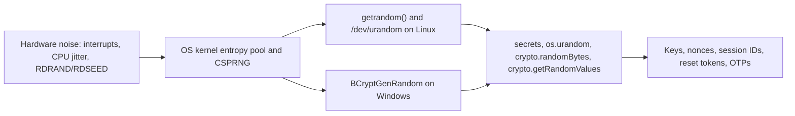

# Randomness and Secure Tokens

## Introduction

Almost every security mechanism depends on something an attacker cannot guess: encryption keys, nonces, salts, session IDs, CSRF tokens, password reset links, API keys, invitation codes and one-time passwords. If the random values behind them are predictable, the strongest algorithm in the world does not help.

There are two very different kinds of random number generators:

- **Statistical PRNGs**, like Python's `random` module or JavaScript's `Math.random()`. They produce numbers that *look* random and are great for simulations, games and sampling. But they are deterministic: from enough outputs, an attacker can reconstruct the internal state and predict every future value.
- **Cryptographically secure PRNGs (CSPRNGs)**, like Python's `secrets` module, `os.urandom`, Node's `crypto.randomBytes` or the browser's `crypto.getRandomValues`. They are seeded from the operating system's entropy sources and designed so that past outputs reveal nothing about future ones.

Think of a statistical PRNG as a deck of cards shuffled once in a fixed order: after watching enough cards, you know what comes next. A CSPRNG is a fresh, fair shuffle every time.

The rule for this page is simple: **any value that protects something must come from a CSPRNG**. The rest of the page explains how much randomness you need, how to turn it into usable tokens, and how to store and expire those tokens.

## Where Randomness Comes From



On modern operating systems, the kernel CSPRNG is the right source. On Linux, `getrandom()` and `/dev/urandom` are both suitable once the system has been seeded at boot. The old advice to read `/dev/random` for "better" randomness is outdated, and language libraries already call the right system interface for you.

## Using a CSPRNG

### Python

Python's [`secrets`](https://docs.python.org/3/library/secrets.html) module is the standard tool. Its documentation explicitly says to prefer it over `random`, which "is designed for modelling and simulation, not security or cryptography."

```python
import os
import secrets
import uuid

print("token_bytes(16) :", secrets.token_bytes(16))
print("token_hex(32)   :", secrets.token_hex(32))
print("token_urlsafe() :", secrets.token_urlsafe(32))
print("6-digit OTP     :", f"{secrets.randbelow(1_000_000):06d}")
print("os.urandom(8)   :", os.urandom(8).hex())
print("uuid4           :", uuid.uuid4())
```

Example output (different every run):

```text
token_bytes(16) : b'\x1dP\x82J\xad\xab\xa7A\x19\xdb\x0b.\x1a\xe3FB'
token_hex(32)   : a96580a7010948b15495d56bea1f6366d088fabe5c63d33f47805f76d15f5187
token_urlsafe() : 3RtXgJAQ92bKaUvYu271u1rvP7jKJx3vBSY0eEiMv3s
6-digit OTP     : 024272
os.urandom(8)   : 08c3458172a04424
uuid4           : 61b0ea4b-ff38-4fe2-b8d2-2824dc621c74
```

Note that the number you pass is a count of **random bytes**, not characters. `token_urlsafe(32)` gives 256 bits of randomness encoded as about 43 characters.

### JavaScript

```javascript
const crypto = require("node:crypto");

// Vulnerable: Math.random() is not a CSPRNG
const weak = Math.random().toString(36).slice(2);

// Fixed: use the CSPRNG
const token = crypto.randomBytes(32).toString("base64url");
const otp = crypto.randomInt(0, 1_000_000).toString().padStart(6, "0");
const id = crypto.randomUUID();

console.log({ weak, token, otp, id });
```

Example output:

```text
{
  weak: 'ir5tmmx5dg',
  token: 'tz5JXO7mBAFhK9_mjOIF6RQgmnKhy2GuuKnwNvDnM2w',
  otp: '882739',
  id: '15bbdd0b-f48d-414f-ba37-83f2bf8eb2d5'
}
```

In browsers, use `crypto.getRandomValues(new Uint8Array(32))` and `crypto.randomUUID()`. Most modern runtimes (Node, Deno, Bun, Cloudflare Workers) expose the same Web Crypto API.

## Vulnerable vs Fixed Token Generation

Vulnerable:

```python
import random
import string
import time

def make_reset_token() -> str:
    # 1. random is a Mersenne Twister: its state can be recovered from outputs.
    # 2. Seeding with the time makes it even easier: an attacker tries
    #    every timestamp around the moment the reset was requested.
    random.seed(time.time())
    return "".join(random.choices(string.ascii_letters + string.digits, k=12))
```

Fixed:

```python
import secrets

def make_reset_token() -> str:
    return secrets.token_urlsafe(32)   # 256 bits from the OS CSPRNG
```

Python's `random` module uses the Mersenne Twister algorithm. Its internal state can be reconstructed from 624 consecutive 32-bit outputs, after which every future value is predictable. Attacks of this kind have hit real applications that generated password reset tokens, coupon codes or session IDs with non-cryptographic generators.

## How Much Randomness Is Enough?

The security of a random token is measured in **bits of entropy**: an attacker needs on average half of 2 to the power of that number guesses.

| Use | Recommended randomness | Why |
| --- | --- | --- |
| Encryption and MAC keys | 128 to 256 bits (16 to 32 bytes) | Must resist offline brute force forever |
| Session IDs, API keys, reset tokens | At least 128 bits, 256 is common | Attacker can guess online at scale and in parallel |
| AES-GCM nonce | 96 bits, unique per key | Uniqueness matters more than secrecy |
| Salt for password hashing | 128 bits | Uniqueness per user |
| 6-digit OTP | About 20 bits | Safe only with short expiry and strict attempt limits |

The Python documentation suggests 32 bytes (256 bits) as sufficient for typical `secrets` use cases. OWASP's session management guidance asks for at least 64 bits of entropy in session IDs, but 128 bits or more costs nothing extra.

Short codes like 6-digit OTPs and invitation codes are fine **only** when the system enforces attempt limits and short lifetimes. With 1,000,000 possibilities and no rate limit, an attacker can try them all.

## Pitfalls When Formatting Random Values

### Modulo bias

A common bug is taking a random byte and using `% n` to pick a character. Because 256 is not a multiple of 36, some characters come up more often than others.

```python
import collections
import secrets

ALPHABET = "abcdefghijklmnopqrstuvwxyz0123456789"   # 36 symbols

def biased_char() -> str:
    # One random byte (0-255) mod 36: 256 is not a multiple of 36,
    # so the first 4 symbols come up more often.
    return ALPHABET[secrets.token_bytes(1)[0] % len(ALPHABET)]

def fair_char() -> str:
    return secrets.choice(ALPHABET)

N = 360_000
for label, fn in [("biased", biased_char), ("fair  ", fair_char)]:
    counts = collections.Counter(fn() for _ in range(N))
    print(label, "a:", counts["a"], " z:", counts["z"], " expected:", N // 36)
```

Example output:

```text
biased a: 11144  z: 9710  expected: 10000
fair   a: 10022  z: 9946  expected: 10000
```

The bias is small here, but in short codes it reduces the effective entropy. Use `secrets.choice`, `secrets.randbelow` or `crypto.randomInt`, which handle this correctly.

### UUIDs are identifiers, not secrets

- **UUIDv4** contains 122 random bits. Many implementations use a CSPRNG, but the specification does not require it, and UUIDs are often logged, shown in URLs and treated as non-secret.
- **UUIDv7** (RFC 9562, available as `uuid.uuid7()` in Python 3.14+) starts with a millisecond timestamp, so much of it is predictable by design. It is great as a sortable database key and terrible as a secret.

Use UUIDs to **identify** things. Use `secrets.token_urlsafe` to **authorize** things. And never rely on an unguessable ID as the only access control. Check authorization on every request (see [Broken Object Level Authorization](../7-sec-api-security/2-sec-bola.mdx)).

### Other environments

- **Forked processes and cloned VMs** can, in rare setups, start with the same user-space PRNG state. Modern OS CSPRNGs and libraries handle this, which is another reason to call the OS source rather than build your own generator.
- **Embedded devices** may have little entropy at first boot. Research has found many devices that generated identical or weak keys for this reason. Generate long-term keys after the system is properly seeded, or provision them at the factory.

## Designing Secure Tokens

Generating random bytes is step one. A secure token system also needs:

1. **Enough entropy** (at least 128 bits).
2. **A recognizable prefix**, such as `myapp_live_`, so secret scanners can detect leaked tokens. GitHub (`ghp_`), Stripe (`sk_live_`) and Slack (`xoxb-`) all do this.
3. **Hashed storage.** Store `SHA-256(token)`, not the token. Because the token is long and random, a fast hash is enough, and a database leak does not reveal usable tokens.
4. **Expiry and single use** where appropriate.
5. **Constant-time comparison** or lookup by hash.
6. **Revocation**, so users and admins can kill tokens.

Here is an API key generator that applies points 1 to 3, plus a short checksum so obviously mistyped keys can be rejected without touching the database:

```python
import base64
import hashlib
import secrets
import zlib

PREFIX = "cnr_live_"

def generate_api_key() -> tuple[str, str]:
    """Return (key shown once to the user, hash stored in the database)."""
    body = secrets.token_urlsafe(32)                         # 256 random bits
    checksum = zlib.crc32(body.encode()).to_bytes(4, "big")  # catches typos, not attacks
    key = PREFIX + body + base64.b32encode(checksum).decode().rstrip("=")
    return key, hashlib.sha256(key.encode()).hexdigest()

def looks_valid(key: str) -> bool:
    """Cheap offline check before any database lookup."""
    if not key.startswith(PREFIX) or len(key) != len(PREFIX) + 43 + 7:
        return False
    body, check = key[len(PREFIX):-7], key[-7:]
    expected = base64.b32encode(zlib.crc32(body.encode()).to_bytes(4, "big")).decode().rstrip("=")
    return secrets.compare_digest(check, expected)

key, stored_hash = generate_api_key()
print("key (show once):", key)
print("stored hash    :", stored_hash[:24], "...")
print("valid          :", looks_valid(key))
print("typo           :", looks_valid(key[:-1] + ("A" if key[-1] != "A" else "B")))
```

Example output:

```text
key (show once): cnr_live_PH9b8WTk384oSUOEJMr2gOX69l1K133mf7m_KDEMZC0SS4GOKQ
stored hash    : c77a44792e9e879a63869d83 ...
valid          : True
typo           : False
```

The CRC32 checksum is **not** a security control. Anyone can compute it. It only lets your API and secret scanners reject random strings that merely look like keys, which cuts noise and database load. Security still comes from the 256 random bits and the hashed storage.

## Real-World Scenario

Your SaaS app's password reset feature emails a link like `https://app.example.com/reset?token=...`. A penetration test reports three findings: the token is an 8-character value from `random.choices`, tokens never expire, and tokens are stored in plaintext in the `password_resets` table.

### Walking through it

Fix all three at once with a small, well-defined token service:

```python
import datetime as dt
import hashlib
import secrets

RESET_TTL = dt.timedelta(minutes=30)
db: dict[str, dict] = {}        # token_hash -> record (a real table in production)

def _hash(token: str) -> str:
    return hashlib.sha256(token.encode()).hexdigest()

def create_reset_token(user_id: int) -> str:
    token = secrets.token_urlsafe(32)               # 256 bits, sent by email
    db[_hash(token)] = {
        "user_id": user_id,
        "expires": dt.datetime.now(dt.timezone.utc) + RESET_TTL,
        "used": False,
    }
    return token                                    # never stored in plaintext

def redeem_reset_token(token: str) -> int | None:
    record = db.get(_hash(token))
    if record is None or record["used"]:
        return None
    if dt.datetime.now(dt.timezone.utc) > record["expires"]:
        return None
    record["used"] = True                           # single use
    return record["user_id"]

t = create_reset_token(user_id=42)
print("email link   : https://app.example.com/reset?token=" + t)
print("stored key   :", next(iter(db))[:16], "...")
print("first use    :", redeem_reset_token(t))
print("second use   :", redeem_reset_token(t))
print("guessed token:", redeem_reset_token(secrets.token_urlsafe(32)))
```

Example output:

```text
email link   : https://app.example.com/reset?token=_6MbWmbxRpnue_6cOMNzq8d5KGQk8e-ilcdlrvhhh94
stored key   : 0bef915c0f5450c8 ...
first use    : 42
second use   : None
guessed token: None
```

Additional steps in the real system:

- Invalidate all outstanding reset tokens and active sessions after a successful reset.
- Rate-limit reset requests per account and per IP, and always respond with the same message whether or not the email exists.
- Set `Referrer-Policy: no-referrer` on the reset page so the token is not leaked to third-party resources, and avoid logging full URLs with tokens.

### Why this approach

Each control addresses a different attack: CSPRNG and length defeat guessing, hashing defeats database leaks, expiry and single use shrink the window for stolen emails or logs. Looking the token up by its hash also avoids timing differences in string comparison.

### When to use it and when not to

- Use opaque random tokens stored server-side for anything you need to revoke: resets, invitations, sessions, API keys.
- Self-contained signed tokens (JWTs or signed URLs) avoid a database lookup, but are harder to revoke. Use them for short-lived, stateless cases. See [JSON Web Tokens](../4-sec-authentication/5-sec-jwt.mdx).
- Do not use short numeric codes unless the channel and rate limits are designed for them.

### Alternatives and trade-offs

| Approach | Pros | Cons | Best for |
| --- | --- | --- | --- |
| Random token, hash stored in DB | Revocable, leak-resistant, simple | DB lookup on every use | Reset links, sessions, API keys |
| Signed token (HMAC or JWT) with expiry | No storage, scales easily | Hard to revoke before expiry, key management | Short-lived stateless links, signed download URLs |
| Short numeric OTP | Easy for humans to type | Low entropy, needs strict rate limits | Email or SMS verification codes, with limits |
| Magic link with device binding | Good UX, resists link forwarding | More complex flow | Passwordless login |

## Common Mistakes

- **Using `random`, `Math.random()`, `rand()` or `java.util.Random`** for anything security-related. Use `secrets`, `crypto.randomBytes`, `getRandomValues` or `java.security.SecureRandom`.
- **Seeding a generator with time, PID or user ID.** CSPRNGs seed themselves. Do not seed them manually.
- **Tokens that are too short**, or that mix random bits with predictable data like timestamps or user IDs.
- **Storing tokens in plaintext.** Store a hash and show the token only once.
- **No expiry or reuse checks** on one-time tokens.
- **Rolling your own encoding** with modulo arithmetic and introducing bias.
- **Treating UUIDs or auto-increment IDs as secrets.**

## Summary

- Security values must come from a CSPRNG: `secrets` and `os.urandom` in Python, `crypto.randomBytes` and `getRandomValues` in JavaScript.
- Statistical PRNGs such as Mersenne Twister and `Math.random()` are predictable from their outputs.
- Use at least 128 bits for tokens and 128 to 256 bits for keys. Short codes need rate limits and expiry.
- Format random values with library helpers to avoid modulo bias, and do not confuse identifiers (UUIDs) with secrets.
- Secure tokens are random, prefixed for scanning, stored as hashes, expiring, single-use where appropriate, and revocable.

## Further Learning

### Exercises

1. Search a codebase you know for `import random`, `Math.random`, `rand(` and `new Random(`. Classify each use as harmless (simulation, UI) or security-relevant, and fix the latter.
2. Extend the reset token example to store records in SQLite with columns `token_hash`, `user_id`, `expires_at` and `used_at`, and add a cleanup job for expired rows.
3. Design an API key format for your app with a prefix, 32 random bytes and a short checksum so typos can be detected before a database lookup. Write `generate()` and `looks_valid()` functions.
4. Calculate how long it would take an attacker making 1,000 guesses per second to have a 50% chance of guessing a 6-digit OTP, an 8-character alphanumeric code, and a 128-bit token.

### Related pages

- [Sessions and Cookies](../4-sec-authentication/4-sec-sessions-and-cookies.mdx) for session ID handling.
- [API Keys and Service Authentication](../4-sec-authentication/10-sec-api-authentication.mdx) for API key design.
- [Common Cryptography Mistakes](./10-sec-crypto-mistakes.mdx) for more randomness bugs found in real code.
