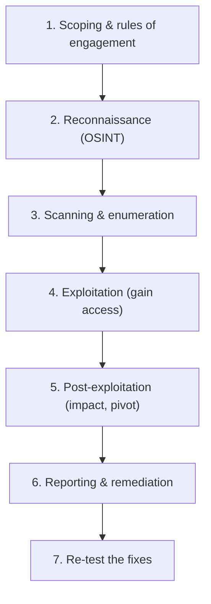
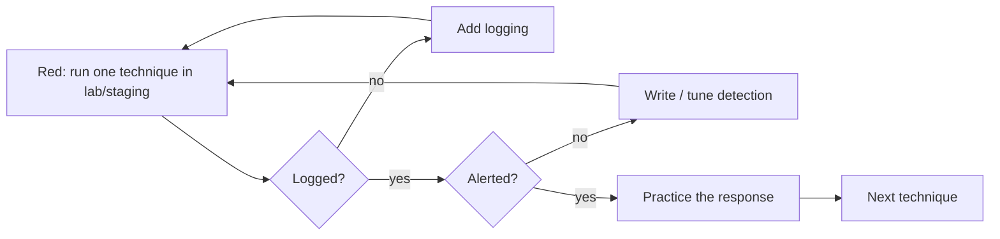

# Penetration Testing Introduction

## Introduction

A **penetration test** (pentest) is an authorized, simulated attack against a system, run to find and demonstrate security weaknesses *before* a real attacker does. The goal is not to break things for fun. It is to give the people who own the system a prioritized, evidence-backed list of what to fix.

Think of it like hiring a locksmith to try every door and window on a building you own, then handing you a report: "the back door latch pops with a credit card, the second-floor window has no lock, and here is a photo of me standing in your living room." You asked them to try, you own the building, and the point is to fix the gaps.

This section teaches offensive security from a **builder and defender** point of view. You learn how attacks work so you can prevent, detect, and respond to them. Everything here is practiced against systems you own or have explicit written permission to test. That is not a formality; it is the line between security research and a crime.

:::danger Authorized targets only
Running these techniques against systems you do not own or have no written permission to test is illegal in most countries (for example under the US Computer Fraud and Abuse Act, the UK Computer Misuse Act, and similar laws worldwide). This section uses only deliberately vulnerable practice targets in a local lab or sanctioned platforms. See [Ethics, Law and Responsible Disclosure](../0-sec-fundamentals/8-sec-ethics-and-law.mdx).
:::

## Pentest vs Related Activities

People use "pentest" loosely. These activities overlap but have different goals, depth, and cost.

| Activity | Question it answers | Depth | Typical output |
| --- | --- | --- | --- |
| Vulnerability scanning | "What known weaknesses might exist?" | Automated, broad, shallow | A list of findings, many unverified |
| Penetration test | "Can these weaknesses actually be exploited, and how far?" | Manual + automated, focused | Verified findings with proof and impact |
| Red team engagement | "Can we detect and stop a realistic attacker over weeks?" | Goal-driven, stealthy, broad | A narrative of how objectives were reached, plus detection gaps |
| Bug bounty | "What can a crowd of researchers find over time?" | Continuous, incentive-driven | A stream of individual reports |

A vulnerability scan tells you a door *might* be unlocked. A pentest walks through it and shows you what is inside. A [red team](#) exercise also tests whether your defenders noticed. We cover [vulnerability scanning](./3-sec-vulnerability-scanning.mdx) and [bug bounty programs](./10-sec-bug-bounty.mdx) later in this section.

## Types of Penetration Test

Engagements are often described by how much the tester knows up front:

- **Black box**: the tester starts with almost nothing, like an external attacker. Realistic, but slower and may miss issues.
- **White box**: the tester gets source code, architecture diagrams, and credentials. Thorough and efficient, best for finding deep logic flaws.
- **Gray box**: a middle ground, for example a standard user account and some documentation. The most common choice for web apps.

They are also described by scope: external network, internal network, web application, mobile, wireless, cloud, API, or social engineering. A **physical** test checks locks, badges, and tailgating. Each needs its own rules and expertise.

## The Phases of an Engagement

Most methodologies describe the same arc. The widely referenced standards are **PTES** (Penetration Testing Execution Standard), **NIST SP 800-115** (Technical Guide to Information Security Testing and Assessment), and the **OWASP Web Security Testing Guide** for web apps.



1. **Scoping and rules of engagement**: agree in writing on targets, allowed techniques, timing, and contacts. Nothing starts before this.
2. **[Reconnaissance](./2-sec-reconnaissance.mdx)**: gather public information about the target.
3. **Scanning and enumeration**: map hosts, ports, services, and versions.
4. **Exploitation**: prove a weakness is real by safely using it. See [Exploitation Basics](./5-sec-exploitation-basics.mdx).
5. **Post-exploitation**: measure the real impact. What data is reachable? Can you move to other systems? See [Privilege Escalation Concepts](./6-sec-privilege-escalation.mdx).
6. **Reporting**: the most valuable deliverable. Clear findings, evidence, risk ratings, and fixes.
7. **Re-test**: confirm the fixes actually work.

The defender's job maps directly onto this: reduce what recon finds, patch what scanning sees, and detect and respond to exploitation attempts.

## Scoping and Rules of Engagement

The **rules of engagement (RoE)** and a signed **authorization** are the paperwork that makes a pentest legal and safe. A minimal scope file might look like this:

```yaml
engagement: "Acme SaaS external web app test"
authorized_by: "Jane Doe, CTO (written approval attached)"
dates: "2026-11-02 to 2026-11-13, 09:00-18:00 UTC"
in_scope:
  - "app.acme.example (203.0.113.10)"
  - "api.acme.example (203.0.113.11)"
out_of_scope:
  - "billing provider (third party, no permission)"
  - "production database writes / destructive tests"
rules:
  - "No denial-of-service testing"
  - "No social engineering of staff"
  - "Stop and call the contact if real customer data is exposed"
emergency_contact: "+1-555-0100, soc@acme.example"
```

:::warning
The IP addresses and domains above use the reserved ranges (`203.0.113.0/24`, `.example`) set aside by RFC 5737 and RFC 2606 for documentation. Never substitute a real address you do not own.
:::

A good RoE prevents the two classic disasters: testing something you were not allowed to touch, and knocking a production system offline. Define what "stop immediately" looks like before you begin.

## A Simple Finding Record

As you work, record findings in a structured way so the report writes itself. Here is a tiny Python helper that validates a finding and computes a rough priority.

```python
from dataclasses import dataclass, field

SEVERITY_ORDER = {"info": 0, "low": 1, "medium": 2, "high": 3, "critical": 4}

@dataclass
class Finding:
    title: str
    severity: str          # one of SEVERITY_ORDER
    affected: str          # host or URL
    evidence: str          # how you proved it
    fix: str               # the remediation
    cvss: float = 0.0      # 0.0-10.0, see vulnerability management page

    def __post_init__(self):
        if self.severity not in SEVERITY_ORDER:
            raise ValueError(f"Unknown severity: {self.severity}")

    @property
    def rank(self) -> int:
        return SEVERITY_ORDER[self.severity]

findings = [
    Finding("Reflected XSS in search box", "high", "app.acme.example/search",
            "Payload echoed unescaped in response", "Output-encode user input", 7.1),
    Finding("Missing HSTS header", "low", "app.acme.example",
            "No Strict-Transport-Security on 200 responses", "Add HSTS header", 3.1),
]

for f in sorted(findings, key=lambda x: x.rank, reverse=True):
    print(f"[{f.severity.upper():8}] {f.title} ({f.affected})")
```

Output:

```text
[HIGH    ] Reflected XSS in search box (app.acme.example/search)
[LOW     ] Missing HSTS header (app.acme.example)
```

We assign real CVSS v4.0 scores in [Vulnerability Management and CVSS](../11-sec-defensive-operations/6-sec-vulnerability-management.mdx).

## Lab Walkthrough: Enforcing Scope in Code

The most common way a well-meaning tester gets into trouble is touching a target that was not in scope. Professionals guard against this with tooling, not memory. Here is a small scope guard you can put in front of every tool you run in your lab. It refuses any target that is not explicitly listed.

```python
import ipaddress
import sys

# The scope from the signed rules of engagement (lab addresses only)
IN_SCOPE_NETS = [ipaddress.ip_network("192.168.56.0/24")]
IN_SCOPE_HOSTS = {"localhost", "juiceshop.lab"}
OUT_OF_SCOPE = {ipaddress.ip_address("192.168.56.1")}   # the hypervisor host

def in_scope(target: str) -> bool:
    if target in IN_SCOPE_HOSTS:
        return True
    try:
        ip = ipaddress.ip_address(target)
    except ValueError:
        return False                     # unknown hostname: refuse by default
    if ip in OUT_OF_SCOPE:
        return False
    return any(ip in net for net in IN_SCOPE_NETS)

for t in ["192.168.56.20", "192.168.56.1", "8.8.8.8", "juiceshop.lab", "example.com"]:
    print(f"{t:16} -> {'ALLOWED' if in_scope(t) else 'REFUSED'}")
```

Output:

```text
192.168.56.20    -> ALLOWED
192.168.56.1     -> REFUSED
8.8.8.8          -> REFUSED
juiceshop.lab    -> ALLOWED
example.com      -> REFUSED
```

Note the design: **deny by default**. An unknown hostname is refused, not allowed. This is the same principle you would apply to a firewall rule or an authorization check, and it is a good habit for any tool that can affect other systems.

You can wrap it as a shell guard so a typo cannot send a scan to the wrong place:

```bash
#!/usr/bin/env bash
# scope-guard.sh: run a command only if the target is in scope
set -euo pipefail
target="$1"; shift
if python3 scope_check.py "$target"; then
  echo "[scope] $target is in scope, running: $*"
  "$@"
else
  echo "[scope] REFUSED: $target is not in the signed scope" >&2
  exit 1
fi
```

## Writing the Report

The report is what the client keeps after the tester leaves. A professional report usually has two audiences and is structured for both:

| Section | Audience | Contents |
| --- | --- | --- |
| Executive summary | Leadership | Overall risk in plain language, top 3 issues, business impact |
| Scope and methodology | Everyone | What was tested, when, how, and what was not tested |
| Findings | Engineers | Each issue: description, evidence, severity, affected assets, fix |
| Strategic recommendations | Leadership + security | Patterns behind the findings (for example "no authorization layer") |
| Appendices | Engineers | Raw tool output, test accounts used, timeline |

The "what was *not* tested" line matters more than people expect. A clean report on a narrow scope can be misread as "the whole company is secure." State limitations clearly.

A short script can turn the `Finding` records from earlier into a Markdown findings table for the report draft:

```python
def findings_table(findings) -> str:
    rows = ["| Severity | Title | Affected | Fix |", "| --- | --- | --- | --- |"]
    for f in sorted(findings, key=lambda x: x.rank, reverse=True):
        rows.append(f"| {f.severity} | {f.title} | {f.affected} | {f.fix} |")
    return "\n".join(rows)

print(findings_table(findings))
```

Output:

```text
| Severity | Title | Affected | Fix |
| --- | --- | --- | --- |
| high | Reflected XSS in search box | app.acme.example/search | Output-encode user input |
| low | Missing HSTS header | app.acme.example | Add HSTS header |
```

## The Defender's View: What a Pentest Looks Like in Your Logs

A pentest is also a free detection exercise. While the tester works, your logs fill up with exactly the patterns a real attacker would produce. If nobody notices, that is a finding in itself.

Typical signals in a web server access log during testing:

```text
203.0.113.50 - - [02/Nov/2026:10:14:01 +0000] "GET /.git/config HTTP/1.1" 404 153 "-" "Mozilla/5.0"
203.0.113.50 - - [02/Nov/2026:10:14:01 +0000] "GET /admin HTTP/1.1" 302 0 "-" "Mozilla/5.0"
203.0.113.50 - - [02/Nov/2026:10:14:02 +0000] "GET /backup.zip HTTP/1.1" 404 153 "-" "Mozilla/5.0"
203.0.113.50 - - [02/Nov/2026:10:14:02 +0000] "GET /search?q=%27 HTTP/1.1" 500 612 "-" "Mozilla/5.0"
```

A burst of 404s for well-known sensitive paths, followed by a 500 on a quoted input, is a classic discovery-then-probe pattern. A tiny detector over your own logs:

```python
import re
from collections import Counter

LOG = """203.0.113.50 - - [02/Nov/2026:10:14:01 +0000] "GET /.git/config HTTP/1.1" 404 153
203.0.113.50 - - [02/Nov/2026:10:14:01 +0000] "GET /admin HTTP/1.1" 302 0
203.0.113.50 - - [02/Nov/2026:10:14:02 +0000] "GET /backup.zip HTTP/1.1" 404 153
203.0.113.50 - - [02/Nov/2026:10:14:02 +0000] "GET /search?q=%27 HTTP/1.1" 500 612
198.51.100.7 - - [02/Nov/2026:10:15:00 +0000] "GET / HTTP/1.1" 200 5120"""

pattern = re.compile(r'^(\S+) .* "(\w+) (\S+) [^"]*" (\d{3})')
errors = Counter()
for line in LOG.splitlines():
    m = pattern.match(line)
    if m and m.group(4)[0] in "45":
        errors[m.group(1)] += 1

for ip, n in errors.items():
    if n >= 3:
        print(f"ALERT: {ip} produced {n} error responses in a short window")
```

Output:

```text
ALERT: 203.0.113.50 produced 4 error responses in a short window
```

Real detection lives in a SIEM (see [Security Logging and SIEM](../11-sec-defensive-operations/1-sec-logging-and-siem.mdx)), but the logic is the same.

### Should the SOC know about the test?

That is a deliberate choice:

- **Announced test**: the SOC knows the tester's IPs and dates. Less disruption, but it does not test detection.
- **Unannounced test** (only a few leaders know): measures whether the SOC detects and escalates. Requires a "white card" contact so a real response can be called off.

Either way, never fully allowlist the tester at the WAF or EDR unless the RoE says to; you want to learn what your controls actually catch.

### Purple teaming

The most efficient modern format combines both sides in the same room: the tester runs a technique, the defenders check whether it was logged and alerted, and together they fix the gap before moving on.



See [Detection Engineering](../11-sec-defensive-operations/2-sec-detection-engineering.mdx) for how those detections are built.

## Real-World Scenario

**Your team runs a SaaS helpdesk product and a new enterprise customer demands a "penetration test report" before they sign.** You have two weeks and a small budget. What do you actually commission?

The mistake here is to run an automated scanner, export the PDF, and call it a pentest. It will be full of unverified, low-value noise and the customer's security team will see through it. Instead:

1. Scope a **gray-box web application pentest** of the helpdesk app and its API, with a test tenant and a standard user account.
2. Write rules of engagement that exclude destructive and denial-of-service tests and name an emergency contact.
3. Let the tester combine automated scanning with manual testing of access control and business logic, which scanners miss.
4. Require a report with verified findings, evidence, CVSS scores, and fixes, plus a free re-test after you remediate.

### What the engagement might deliver

A realistic outcome for an app like this:

| Finding | Severity | Root cause | Fix |
| --- | --- | --- | --- |
| Tenant A can read tenant B's tickets by changing an id | High | No object-level authorization | Scope every query by tenant id |
| Stored XSS in ticket comments | High | Missing output encoding | Auto-escaping templates plus CSP |
| Password reset tokens never expire | Medium | Insecure design | 15-minute single-use tokens |
| Verbose stack traces on errors | Low | Debug mode in production | Generic error pages, log details server-side |

Notice that the two high findings are things no scanner would reliably catch: they depend on understanding what *should* happen in a multi-tenant helpdesk. That is the value a human tester adds. Hand the customer the executive summary and the re-test letter, not the raw tool output.

### Why this approach

A gray-box web app test matches the actual risk (a logged-in customer abusing the multi-tenant app) and fits the budget and timeline better than a full black-box external test. The test tenant protects real customer data.

### When to use it, when not to

Commission a pentest when you have a specific system, a deadline (compliance, a customer, a launch), and code that is reasonably stable. Do **not** pentest an app that is still changing hourly, or one with obvious unpatched issues you already know about. Fix the known problems first; a pentest of a swamp just maps the swamp.

### Alternatives and trade-offs

| Approach | Pros | Cons | Best for |
| --- | --- | --- | --- |
| Automated scan only | Cheap, fast, repeatable | Misses logic flaws, many false positives | Continuous baseline checks |
| Point-in-time pentest | Verified, deep, human judgment | Snapshot in time, costs more | Compliance, pre-launch, customer asks |
| Bug bounty | Continuous, pay for results | Unpredictable, needs maturity to triage | Mature teams with public assets |
| Red team | Tests detection and response | Expensive, needs a mature SOC | Organizations proving resilience |

Many mature teams use several: scans in CI, an annual pentest, and a bug bounty.

## Common Mistakes

- **Starting without written authorization.** The single most important rule. No signature, no test.
- **Treating a scan as a pentest.** Automation finds candidates; humans verify impact.
- **Scope creep.** Testing something "interesting" that was not in scope can be a crime, not initiative.
- **Destructive testing in production.** Denial-of-service and data-mutating tests belong only where the RoE allows them.
- **A report nobody can act on.** Findings without clear fixes and severities waste everyone's time.
- **Skipping the re-test.** A fix that was never verified is a guess.
- **Not stating limitations.** A report that omits what was out of scope gets misread as a clean bill of health.
- **Fully allowlisting the tester.** You lose the chance to learn what your WAF, EDR and SOC actually catch.
- **No emergency stop.** Every engagement needs a named contact and a way to halt testing within minutes.
- **Storing evidence carelessly.** Screenshots and logs from a test can contain sensitive data; encrypt them and delete them on the agreed date.

## Summary

- A penetration test is an *authorized* simulated attack that verifies and demonstrates real impact.
- It differs from a vulnerability scan (broad, automated, unverified) and a red team exercise (goal-driven, tests detection).
- Engagements follow phases: scope, recon, scan, exploit, post-exploit, report, re-test.
- Rules of engagement and signed authorization make the work legal and safe.
- The report is the product. Verified findings, evidence, severities, and fixes are what the customer pays for.

## Further Learning

- Read the **PTES**, **NIST SP 800-115**, and **OWASP Web Security Testing Guide** methodologies.
- Set up a local lab in the next page so you can practice legally.

### Exercises

1. Write a one-page rules-of-engagement document for a hypothetical test of a web app you own, using the YAML template above.
2. Compare a pentest and a vulnerability scan in your own words for a non-technical manager.
3. Extend the `Finding` class to export findings to JSON, ready for a report generator.
4. Add CIDR exclusions and a date window (start/end of the engagement) to the scope guard, and refuse to run outside it.

Related pages: [Building a Safe Practice Lab](./1-sec-lab-setup.mdx), [Ethics, Law and Responsible Disclosure](../0-sec-fundamentals/8-sec-ethics-and-law.mdx), [Vulnerability Management and CVSS](../11-sec-defensive-operations/6-sec-vulnerability-management.mdx).
