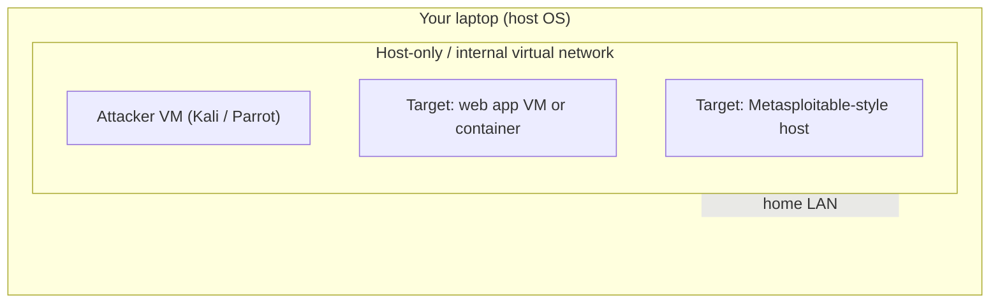
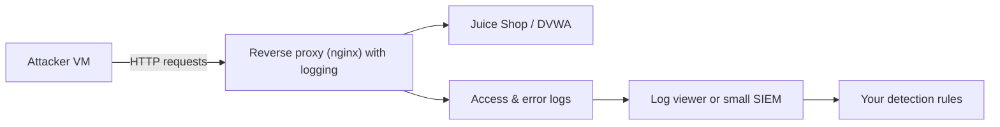

# Building a Safe Practice Lab

## Introduction

To learn offensive security without breaking the law or harming anyone, you need a place where you are both the attacker and the owner. That place is a **practice lab**: an isolated set of virtual machines or containers on your own computer, running deliberately vulnerable applications that exist to be attacked.

The lab is like a flight simulator. A trainee pilot does not learn stalls by stalling a real airliner full of passengers. They practice every dangerous maneuver in a simulator where mistakes cost nothing. Your lab is that simulator: you can run the noisiest scan, the clumsiest exploit, and the most destructive payload, because the only thing you can break is a throwaway VM you can rebuild in minutes.

:::danger The whole point is isolation
A practice lab must never touch systems or networks you do not own. Deliberately vulnerable apps are, by design, trivially hackable. If one is reachable from the internet, real attackers *will* find and compromise it, and your machine becomes their foothold. Keep the lab isolated and never expose it.
:::

## The Design Goals

A good lab has four properties:

- **Isolated**: it cannot reach your real network, your employer's network, or the internet-facing world, except in controlled ways.
- **Disposable**: you can reset any machine to a clean state with snapshots or `docker compose down`.
- **Realistic enough**: it contains targets that behave like real apps and services.
- **Cheap**: it runs on a laptop with free, open-source tools.



The key is the **host-only (internal) virtual network**: the VMs can talk to each other but not to your home router or the internet. You can usually enable a second, NAT interface temporarily when you need to download updates, then disable it while testing.

## Option A: Virtual Machines

VMs give you full, realistic operating systems. You need a **hypervisor**:

- **VirtualBox** (free, cross-platform) or **VMware Workstation Player / Fusion** (free for personal use) on Windows, macOS (Intel), and Linux.
- **UTM** (free) or **VMware Fusion** for Apple Silicon Macs, which run ARM images.
- **Hyper-V** is built into Windows Pro.

A common layout:

- **Attacker VM**: Kali Linux or Parrot OS. These ship with security tools pre-installed. Download the official image and verify its checksum.
- **Target VMs**: intentionally vulnerable systems (below).

:::tip Snapshots are your undo button
Take a snapshot of each VM right after you install and configure it. After a messy test, revert to the snapshot and you are back to a clean state in seconds. Snapshot before every risky action.
:::

### Network configuration

In VirtualBox, set each lab VM's adapter to **Host-only Adapter** or **Internal Network**, not **Bridged**. Bridged puts the VM directly on your home LAN, which defeats isolation. Verify from the attacker VM that you *cannot* reach the internet or your router while in test mode.

```bash
# On the attacker VM, confirm isolation (should fail or time out in test mode):
ping -c 2 8.8.8.8
# Confirm you CAN reach the target on the host-only network:
ping -c 2 192.168.56.20
```

Example output:

```text
PING 8.8.8.8 (8.8.8.8) 56(84) bytes of data.
--- 8.8.8.8 ping statistics ---
2 packets transmitted, 0 received, 100% packet loss, time 1012ms

PING 192.168.56.20 (192.168.56.20) 56(84) bytes of data.
64 bytes from 192.168.56.20: icmp_seq=1 ttl=64 time=0.42 ms
```

## Option B: Docker Containers

For web-app targets, containers are faster and lighter than full VMs. You need Docker installed (see [/docs/devops/docker](/docs/devops/docker)).

**OWASP Juice Shop** is a modern, intentionally vulnerable web application maintained by OWASP. Bind it to localhost only:

```bash
# Runs the Juice Shop on http://localhost:3000, reachable only from this machine
docker run --rm -p 127.0.0.1:3000:3000 bkimminich/juice-shop
```

The `127.0.0.1:` prefix is doing the security work: it binds the port to the loopback interface so nothing on your network can reach it. Open `http://localhost:3000` in a browser on the host.

**DVWA** (Damn Vulnerable Web Application) is a classic PHP/MySQL target. The maintained version uses Docker Compose:

```bash
git clone https://github.com/digininja/DVWA.git
cd DVWA
docker compose up -d
# Then open http://localhost:4280  (default login admin / password)
```

DVWA's compose file binds to `127.0.0.1:4280:80` by default, so it is reachable only from your machine. The project README explicitly warns never to put it on an internet-facing server.

:::caution Default credentials are intentional
`admin` / `password` is the known default for DVWA. That is fine for a disposable lab target. It is a disaster anywhere else. Never carry lab defaults into real systems.
:::

## A Catalogue of Legal Targets

| Target | Type | Runs as | Good for |
| --- | --- | --- | --- |
| OWASP Juice Shop | Modern web app | Container / Node | OWASP Top 10, web testing |
| DVWA | Classic web app | Container / LAMP | Injection, XSS, with difficulty levels |
| OWASP WebGoat | Guided web app lessons | Container / Java | Learning with built-in tutorials |
| Metasploitable 2/3 | Vulnerable Linux host | VM | Network services, exploitation |
| OWASP Broken Web Apps | Collection of apps | VM | Variety of old vulnerable apps |

And hosted platforms where the targets are provided and sanctioned (no local setup):

- **PortSwigger Web Security Academy**: free, excellent, web-focused labs.
- **TryHackMe**: guided rooms, beginner friendly.
- **Hack The Box**: boxes and challenges, from easy to hard.

On these platforms you are explicitly authorized to attack *their* provided targets only. Their terms of service are your rules of engagement.

## A Reproducible Lab with Compose

You can define a small web-target lab as code so a teammate can stand up an identical environment. Save this as `compose.yml`:

```yaml
services:
  juiceshop:
    image: bkimminich/juice-shop
    ports:
      - "127.0.0.1:3000:3000"   # localhost only
    restart: unless-stopped

  webgoat:
    image: webgoat/webgoat
    ports:
      - "127.0.0.1:8080:8080"
      - "127.0.0.1:9090:9090"
    restart: unless-stopped
```

Validate the file before running it:

```bash
docker compose -f compose.yml config --quiet && echo "compose file is valid"
```

Example output:

```text
compose file is valid
```

Then `docker compose up -d`, and tear the whole lab down with `docker compose down`.

## Lab Walkthrough: Bring Up and Verify the Lab

A lab is only safe if you *verify* its isolation rather than assume it. Walk through this once after every change.

### Step 1: start the targets

```bash
docker compose -f compose.yml up -d
docker compose -f compose.yml ps
```

Example output:

```text
NAME                 IMAGE                   STATUS          PORTS
lab-juiceshop-1      bkimminich/juice-shop   Up 12 seconds   127.0.0.1:3000->3000/tcp
lab-webgoat-1        webgoat/webgoat         Up 12 seconds   127.0.0.1:8080->8080/tcp, 127.0.0.1:9090->9090/tcp
```

Every port mapping should start with `127.0.0.1`. If you see `0.0.0.0`, stop and fix the compose file.

### Step 2: confirm what is listening

```bash
ss -tlnp | grep -E ':(3000|8080|9090)\b'
```

Example output:

```text
LISTEN 0  4096  127.0.0.1:3000  0.0.0.0:*  users:(("docker-proxy",pid=4121,fd=4))
LISTEN 0  4096  127.0.0.1:8080  0.0.0.0:*  users:(("docker-proxy",pid=4139,fd=4))
LISTEN 0  4096  127.0.0.1:9090  0.0.0.0:*  users:(("docker-proxy",pid=4152,fd=4))
```

The local address column is the one that matters: loopback only.

### Step 3: prove it from another machine

From a phone or another computer on your home Wi-Fi, try to open `http://<your-laptop-ip>:3000`. It must fail. This is the test most people skip, and it is the one that catches a mistaken `0.0.0.0` binding or a host firewall rule you forgot about.

### Step 4: automate the check

A small script can fail loudly if any lab port is exposed beyond loopback:

```python
import subprocess

LAB_PORTS = {"3000", "8080", "9090", "4280"}

out = subprocess.run(["ss", "-tlnH"], capture_output=True, text=True).stdout
problems = []
for line in out.splitlines():
    cols = line.split()
    if len(cols) < 4:
        continue
    local = cols[3]                       # for example 127.0.0.1:3000 or 0.0.0.0:3000
    addr, _, port = local.rpartition(":")
    if port in LAB_PORTS and addr not in ("127.0.0.1", "[::1]"):
        problems.append(local)

print("EXPOSED:", problems) if problems else print("OK: lab ports bound to loopback only")
```

Example output:

```text
OK: lab ports bound to loopback only
```

Run it before every practice session; it takes less than a second.

### Step 5: reset to clean

```bash
docker compose -f compose.yml down       # removes containers (and their state)
docker compose -f compose.yml up -d      # fresh, unmodified targets
```

For VMs, revert to the clean snapshot. Practicing against a target you have already modified teaches the wrong lessons.

## The Defender's View: Your Lab Is Also a Detection Lab

The same lab that lets you attack also lets you *watch*. Add a log pipeline and you can see exactly what each technique looks like from the defender's chair, which is the real point of this section.



A minimal nginx reverse proxy in front of the lab target, logging in JSON so it is easy to query:

```nginx
log_format lab_json escape=json
  '{"time":"$time_iso8601","ip":"$remote_addr","method":"$request_method",'
  '"uri":"$request_uri","status":$status,"ua":"$http_user_agent"}';

server {
    listen 127.0.0.1:8000;
    access_log /var/log/nginx/lab_access.json lab_json;

    location / {
        proxy_pass http://127.0.0.1:3000;   # Juice Shop
    }
}
```

Now point your browser at `http://localhost:8000` instead of port 3000. Every request you make while practicing lands in `lab_access.json`, ready for the detection exercises in [Security Logging and SIEM](../11-sec-defensive-operations/1-sec-logging-and-siem.mdx) and [Detection Engineering](../11-sec-defensive-operations/2-sec-detection-engineering.mdx).

```bash
tail -n 2 /var/log/nginx/lab_access.json
```

Example output:

```text
{"time":"2026-10-11T10:02:11+00:00","ip":"127.0.0.1","method":"GET","uri":"/rest/products/search?q=apple","status":200,"ua":"Mozilla/5.0"}
{"time":"2026-10-11T10:02:15+00:00","ip":"127.0.0.1","method":"GET","uri":"/ftp","status":200,"ua":"Mozilla/5.0"}
```

## Lab Hygiene Checklist

| Check | Why |
| --- | --- |
| All target ports bound to `127.0.0.1` | Nobody else can reach the vulnerable apps |
| VMs on host-only or internal network | Lab traffic never touches your LAN |
| Clean snapshots taken | One-click reset after each exercise |
| No real credentials or data in the lab | A compromised lab cannot leak anything real |
| Attacker VM images verified by checksum | You are not starting from a tampered tool image |
| Lab shut down after practice | Nothing vulnerable is left running unattended |
| Logging enabled on a proxy | You learn the defender's view of every technique |

## Real-World Scenario

**You are a backend developer who wants to understand the vulnerabilities in your own code, and your company wants to offer internal "secure coding" workshops.** You need a lab that twenty engineers can use on their laptops, safely, during a half-day session.

The container approach fits best. Give everyone a one-page guide: install Docker, clone a repo with the `compose.yml` above, run `docker compose up -d`, and work through a set of Juice Shop and WebGoat challenges bound to localhost. No corporate network access, no VMs to manage, no cloud bill, and everyone can reset with `docker compose down && docker compose up -d`.

Ship the workshop repo with a one-command pre-flight check, so the facilitator is not debugging twenty laptops at once:

```bash
#!/usr/bin/env bash
# preflight.sh: verify a workshop laptop is ready and safe
set -euo pipefail
command -v docker >/dev/null || { echo "Install Docker first"; exit 1; }
docker compose version >/dev/null || { echo "Docker Compose v2 is required"; exit 1; }
docker compose -f compose.yml config --quiet
docker compose -f compose.yml up -d
sleep 10
curl -fsS -o /dev/null http://127.0.0.1:3000 && echo "Juice Shop: OK"
python3 check_bindings.py
```

Example output:

```text
Juice Shop: OK
OK: lab ports bound to loopback only
```

Agree on a simple rule with the security team in advance: the workshop machines run the lab only on loopback, and nobody runs any tool against the corporate network during the session.

### Why this approach

Containers start in seconds, bind to localhost, and reset cleanly, so a room of developers can all run an identical, isolated target with minimal setup. WebGoat's built-in lessons mean the session is self-guiding.

### When to use it, when not to

Use containers for web-app practice and quick resets. Use **full VMs** when you need to practice network-level attacks, privilege escalation on a real OS, or multi-host scenarios, because a container is not a faithful stand-in for a whole machine. Use **hosted platforms** when you do not want to run anything locally or want a guided curriculum.

### Alternatives and trade-offs

| Approach | Pros | Cons | Best for |
| --- | --- | --- | --- |
| Docker containers | Fast, light, easy reset | Not a full OS, networking is simplified | Web-app practice, workshops |
| Local VMs | Realistic OS, full network stack | Heavy, more setup, uses disk and RAM | Network, privesc, multi-host labs |
| Hosted labs (THM/HTB/PortSwigger) | Zero setup, sanctioned, guided | Needs internet, some cost, less control | Learning paths, on the go |
| Cloud lab (your own VPC) | Scales, team access | Costs money, must lock down tightly | Team ranges, advanced scenarios |

:::warning Cloud labs
If you build a lab in a cloud account, it is easy to accidentally expose a vulnerable box to the entire internet via a misconfigured security group. Restrict access to your own IP, use private subnets, and tear it down when done. A misconfigured security group can expose a vulnerable box to the whole internet.
:::

## Common Mistakes

- **Bridged networking.** It places the vulnerable VM on your real LAN. Use host-only or internal networks.
- **Exposing a container to `0.0.0.0`.** Always bind practice targets to `127.0.0.1`.
- **No snapshots.** Without them, a broken VM means a full reinstall.
- **Testing the platform instead of the target.** On TryHackMe or Hack The Box, attack only the provided machine, never their infrastructure.
- **Leaving the lab running and reachable.** Shut it down after practice. A forgotten, exposed Juice Shop is a real incident waiting to happen.
- **Using real data.** Never load real customer or personal data into a deliberately vulnerable app.
- **Never verifying isolation.** Assuming the binding is right is not the same as testing it from another device.
- **Practicing on a dirty target.** Reset to a clean snapshot so each exercise starts from known state.
- **Unverified tool images.** Download attacker distributions from the official site and check the published checksum.
- **Reusing lab credentials elsewhere.** Lab passwords like `admin`/`password` must never appear in a real system or a password manager entry you share.

## Summary

- A practice lab lets you learn offensive techniques legally, because you own every target.
- Make it isolated (host-only networking), disposable (snapshots, `docker compose down`), realistic, and cheap.
- Use containers (Juice Shop, DVWA, WebGoat) for web apps and VMs (Metasploitable, Kali) for network and OS practice.
- Hosted platforms provide sanctioned targets with no local setup; their terms of service are your rules of engagement.
- Bind targets to localhost, never expose them, and never load real data.

## Further Learning

- Set up Kali or Parrot as your attacker VM and take a clean snapshot.
- Work through the first few PortSwigger Web Security Academy labs.

### Exercises

1. Stand up Juice Shop with the Docker command above and confirm with `ss -tlnp` that it is bound to `127.0.0.1` only.
2. Create a `compose.yml` adding DVWA to the lab and validate it with `docker compose config`.
3. On a VM, verify isolation: show that you cannot ping an internet address while in test mode but can reach another lab VM.
4. Put the nginx JSON-logging proxy in front of Juice Shop and write a one-line command that counts requests per status code.

Related pages: [Penetration Testing Introduction](./0-sec-pentest-introduction.mdx), [Reconnaissance and OSINT](./2-sec-reconnaissance.mdx), [/docs/devops/docker](/docs/devops/docker).
