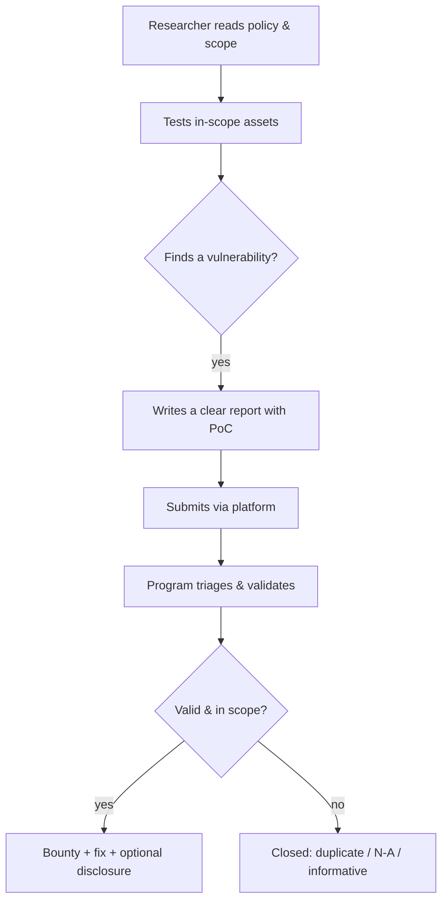
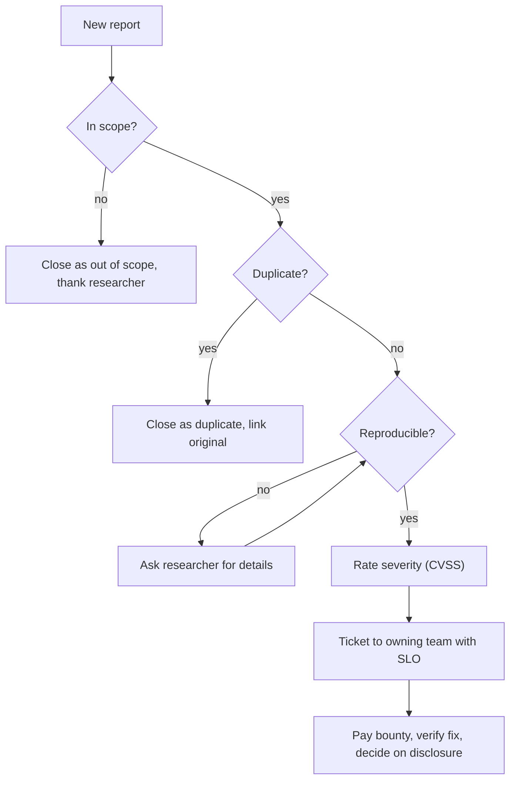

# Bug Bounty Programs

## Introduction

A **bug bounty program** is a standing invitation from an organization to security researchers: "find vulnerabilities in our systems, report them responsibly, and we will reward you." It turns the global community of ethical hackers into a continuous, pay-for-results security team. Platforms like **HackerOne**, **Bugcrowd**, and **Intigriti** connect researchers with programs and handle triage, payment, and disclosure.

Compare it to hiring one building inspector once a year versus posting a public reward for anyone who finds a safety hazard, with clear rules for what counts and how to report it. The second approach brings many eyes, continuously, and you only pay when someone finds something real. That is the bug bounty model.

This page covers both sides: how to participate ethically as a researcher, and how to run a program as a company. The ethics are built in: a bounty program is the formal, legal authorization that makes testing someone else's system allowed, within its scope.

:::danger Scope is the authorization
A bug bounty's **scope and policy are your legal permission slip.** Testing only what the program lists as in-scope, using only allowed techniques, is what keeps you on the right side of the law. Testing out-of-scope assets or ignoring the rules can still be a crime, bounty or not.
:::

## How It Works



Reports are rated by severity (usually CVSS) and rewarded on a bounty table. Payouts range from small amounts for low-severity issues to large sums for critical ones on mature programs. Many programs also run **Vulnerability Disclosure Programs (VDPs)**, which accept reports but pay no bounty; these exist mainly to give researchers a safe, legal channel.

## For the Researcher

### Read the policy first, every time

Before touching anything, read the program's policy. It defines:

- **In-scope assets**: the exact domains, apps, or products you may test.
- **Out-of-scope**: assets and issue types they do not want (often third-party services, social engineering, denial of service, automated scanner spam).
- **Allowed techniques** and **rules** (for example, use test accounts, do not access other users' real data).
- **Safe harbor**: a legal promise not to pursue researchers acting in good faith within the rules.

### Write a report that gets paid

Triage teams see enormous volumes. A clear, reproducible report stands out and gets rewarded faster. A good structure:

```text
Title:   Stored XSS in profile "bio" field (app.example.com)
Severity: High (CVSS ~7.4)
Summary: User-supplied bio is rendered without output encoding, so
         script stored by one user executes in other users' browsers.
Steps to reproduce:
  1. Log in as test account A.
  2. Set profile bio to:  <the payload, in a code block>
  3. Log in as test account B and view A's profile.
Expected: bio shown as text.
Actual:   the script executes (screenshot attached).
Impact:   Account takeover via session/token theft across users.
Remediation: Output-encode the bio on render; add a Content-Security-Policy.
```

Good reports share five traits: a clear title, accurate severity, **reproducible** steps, demonstrated **impact**, and a suggested **fix**. Avoid overclaiming severity; triagers notice, and it hurts your reputation.

:::caution Stay inside the lines
If you accidentally access real user data, **stop, do not download or share it, and report it immediately.** Never pivot, never pursue persistence, never test denial of service unless explicitly allowed. Curiosity that strays out of scope can turn a payout into a prosecution.
:::

### Lab Walkthrough: Writing a Report That Gets Paid

You can practice the report-writing skill entirely in your lab, which is where most researchers lose points. Find a benign issue in Juice Shop (for example, a security header missing on a response), then write it up to a professional standard.

```bash
# Observe a missing header on your own lab target
curl -sI http://localhost:3000 | grep -i 'strict-transport-security' || echo "HSTS header absent"
```

Example output:

```text
HSTS header absent
```

Turn that observation into a structured, reproducible report. A helper that enforces the required fields so nothing is missing:

```python
from dataclasses import dataclass, field

@dataclass
class Report:
    title: str
    asset: str
    severity: str
    steps: list
    impact: str
    remediation: str

    def validate(self):
        missing = [k for k, v in self.__dict__.items() if not v]
        if missing:
            raise ValueError(f"Report incomplete: {missing}")
        if len(self.steps) < 2:
            raise ValueError("Steps must be reproducible (>= 2 steps)")
        return "ready to submit"

r = Report(
    title="Missing HSTS header on app root",
    asset="localhost:3000 (lab)",
    severity="Low",
    steps=["Request GET / over HTTPS", "Observe no Strict-Transport-Security header"],
    impact="Users could be downgraded to HTTP on a hostile network",
    remediation="Add Strict-Transport-Security with a long max-age and includeSubDomains",
)
print(r.validate())
```

Example output:

```text
ready to submit
```

Practicing this way means that when you test a *real* in-scope program, the report writes itself and triagers reward the clarity.

### Legal safe harbor

Good programs publish a **safe harbor** clause authorizing good-faith research and promising not to pursue legal action for activity within the rules. Frameworks like **disclose.io** provide standardized safe-harbor language. On the policy side, organizations increasingly publish a **`security.txt`** file (standardized as RFC 9116) at `/.well-known/security.txt` pointing researchers to their contact and policy.

```text
# https://example.com/.well-known/security.txt
Contact: mailto:security@example.com
Policy: https://example.com/security-policy
Expires: 2027-01-01T00:00:00.000Z
```

Even so, safe harbor is a promise, not a law. Stay strictly in scope; good faith plus a clear policy is your protection.

## For the Company

Running a program well takes maturity. The prerequisites:

1. **You can already fix bugs quickly.** A flood of reports you cannot remediate is worse than useless.
2. **You have triage capacity.** Someone must validate, deduplicate, and respond, fast. Platforms help, but you still own the fixes.
3. **A clear scope and policy**, with safe harbor and a bounty table.
4. **A disclosure policy**: whether and when reports can be made public. HackerOne's default guidance, for example, allows disclosure of resolved reports after a window (often 30 days) when both parties agree, with "last resort" rules if a program goes unresponsive for a long period.

### Start with a VDP

Most organizations should begin with a **VDP** (no bounty) or a **private** program (invite-only, limited researchers) before opening a public, paid program. This lets you build triage and remediation muscle without being overwhelmed.

### Triage workflow

Every incoming report goes through the same pipeline. Writing it down before launch is what separates a calm program from a chaotic one.



A small intake helper can do the mechanical checks so humans spend time on reproduction and impact:

```python
IN_SCOPE = {"app.example.com", "api.example.com"}
known = {"stored xss in profile bio"}

def triage(report: dict) -> str:
    if report["asset"] not in IN_SCOPE:
        return "out-of-scope"
    if report["title"].strip().lower() in known:
        return "duplicate"
    if len(report.get("steps", [])) < 2:
        return "needs-info"
    return "to-reproduce"

reports = [
    {"asset": "app.example.com", "title": "Stored XSS in profile bio", "steps": ["a", "b"]},
    {"asset": "blog.thirdparty.com", "title": "Open redirect", "steps": ["a", "b"]},
    {"asset": "api.example.com", "title": "IDOR on invoices", "steps": ["a"]},
    {"asset": "api.example.com", "title": "IDOR on orders", "steps": ["a", "b", "c"]},
]
for r in reports:
    print(f"{r['title']:28} -> {triage(r)}")
```

Output:

```text
Stored XSS in profile bio    -> duplicate
Open redirect                -> out-of-scope
IDOR on invoices             -> needs-info
IDOR on orders               -> to-reproduce
```

Response-time targets are worth publishing in the policy, for example first response within a few business days and a triage decision soon after. Researchers judge programs largely on responsiveness.

### Publish and check your security.txt

RFC 9116 requires the `Contact` and `Expires` fields, and the file should be served at `/.well-known/security.txt` over HTTPS. A quick self-check:

```python
import datetime

text = """Contact: mailto:security@example.com
Policy: https://example.com/security-policy
Expires: 2027-01-01T00:00:00.000Z"""

fields = dict(line.split(": ", 1) for line in text.splitlines())
assert "Contact" in fields and "Expires" in fields, "missing required field"
expires = datetime.datetime.fromisoformat(fields["Expires"].replace("Z", "+00:00"))
days = (expires - datetime.datetime.now(datetime.timezone.utc)).days
print("security.txt OK, expires in", days, "days" if days > 0 else "(EXPIRED, update it)")
```

Example output:

```text
security.txt OK, expires in 81 days
```

An expired `security.txt` tells researchers nobody is maintaining the channel. Put the renewal on a calendar.

## The Defender's View: Bounty Traffic in Your Logs

Opening a program means researchers will send test traffic to your production assets. Plan for it:

- **Ask researchers to identify themselves**, for example with a custom request header containing their platform username. This lets your SOC tell sanctioned testing from real attacks.
- **Do not blanket-allowlist researchers** at the WAF. You want to know what your controls catch, and attackers can fake headers.
- **Keep alerting on.** A real attacker may be hiding in the same traffic. Treat the header as context for triage, not a reason to ignore an alert.
- **Give test accounts.** Providing dedicated test tenants reduces the chance that researchers touch real customer data.

A simple log tag that marks requests carrying a researcher header, so analysts can filter them during triage:

```nginx
map $http_x_bugbounty $bounty_tag {
    default "";
    "~.+"   "bounty";
}
log_format tagged '$remote_addr [$time_local] "$request" $status tag=$bounty_tag';
access_log /var/log/nginx/app_tagged.log tagged;
```

Example log lines:

```text
203.0.113.77 [11/Oct/2026:10:12:01 +0000] "GET /api/v1/invoices/1002 HTTP/1.1" 403 tag=bounty
198.51.100.9 [11/Oct/2026:10:12:03 +0000] "GET /.env HTTP/1.1" 404 tag=
```

The second line has no tag and probes a sensitive path, so it deserves a closer look. See [Security Logging and SIEM](../11-sec-defensive-operations/1-sec-logging-and-siem.mdx).

## Bug Bounty vs Pentest vs VDP

| Model | Coverage | Cost model | Best for |
| --- | --- | --- | --- |
| Penetration test | Deep, scoped, point-in-time | Fixed fee | Compliance, pre-launch, specific systems |
| Bug bounty | Broad, continuous, varied | Pay per valid finding | Mature teams, public assets, ongoing assurance |
| VDP | Inbound reports, no incentive | Mostly staff time | A legal reporting channel for everyone |
| Private bounty | Continuous, controlled crowd | Pay per finding | Ramping up before going public |

These are complements, not substitutes. A common maturity path is: secure development, then pentests, then a VDP, then a private bounty, then a public bounty.

## Real-World Scenario

**Your SaaS company has a public web app, a security team of three, and leadership asking whether to "launch a bug bounty like the big companies do."** You already run annual pentests and fix findings within SLOs.

The honest answer is "yes, but staged." Jumping straight to a public, paid program would bury your three-person team in reports. Instead:

1. Publish a **`security.txt`** and a **VDP** with safe-harbor language, so researchers already finding bugs have a legal channel. Measure the volume and quality.
2. After a few months, launch a **private** bounty on a platform with a small, invited group and a modest bounty table.
3. Tune scope, response times, and the bounty table based on real data.
4. Only then consider going **public**, once triage and remediation keep up.

### Why this approach

Bug bounties reward you for *remediation capacity*, not for finding bugs. A staged rollout grows that capacity safely and avoids the classic failure: a flashy public launch, a flood of reports, slow responses, and angry researchers posting about it.

### When to use it, when not to

Run a bounty when you have fast remediation, triage capacity, and public-facing assets worth continuous testing. Do **not** launch one if you cannot fix bugs quickly, if a pentest hasn't yet cleared the obvious issues (you will pay bounties for low-hanging fruit you could have found cheaply), or if your scope is tiny and stable (a pentest fits better).

### Alternatives and trade-offs

| Situation | Better choice |
| --- | --- |
| Need a compliance report by a date | Penetration test |
| Want a legal reporting channel, no budget | VDP + security.txt |
| Mature team, public assets, ongoing risk | Bug bounty (staged) |
| Known unpatched issues still open | Fix those first, then test |

## Measuring a Program's Health

Track a few numbers to know whether the program works and whether researchers will keep participating:

| Metric | What it tells you | Healthy direction |
| --- | --- | --- |
| Time to first response | Whether researchers feel heard | Down |
| Time to triage | How fast you decide validity | Down |
| Time to bounty | How quickly you pay | Down |
| Time to fix, by severity | Your real remediation capacity | Down |
| Valid-report ratio | Report quality and scope clarity | Up |
| Repeat findings of one bug class | Whether root causes get fixed | Down |

The last row matters most to defenders. If researchers keep finding the same class of bug on different endpoints, paying for each one is the expensive path; fix the pattern with a shared control and regression tests. A bounty program is a sensor for systemic weaknesses, not just a stream of individual bugs.

## Common Mistakes

### Researchers

- **Testing out of scope.** The fastest way to lose safe harbor and face legal trouble.
- **Vague or unreproducible reports.** They get closed as informative.
- **Overclaiming severity.** It damages trust and your reputation score.
- **Accessing real user data.** Stop and report; never download or pivot.

### Companies

- **Launching public before you can remediate.** You will drown and alienate researchers.
- **No safe harbor.** Researchers will avoid you, or worse, disclose without warning.
- **Slow or silent triage.** Unresponsiveness is the top researcher complaint and triggers last-resort disclosure.
- **Paying bounties for bugs a pentest should have caught.** Do the cheap, thorough test first.
- **An expired or missing `security.txt`.** Researchers cannot find you, or assume nobody is listening.
- **Allowlisting researcher traffic at the WAF.** Attackers can forge identifying headers; keep controls and alerting on.
- **No test accounts.** Without them, researchers may stumble into real customer data.
- **Vague bounty tables.** Unclear payout rules cause disputes; publish examples per severity.

## Summary

- A bug bounty is a standing, scoped invitation to researchers to find and report vulnerabilities for rewards.
- The program's scope and policy are the researcher's legal authorization; staying in scope is non-negotiable.
- Great reports are clear, reproducible, accurately rated, impact-demonstrating, and suggest a fix.
- Safe harbor (and standards like disclose.io and `security.txt`/RFC 9116) create a legal, usable channel.
- Companies should start with a VDP or private program and only go public once they can triage and fix quickly.

## Further Learning

- Read a public bug bounty policy end to end and identify its scope, exclusions, and safe-harbor clause.
- Study published, disclosed reports to learn what a high-quality write-up looks like.

### Exercises

1. Write a complete bug bounty report (using the template above) for a flaw you found in your own lab app.
2. Draft a `security.txt` file and a short VDP policy with safe-harbor language for a site you own.
3. Build a decision checklist for whether your organization is ready to run a public bug bounty.
4. Extend the triage helper to estimate a response deadline per severity and flag reports that are past it.

Related pages: [Penetration Testing Introduction](./0-sec-pentest-introduction.mdx), [Capture the Flag Competitions](./9-sec-ctf.mdx), [Ethics, Law and Responsible Disclosure](../0-sec-fundamentals/8-sec-ethics-and-law.mdx), [Vulnerability Management and CVSS](../11-sec-defensive-operations/6-sec-vulnerability-management.mdx).
