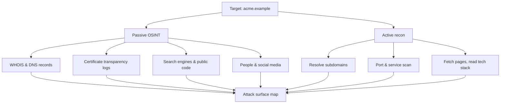
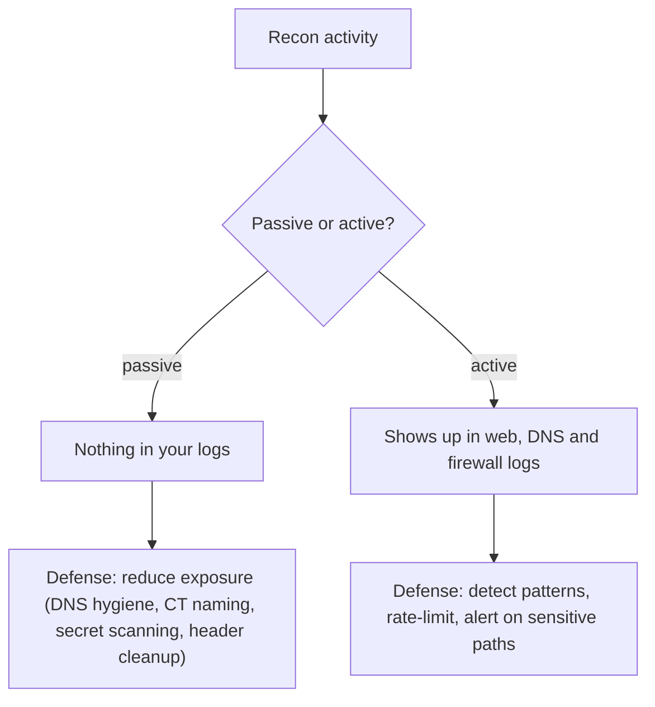

# Reconnaissance and OSINT

## Introduction

**Reconnaissance** is the information-gathering phase of an attack or a pentest. Before anyone touches a login form, they learn everything they can about the target: what domains and servers it has, what technologies it runs, which employees work there, and what has leaked onto the internet. **OSINT** (Open-Source Intelligence) is reconnaissance using only publicly available information.

It is the burglar casing the neighborhood. Before trying a door, they note which houses have alarm signs, which have newspapers piling up (nobody home), whose social media says "off to Hawaii for two weeks!", and where the spare key usually hides. None of that is breaking in. All of it makes breaking in easier.

For a defender, this is the most empowering phase to understand, because **everything an attacker finds here, you can find first and reduce.** Your attack surface is largely made of information you published without thinking about who was reading. See [Attack Surface](../0-sec-fundamentals/3-sec-attack-surface.mdx).

:::danger Authorized targets only
Active reconnaissance touches the target's systems and can be logged or even illegal against systems you do not own. Practice only against your own assets or sanctioned lab targets. Passive OSINT on public data is lower risk, but automated scraping can still violate a site's terms of service.
:::

## Passive vs Active Reconnaissance

The crucial distinction is whether you *interact* with the target's systems.

| Type | Interacts with target? | Detectable? | Examples |
| --- | --- | --- | --- |
| Passive | No (uses third parties and public data) | Essentially no | WHOIS, certificate logs, search engines, social media, code repos |
| Active | Yes (sends packets to the target) | Yes, can appear in logs | DNS zone queries, port scans, grabbing web pages, enumerating endpoints |



Passive comes first because it is quiet and often enough. Active recon (covered in depth in [Vulnerability Scanning](./3-sec-vulnerability-scanning.mdx) and [Network Scanning with Nmap](../2-sec-network-security/10-sec-network-scanning.mdx)) only begins once you have authorization.

## Passive Techniques

### Domain and DNS information

**WHOIS** tells you who registered a domain and when. **DNS records** reveal mail servers (MX), text records (SPF, DKIM, DMARC), and host addresses.

```bash
whois acme.example
dig acme.example ANY +noall +answer
dig acme.example MX +short
```

Attackers look for forgotten subdomains and stale records. A `dev.acme.example` that still points at an old, unpatched server is a classic foothold.

### Certificate transparency

Every TLS certificate issued by a public CA is logged in **Certificate Transparency (CT)** logs, which are searchable. Because certificates list their domains, CT logs quietly reveal subdomains, including internal-sounding ones like `vpn-test.acme.example`. Services such as `crt.sh` let you search these logs. This is a favorite because it is entirely passive and often reveals hosts the organization forgot about.

### Search engines and public code

Precise search queries ("Google dorking") surface exposed files, directory listings, and login pages, for example `site:acme.example filetype:pdf` or searches for configuration files. The same technique applied to **public code repositories** finds accidentally committed secrets: API keys, passwords, and internal URLs. This is why [secret scanning](../6-sec-appsec-and-devsecops/7-sec-secret-scanning.mdx) in your own repos matters so much.

### People and organizations

Job postings reveal your tech stack ("must know Kubernetes, Django, and Snowflake"). Professional networks reveal names, roles, and email formats. Conference talks reveal architecture. All of this feeds [social engineering](./8-sec-social-engineering.mdx).

## Active Techniques (Authorized Only)

Once you have permission, active recon fills in the map:

- **Subdomain enumeration**: resolving a wordlist of candidate names against DNS to find live hosts.
- **Port and service scanning**: finding open ports and the software behind them (see [Network Scanning with Nmap](../2-sec-network-security/10-sec-network-scanning.mdx)).
- **Technology fingerprinting**: reading HTTP headers and page content to identify frameworks, servers, and versions.

A minimal, safe example against *your own* lab host, reading one response header set:

```bash
# Only against a host you own or a sanctioned lab target
curl -sI http://localhost:3000 | head -n 12
```

Example output:

```text
HTTP/1.1 200 OK
Access-Control-Allow-Origin: *
X-Content-Type-Options: nosniff
X-Frame-Options: SAMEORIGIN
Feature-Policy: payment 'self'
X-Recruiting: /#/jobs
Content-Type: text/html; charset=utf-8
```

Even headers leak information: a `Server:` or `X-Powered-By:` header naming a version points straight at known vulnerabilities. Removing or genericizing those headers is a cheap defensive win (see [Security Headers, CORS and CSP](../3-sec-web-security/9-sec-security-headers.mdx)).

## Building a Footprint Record

Recon produces a lot of scattered data. A small structured record keeps it organized and, importantly, lets a defender diff it over time to spot new exposure.

```python
import json
from dataclasses import dataclass, field, asdict

@dataclass
class Asset:
    hostname: str
    source: str                 # how you found it: "ct-log", "dns", "job-post"
    notes: str = ""
    exposed_services: list = field(default_factory=list)

footprint = [
    Asset("app.acme.example", "ct-log", "main web app", ["443/https"]),
    Asset("dev.acme.example", "ct-log", "looks like a staging box", ["80/http", "22/ssh"]),
    Asset("vpn.acme.example", "dns", "remote access gateway", ["443/https"]),
]

# A defender's view: which assets expose plaintext HTTP or SSH to the world?
risky = [a.hostname for a in footprint
         if any(s.startswith(("80/", "22/")) for s in a.exposed_services)]
print("Review these first:", risky)
print(json.dumps([asdict(a) for a in footprint[:1]], indent=2))
```

Output:

```text
Review these first: ['dev.acme.example']
[
  {
    "hostname": "app.acme.example",
    "source": "ct-log",
    "notes": "main web app",
    "exposed_services": [
      "443/https"
    ]
  }
]
```

## Lab Walkthrough: Recon Against Your Local Juice Shop

You can practice the *active* fingerprinting step safely against the Juice Shop container from [Building a Safe Practice Lab](./1-sec-lab-setup.mdx). Everything below targets `localhost` only.

### Step 1: read the front page and its headers

```bash
curl -s http://localhost:3000 | grep -oE '<title>[^<]*</title>'
curl -sI http://localhost:3000 | grep -iE '^(server|x-powered-by|x-recruiting)'
```

Example output:

```text
<title>OWASP Juice Shop</title>
X-Recruiting: /#/jobs
```

The title and custom headers already identify the product. On a real site, these are the clues an attacker uses to match software to known vulnerabilities.

### Step 2: look for files the app tells you about

Many sites publish `robots.txt` to keep crawlers out of certain paths, which also tells everyone where those paths are.

```bash
curl -s http://localhost:3000/robots.txt
```

Example output:

```text
User-agent: *
Disallow: /ftp
```

`robots.txt` is a request to polite crawlers, not an access control. Anything listed there must be protected by real authentication or removed. Juice Shop deliberately makes this mistake so you can learn to spot it.

### Step 3: check client-side code for endpoints

Single-page apps ship their routes and API paths to the browser. Listing them is a normal part of mapping an app:

```bash
curl -s http://localhost:3000/main.js | grep -oE '/rest/[a-zA-Z/]+' | sort -u | head -n 5
```

Example output:

```text
/rest/admin/application-configuration
/rest/basket/
/rest/products/search
/rest/user/login
/rest/user/whoami
```

The defensive lesson: **assume every endpoint in your frontend bundle is known to attackers.** Hiding an admin route in JavaScript is not security; the server must enforce authorization on every route.

:::note
Exact file names and output differ between Juice Shop releases. The point is the technique, not the specific strings.
:::

## The Defender's View: Detecting and Reducing Recon

Passive recon leaves no trace on your systems, so the defense there is *reducing what is public*. Active recon does leave traces, and you can watch for them.



### Signals active recon produces

| Recon activity | Where it shows up | What it looks like |
| --- | --- | --- |
| Path discovery | Web access logs | Bursts of 404s for `/admin`, `/.git/`, `/backup.zip` |
| Subdomain brute force | Authoritative DNS logs | Many NXDOMAIN answers for random names |
| Port scanning | Firewall / flow logs | One source touching many ports quickly |
| Technology fingerprinting | Web logs | Requests for version files, unusual user agents |

### Make the sensitive-path probe noisy for the attacker

A cheap, high-signal control is a short list of paths that no legitimate user ever requests. Log them specially and alert:

```nginx
# Inside your server block
location ~ ^/(\.git|\.env|backup\.zip|wp-admin|phpmyadmin) {
    access_log /var/log/nginx/canary.log;
    return 404;
}
```

```bash
# How many distinct sources probed canary paths today?
awk '{print $1}' /var/log/nginx/canary.log | sort | uniq -c | sort -rn | head
```

Example output:

```text
     14 203.0.113.50
      2 198.51.100.7
```

### Reduce what passive recon can find

- **Name certificates carefully.** Prefer a wildcard certificate for internal-sounding hosts, or keep them on private CAs, so CT logs do not list every service.
- **Remove stale DNS records** when you decommission a host. A record pointing at a released cloud IP can enable subdomain takeover.
- **Strip version headers.** In nginx, `server_tokens off;` hides the version number.
- **Scan your public repos for secrets** continuously and rotate anything found.
- **Publish a `security.txt`** so researchers who find something during their own recon know where to report it (see [Bug Bounty Programs](./10-sec-bug-bounty.mdx)).

A minimal "stale DNS" check you can run against your own zone export:

```python
import socket

records = {"app.acme.example": "203.0.113.10", "old-blog.acme.example": "203.0.113.99"}
for host, expected in records.items():
    try:
        socket.create_connection((expected, 443), timeout=2).close()
        print(f"{host}: target answers on 443")
    except OSError:
        print(f"{host}: no service at {expected} -> review or delete this record")
```

Example output:

```text
app.acme.example: target answers on 443
old-blog.acme.example: no service at 203.0.113.99 -> review or delete this record
```

## Real-World Scenario

**Your startup just raised funding, hired twenty engineers, and spun up dozens of cloud resources and subdomains in a few months. Your CTO asks: "What does the internet actually know about us?"** You have no map of your own external footprint.

Run reconnaissance *on yourself*, the same way an attacker would:

1. Enumerate your domains and pull every subdomain from DNS and certificate transparency logs.
2. Search public code repositories and search engines for your domain, looking for leaked secrets and exposed files.
3. Check job posts and employee profiles for over-sharing of your stack.
4. For each live host, record what services it exposes.
5. Produce a prioritized list: forgotten hosts to decommission, plaintext services to encrypt or firewall, secrets to rotate, and headers to tighten.

This is **attack surface management**, and the output is a backlog of concrete fixes.

A sample first-pass result might look like this:

| Discovery | Source | Risk | Action |
| --- | --- | --- | --- |
| `old-staging.acme.example` still live, unpatched | CT log | High | Decommission or patch and firewall |
| AWS access key in an old commit | public repo | Critical | Rotate the key, scrub history |
| `admin-internal.acme.example` named in a cert | CT log | Medium | Rename, move behind VPN |
| Job post lists exact framework versions | careers page | Low | Generalize the wording |

Run the same sweep monthly and diff it against last month's; the new rows are what appeared since you last looked.

A first pass at a startup like this often produces a list like the one below:

| Discovery | Source | Risk | Action |
| --- | --- | --- | --- |
| `staging.acme.example` with a login page | CT logs | Old code, weaker controls than prod | Put behind SSO or VPN |
| `jenkins.acme.example` reachable from internet | DNS + fetch | CI server compromise means code and secrets | Restrict to VPN, require SSO |
| AWS key in a public repo from 2024 | Code search | Possible cloud account access | Rotate key, scan history, add pre-commit scanning |
| `old-blog.acme.example` pointing at released IP | DNS | Subdomain takeover | Delete the record |
| Job post naming exact database version | Job board | Helps attackers match CVEs | Describe skills, not versions |

To keep it from drifting again, make it a scheduled job that diffs the footprint against the last run and opens a ticket for anything new:

```python
import json

previous = {"app.acme.example", "vpn.acme.example"}
current = {"app.acme.example", "vpn.acme.example", "demo-2.acme.example"}

new_assets = sorted(current - previous)
gone_assets = sorted(previous - current)
print(json.dumps({"new": new_assets, "removed": gone_assets}))
```

Output:

```text
{"new": ["demo-2.acme.example"], "removed": []}
```

Each new asset gets an owner and a review. Unowned assets are the ones attackers find first.

### Why this approach

You cannot defend what you do not know you have. Fast-growing teams routinely leave staging boxes, old marketing sites, and test APIs exposed. Self-recon finds them before an attacker does, and CT logs plus DNS give you most of the map passively, with no risk.

### When to use it, when not to

Do this continuously, not once. New subdomains and certificates appear every week. Do **not** point active scanning tools at assets you are unsure you own, especially in shared cloud ranges, which can be a legal problem. Stick to passive sources when ownership is uncertain.

### Alternatives and trade-offs

| Approach | Pros | Cons | Best for |
| --- | --- | --- | --- |
| Manual OSINT | Free, deep, no tooling | Slow, easy to miss assets | Small footprints, learning |
| Open-source recon tools | Fast, repeatable | Noise, must verify results | Regular self-assessment |
| Commercial ASM platform | Continuous, alerts on changes | Costs money | Larger orgs, many assets |
| Bug bounty / pentest | Humans find the subtle stuff | Point-in-time or variable | Validating your own findings |

## Common Mistakes

- **Forgetting that CT logs are public.** Naming a certificate `secret-admin.acme.example` advertises it to the world.
- **Leaking secrets in public repos.** Scan your own code; rotate anything found. See [Secret Scanning](../6-sec-appsec-and-devsecops/7-sec-secret-scanning.mdx).
- **Over-sharing in job posts.** You can describe a role without publishing your entire architecture and versions.
- **Verbose server headers.** Strip version banners from HTTP responses and services.
- **Doing self-recon once.** Attack surface grows continuously; monitor it continuously.
- **Active scanning without authorization.** Passive is safe; active touches systems and must be authorized.
- **Treating `robots.txt` as access control.** It advertises the paths you wanted hidden.
- **Hiding admin routes in frontend code.** Every route in the JavaScript bundle is public knowledge; enforce authorization on the server.
- **Leaving dangling DNS records.** A record pointing at a released cloud address can let someone else serve content on your subdomain.
- **No logging on sensitive paths.** Probes for `/.git` or `/.env` are cheap, high-signal alerts you get for free.

## Summary

- Reconnaissance maps a target; OSINT does it using only public information.
- Passive recon (WHOIS, DNS, certificate transparency, search engines, people) does not touch the target and is hard to detect.
- Active recon (subdomain resolution, port scans, fingerprinting) touches the target and needs authorization.
- Defenders should run recon on themselves to find forgotten hosts, leaked secrets, and over-sharing.
- Attack surface management is continuous, because new exposure appears all the time.

## Further Learning

- Explore `crt.sh` for a domain you own and list its certificates.
- Read [Attack Surface](../0-sec-fundamentals/3-sec-attack-surface.mdx) for the defender's framing.

### Exercises

1. For a domain you own, collect its DNS records and CT-log subdomains, and build a footprint record using the `Asset` class above.
2. Inspect the HTTP response headers of your own site and list every one that reveals software or versions.
3. Write a short policy for what your team may and may not include in public job postings.
4. Run the Juice Shop lab walkthrough, then add an nginx canary location for three sensitive paths and confirm the probes land in a separate log.

Related pages: [Vulnerability Scanning](./3-sec-vulnerability-scanning.mdx), [Network Scanning with Nmap](../2-sec-network-security/10-sec-network-scanning.mdx), [Secret Scanning](../6-sec-appsec-and-devsecops/7-sec-secret-scanning.mdx), [Social Engineering and Phishing](./8-sec-social-engineering.mdx).
