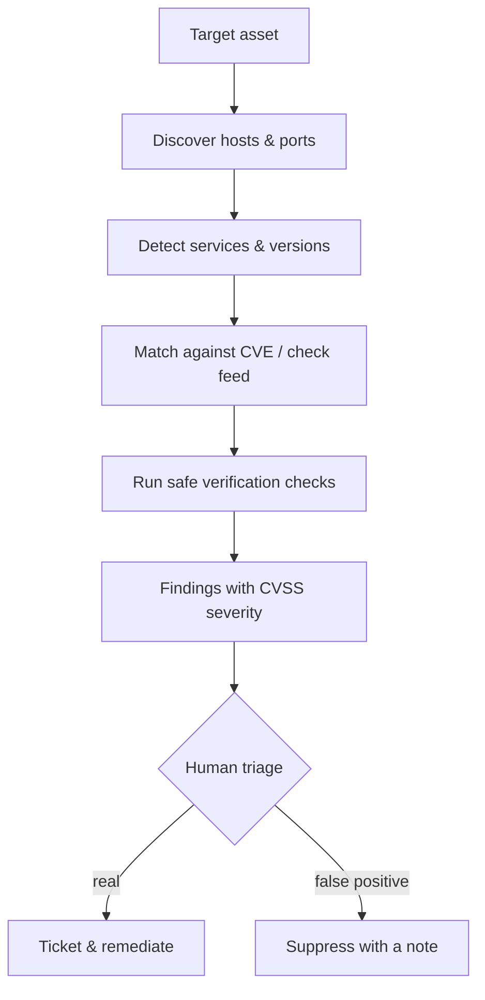
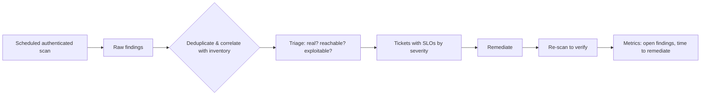

# Vulnerability Scanning

## Introduction

A **vulnerability scanner** is an automated tool that checks a system against a database of known weaknesses: missing patches, outdated software versions, insecure configurations, and exposed services. It is the broad, fast, cheap layer of security testing. Where a [pentest](./0-sec-pentest-introduction.mdx) is a surgeon, a scanner is an X-ray machine: it quickly images a lot of patients and flags areas that *might* need attention, but a human still has to read the film.

Scanning is where offensive and defensive security meet. The same tool that an attacker uses to find a weak host is the tool you run on a schedule to find and fix that host first. Most of this page is about using scanning *defensively*, because that is where it delivers the most value.

:::danger Authorized targets only
A vulnerability scan sends probes to the target and is noisy and clearly visible in logs. Scanning systems you do not own or have no permission to test is hostile activity and may be illegal. Scan your own assets or sanctioned lab targets only.
:::

## How a Scanner Works

A scanner combines a catalogue of checks with a way to observe the target:

1. **Discovery**: find live hosts and open ports (see [Network Scanning with Nmap](../2-sec-network-security/10-sec-network-scanning.mdx)).
2. **Service and version detection**: identify the software and version behind each port.
3. **Matching**: compare observed versions and configurations against a feed of known vulnerabilities, often keyed to **CVE** identifiers.
4. **Testing**: run safe checks (for example, requesting a page and reading the response) to confirm a condition.
5. **Reporting**: output findings with severities, usually **CVSS** scores.



The step everyone underestimates is **human triage**. Scanners err on the side of reporting, so a raw report mixes genuine critical issues with noise.

## Authenticated vs Unauthenticated Scans

This choice changes what a scan can see.

| Scan type | What it sees | Pros | Cons |
| --- | --- | --- | --- |
| Unauthenticated | Only what is exposed externally | Mimics an outside attacker | Misses missing patches and local config issues |
| Authenticated (credentialed) | Installed packages, patch levels, local config | Far more accurate, fewer false positives | Needs credentials, more setup |

An unauthenticated scan might guess a service is vulnerable from its banner. An **authenticated** scan logs in (or uses an agent) and reads the actual installed package versions, so it knows for certain whether a patch is applied. For internal asset management, authenticated scans are the gold standard.

## Categories of Scanner

- **Network / infrastructure scanners** assess hosts, ports, and services. Open-source Greenbone / OpenVAS and commercial tools like Nessus and Qualys fit here. OpenVAS is the scanner component of **Greenbone Community Edition** and is typically run via the Greenbone Community Containers.
- **Web application scanners** (DAST) crawl and test web apps for issues like injection and XSS. Covered in [Dynamic Analysis (DAST)](../6-sec-appsec-and-devsecops/3-sec-dast.mdx).
- **Dependency / SCA scanners** check your software's libraries for known-vulnerable versions. Covered in [Dependency Scanning and SCA](../6-sec-appsec-and-devsecops/4-sec-dependency-scanning.mdx).
- **Cloud and container scanners** check images and cloud configurations.

Pick the category that matches what you are assessing. A network scanner will not find a vulnerable npm package, and a dependency scanner will not notice an exposed database port.

## Reading and Triaging Results

A scan result is a *hypothesis*, not a verdict. For each finding, ask:

- **Is it real?** Does the version actually match, is the feature actually enabled?
- **Is it reachable?** A critical flaw in a service firewalled off from everything is lower risk than a medium flaw on the public login page.
- **Is it exploitable here?** Some CVEs require conditions you do not have.

A small triage helper that re-prioritizes raw findings by combining severity with exposure:

```python
from dataclasses import dataclass

@dataclass
class ScanFinding:
    cve: str
    cvss: float          # 0.0 - 10.0
    host: str
    internet_facing: bool
    confirmed: bool      # did a human verify it?

def priority(f: ScanFinding) -> str:
    if not f.confirmed:
        return "triage-needed"
    score = f.cvss + (2.0 if f.internet_facing else 0.0)
    if score >= 9: return "P1-now"
    if score >= 7: return "P2-this-week"
    if score >= 4: return "P3-this-sprint"
    return "P4-backlog"

findings = [
    ScanFinding("CVE-2024-XXabc", 9.8, "app.acme.example", True, True),
    ScanFinding("CVE-2023-XXdef", 7.5, "db-internal", False, True),
    ScanFinding("CVE-2022-XXghi", 5.0, "legacy", True, False),
]
for f in findings:
    print(f"{f.cve}: {priority(f)}")
```

Output:

```text
CVE-2024-XXabc: P1-now
CVE-2023-XXdef: P2-this-week
CVE-2022-XXghi: triage-needed
```

:::note
The CVE identifiers above are placeholders. Real CVE IDs look like `CVE-2024-3094`. Always look up the actual advisory for severity and affected versions.
:::

Full vulnerability management, including CVSS v4.0 scoring and service-level objectives for remediation, is covered in [Vulnerability Management and CVSS](../11-sec-defensive-operations/6-sec-vulnerability-management.mdx).

## Scanning in CI/CD

The modern practice is to scan continuously and early, not once a year. Dependency and container scans belong in your pipeline so a vulnerable library is caught at pull-request time. A minimal pipeline step (concept, using a generic SCA tool) looks like:

```yaml
jobs:
  security-scan:
    runs-on: ubuntu-latest
    steps:
      - uses: actions/checkout@v4
      - name: Dependency vulnerability scan
        run: |
          # Example SCA command; fails the build on high/critical findings
          sca-tool scan --fail-on high --format sarif --output results.sarif
      - name: Upload results
        run: echo "Upload results.sarif to your security dashboard"
```

See [Securing CI/CD Pipelines](../6-sec-appsec-and-devsecops/8-sec-pipeline-security.mdx) for the full picture.

## Lab Walkthrough: Scanning Your Own Lab Target

You can practice reading scan output safely against the Juice Shop container. Keep every command pointed at `localhost`.

### Step 1: see which ports are open

A port and service discovery pass is the start of any infrastructure scan. Against your own lab host:

```bash
# Discover service and version on the lab web port only
nmap -sV -p 3000 127.0.0.1
```

Example output (trimmed):

```text
PORT     STATE SERVICE VERSION
3000/tcp open  http    Node.js Express framework
```

The version string is exactly what a scanner feeds into its CVE-matching step. More on this in [Network Scanning with Nmap](../2-sec-network-security/10-sec-network-scanning.mdx).

### Step 2: run a safe scripted check

Nmap's scripting engine has a `--script` option; the `http-headers` script is a safe, read-only check that reports what the server exposes:

```bash
nmap -p 3000 --script http-headers 127.0.0.1
```

Example output (trimmed):

```text
| http-headers:
|   Access-Control-Allow-Origin: *
|   X-Content-Type-Options: nosniff
|   X-Frame-Options: SAMEORIGIN
```

### Step 3: turn findings into a triaged list

Export whatever your scanner produces and run it through the triage helper above. The discipline is the same in a lab as in production: confirm, judge reachability, then prioritize.

:::caution
Even in a lab, avoid aggressive scan flags against fragile services. Some old applications crash under heavy scanning. Start light, and never run these commands against anything but your own targets.
:::

## The Defender's View: Running and Reading a Scanning Program

Scanning is overwhelmingly a *defensive* activity; you run it on your own estate on a schedule. Two things decide whether it helps: accurate data (authenticated scans) and a process that actually closes findings.



### Suppressions with an audit trail

False positives are inevitable. The right way to silence one is a tracked suppression with a reason and an expiry, never a silent edit. A simple suppression file:

```yaml
suppressions:
  - id: "CVE-2021-XXxyz"
    asset: "legacy-report-server"
    reason: "Not exploitable: vulnerable module is not loaded in our config"
    approved_by: "security-lead"
    expires: "2027-01-01"
```

```python
import datetime, yaml

data = yaml.safe_load(open("suppressions.yml"))
today = datetime.date.today()
for s in data["suppressions"]:
    exp = datetime.date.fromisoformat(s["expires"])
    status = "ACTIVE" if exp >= today else "EXPIRED - re-review"
    print(f"{s['id']} on {s['asset']}: {status}")
```

Example output:

```text
CVE-2021-XXxyz on legacy-report-server: ACTIVE
```

Expiring suppressions force a periodic re-check, so a "temporary" exception does not quietly become permanent.

### Metrics that matter

Report on **mean time to remediate** by severity and the **count of findings past their SLO**, not the raw number of findings. A scanner that finds 10,000 issues is not a problem; 12 critical findings open past their deadline is.

### Detecting a scan run *against* you

The same probes you run defensively look, from the target's side, like an attacker's recon. A scan against your public assets produces a recognizable burst: one source touching many ports or paths in a short window, often with unusual user agents. A tiny detector over access logs:

```python
from collections import defaultdict

requests = [
    ("203.0.113.50", "/admin"), ("203.0.113.50", "/.env"),
    ("203.0.113.50", "/wp-login.php"), ("203.0.113.50", "/api/v1"),
    ("203.0.113.50", "/backup.sql"), ("198.51.100.7", "/"),
]
paths_by_ip = defaultdict(set)
for ip, path in requests:
    paths_by_ip[ip].add(path)

for ip, paths in paths_by_ip.items():
    if len(paths) >= 5:
        print(f"Possible scan: {ip} hit {len(paths)} distinct paths")
```

Example output:

```text
Possible scan: 203.0.113.50 hit 5 distinct paths
```

Rate limiting and a WAF blunt opportunistic scanners, but remember that detection is a signal, not a wall; a patient attacker scans slowly. The durable defense is still to have nothing unpatched for them to find.

### Choosing a scanner

| Need | Reach for |
| --- | --- |
| Patch state across servers | Authenticated network scanner or agents |
| Web app runtime issues | A DAST web scanner |
| Vulnerable libraries | An SCA tool in CI |
| Container images | An image scanner in the registry pipeline |
| Cloud misconfiguration | A cloud posture tool |

No single tool covers all of these, which is why mature programs run several and feed them into one triage queue.

## Real-World Scenario

**Your company has 300 cloud servers and a compliance auditor who wants evidence that you find and fix vulnerabilities on a schedule.** Patching is ad hoc, and nobody can say which hosts are behind on updates.

Stand up a scanning program:

1. Deploy **authenticated** scanning (agents or credentialed scans) across all 300 hosts, so you read real patch levels, not guesses.
2. Scan on a schedule (for example weekly) and after major changes.
3. Feed findings into a ticketing workflow with remediation deadlines tied to severity (an SLO: critical in 7 days, high in 30, and so on).
4. Add dependency and container scanning to CI so new code does not reintroduce known-vulnerable libraries.
5. Keep the scan history as the evidence the auditor wants.

### Why this approach

Authenticated scanning gives accurate, low-false-positive data about patch state, which is exactly what both security and the auditor need. Scheduling plus SLOs turns a pile of findings into a managed process, and CI scanning stops new debt from piling up.

### When to use it, when not to

Scan continuously for *known* issues; that is what scanners are great at. Do **not** rely on scanning alone to prove you are secure. Scanners cannot find business-logic flaws, broken access control between users, or novel vulnerabilities. Those need a [pentest](./0-sec-pentest-introduction.mdx) and secure design. Also avoid aggressive scans against fragile legacy systems during business hours; some old services crash under scan load.

### Alternatives and trade-offs

| Approach | Pros | Cons | Best for |
| --- | --- | --- | --- |
| Unauthenticated network scan | Attacker's-eye view, no creds | Misses patch/config detail | External exposure checks |
| Authenticated scan / agents | Accurate patch and config data | Needs credentials or agents | Internal asset management |
| DAST (web scanner) | Finds runtime web issues | Noisy, misses logic flaws | Web app baseline |
| SCA / dependency scan | Catches vulnerable libraries early | Only covers known CVEs | Every codebase, in CI |
| Pentest | Finds what scanners cannot | Point-in-time, costs more | Deep assurance |

The right answer is usually "several of these," layered.

## Scanning Container Images

Many teams ship code as container images, which carry their own operating-system packages. Scan images in the build pipeline before they reach a registry, and rescan on a schedule, because new CVEs appear for packages that were clean yesterday.

```yaml
# Concept: an image-scan gate in CI (replace image-scanner with your tool)
- name: Build image
  run: docker build -t myapp:candidate .
- name: Scan image and fail on critical findings
  run: image-scanner scan myapp:candidate --severity CRITICAL --exit-code 1
```

The habits that cut image findings the most:

- Start from **small, maintained base images**; fewer packages means fewer CVEs.
- **Rebuild regularly** so base-image patches flow in, rather than patching running containers.
- **Pin versions** and update them deliberately, with the scan as the gate.

See [Dependency Scanning and SCA](../6-sec-appsec-and-devsecops/4-sec-dependency-scanning.mdx) and [Securing CI/CD Pipelines](../6-sec-appsec-and-devsecops/8-sec-pipeline-security.mdx).

## Common Mistakes

- **Treating the raw report as the truth.** Triage for real, reachable, exploitable issues.
- **Only unauthenticated scanning.** You miss most missing-patch findings.
- **Scanning and never fixing.** A report nobody acts on is theater. Tie findings to tickets and SLOs.
- **Ignoring false-positive hygiene.** Suppress confirmed false positives *with a documented reason* so the next scan stays readable.
- **Scanning without authorization.** Even "just checking" another company's server is hostile activity.
- **Thinking a clean scan means secure.** Scanners find known issues only.
- **Silent suppressions.** Hiding a finding without a reason and an expiry hides real risk; track every exception.
- **Counting findings instead of fixing them.** Report mean-time-to-remediate and overdue criticals, not raw totals.
- **Scanning fragile systems at peak hours.** Some legacy services crash under load; schedule carefully and start light.
- **No asset inventory.** You cannot act on findings for hosts you did not know you had; correlate scans with inventory.

## Summary

- Vulnerability scanners automate the discovery of *known* weaknesses and report them with CVSS severities.
- Authenticated scans read real patch and config state and are far more accurate than unauthenticated ones.
- Different scanner categories exist for networks, web apps, dependencies, and cloud; use the right one.
- A scan result is a hypothesis; human triage for real, reachable, exploitable issues is essential.
- Scan continuously, tie findings to remediation SLOs, and remember scanners cannot find logic flaws or novel bugs.

## Further Learning

- Run an authenticated scan against a lab VM and compare it with an unauthenticated scan of the same host.
- Read [Vulnerability Management and CVSS](../11-sec-defensive-operations/6-sec-vulnerability-management.mdx) for scoring and SLOs.

### Exercises

1. Using the `ScanFinding` triage helper, add logic that lowers priority when a host is behind a firewall and not internet-facing.
2. Write remediation SLOs for your team (days-to-fix per severity) and justify each number.
3. Add a dependency-scanning step to a sample CI pipeline that fails the build on high-severity findings.
4. Run the Juice Shop lab walkthrough, then write a suppression entry (with reason and expiry) for one finding you judge a false positive.
5. Draft a one-page scanning policy covering cadence, authenticated vs unauthenticated scope, SLOs, and who owns remediation.

Related pages: [Penetration Testing Introduction](./0-sec-pentest-introduction.mdx), [Network Scanning with Nmap](../2-sec-network-security/10-sec-network-scanning.mdx), [Dependency Scanning and SCA](../6-sec-appsec-and-devsecops/4-sec-dependency-scanning.mdx), [Vulnerability Management and CVSS](../11-sec-defensive-operations/6-sec-vulnerability-management.mdx).
