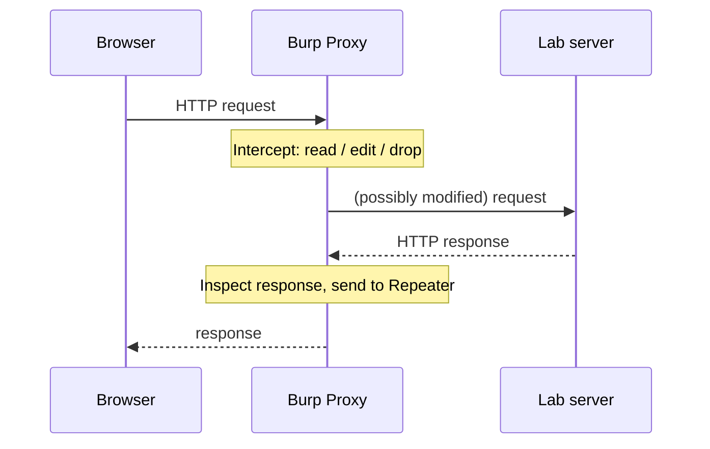
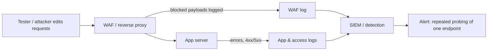

# Web Testing with Burp Suite

## Introduction

**Burp Suite** is the most widely used tool for manual web application security testing. At its heart it is an **intercepting proxy**: it sits between your browser and a web application, so you can pause, read, and modify every HTTP request and response. That ability, to change a request *after* the browser sends it, is what lets you test whether the server trusts data it should not.

Think of it as a pause button and an editor for the conversation between a browser and a server. Normally that conversation happens in milliseconds and you only see the polished web page. Burp lets you freeze a single message mid-flight, read exactly what was sent, change one field, and watch how the server reacts. Most web vulnerabilities become visible the moment you can do that.

This page uses Burp against **your own lab target** (OWASP Juice Shop from [Building a Safe Practice Lab](./1-sec-lab-setup.mdx)). Every finding is paired with the defensive fix, because the reason to learn this is to build apps that survive it.

:::danger Authorized targets only
Intercepting and modifying traffic is only legal against systems you own or have written permission to test. Point Burp at your local lab or a sanctioned platform like the PortSwigger Web Security Academy. Never intercept traffic to a site you do not control.
:::

## Editions and What You Get

| Edition | Cost | Key tools included |
| --- | --- | --- |
| Community | Free | Intercepting proxy, HTTP history, Repeater, Decoder, Sequencer, Comparer, a rate-limited Intruder |
| Professional | Paid license | Everything in Community plus the full web vulnerability scanner, unthrottled Intruder, project saving, Collaborator (OAST), and Pro extensions |

The **Community Edition is enough to learn** every core manual technique. Professional adds automation (a scanner, faster Intruder, out-of-band testing). PortSwigger also offers AI-assisted features in recent releases; check the current release notes, as capabilities and edition boundaries change. An open-source alternative, **OWASP ZAP**, offers a similar proxy and a free scanner.

## The Core Workflow



1. **Configure the browser** to send traffic through Burp's proxy (by default `127.0.0.1:8080`). Burp ships with its own pre-configured browser, which is the easiest route, and you install Burp's CA certificate so HTTPS can be inspected.
2. **Browse the app** normally. Every request appears in **HTTP history**, building a map of endpoints.
3. **Intercept** a specific request to pause and edit it.
4. **Send to Repeater** to replay and tweak a single request repeatedly, watching how responses change.
5. **Analyze** with Decoder (encode/decode values) and Comparer (diff two responses).

## The Intercepting Proxy

With **Intercept** on, Burp holds each request until you forward, drop, or edit it. This is where you see the raw truth of what the browser sends, including hidden fields, cookies, and headers the UI never shows you.

A typical login request to the lab looks like this:

```text
POST /rest/user/login HTTP/1.1
Host: localhost:3000
Content-Type: application/json
Content-Length: 46

{"email":"test@juice.shop","password":"hunter2"}
```

Because you can edit the body before forwarding, you can test how the server handles unexpected input. The **defensive lesson**: the server must validate and parameterize everything it receives, because the client can send anything, not just what your forms allow. See [Input Validation and Output Encoding](../5-sec-secure-coding/1-sec-input-validation.mdx) and [SQL Injection](../3-sec-web-security/3-sec-sql-injection.mdx).

## Repeater: The Workhorse

**Repeater** lets you take one request and send variations of it by hand, reading each response. It is how you methodically test a single endpoint. The loop is: change one thing, send, read the response, repeat.

For example, to understand **broken access control**, you capture a request that fetches *your* order, `GET /rest/orders/42`, then in Repeater change `42` to another id and see whether the server returns someone else's order. If it does, the app is failing to check ownership.

```text
GET /rest/orders/42 HTTP/1.1      -> change to /rest/orders/43
Host: localhost:3000
Authorization: Bearer <your-token>
```

The **defensive lesson** is the whole point: the server must verify that the authenticated user owns object `43` before returning it. This flaw class is **IDOR / Broken Object Level Authorization**, the top item in the OWASP API Security Top 10. The fix is an ownership check on every object access:

```python
# Vulnerable: trusts the id in the URL, returns any order
@app.get("/rest/orders/<int:order_id>")
def get_order_vuln(order_id):
    return db.get_order(order_id)        # no ownership check!

# Fixed: scope the lookup to the current user
@app.get("/rest/orders/<int:order_id>")
def get_order_fixed(order_id):
    order = db.get_order(order_id)
    if order is None or order.user_id != current_user.id:
        abort(404)                       # do not even reveal it exists
    return order
```

See [Broken Access Control](../3-sec-web-security/2-sec-broken-access-control.mdx) for the full treatment.

## The Other Tools, Briefly

- **Intruder**: automates sending many variations of a request (for example, fuzzing a parameter). Community's version is rate-limited. Use it responsibly and only on authorized targets.
- **Decoder**: encodes and decodes values (URL, Base64, hex) so you can read tokens and craft payloads.
- **Sequencer**: analyzes the randomness of tokens like session ids. A predictable session token is a serious flaw; see [Sessions and Cookies](../4-sec-authentication/4-sec-sessions-and-cookies.mdx) and [Randomness and Secure Tokens](../1-sec-cryptography/9-sec-randomness.mdx).
- **Comparer**: diffs two responses, handy for spotting how a small input change alters output.

## A Minimal Reproduction Note

When you find an issue, record it so a developer can reproduce and fix it. A good note is tool-agnostic:

```text
Title:   IDOR on GET /rest/orders/{id}
Target:  localhost:3000 (lab)
Steps:   1. Log in as user A, place an order (id 42).
         2. In Repeater, send GET /rest/orders/43 with A's token.
Result:  200 OK returns user B's order details.
Impact:  Any user can read any other user's orders.
Fix:     Enforce order.user_id == current_user.id; return 404 otherwise.
```

Notice the finding does not depend on Burp. Burp helped you *see* it; the fix lives in the server code.

## Lab Walkthrough: Finding and Fixing an Issue in Juice Shop

Here is the full loop against your local Juice Shop, from observation to fix. Everything targets `localhost:3000`.

### Step 1: capture the baseline request

Browse to the product search and submit a normal query. In HTTP history you see:

```text
GET /rest/products/search?q=apple HTTP/1.1
Host: localhost:3000
```

### Step 2: probe one input in Repeater

Send that request to Repeater and change the query to a single quote, a classic way to see whether input is being concatenated into a backend query. Watch the status code and response body change:

```text
GET /rest/products/search?q=' HTTP/1.1   ->  500 Internal Server Error
```

A 500 on an unbalanced quote is a strong hint that input reaches a query engine unescaped. (Juice Shop is intentionally vulnerable here so you can learn the signal.) The point for a defender is the *signal*, not building a working exploit.

### Step 3: read the defensive lesson and apply the fix

The server built a query by concatenating `q`. The fix is a parameterized query so input is always treated as data:

```python
# Vulnerable (concept): user input concatenated into the query
rows = db.execute("SELECT * FROM products WHERE name LIKE '%" + q + "%'")

# Fixed: bind the value as a parameter
rows = db.execute("SELECT * FROM products WHERE name LIKE ?", (f"%{q}%",))
```

See [SQL Injection](../3-sec-web-security/3-sec-sql-injection.mdx) for the full treatment, including ORMs and allowlisting.

### Step 4: confirm the fix removes the signal

After the fix, the same quoted input returns a normal `200` with zero matches instead of a `500`. The input is now data, not code. In your own apps, add a regression test that sends hostile input and asserts a clean response.

## A Disciplined Testing Methodology

A proxy makes it easy to poke around aimlessly. Professionals work from a checklist so coverage is repeatable, usually the **OWASP Web Security Testing Guide (WSTG)**. For each endpoint, walk a short list rather than improvising:

| Check | What you are confirming |
| --- | --- |
| Authentication | Does the endpoint require a valid session at all? |
| Authorization | Can user A act on user B's objects (IDOR)? Can a normal user reach admin actions? |
| Input handling | Is input validated and encoded (injection, XSS)? |
| Rate limiting | Can the action be brute-forced or abused in bulk? |
| Error handling | Do errors leak stack traces or internal details? |

Record each endpoint and its result so the test is auditable and so a re-test later checks the same things:

```python
from dataclasses import dataclass

@dataclass
class EndpointResult:
    endpoint: str
    authz_ok: bool
    input_ok: bool
    notes: str = ""

results = [
    EndpointResult("GET /rest/orders/{id}", authz_ok=False, input_ok=True,
                   notes="IDOR: returns other users' orders"),
    EndpointResult("GET /rest/products/search", authz_ok=True, input_ok=False,
                   notes="500 on quote: input reaches query engine"),
]
for r in results:
    flags = [n for n, ok in (("authz", r.authz_ok), ("input", r.input_ok)) if not ok]
    print(f"{r.endpoint}: {'FAIL ' + ','.join(flags) if flags else 'pass'} - {r.notes}")
```

Example output:

```text
GET /rest/orders/{id}: FAIL authz - IDOR: returns other users' orders
GET /rest/products/search: FAIL input - 500 on quote: input reaches query engine
```

This table *is* your findings list, and it drives both the report and the regression tests.

## The Defender's View: What Proxy Testing Looks Like in Logs and at the WAF

Repeater traffic is visible server-side. A developer tweaking one endpoint by hand produces a recognizable pattern: many requests to the *same* path with small variations, from the same session, in a short window.



### Log the signal

Make sure your access log records the query string and status so probing stands out:

```nginx
log_format probe escape=json
  '{"t":"$time_iso8601","ip":"$remote_addr","uri":"$request_uri","status":$status}';
access_log /var/log/nginx/app.json probe;
```

```bash
# Count 4xx/5xx responses per client in the log (probing bubbles up)
python3 - <<'PY'
import json
from collections import Counter
bad = Counter()
for line in open("/var/log/nginx/app.json"):
    e = json.loads(line)
    if e["status"] >= 400:
        bad[e["ip"]] += 1
for ip, n in bad.most_common(5):
    print(ip, n)
PY
```

Example output:

```text
127.0.0.1 37
```

### WAF vs fix: both, in the right order

A **Web Application Firewall** can block many injection and XSS payloads at the edge, which buys time, but it is a filter that attackers work to bypass. The code fix (parameterized queries, output encoding, authorization checks) removes the flaw itself. The right posture is **both**: fix the code as the durable control, and run a WAF for defense in depth and to slow opportunistic attacks. See the trade-off in the scenario below and in [Security Headers, CORS and CSP](../3-sec-web-security/9-sec-security-headers.mdx).

## Real-World Scenario

**Your team ships a REST API behind a single-page app, and QA only ever tests through the UI.** A customer reports they could see another customer's invoice by changing a number in the URL. Leadership asks how this slipped through and how to catch the next one.

The gap is that UI testing never exercises what the API does with hand-crafted requests. Introduce proxy-based testing:

1. Give developers and QA Burp Community (or OWASP ZAP) and teach the intercept-and-Repeater loop.
2. For every endpoint that returns a user-scoped object, test it with another user's token and a different id.
3. Add automated authorization tests to CI so the check runs forever, not just once.
4. Fix the API to enforce object-level authorization on every access, and add [DAST](../6-sec-appsec-and-devsecops/3-sec-dast.mdx) as a baseline.

### How the fix becomes permanent

A one-time manual test finds the bug; an automated test keeps it fixed. Add an authorization test to CI that logs in as two users and asserts each cannot read the other's objects:

```python
def test_cannot_read_other_users_order(client):
    a = login(client, "user_a")
    b = login(client, "user_b")
    order_id = place_order(client, a)                # belongs to user A
    resp = client.get(f"/rest/orders/{order_id}", headers=auth(b))
    assert resp.status_code in (403, 404)            # B must not see A's order
```

Example output:

```text
test_cannot_read_other_users_order PASSED
```

Now the moment someone reintroduces the flaw, the build fails. That is how proxy-found issues stop recurring.

### Why this approach

Broken object level authorization is invisible from the UI and is the most common serious API flaw. A proxy lets a human test it directly, and automated authorization tests make the fix permanent. Burp is the fastest way to *demonstrate* the problem to developers, which is what gets it fixed.

### When to use it, when not to

Use Burp for manual, exploratory web and API testing, especially access control, business logic, and anything the UI hides. Do **not** rely on it as your only control: pair manual testing with automated tests in CI and a scanner for breadth. For purely static code issues, use [SAST](../6-sec-appsec-and-devsecops/2-sec-sast.mdx) instead.

### Alternatives and trade-offs

| Tool / approach | Pros | Cons | Best for |
| --- | --- | --- | --- |
| Burp Community | Industry standard, powerful manual tools, free | No full scanner, throttled Intruder | Learning, manual web/API testing |
| Burp Professional | Scanner, fast Intruder, Collaborator | Paid | Professional pentesters |
| OWASP ZAP | Free, open source, has a scanner, scriptable | Different UX, smaller extension ecosystem | Teams wanting free automation |
| Automated DAST in CI | Continuous, no human needed | Misses logic and authz flaws | Baseline regression checks |

## From Proxy Findings to a Hardening Checklist

Most proxy-found issues map to a handful of server-side fixes. Use this table as a review checklist for every endpoint you build:

| Finding type | Server-side fix |
| --- | --- |
| IDOR / BOLA | Scope every lookup by the authenticated user or tenant |
| 500 error on a quote character | Parameterized queries, allowlists for identifiers |
| Reflected or stored XSS | Auto-escaping templates and a strict Content-Security-Policy |
| Admin endpoint visible in the frontend | Server-side role check on every route |
| Stack traces in responses | Generic error pages, details only in server logs |
| Predictable session tokens | Generate tokens with a CSPRNG |

For the last row, Python's `secrets` module is the right tool:

```python
import secrets
print(len(secrets.token_urlsafe(32)))   # 32 random bytes, URL-safe encoded
```

Output:

```text
43
```

## Common Mistakes

- **Intercepting unauthorized traffic.** Only your own apps or sanctioned labs.
- **Forgetting Intercept is on.** Your browser will appear to hang; toggle it off when just browsing.
- **Testing only through the UI.** The UI hides the requests where the bugs live.
- **Finding IDOR and fixing only the one id.** Fix the *pattern*: enforce authorization on every object access.
- **Leaving Burp's CA certificate trusted after testing.** Remove it from browsers you use normally.
- **Running Intruder aggressively.** Even on authorized targets, flooding can cause outages; keep it measured.
- **Fixing with a WAF rule alone.** A WAF slows attackers but does not remove the flaw; fix the code too.
- **No regression test for the fix.** Add a test that sends hostile input and asserts a clean response, so the bug cannot return.
- **Ignoring the log signal.** Repeated probing of one endpoint is detectable; make sure your access log captures the query string and status.
- **Trusting client-side validation.** The proxy proves the client can send anything; all validation must be server-side.

## Summary

- Burp Suite is an intercepting proxy that lets you pause, read, and modify HTTP traffic between a browser and a web app.
- The Community Edition covers every core manual technique: Proxy, Repeater, Decoder, Sequencer, Comparer.
- Repeater is the workhorse for methodically testing one endpoint, including access-control flaws like IDOR.
- Every finding maps to a server-side fix; the tool reveals the problem, the code fixes it.
- Use it only on authorized targets, pair it with automated tests, and OWASP ZAP is a free alternative.

## Further Learning

- Work through the PortSwigger Web Security Academy's access-control and Repeater labs.
- Reproduce the IDOR scenario against Juice Shop in your lab, then apply the fixed code pattern.

### Exercises

1. Configure Burp Community with your lab browser and capture a login request to Juice Shop in HTTP history.
2. Use Repeater to test an object-id endpoint for IDOR, then write the reproduction note and the fixed handler.
3. Use Sequencer (concept) to reason about whether a session token looks random, and relate it to [Randomness and Secure Tokens](../1-sec-cryptography/9-sec-randomness.mdx).
4. Run the four-step Juice Shop walkthrough, then write the parameterized-query fix and a regression test for it.
5. Add JSON access logging to a lab proxy and write a one-liner that flags any client with more than 20 error responses.

Related pages: [Building a Safe Practice Lab](./1-sec-lab-setup.mdx), [Broken Access Control](../3-sec-web-security/2-sec-broken-access-control.mdx), [Cross-Site Scripting (XSS)](../3-sec-web-security/4-sec-xss.mdx), [Dynamic Analysis (DAST)](../6-sec-appsec-and-devsecops/3-sec-dast.mdx).
