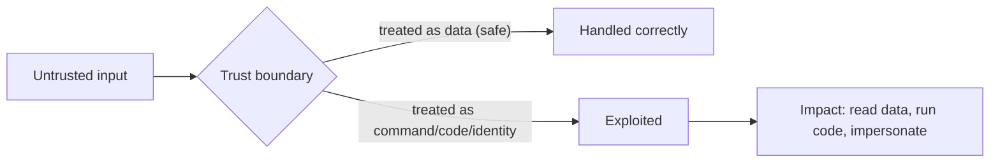
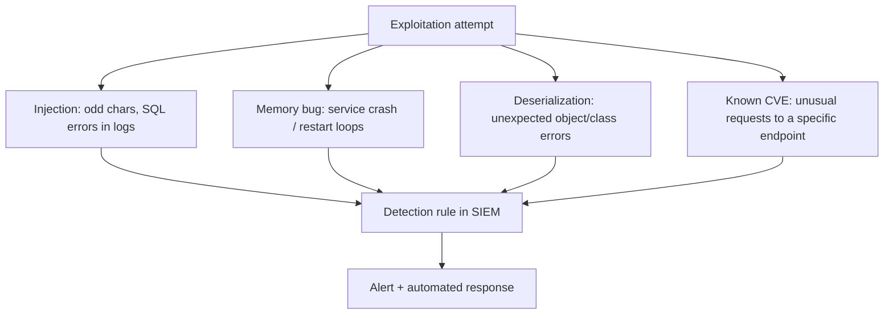
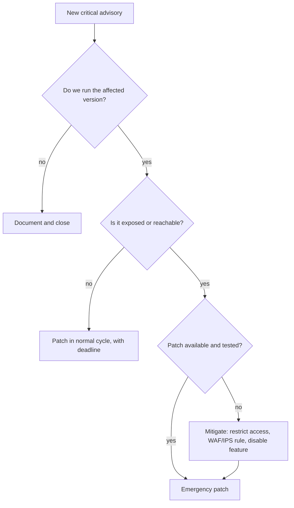

# Exploitation Basics

## Introduction

**Exploitation** is the step where a tester turns a *potential* weakness into *proof*. A scanner says "this version might be vulnerable." Exploitation answers "yes, and here is a screenshot of me reading a file I should not be able to read." The point is never destruction; it is demonstrating real impact so the owner understands why a finding matters and fixes it.

This page stays at the **concept level**, the same level as a reputable training course. It explains the main classes of vulnerability and how exploitation frameworks are used in a lab, and it pairs every concept with the defense. It does **not** provide working exploits, payloads, or steps against real targets. The goal is a defender who understands the attacker's playbook well enough to break it.

:::danger Authorized targets only
Exploiting a system you do not own or lack written permission to test is a crime in most jurisdictions. Everything here is for your own isolated lab (Metasploitable, Juice Shop, DVWA) or sanctioned platforms. See [Building a Safe Practice Lab](./1-sec-lab-setup.mdx) and [Ethics, Law and Responsible Disclosure](../0-sec-fundamentals/8-sec-ethics-and-law.mdx).
:::

## What "Exploiting" Actually Means

An exploit takes advantage of a gap between what a system *should* do and what it *actually* does when given unexpected input. Almost every exploit comes down to one idea: **data crossing a trust boundary is treated as something more privileged than data.** Input becomes a command, a file path, code, or a trusted identity.



The defender's whole job is to keep that boundary intact: validate input, separate code from data, and assume everything from outside is hostile.

## Common Vulnerability Classes (Concept Level)

### Injection

The application builds a command or query by concatenating untrusted input, so the input can change the command's meaning. SQL injection, command injection, and LDAP injection all share this shape.

- **Why it works**: the interpreter cannot tell the developer's intent from the attacker's input once they are glued into the same string.
- **Defense**: never concatenate. Use parameterized queries and safe APIs so input is always data. See [SQL Injection](../3-sec-web-security/3-sec-sql-injection.mdx) and [Command Injection and Path Traversal](../3-sec-web-security/7-sec-command-injection.mdx).

```python
# Vulnerable: input becomes part of the SQL command
cur.execute(f"SELECT * FROM users WHERE name = '{name}'")

# Fixed: input is bound as a parameter, never as SQL
cur.execute("SELECT * FROM users WHERE name = ?", (name,))
```

Where the untrusted value must be an *identifier* (a column or table name) that cannot be parameterized, use a strict allowlist instead of concatenation:

```python
# Fixed: only known-good column names are ever used
ALLOWED_SORT = {"name", "created_at", "price"}

def sort_products(column: str):
    if column not in ALLOWED_SORT:          # reject anything unexpected
        raise ValueError("invalid sort column")
    return db.execute(f"SELECT * FROM products ORDER BY {column}")
```

The pattern is always the same: keep untrusted data out of the position where it could be interpreted as code, either by binding it as a parameter or by mapping it to a fixed set of safe values.

### Memory-safety bugs

In languages without memory safety (C, C++), writing past the end of a buffer can overwrite adjacent memory and, in the classic case, redirect program execution. These underpin many of the most serious remote-code-execution CVEs.

- **Why it works**: the language trusts the programmer to track buffer sizes, and a mistake lets input overwrite control data.
- **Defense**: use memory-safe languages where possible; rely on modern mitigations (ASLR, stack canaries, non-executable memory, compiler hardening); keep software patched. See [Memory Safety](../5-sec-secure-coding/4-sec-memory-safety.mdx).

### Insecure deserialization and unsafe object handling

An app turns attacker-controlled bytes back into live objects without validation, which can trigger code execution.

- **Defense**: avoid deserializing untrusted data; use data-only formats (JSON) with strict schemas. See [Insecure Deserialization](../3-sec-web-security/8-sec-insecure-deserialization.mdx).

### Known-vulnerable components

The most common real-world "exploit" is simply running software with a public CVE and a published fix you did not apply.

- **Defense**: inventory and patch. [Dependency Scanning and SCA](../6-sec-appsec-and-devsecops/4-sec-dependency-scanning.mdx) and [Patch Management](../9-sec-system-hardening/3-sec-patch-management.mdx).

You cannot patch what you do not know you ship. A **software bill of materials (SBOM)** lists every component and version, so when a new CVE drops you can answer "are we affected?" in minutes instead of days. See [SBOMs, Signing and SLSA](../6-sec-appsec-and-devsecops/6-sec-sbom-and-signing.mdx). The majority of real-world "exploitation" is simply this class: public bug, public fix, nobody applied it.

### Server-side request forgery and access-control flaws

Not every serious exploit involves memory or code. Two of the most common high-impact classes in modern apps are purely logical:

- **Server-Side Request Forgery (SSRF)**: the app fetches a URL the attacker controls, letting them reach internal services (such as cloud metadata endpoints) the attacker could not reach directly. *Defense: allowlist destinations, block internal address ranges, require explicit egress rules.* See [Server-Side Request Forgery (SSRF)](../3-sec-web-security/6-sec-ssrf.mdx).
- **Broken access control**: the app simply fails to check whether the caller is allowed to do what they asked. No clever payload needed, just a changed id. *Defense: enforce authorization on every object and action, server-side.* See [Broken Access Control](../3-sec-web-security/2-sec-broken-access-control.mdx).

These matter because they need no special tooling and are devastating. A defender who only worries about buffer overflows misses the bugs most likely to actually hit them.

## Exploit Chains: Small Bugs Add Up

Real intrusions rarely use one dramatic exploit. They **chain** several low- and medium-severity issues into a high-impact result. A verbose error message (low) reveals a path; a missing authorization check (medium) exposes a function; a known-vulnerable library (medium) on that function yields code execution (critical).

```text
info leak (low)  ->  weak authz (medium)  ->  outdated lib (medium)  =  full compromise (critical)
```

The lesson for defenders is twofold: do not dismiss low-severity findings in isolation, and remember that **breaking any one link** in the chain stops the whole attack. This is the core argument for defense in depth over any single perfect control.

## Where Exploitation Frameworks Fit

**Metasploit** is the best-known open-source exploitation framework. In a lab, it packages the whole flow: choose a module for a known vulnerability, set options like the target address, and run it to confirm the issue. Its value for *learning* is that it makes the attacker's workflow concrete and repeatable against a box like Metasploitable.

A conceptual Metasploit session against a lab host looks like this (illustrative, not a working recipe):

```text
msf6 > use exploit/<module-for-a-known-lab-vuln>
msf6 > set RHOSTS 192.168.56.20      # your lab target only
msf6 > set LHOST 192.168.56.10       # your attacker VM
msf6 > run
[*] Session opened (demonstrates the vulnerability is real)
```

The defensive reading of that session is a checklist: the target ran unpatched software (patch it), exposed a service it did not need (reduce attack surface), and nothing detected or blocked the attempt (add detection). Every exploit tells you three things to fix.

:::note
Frameworks are dual-use tools. The same Metasploit that validates a finding in your lab is used by attackers. That is exactly why defenders study it: the techniques map directly to [MITRE ATT&CK](../11-sec-defensive-operations/3-sec-mitre-attack.mdx), which you can use to build detections.
:::

## Lab Walkthrough: Validating a Known Vulnerability Safely

The responsible way to confirm a vulnerability is to prove it *exists* with the least intrusive action, in a lab, and then focus entirely on the fix. Here is that loop for a known-vulnerable component, using your lab (Metasploitable or a deliberately old container).

### Step 1: identify the exact version

```bash
# Read the service banner on your own lab host only
nc -w3 192.168.56.20 21 </dev/null
```

Example output:

```text
220 (vsFTPd 2.3.4)
```

### Step 2: check it against an advisory

Look the version up in the vendor advisory or the CVE database. If the installed version falls in the affected range, the finding is credible. This is exactly what a scanner automates, but doing it once by hand builds the intuition.

### Step 3: confirm with a minimal, safe check

In a lab you may run a framework module that *demonstrates* the condition without destructive action, for example proving a command runs by reading a harmless value like the hostname. Record the outcome and stop there. Do not add persistence, do not pivot, do not touch data.

### Step 4: write the defensive checklist

Every confirmed vulnerability yields the same three questions, each a fix:

```text
1. Why was this version present?   -> patch; add to patch-management cadence
2. Why was the service reachable?  -> firewall / segment it; close unused ports
3. Why did nothing detect it?      -> add logging and a detection rule
```

That checklist, not the exploit, is the deliverable.

## The Defender's View: Detecting Exploitation Attempts

Exploitation is noisy if you are watching. Each class leaves signatures you can detect and alert on.



| Class | Detection signal | Prevent | Detect |
| --- | --- | --- | --- |
| Injection | DB errors, quotes/SQL keywords in input, 500s | Parameterized queries | Alert on query errors spiking |
| Memory safety | Segfaults, crash/restart loops | Memory-safe languages, hardening | Alert on repeated crashes |
| Deserialization | Class-not-found / unexpected type errors | No untrusted deserialization | Alert on deserialization exceptions |
| Known CVE | Requests matching the exploit pattern | Patch promptly | Signature/IDS rule for the CVE |

A tiny example: alert when application logs show a burst of database errors, a classic injection probe fingerprint.

```python
import re
from collections import Counter

log = [
    "ERROR: syntax error at or near \"'\"",
    "INFO: request served",
    "ERROR: unterminated quoted string",
    "ERROR: syntax error at or near \"OR\"",
]
db_errors = Counter("db_error" for l in log if re.search(r"syntax error|unterminated", l))
if db_errors["db_error"] >= 3:
    print(f"ALERT: {db_errors['db_error']} DB errors - possible injection probing")
```

Example output:

```text
ALERT: 3 DB errors - possible injection probing
```

These map directly to [MITRE ATT&CK](../11-sec-defensive-operations/3-sec-mitre-attack.mdx) techniques, which is how you turn "an attacker might do X" into a concrete detection. See [Detection Engineering](../11-sec-defensive-operations/2-sec-detection-engineering.mdx) and [Security Logging and SIEM](../11-sec-defensive-operations/1-sec-logging-and-siem.mdx).

## Proof of Concept vs Weaponization

A professional pentest stops at a **proof of concept (PoC)**: the minimum needed to demonstrate impact safely, such as reading a non-sensitive file or showing you can run a harmless command. It does **not** deploy persistent malware, destroy data, or exfiltrate real customer records. The rules of engagement define the line, and a good tester stays well inside it.

| Stage | What it is | Appropriate in a pentest? |
| --- | --- | --- |
| Validation | Confirm the vuln exists | Yes |
| Proof of concept | Show limited, safe impact | Yes, within scope |
| Weaponization | Reliable, destructive, persistent exploit | No (that is an attacker's goal) |

## Real-World Scenario

**A scanner flags "possible remote code execution" on an internal application server, severity critical. Management asks: is this real, and how bad is it?** The scanner result alone cannot answer that.

A safe, authorized validation:

1. In a **staging clone** of the server (never production first), confirm the exact software version against the CVE's affected range.
2. Use a PoC (from the vendor advisory or a framework module) that demonstrates the condition *without* destructive actions, for example proving code runs by reading a harmless value.
3. Record impact: what could an attacker reach from this host? Which data and which other systems?
4. Report with evidence, then patch, restrict network access to the service, and add detection for exploitation attempts.

A realistic timeline for this kind of finding:

| Time | Action | Owner |
| --- | --- | --- |
| Hour 0 | Scanner alert lands in the queue | Security |
| Hour 2 | Version confirmed against the advisory | Security |
| Hour 4 | Service restricted to the internal admin network | Platform |
| Day 1 | Safe validation in staging confirms the condition | Security |
| Day 2 | Patch tested and rolled out | Platform |
| Day 3 | Re-scan confirms the fix; detection rule added | Security + SOC |

Note that access was restricted on hour 4, *before* validation finished. Containment does not wait for certainty when the fix is cheap and reversible.

### Why this approach

Validation turns a "possible" into a "confirmed" or a "false positive," which completely changes prioritization. Doing it in staging avoids harming production. Measuring reachable impact (post-exploitation thinking) is what sets the real severity, not the raw CVSS alone.

### When to use it, when not to

Validate when the stakes or the uncertainty are high and you have authorization and a safe environment. Do **not** run exploit code against production without explicit sign-off and a rollback plan, and do not run PoCs you do not understand; some "PoCs" online are themselves malicious. When in doubt, patch first and validate in a lab.

### Alternatives and trade-offs

| Approach | Pros | Cons | Best for |
| --- | --- | --- | --- |
| Patch without validating | Fast, safe, removes the risk | You never learn true impact | Clear-cut, easy-to-patch CVEs |
| Validate in staging | Confirms real impact safely | Takes time and a test environment | High-severity, high-uncertainty findings |
| Full exploitation in prod | Most realistic | Risky, needs strict authorization | Rare, sanctioned red-team goals |

Often the best move is simply to patch; validation is for when you must prioritize among many findings or justify urgent action.

## Post-Exploitation: Measuring Impact Responsibly

Once a vulnerability is confirmed, a pentester's next question is "so what?" The *impact* is what sets the real severity, and measuring it is a disciplined, bounded activity, not a free-for-all.

- **What data is reachable?** List it; do not exfiltrate it.
- **What else can this host reach?** Note reachable systems; do not pivot destructively.
- **Could privileges be escalated?** Reason about it; see [Privilege Escalation Concepts](./6-sec-privilege-escalation.mdx).

The rules of engagement set the boundary. A good tester documents the *potential* impact with the minimum proof and stops, because the goal is to inform the fix, not to cause harm. The defender reads the same assessment as a map of blast radius: if a single web compromise can reach the customer database, the fix list includes segmentation and least privilege, not just the original bug.

```text
Impact assessment (lab example)
  Foothold:        www-data on app-vm
  Reachable data:  app config with DB credentials (noted, not exfiltrated)
  Reachable hosts: db-vm on 192.168.56.0/24 (noted, not pivoted)
  Escalation:      passwordless sudo present -> root feasible
  Blast radius:    high; recommend segmentation + least privilege
```

## Breaking the Exploit Chain (Defender's View)

An exploit rarely stands alone; it is a chain. Defense in depth means any broken link stops the attack:

1. **Reduce attack surface**: do not expose the service at all. See [Attack Surface](../0-sec-fundamentals/3-sec-attack-surface.mdx).
2. **Patch**: remove the vulnerability.
3. **Harden**: least privilege, so a compromised process can do little. See [Least Privilege and Zero Trust](../0-sec-fundamentals/5-sec-least-privilege.mdx).
4. **Segment**: network segmentation limits lateral movement. See [Network Segmentation](../2-sec-network-security/2-sec-network-segmentation.mdx).
5. **Detect**: log and alert on exploitation behavior. See [Detection Engineering](../11-sec-defensive-operations/2-sec-detection-engineering.mdx).
6. **Respond**: a practiced plan to contain and recover. See [Incident Response Lifecycle](../12-sec-incident-response/0-sec-incident-response-lifecycle.mdx).

## Patch Now, or Mitigate First?

When a serious vulnerability is announced, the defender's first decision is usually not "can we exploit it?" but "how fast can we close it?" A simple decision flow:



**Virtual patching** (a WAF or IPS rule that blocks the known attack pattern) is a legitimate stopgap while a real patch is tested, but treat it as temporary: give it an owner and an expiry date. Attackers vary payloads, and a signature only blocks what it was written for.

| Option | Speed | Durability | Risk |
| --- | --- | --- | --- |
| Emergency patch | Hours to days | Permanent fix | Possible regression |
| Restrict network access | Minutes | Good while it lasts | May break legitimate use |
| WAF / IPS rule | Minutes | Weak, bypassable | False positives |
| Disable the feature | Minutes | Good | Business impact |

The asset inventory and SBOM from earlier pages are what make the first question ("do we run it?") answerable in minutes.

## Common Mistakes

- **Running exploit code you do not understand.** It may be destructive or malicious itself.
- **Testing in production first.** Clone to staging; protect real data and uptime.
- **Confusing a PoC with weaponization.** Stop at safe proof of impact.
- **Fixing only the single exploited host.** The same flaw likely exists elsewhere; fix the class.
- **Ignoring the detection gap.** If nothing noticed the exploit, that is itself a finding.
- **Assuming CVSS equals your risk.** Reachability and blast radius in *your* environment set the real severity.
- **Stopping at the exploit instead of the fix.** The defensive checklist (patch, segment, detect) is the real deliverable.
- **No detection for the attempt.** If an exploit leaves no alert, add logging; a silent compromise is the worst outcome.
- **Downloading random "PoCs".** Many public proof-of-concept scripts are themselves malicious; read and understand before running, in a lab.
- **Validating in production first.** Clone to staging; protect real data and uptime.

## Summary

- Exploitation proves a weakness is real and shows its impact; in a pentest it stops at a safe proof of concept.
- Most exploits come from untrusted data crossing a trust boundary and being treated as command, code, or identity.
- Key classes: injection, memory-safety bugs, insecure deserialization, and known-vulnerable components; each has a clear defense.
- Frameworks like Metasploit make the attacker workflow concrete in a lab and map onto MITRE ATT&CK for detection.
- Defenders break the exploit chain at many links: reduce surface, patch, harden, segment, detect, and respond.

## Further Learning

- Read the vendor advisory for a recent CVE in software you run and note its affected versions, fixed version, and suggested mitigations.
- Compare the advisory's CVSS score with your own estimate once reachability in your environment is taken into account.
- Reproduce a known vulnerability on Metasploitable in your lab, then write the six-step defensive checklist for it.
- Map one exploitation technique to its [MITRE ATT&CK](../11-sec-defensive-operations/3-sec-mitre-attack.mdx) technique and draft a detection idea.

### Exercises

1. Take the vulnerable SQL snippet above and rewrite three more queries in your own code to use parameters.
2. For a CVE in software you run, write a plan to validate it safely in staging and the fixes you would apply regardless.
3. Pick one vulnerability class and list every defense-in-depth layer that would blunt it.
4. Run the four-step validation loop in your lab against one known-vulnerable service and write its defensive checklist.
5. Write a detection rule idea (log source, condition, severity) for one exploitation class and map it to a MITRE ATT&CK technique.

Related pages: [Vulnerability Scanning](./3-sec-vulnerability-scanning.mdx), [Privilege Escalation Concepts](./6-sec-privilege-escalation.mdx), [SQL Injection](../3-sec-web-security/3-sec-sql-injection.mdx), [MITRE ATT&CK](../11-sec-defensive-operations/3-sec-mitre-attack.mdx).
