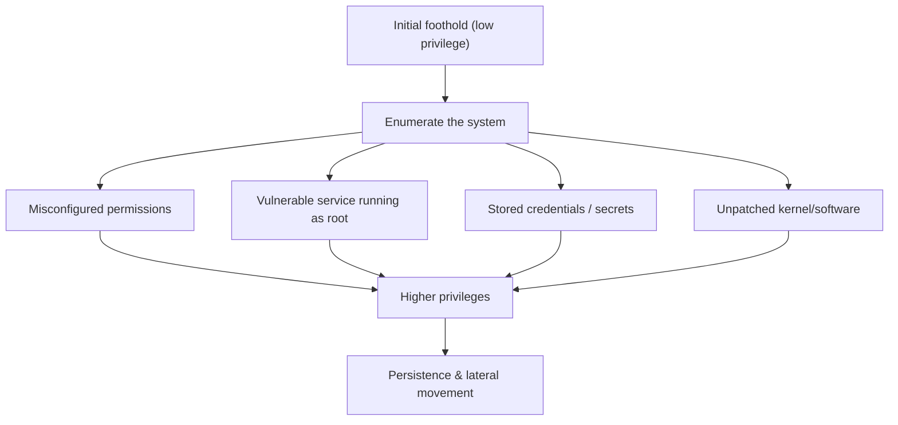
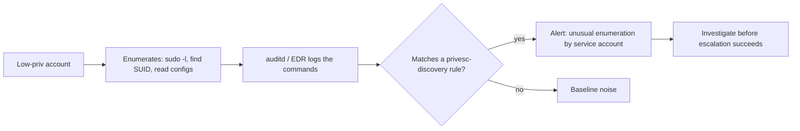

# Privilege Escalation Concepts

## Introduction

**Privilege escalation** is how an attacker who has gained *some* access turns it into *more* access, ideally full administrative control. A phished employee's laptop, a compromised web app running as a low-privilege user, a stolen read-only API key: each is a starting point. Privilege escalation is the stairway from that foothold to the crown jewels.

Picture a cruise ship. A ticket gets you to the passenger decks. **Horizontal** escalation is slipping into another passenger's identical cabin. **Vertical** escalation is finding an unlocked crew door, then the bridge, then the captain's master key. The attacker rarely walks straight onto the bridge; they climb, one overlooked door at a time.

This page is **concept level** and defense-focused, in line with the section's ethics rules. It explains the *categories* of escalation and the misconfigurations that enable them, with the hardening that closes each one. It does not provide working exploit steps.

:::danger Authorized targets only
Practice these concepts only on systems you own or in a sanctioned lab. Escalating privileges on a system you are not authorized to test is a serious crime even if you were legitimately on it for another reason.
:::

## Horizontal vs Vertical

| Type | Meaning | Example |
| --- | --- | --- |
| Horizontal | Access another account at the *same* privilege level | Reading another user's files or data (IDOR) |
| Vertical | Gain a *higher* privilege level | Standard user to root/administrator |

Both matter. Horizontal escalation in a multi-tenant app leaks other customers' data; vertical escalation on a server gives total control. [Broken access control](../3-sec-web-security/2-sec-broken-access-control.mdx) is horizontal escalation at the application layer.



The first thing an attacker does after landing is **enumerate**: list what they can see and touch. Most escalation comes not from exotic exploits but from boring misconfigurations the system handed them.

## How Escalation Happens (Concept Level)

### On Linux

The common paths are configuration and hygiene failures, not zero-days:

- **Overly broad sudo rights**: a user allowed to run a flexible program as root (an editor, an interpreter, an archiver) can often reach a root shell through that program's own features.
- **SUID/SGID binaries**: programs that run as their owner (often root) regardless of who launches them. A misconfigured or vulnerable one is a classic lever.
- **World-writable files and scripts run by root**: if root runs a script anyone can edit, anyone can run code as root.
- **Secrets on disk**: passwords and keys in config files, history files, or environment variables.
- **Unpatched kernel or services**: a local privilege-escalation CVE.

### On Windows

- **Misconfigured service permissions**: a service running as SYSTEM whose executable or configuration a normal user can modify.
- **Unquoted service paths** and writable directories in the path.
- **Excessive privileges** and tokens granted to accounts.
- **Stored credentials**: in the registry, scripts, or credential stores.
- **Missing patches** for known local escalation issues.

The unifying theme: **something high-privilege trusts something a low-privilege user controls.** That is the same trust-boundary idea from [Exploitation Basics](./5-sec-exploitation-basics.mdx), applied locally.

## The Defender's Core Principle: Least Privilege

Nearly every escalation path is closed by [least privilege](../0-sec-fundamentals/5-sec-least-privilege.mdx): give each account, service, and process only the permissions it truly needs, and nothing more. If the web app runs as a dedicated low-privilege user with no sudo rights, a web compromise stays contained.

A few concrete defensive checks you *can* run safely on your own systems:

```bash
# Linux: find SUID binaries (review anything unusual against a known baseline)
find / -perm -4000 -type f 2>/dev/null

# Review who can run what as root
sudo -l

# Find world-writable files (should be rare and intentional)
find / -xdev -type f -perm -0002 2>/dev/null | head
```

Example output:

```text
/usr/bin/passwd
/usr/bin/sudo
/usr/bin/mount
```

The defensive workflow is: build a known-good baseline of SUID binaries and sudo rules, then alert on anything that deviates. See [Linux Hardening](../9-sec-system-hardening/0-sec-linux-hardening.mdx).

### Running services with least privilege

```python
# Vulnerable pattern: the whole app runs as root "to avoid permission errors"
# (A web RCE now means full server compromise.)

# Fixed pattern: a dedicated, unprivileged service account
# useradd --system --no-create-home --shell /usr/sbin/nologin appsvc
# Run the app as appsvc; grant only the specific files/ports it needs.
```

In containers, the same rule applies: do not run as root inside the container, drop Linux capabilities, and use a read-only root filesystem where possible.

```yaml
# docker-compose hardening excerpt
services:
  app:
    image: myapp:1.0.0
    user: "10001:10001"       # non-root
    read_only: true
    cap_drop: ["ALL"]
    security_opt: ["no-new-privileges:true"]
```

## Lab Walkthrough: Finding a Misconfiguration on Your Own VM

On a lab VM you control, you can safely practice the *enumeration* step defenders most want to detect, then fix what you find. Everything below runs on your own machine.

### Step 1: establish a baseline

A defender's superpower is a known-good baseline. Capture the current SUID set and sudo rules on a freshly installed VM:

```bash
find / -perm -4000 -type f 2>/dev/null | sort > /root/baseline-suid.txt
wc -l /root/baseline-suid.txt
```

Example output:

```text
17 /root/baseline-suid.txt
```

### Step 2: introduce and detect a misconfiguration

Deliberately create a risky configuration (in the lab only) and see how it stands out against the baseline:

```bash
# (Lab only) simulate a careless admin granting broad sudo
echo 'appsvc ALL=(ALL) NOPASSWD: ALL' | sudo tee /etc/sudoers.d/99-bad
sudo -l -U appsvc 2>/dev/null | tail -n 2
```

Example output:

```text
User appsvc may run the following commands:
    (ALL) NOPASSWD: ALL
```

That single line is a full vertical-escalation path: a web compromise running as `appsvc` becomes root. Remove it immediately after the exercise:

```bash
sudo rm /etc/sudoers.d/99-bad
```

### Step 3: diff against the baseline to catch drift

```bash
find / -perm -4000 -type f 2>/dev/null | sort | diff /root/baseline-suid.txt -
```

Example output (an added SUID binary appears as a new line):

```text
> /usr/local/bin/suspicious
```

In production, run this diff on a schedule and alert on any change. This is the heart of file-integrity monitoring.

## Enumeration Is the Warning Sign

Because attackers must enumerate before they escalate, enumeration is a **detection opportunity**. A low-privilege account suddenly listing SUID binaries, reading many config files, or checking sudo rights is suspicious. Logging and alerting on these behaviors (mapped to [MITRE ATT&CK](../11-sec-defensive-operations/3-sec-mitre-attack.mdx) Discovery and Privilege Escalation tactics) catches attackers mid-climb. See [Detection Engineering](../11-sec-defensive-operations/2-sec-detection-engineering.mdx).



On Linux, the audit daemon (`auditd`) can record the exact commands. A rule to watch for sudo-rights enumeration:

```text
# /etc/audit/rules.d/privesc.rules
-w /usr/bin/sudo -p x -k sudo_exec
-w /etc/sudoers -p wa -k sudoers_change
-w /etc/sudoers.d/ -p wa -k sudoers_change
```

Then alert when a *service* account (which should never do this interactively) triggers `sudo_exec` or when `/etc/sudoers.d/` changes outside a deployment window. The signal is cheap and the false-positive rate is low, because legitimate service accounts do not explore the system.

## Escalation in the Cloud

In cloud environments, "privilege escalation" often means abusing **IAM permissions** rather than an OS flaw. A role that can modify its own policy, create access keys for other users, or pass a more privileged role to a new resource can bootstrap itself to admin. The misconfiguration is the same shape as passwordless sudo: an identity trusted to grant itself more trust.

Defenses mirror the on-host ones:

- Grant least-privilege IAM policies; avoid wildcards like `"Action": "*"`.
- Watch for dangerous permission combinations (self-policy-editing, role-passing) with a cloud posture tool.
- Require strong authentication and log every privilege-granting API call.

A compromised application server with an over-broad instance role is a classic cloud escalation path, which is why instance credentials should be scoped to exactly what the workload needs. See [The Shared Responsibility Model](../8-sec-cloud-and-container/0-sec-cloud-shared-responsibility.mdx) for how cloud duties split between you and the provider.

## Hardening Services with systemd

On modern Linux, systemd can sandbox a service so that even if its code is exploited, the attacker gains very little. These directives are a cheap, high-value layer:

```ini
# /etc/systemd/system/myapp.service
[Service]
ExecStart=/usr/local/bin/myapp
User=appsvc                # not root
Group=appsvc
NoNewPrivileges=true       # process can never gain new privileges (blocks SUID tricks)
ProtectSystem=strict       # most of the filesystem is read-only
ProtectHome=true           # /home, /root, /run/user are inaccessible
PrivateTmp=true            # private /tmp, no shared-tmp attacks
CapabilityBoundingSet=     # drop all Linux capabilities
ReadWritePaths=/var/lib/myapp   # the only writable location it needs
```

Verify the sandboxing after deployment:

```bash
systemd-analyze security myapp.service | head -n 5
```

Example output:

```text
  NAME                  DESCRIPTION                       EXPOSURE
✓ NoNewPrivileges=      Service cannot gain privileges
✓ User=/DynamicUser=    Service runs as unprivileged
✓ CapabilityBoundingSet Service has no capabilities
  Overall exposure level for myapp.service: 2.3 OK 🙂
```

The exposure score gives you a concrete target to lower. Each tightened directive removes an escalation avenue.

## A Note on Windows

The same principle applies with different mechanics. Defensively:

- Run services under low-privilege or **virtual service accounts**, never as `LocalSystem` unless truly required.
- Fix **unquoted service paths** and ensure service binaries and their folders are not writable by normal users.
- Enable **User Account Control** and avoid day-to-day work in administrator accounts.
- Use **LAPS** (Local Administrator Password Solution) so every machine has a unique, rotated local admin password, defeating lateral movement by shared credentials.

See [Windows Hardening Basics](../9-sec-system-hardening/1-sec-windows-hardening.mdx).

## Real-World Scenario

**Your public web app runs on a cloud VM. During a pentest, the tester exploits a file-upload flaw to run code as the `www-data` user, then escalates to root because the app server was configured with passwordless sudo "for deployment convenience."** From root, they can read the database credentials and pivot to the database server.

The report has two findings, and the escalation one is arguably worse than the initial bug. Remediation:

1. Remove the passwordless sudo; the service account gets *zero* sudo rights.
2. Run the app as a dedicated unprivileged user, in a container with dropped capabilities and `no-new-privileges`.
3. Move deployment to a separate, authenticated mechanism, not sudo from the app user.
4. Put database credentials in a secrets manager, not readable config files. See [Secrets Management in Code](../5-sec-secure-coding/3-sec-secrets-in-code.mdx).
5. Segment the network so the app host cannot freely reach the database host. See [Network Segmentation](../2-sec-network-security/2-sec-network-segmentation.mdx).
6. Add detection for the enumeration and escalation behavior.

### Why this approach

The initial file-upload bug will be fixed, but *something else* will eventually be exploited. Least privilege and segmentation ensure the next foothold stays small. Defense in depth means the attacker has to beat several controls, not one.

### When to use it, when not to

Apply least privilege everywhere, always; there is rarely a good reason to run application code as root. The trade-off is operational friction: tightly scoped permissions require more careful deployment design. That friction is worth it; "run as root to avoid permission errors" is how most of these incidents begin.

### Alternatives and trade-offs

| Control | Pros | Cons | Best for |
| --- | --- | --- | --- |
| Least-privilege service accounts | Contains any single compromise | Requires careful permission design | Every service, always |
| Containerization with dropped caps | Strong isolation, portable | Learning curve, not a full VM boundary | Modern app deployments |
| Separate VMs/segmentation | Limits lateral movement | More infrastructure to manage | Sensitive data tiers |
| Detection on enumeration | Catches attackers mid-climb | Needs logging and tuning | Mature security operations |

The strongest answer combines prevention (least privilege) with detection.

## Keeping Privilege Low Over Time

Least privilege decays. People change teams, temporary access becomes permanent, and services gain permissions "just for this release." Treat privilege as something you review on a schedule:

- **Quarterly access reviews**: owners confirm who still needs admin, sudo, or privileged cloud roles.
- **Just-in-time elevation**: grant admin rights for a short window through an approval workflow, then revoke automatically.
- **Break-glass accounts**: a few emergency admin accounts, heavily monitored, used only when normal paths fail.
- **Configuration as code**: keep sudoers files, service units, and IAM policies in version control so every change is reviewed and auditable.

A tiny report that highlights stale privileged access from an exported list:

```python
from datetime import date

privileged = [
    {"user": "alice", "role": "admin", "last_used": date(2026, 9, 30)},
    {"user": "bob", "role": "admin", "last_used": date(2026, 3, 2)},
]
for p in privileged:
    idle = (date(2026, 10, 11) - p["last_used"]).days
    if idle > 90:
        print(f"Review: {p['user']} has {p['role']} but unused for {idle} days")
```

Output:

```text
Review: bob has admin but unused for 223 days
```

## Common Mistakes

- **Running everything as root or SYSTEM.** The single biggest enabler of escalation.
- **Passwordless or overly broad sudo.** Scope sudo to specific, non-interactive commands only.
- **Secrets in config files and scripts.** Use a secrets manager; never leave credentials readable by the service user.
- **No SUID/sudo baseline.** Without a known-good baseline you cannot spot a malicious change.
- **Flat networks.** One compromised host reaching everything turns a small bug into a breach.
- **Ignoring enumeration signals.** Discovery activity from low-privilege accounts is an early warning.
- **No SUID/sudo baseline diff.** Without a scheduled diff you cannot see a malicious change until it is used.
- **Writable files owned by root.** If a low-privilege user can edit a script root runs, that is root access; audit ownership and permissions.
- **Over-mounting host paths into containers.** Bind-mounting the Docker socket or host root into a container hands out host control.
- **Leaving lab misconfigurations in place.** Always remove deliberately-weak settings after an exercise.

## Summary

- Privilege escalation turns a small foothold into greater (horizontal) or higher (vertical) access.
- Most escalation comes from misconfigurations: broad sudo, risky SUID binaries, writable files, stored secrets, and missing patches.
- The unifying flaw is high-privilege components trusting low-privilege-controlled input.
- Least privilege, for users, services, containers, and networks, closes most escalation paths.
- Enumeration precedes escalation, so detecting it catches attackers before they reach the top.

## Further Learning

- On a lab VM, build a baseline of SUID binaries and sudo rules, then practice spotting an added one.
- Read [Linux Hardening](../9-sec-system-hardening/0-sec-linux-hardening.mdx) and apply a service-account hardening checklist.

### Exercises

1. Audit a lab server with the `find` and `sudo -l` commands above and write up anything that violates least privilege.
2. Rewrite a Docker Compose service to run as non-root with dropped capabilities and `no-new-privileges`.
3. Draft a detection rule idea for "a low-privilege account enumerating SUID binaries," referencing MITRE ATT&CK.
4. Add the `auditd` rules above on a lab VM, trigger a sudoers change, and confirm the event is recorded with your key.
5. Harden a sample systemd service unit with `User=`, `NoNewPrivileges=true`, `ProtectSystem=strict`, and explain each line.

Related pages: [Exploitation Basics](./5-sec-exploitation-basics.mdx), [Least Privilege and Zero Trust](../0-sec-fundamentals/5-sec-least-privilege.mdx), [Linux Hardening](../9-sec-system-hardening/0-sec-linux-hardening.mdx), [Network Segmentation](../2-sec-network-security/2-sec-network-segmentation.mdx).
