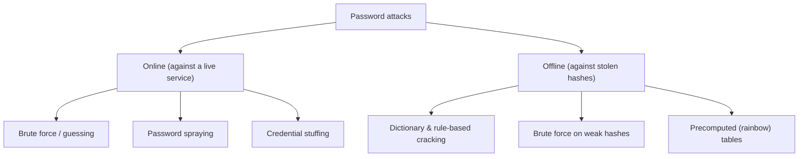
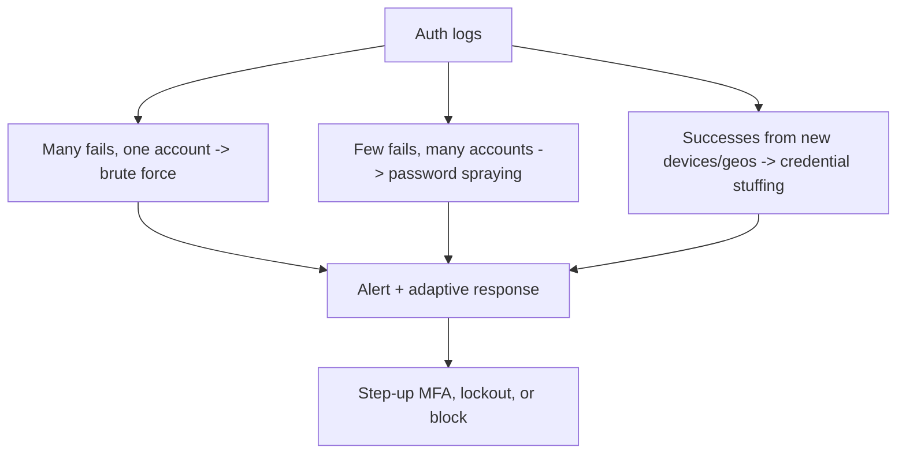

# Password Attacks and Defenses

## Introduction

Passwords are still the front door to most systems, which makes attacking them one of the oldest and most reliable techniques. Understanding password attacks is essential for *defenders*, because the defenses, how you store passwords, how you rate-limit logins, and whether you add a second factor, are entirely in your control and decide whether these attacks succeed.

Think of password security as a safe. An attacker can try combinations on the dial (online guessing), steal the whole safe and work on it in a basement (offline cracking), or find where you wrote the combination on a sticky note (credential reuse). Each threat has a different defense, and a strong lock does nothing if the combination is "0000" or taped to the door.

This page explains the attack categories at a concept level and focuses on defenses. It uses current, verified libraries and the current **NIST SP 800-63B** password guidance.

:::danger Authorized targets only
Cracking or guessing passwords for accounts you do not own is illegal. Practice cracking only against hashes you generated yourself in a lab, or on sanctioned platforms. Never test credentials against real third-party services.
:::

## The Categories of Attack



### Online attacks

These target a live login endpoint, so they are *rate-limited by the service* (if you built it right).

- **Brute force / guessing**: trying many passwords for one account. Slow and noisy; easy to block.
- **Password spraying**: trying one or a few common passwords across *many* accounts, to stay under per-account lockout thresholds. A top cause of real breaches.
- **Credential stuffing**: replaying username/password pairs leaked from *other* breaches, betting that people reuse passwords. Extremely effective because reuse is rampant.

### Offline attacks

If an attacker steals your password database, they can attack the **hashes** on their own hardware, as fast as their GPUs allow, with no rate limit. Here your choice of hashing algorithm is the entire defense.

- **Dictionary and rule-based cracking**: hash a wordlist (and variations like `Password1!`) and compare.
- **Brute force**: try all combinations; feasible only against weak, fast hashes.
- **Rainbow tables**: precomputed hash lookups, defeated entirely by salting.

## Defense 1: Store Passwords Correctly

Never store passwords in plaintext or with fast, general-purpose hashes (MD5, SHA-256). Use a **slow, salted, memory-hard password hashing function**: **Argon2id** (preferred), **scrypt**, or **bcrypt**. These are deliberately expensive, so each offline guess costs real time and memory.

```python
# pip install argon2-cffi
from argon2 import PasswordHasher
from argon2.exceptions import VerifyMismatchError

ph = PasswordHasher()   # sensible Argon2id defaults

# Registration: store only the hash (salt is generated and embedded automatically)
stored = ph.hash("correct horse battery staple")
print(stored[:24], "...")

# Login: verify
def check(stored_hash: str, attempt: str) -> bool:
    try:
        return ph.verify(stored_hash, attempt)
    except VerifyMismatchError:
        return False

print(check(stored, "wrong-password"))
print(check(stored, "correct horse battery staple"))
```

Example output:

```text
$argon2id$v=19$m=65536,t ...
False
True
```

bcrypt remains acceptable; it has a 72-byte input limit, so pre-hash long inputs or use Argon2id. See [Password Hashing](../1-sec-cryptography/2-sec-password-hashing.mdx) for parameters and migration.

```python
# Vulnerable: fast, unsalted hash. Crackable at billions of guesses/second.
import hashlib
bad = hashlib.sha256("hunter2".encode()).hexdigest()

# Fixed: slow, salted, memory-hard (Argon2id), as above.
```

## Defense 2: Rate Limit and Monitor Online Logins

Offline defense is the algorithm; online defense is throttling. **NIST SP 800-63B** calls for limiting consecutive failed attempts (an upper bound of 100 per account before the authenticator is locked and must be reset), plus measures like increasing delays after failures and bot detection.

```python
import time
from collections import defaultdict

FAILS = defaultdict(list)          # account -> list of failure timestamps
WINDOW = 900                       # 15 minutes
MAX_FAILS = 5                      # tune to your risk

def allow_attempt(account: str) -> bool:
    now = time.time()
    FAILS[account] = [t for t in FAILS[account] if now - t < WINDOW]
    return len(FAILS[account]) < MAX_FAILS

def record_failure(account: str):
    FAILS[account].append(time.time())

# Usage sketch
acct = "alice@example.com"
if not allow_attempt(acct):
    print("Too many attempts; slow down or verify it's you.")
else:
    print("Proceed to verify password")
```

Output:

```text
Proceed to verify password
```

Crucially, account-based limits alone do not stop **spraying** (few guesses per account across many accounts) or **stuffing** (correct-looking credentials). Add: IP and device reputation, CAPTCHA/bot detection on anomalies, impossible-travel checks, and alerting when failed logins spike across many accounts.

## Defense 3: Check Against Breach and Common-Password Lists

NIST requires screening new passwords against a blocklist of common and breached values. You can do this privately using a breach corpus with **k-anonymity**: hash the password, send only the first few characters of the hash, and compare locally against the returned bucket. The full password and full hash never leave your server.

```python
import hashlib

def breach_bucket_prefix(password: str) -> str:
    # SHA-1 is used only as a lookup index here, never to store the password.
    digest = hashlib.sha1(password.encode()).hexdigest().upper()
    prefix, suffix = digest[:5], digest[5:]
    # You would send ONLY `prefix` to the range API, then match `suffix`
    # against the returned list locally. The service never sees the password.
    return f"query prefix={prefix}, match suffix={suffix[:6]}... locally"

print(breach_bucket_prefix("lab-only-example"))
```

Example output:

```text
query prefix=F3BBB, match suffix=D4E9F2... locally
```

If the suffix is found, the password is in a known breach; reject it and tell the user to choose another. This blocks credential stuffing at the source: a password already leaked elsewhere is never allowed in the first place.

## Defense 4: Reduce Reliance on Passwords

The strongest defenses move beyond passwords:

- **Multi-factor authentication (MFA)**: even a correct password is not enough. Phishing-resistant factors (security keys, passkeys) are best. See [Multi-Factor Authentication](../4-sec-authentication/2-sec-mfa.mdx).
- **Passkeys / WebAuthn**: public-key credentials with nothing crackable to steal and no password to phish or reuse. See [Passkeys and WebAuthn](../4-sec-authentication/3-sec-passkeys.mdx).

## Lab Walkthrough: Why Hash Choice Decides Offline Safety

You can demonstrate, safely and entirely on your own machine, why a slow hash defeats offline cracking. Generate hashes of a *test* password you invented, then measure how long a single verification takes. Never use real passwords.

```python
import time, hashlib
from argon2 import PasswordHasher

test = "lab-only-passphrase-2026"

# Fast, general-purpose hash (WRONG for passwords)
t0 = time.perf_counter()
for _ in range(100_000):
    hashlib.sha256(test.encode()).hexdigest()
fast = (time.perf_counter() - t0) / 100_000

# Slow, memory-hard password hash (RIGHT)
ph = PasswordHasher()
h = ph.hash(test)
t0 = time.perf_counter()
ph.verify(h, test)
slow = time.perf_counter() - t0

print(f"SHA-256 per hash:  {fast*1e6:8.2f} microseconds")
print(f"Argon2id verify:   {slow*1e3:8.2f} milliseconds")
```

Example output (numbers vary by machine):

```text
SHA-256 per hash:      1.10 microseconds
Argon2id verify:      45.00 milliseconds
```

The gap is the whole story. A fast hash lets an attacker try billions of guesses per second against a stolen database; Argon2id makes each guess cost tens of milliseconds *and* significant memory, turning a feasible attack into an infeasible one. You are not cracking anything here, just measuring your own defenses.

:::note
The point of this exercise is the *ratio*, not the absolute numbers. Tune Argon2id so a single verify takes a noticeable fraction of a second on your production hardware, balancing security against login latency.
:::

## What Modern NIST Guidance Actually Says

The current **SP 800-63B** guidance changed what "strong policy" means:

| Rule | Modern guidance |
| --- | --- |
| Minimum length | At least 8; at least 15 for single-factor passwords; allow up to 64+ |
| Composition rules | Do **not** require mixes of character types |
| Periodic rotation | Do **not** force it; change only on evidence of compromise |
| Blocklist | **Do** screen against common/breached passwords |
| Rate limiting | Limit failed attempts (upper bound 100 per account), add delays and bot detection |
| Password managers | Allow paste and autofill |

The old advice (complex characters, forced 90-day changes) actively *weakened* security by pushing users toward predictable patterns. See [Secure Password Authentication](../4-sec-authentication/1-sec-password-authentication.mdx).

## The Defender's View: Detecting Password Attacks

Each attack type has a distinct fingerprint in your authentication logs. Detecting the pattern is as important as preventing it.



| Attack | Log fingerprint | Response |
| --- | --- | --- |
| Brute force | Spike of failures on one account | Per-account throttle, lockout |
| Password spraying | A few failures across *many* accounts, often one source | Source-based rate limit, alert on breadth |
| Credential stuffing | Many *successful* logins from new devices/locations | Risk-based step-up MFA, notify users |

Crucially, per-account counters miss spraying and stuffing because no single account sees many attempts. You need a view *across* accounts. A small detector for a spraying pattern:

```python
from collections import defaultdict

# (timestamp omitted) failed logins: (source_ip, account)
fails = [
    ("203.0.113.9", "alice"), ("203.0.113.9", "bob"),
    ("203.0.113.9", "carol"), ("203.0.113.9", "dave"),
    ("203.0.113.9", "erin"),
]
accounts_by_ip = defaultdict(set)
for ip, acct in fails:
    accounts_by_ip[ip].add(acct)

for ip, accts in accounts_by_ip.items():
    if len(accts) >= 5:
        print(f"ALERT spraying: {ip} failed against {len(accts)} distinct accounts")
```

Example output:

```text
ALERT spraying: 203.0.113.9 failed against 5 distinct accounts
```

Feed authentication events into a SIEM and alert on all three patterns. See [Security Logging and SIEM](../11-sec-defensive-operations/1-sec-logging-and-siem.mdx). Always log the *outcome* and metadata (source, device, geo), never the password itself, even hashed.

## Real-World Scenario

**Your consumer app sees a spike in account takeovers. Logs show successful logins from unusual locations, with no brute-force pattern on any single account.** This is the signature of **credential stuffing**: attackers replaying passwords leaked elsewhere, so each login looks "correct."

Per-account lockout will not help, because they usually get the password right on the first try. Layered response:

1. Screen all passwords (at set and at next login) against a breach corpus; force a reset for matches.
2. Roll out MFA, prioritizing phishing-resistant passkeys, and require it for risky logins.
3. Add bot detection and device/IP reputation; challenge anomalous logins with step-up verification.
4. Alert when logins succeed from new devices/locations and notify users.
5. Confirm passwords are stored with Argon2id, in case the database itself was exposed.

### Why this approach

Stuffing exploits password *reuse*, not weak hashing or your rate limits, so the defenses must target reuse (breach screening) and add a factor the attacker does not have (MFA/passkeys). Rate limiting and strong hashing remain necessary for the other attack types.

### When to use it, when not to

MFA and breach screening are appropriate for essentially every user-facing app. The trade-off is user friction; mitigate it with passkeys (often *less* friction than passwords) and risk-based step-up so low-risk logins stay smooth. For internal/admin accounts, phishing-resistant MFA should be mandatory, no exceptions.

### Alternatives and trade-offs

| Control | Stops which attacks | Cost / friction | Notes |
| --- | --- | --- | --- |
| Argon2id hashing | Offline cracking | Low (one-time) | Non-negotiable baseline |
| Rate limiting | Online brute force | Low | Weak against spraying/stuffing alone |
| Breach-password screening | Credential stuffing (reuse) | Low | Use k-anonymity, never send the password |
| MFA (TOTP) | Stuffing, weak passwords | Medium, phishable | Big improvement, not phishing-proof |
| Passkeys / WebAuthn | Stuffing, phishing, reuse | Medium rollout, low ongoing | Strongest; no shared secret to steal |

## Upgrading Legacy Password Storage

Many real systems still hold old hashes (MD5, SHA-1, unsalted SHA-256). You cannot reverse them to rehash, but you can upgrade users transparently the next time they log in:

```python
import hashlib
from argon2 import PasswordHasher

ph = PasswordHasher()

def login(user: dict, attempt: str) -> bool:
    if user["algo"] == "sha256":                       # legacy record
        if hashlib.sha256(attempt.encode()).hexdigest() != user["hash"]:
            return False
        user["hash"], user["algo"] = ph.hash(attempt), "argon2id"   # upgrade now
        return True
    ok = ph.verify(user["hash"], attempt)
    if ph.check_needs_rehash(user["hash"]):            # parameters were raised
        user["hash"] = ph.hash(attempt)
    return ok

u = {"algo": "sha256", "hash": hashlib.sha256(b"lab-pass").hexdigest()}
print(login(u, "lab-pass"), u["algo"])
```

Output:

```text
True argon2id
```

For accounts that never log in again, wrap the old hash inside Argon2id (hash the legacy hash) so the whole table is protected now, and expire those accounts after a set period.

## Common Mistakes

- **Fast or unsalted hashes.** MD5/SHA-256 on passwords is crackable at enormous speed. Use Argon2id.
- **Relying on rate limiting alone.** It does little against spraying and stuffing.
- **Forcing complexity and rotation.** Modern guidance says these backfire; screen against blocklists instead.
- **Capping password length or blocking paste.** This breaks password managers and weakens security.
- **No MFA on admin accounts.** The highest-value accounts need the strongest factor.
- **Not monitoring login anomalies.** Successful logins from new places are the clearest stuffing signal.
- **Per-account limits only.** They miss spraying and stuffing; add cross-account and per-source detection.
- **Logging passwords.** Never log the credential, even hashed; log outcome, source, device, and geo instead.
- **Tuning Argon2id too low.** Pick parameters that make each verify cost a noticeable fraction of a second on your hardware.
- **Account-enumeration leaks.** Different responses for "unknown user" vs "wrong password" help attackers; keep them identical and generic.

## Summary

- Password attacks split into online (rate-limited by you) and offline (limited only by your hash choice).
- Spraying and credential stuffing, which exploit password reuse, cause many real breaches.
- Store passwords with Argon2id (or bcrypt/scrypt): slow, salted, memory-hard.
- Rate-limit and monitor logins, screen passwords against breach lists, and follow current NIST 800-63B guidance.
- The strongest defense is to rely less on passwords: MFA and, best of all, passkeys.

## Further Learning

- Hash a test password with Argon2id and time how long a single verify takes.
- Read [Passkeys and WebAuthn](../4-sec-authentication/3-sec-passkeys.mdx) and plan a passkey rollout.

### Exercises

1. Replace a SHA-256 password store with `argon2-cffi` and add a verify-and-rehash-on-login upgrade path.
2. Extend the rate-limiter to also track failures per IP and detect a spraying pattern across many accounts.
3. Write a short, NIST-aligned password policy for your app and explain why it omits forced rotation and complexity rules.
4. Run the hashing benchmark on your machine and choose Argon2id parameters that target roughly 250 ms per verify.
5. Extend the spraying detector to also flag credential stuffing (successful logins from many new source IPs for different accounts).

Related pages: [Password Hashing](../1-sec-cryptography/2-sec-password-hashing.mdx), [Secure Password Authentication](../4-sec-authentication/1-sec-password-authentication.mdx), [Multi-Factor Authentication](../4-sec-authentication/2-sec-mfa.mdx), [Passkeys and WebAuthn](../4-sec-authentication/3-sec-passkeys.mdx).
