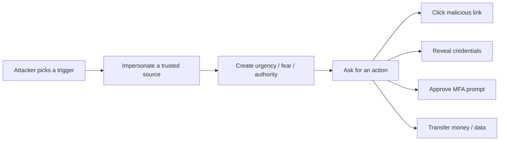
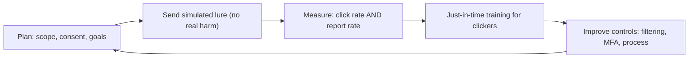

# Social Engineering and Phishing

## Introduction

**Social engineering** is hacking people instead of machines. Rather than defeating a firewall, the attacker convinces a human to open the door: click a link, hand over a password, approve a login, or wire money. **Phishing**, fraudulent messages that impersonate a trusted party, is the most common form and the starting point of a large share of real breaches.

It works because it targets the one component you cannot patch: human judgment under pressure. A con artist does not pick the lock; they wear a delivery uniform, carry a heavy box, and ask you to hold the door. You help, because helping is normal and refusing feels rude. Social engineering weaponizes exactly that instinct.

For a defender, this topic is about building an organization and systems that stay safe *even when a person is fooled*, because eventually someone will be. The ethics here are especially important: phishing simulations and awareness testing must be authorized, scoped, and never punitive.

:::danger Authorized and ethical only
Only run phishing simulations or social-engineering tests against your own organization, with leadership authorization and clear rules. Never target individuals without consent, never use real coercion or harm, and never collect real credentials. Simulations are for learning, not for shaming staff.
:::

## Why It Works: The Triggers

Attackers exploit predictable psychological levers (often credited to Robert Cialdini's principles of influence):

- **Authority**: "This is the CEO. I need this done now."
- **Urgency and scarcity**: "Your account will be closed in 2 hours."
- **Fear**: "We detected fraud on your account; verify immediately."
- **Trust / familiarity**: spoofing a brand, a colleague, or a vendor you know.
- **Reciprocity and helpfulness**: people want to assist, especially someone who seems stuck.
- **Social proof**: "Everyone on your team has already completed this."



## The Forms of Attack

| Form | Channel | Description |
| --- | --- | --- |
| Phishing | Email (mass) | Fraudulent email to many targets |
| Spear phishing | Email (targeted) | Tailored to a specific person using OSINT |
| Whaling | Email | Targeting executives, high value |
| Business Email Compromise (BEC) | Email | Impersonating an exec/vendor to redirect payments |
| Smishing | SMS | Phishing via text message |
| Vishing | Voice call | Phone-based pretexting, now often AI voice |
| Pretexting | Any | An invented scenario to build trust |
| Baiting | Physical / digital | A lure like a "found" USB drive |
| MFA fatigue | Push notifications | Spamming approve prompts until the user taps yes |

Attacks increasingly combine channels (an email followed by a "confirming" phone call) and use AI to write flawless, personalized messages and even clone voices, which has made the old "look for bad grammar" advice unreliable.

## The Phishing Chain and Where to Break It

A phishing attack is a chain of steps, and defenders can break any link:

1. **Reconnaissance**: the attacker gathers names, roles, and email formats (see [Reconnaissance and OSINT](./2-sec-reconnaissance.mdx)). *Defense: reduce public oversharing.*
2. **Delivery**: the email reaches the inbox. *Defense: email authentication and filtering.*
3. **Deception**: the user believes it. *Defense: training and clear reporting.*
4. **Action**: the user clicks or enters credentials. *Defense: phishing-resistant MFA, no-credential-on-link habits.*
5. **Exploitation**: the attacker uses what they got. *Defense: least privilege, detection, response.*

## Defense 1: Authenticate Email

Three standards let receiving servers verify that mail really came from your domain and reject spoofs. Publish all three for every domain you own (even ones that do not send mail):

- **SPF** (Sender Policy Framework): lists which servers may send for your domain.
- **DKIM** (DomainKeys Identified Mail): cryptographically signs messages.
- **DMARC**: tells receivers what to do when SPF/DKIM fail, and sends you reports.

```text
# DNS TXT records (illustrative)
example.com.          TXT  "v=spf1 include:_spf.example-mail.com -all"
_dmarc.example.com.   TXT  "v=DMARC1; p=reject; rua=mailto:dmarc@example.com"
```

Move DMARC from `p=none` (monitor) to `p=quarantine` and finally `p=reject` once reports show legitimate mail passes. This stops attackers from spoofing *your* domain to your own staff and customers. See [DNS Security](../2-sec-network-security/4-sec-dns-security.mdx).

## Defense 2: Phishing-Resistant MFA

Most MFA (SMS codes, TOTP, push) can still be phished: the user enters the code on a fake site that relays it, or taps "approve" during MFA fatigue. **Passkeys / WebAuthn** security keys are *phishing-resistant* because the credential is cryptographically bound to the real site's origin; it simply will not work on a look-alike domain.

```python
# Concept: why origin binding defeats phishing.
legit_origin  = "https://accounts.example.com"
phish_origin  = "https://accounts.examp1e.com"   # note the digit 1

def webauthn_allows(requesting_origin: str) -> bool:
    # The authenticator signs a challenge bound to the real origin only.
    return requesting_origin == legit_origin

print(webauthn_allows(phish_origin))   # phishing site cannot get a valid assertion
print(webauthn_allows(legit_origin))
```

Output:

```text
False
True
```

See [Passkeys and WebAuthn](../4-sec-authentication/3-sec-passkeys.mdx) and [Multi-Factor Authentication](../4-sec-authentication/2-sec-mfa.mdx).

## Lab Walkthrough: Build a Phishing Analysis Checklist

You cannot ethically phish real people to practice, but you *can* practice **analysis**: safely dissecting a suspicious email's headers and links in an isolated environment. This is exactly what a SOC analyst does. Use a sample you received yourself or a provided training sample, never a live link.

### Step 1: read the authentication results

Mail servers stamp the results of SPF, DKIM, and DMARC into the headers. Check them first:

```text
Authentication-Results: mx.example.com;
  spf=fail smtp.mailfrom=ceo@acme-payroll.cc;
  dkim=none;
  dmarc=fail (p=reject) header.from=acme.com
```

`spf=fail`, `dkim=none`, and `dmarc=fail` on a message claiming to be from your domain is a near-certain spoof. A parser that flags this:

```python
def verdict(headers: str) -> str:
    bad = sum(flag in headers for flag in ("spf=fail", "dkim=fail", "dkim=none", "dmarc=fail"))
    return "LIKELY SPOOF" if bad >= 2 else "needs review"

sample = "spf=fail smtp.mailfrom=ceo@acme-payroll.cc dkim=none dmarc=fail"
print(verdict(sample))
```

Example output:

```text
LIKELY SPOOF
```

### Step 2: inspect the display name vs the real address

A classic trick is a friendly display name hiding a hostile address:

```text
From: "Acme CEO" <ceo@acme-payroll.cc>
```

The display name says "Acme CEO"; the actual domain is `acme-payroll.cc`, not `acme.com`. Teach people to read the address, not the name.

### Step 3: examine links without clicking

Hover (or in analysis, read the raw HTML) to see the true destination, and watch for look-alike domains using digit/letter swaps:

```text
Displayed: https://acme.com/reset
Actual:    https://acme.com.secure-login.cc/reset   <- real domain is secure-login.cc
```

Record these indicators in a reusable triage checklist that any employee or analyst can follow.

## Defense 3: People and Process

- **Awareness training**: teach the triggers and how to verify, repeatedly and realistically. Make it blameless.
- **Easy reporting**: a one-click "report phishing" button turns every employee into a sensor and speeds response.
- **Out-of-band verification for money and data**: any payment change or sensitive request must be confirmed through a *separate, known* channel (call the known number, not the one in the email). This single rule stops most BEC.
- **Simulated phishing**: authorized, scoped campaigns that measure click/report rates and guide training, never used to punish.

:::tip Measure reporting, not just clicking
A mature program celebrates a rising *report rate*, not just a falling click rate. You want people who notice and raise the alarm, because the attacker only needs one success, and your defenders need early warning.
:::

## The Defender's View: Running Authorized Simulations and Measuring Response

An authorized phishing simulation is a controlled test, run with leadership sign-off, that measures and improves readiness. Done well it is blameless and educational; done badly it breeds resentment and teaches people to hide mistakes.



Rules that keep a program ethical and effective:

- **Authorization in writing** from leadership, with HR and legal aware.
- **No real harm or humiliation.** No capturing real credentials, no public shaming, no firing-threat lures.
- **Blameless debrief.** Clickers get immediate, supportive micro-training, not punishment.
- **Measure reporting, not just clicking.** A rising report rate means your human sensors are working.

Track the metrics over time so you can show improvement:

```python
campaigns = [
    {"month": "Jan", "sent": 500, "clicked": 90, "reported": 60},
    {"month": "Apr", "sent": 500, "clicked": 45, "reported": 210},
]
for c in campaigns:
    click = 100 * c["clicked"] / c["sent"]
    report = 100 * c["reported"] / c["sent"]
    print(f"{c['month']}: click {click:.0f}%  report {report:.0f}%")
```

Example output:

```text
Jan: click 18%  report 12%
Apr: click 9%  report 42%
```

The healthy trend is clicks down *and* reports up. A program that only drives clicks down (by making lures obvious) misses the point; you want people who notice and raise the alarm.

## Real-World Scenario

**Your finance team receives an email, apparently from the CEO, urgently asking to change a vendor's bank details before a payment runs that afternoon.** The writing is perfect and the sender name matches. This is textbook **Business Email Compromise**.

Layered defense:

1. **DMARC at `p=reject`** so an exact-domain spoof is blocked outright; the attacker is forced to a look-alike domain, which is easier to spot.
2. **A hard process rule**: no bank-detail change happens without out-of-band verification to a pre-known phone number, regardless of who seems to be asking.
3. **Training** so finance recognizes urgency + authority + payment change as the BEC pattern and feels empowered to pause.
4. **A report button** so the email is flagged to security, who can warn others and hunt for similar messages.
5. **Phishing-resistant MFA** on email accounts so a compromised mailbox (the other BEC variant) is far less likely.

### Why this approach

Technology alone cannot stop a convincing look-alike-domain email, and people alone cannot catch every spoof. The combination, email authentication to cut the easy spoofs, plus an unbreakable out-of-band process for money, defeats the attack even when a person is momentarily fooled.

### When to use it, when not to

Out-of-band verification should be mandatory for financial and sensitive-data requests everywhere. The trade-off is a little friction on legitimate requests, which is trivial next to a six-figure fraudulent transfer. For low-risk internal requests, lighter verification is fine; match the control to the stakes.

### Alternatives and trade-offs

| Control | Strength | Limitation | Best for |
| --- | --- | --- | --- |
| Email filtering | Blocks bulk/known-bad | Misses targeted, novel lures | Baseline for all mail |
| SPF/DKIM/DMARC | Stops domain spoofing | Not look-alike domains | Every domain you own |
| Awareness training | Builds human judgment | Fades, never 100% | Whole organization, ongoing |
| Phishing-resistant MFA | Defeats credential phishing | Rollout effort | Protecting accounts |
| Out-of-band verification | Stops BEC/payment fraud | Adds process friction | Money and data changes |

## When Someone Falls for It: Fast Response

Assume that eventually someone clicks and enters credentials. Speed of response then decides whether it becomes an incident. Pre-build this playbook:

1. **Contain**: force a password reset and revoke active sessions and tokens for the affected account immediately.
2. **Check MFA**: look for attacker-registered MFA devices or new app passwords; remove them.
3. **Scope**: review the account's recent activity: mail rules (auto-forwarding is a classic BEC move), sent items, and data access.
4. **Hunt**: search for the same lure delivered to others and quarantine it.
5. **Recover and learn**: restore normal access, then run a blameless review.

```text
Compromised-account checklist
  [ ] Reset password, revoke all sessions/refresh tokens
  [ ] Remove unknown MFA methods / app passwords
  [ ] Delete malicious inbox rules (auto-forward, auto-delete)
  [ ] Review sent mail and data downloads
  [ ] Search & purge the lure from other mailboxes
  [ ] Notify affected parties; blameless debrief
```

This ties directly into [Incident Response Playbooks](../12-sec-incident-response/1-sec-incident-playbooks.mdx). The person who reports "I think I just clicked something" is doing exactly the right thing; reward it.

## Deepfakes and AI-Era Lures

Attackers now use AI to clone voices and generate convincing video and text. A "CFO" on a video call approving a transfer may be synthetic. The defenses are process-based, because you can no longer rely on recognizing a voice or face:

- Keep the **out-of-band, pre-known-channel** rule for money and sensitive actions, regardless of how convincing the request seems.
- Use **code words** or ticketing workflows for high-risk approvals.
- Treat urgency plus a request to bypass normal process as the red flag itself, independent of who appears to be asking.

## Technical Guardrails That Assume a Click

Training reduces clicks; guardrails limit the damage when a click still happens. Useful controls, roughly in order of value:

| Guardrail | What it limits |
| --- | --- |
| Phishing-resistant MFA | Stolen passwords become useless |
| Block auto-forwarding to external domains | A classic BEC persistence trick |
| External-sender banners | Reminds users a "colleague" is outside the company |
| Look-alike domain monitoring | Spots domains registered to imitate yours |
| Attachment sandboxing and macro blocking | Malicious documents from the internet |
| DNS filtering | Known-bad destinations after a click |

A simple look-alike check for domains you see in mail logs, using edit distance against your real domain:

```python
def distance(a: str, b: str) -> int:
    prev = list(range(len(b) + 1))
    for i, ca in enumerate(a, 1):
        cur = [i]
        for j, cb in enumerate(b, 1):
            cur.append(min(prev[j] + 1, cur[j - 1] + 1, prev[j - 1] + (ca != cb)))
        prev = cur
    return prev[-1]

ours = "acme.com"
for d in ["acme.com", "acrne.com", "acme-payroll.cc", "acme.co"]:
    dist = distance(d, ours)
    if 0 < dist <= 2:
        print(f"Look-alike: {d} (distance {dist})")
```

Output:

```text
Look-alike: acrne.com (distance 2)
Look-alike: acme.co (distance 1)
```

### Make reporting one click

The report button is only useful if reports reach someone quickly. A minimal flow: the user clicks "Report phishing", the message goes to a shared security mailbox or ticket queue, an analyst (or automation) checks the headers and links, and similar messages are pulled from every inbox. Close the loop by telling the reporter what happened; people who hear "thanks, that was real and we removed it from 40 inboxes" report again.

## Common Mistakes

- **Teaching "look for bad grammar."** AI-written phishing is flawless; teach verification habits instead.
- **DMARC stuck at `p=none`.** Monitoring forever never blocks a spoof. Progress to `p=reject`.
- **Phishable MFA on high-value accounts.** Prefer passkeys/security keys for admins and finance.
- **Punitive simulations.** Shaming staff teaches them to hide mistakes, not report them.
- **No out-of-band rule for payments.** This is the gap BEC drives a truck through.
- **Hard-to-find reporting.** If reporting is a chore, people just delete suspicious mail and you lose the signal.
- **Reading the display name, not the address.** The friendly name is attacker-controlled; check the real domain.
- **Trusting a link because the start looks right.** `acme.com.secure-login.cc` is the attacker's domain, not yours.
- **Simulations without sign-off.** Always get written authorization; unauthorized tests harm trust and can break policy.
- **Ignoring vishing and smishing.** Phone and SMS lures, now often AI voice, bypass email controls entirely.

## Summary

- Social engineering attacks human judgment; phishing is its most common form and a top breach cause.
- Attackers exploit authority, urgency, fear, trust, and helpfulness, increasingly with AI-crafted, multi-channel lures.
- Authenticate your email with SPF, DKIM, and DMARC (reach `p=reject`) to stop domain spoofing.
- Use phishing-resistant MFA (passkeys/security keys), which is bound to the real site's origin.
- Pair technology with blameless training, easy reporting, and mandatory out-of-band verification for money and data.

## Further Learning

- Check your domain's SPF, DKIM, and DMARC records and plan the path to `p=reject`.
- Read [Passkeys and WebAuthn](../4-sec-authentication/3-sec-passkeys.mdx) for the strongest anti-phishing control.

### Exercises

1. Draft the SPF and DMARC TXT records for a domain you own and describe the staged rollout to `p=reject`.
2. Write a one-page, blameless anti-phishing guide for non-technical staff that avoids the "bad grammar" myth.
3. Design an out-of-band verification procedure for vendor bank-detail changes and list where it could still fail.
4. Build the header-analysis checklist from the lab walkthrough and run it against a training sample, recording each indicator.
5. Sketch a blameless phishing-simulation plan: scope, consent, metrics (click and report), and the debrief flow.

Related pages: [Reconnaissance and OSINT](./2-sec-reconnaissance.mdx), [Multi-Factor Authentication](../4-sec-authentication/2-sec-mfa.mdx), [Passkeys and WebAuthn](../4-sec-authentication/3-sec-passkeys.mdx), [DNS Security](../2-sec-network-security/4-sec-dns-security.mdx).
