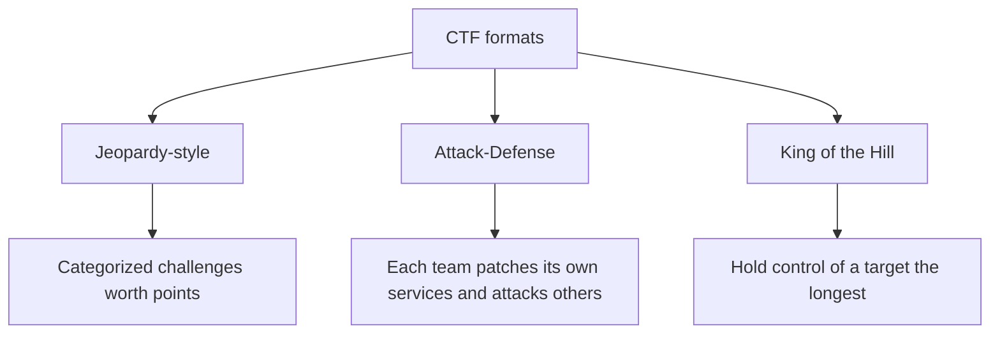
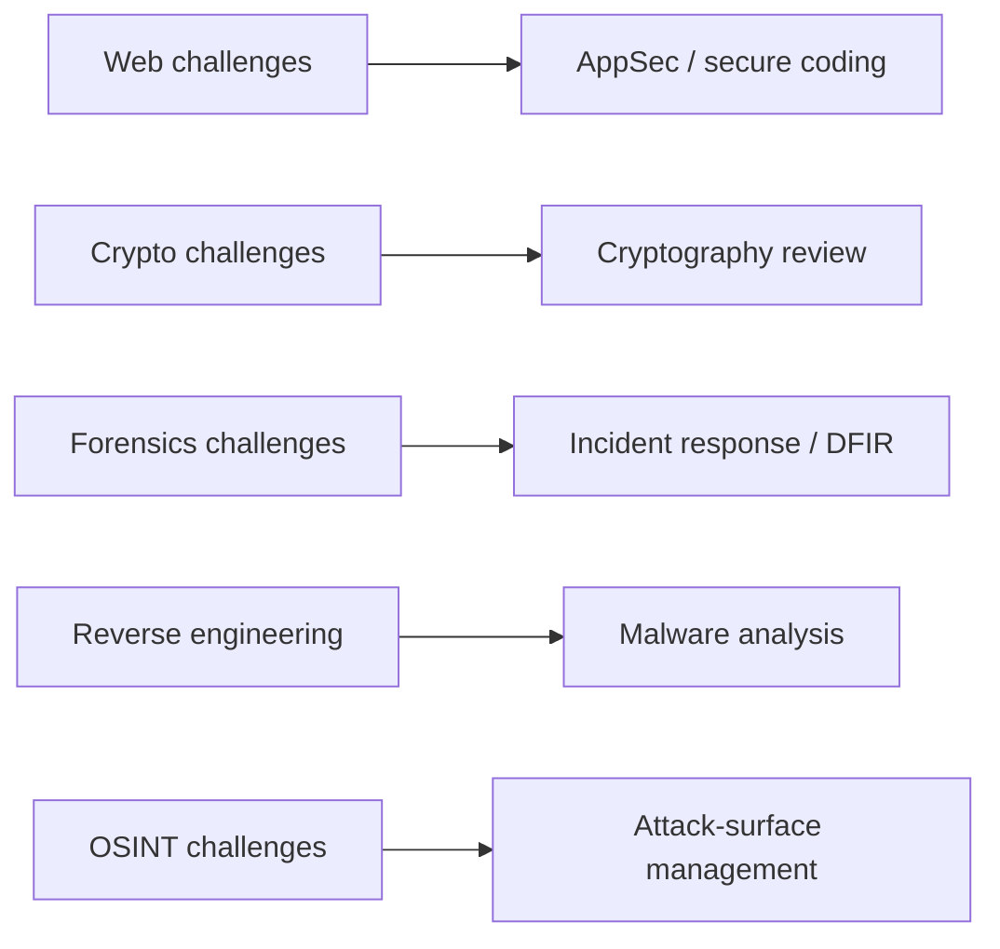

# Capture the Flag Competitions

## Introduction

A **Capture the Flag (CTF)** is a security competition where you solve challenges to find hidden strings called **flags**, usually in a format like `flag{y0u_found_it}`. Each challenge is a self-contained puzzle: exploit this deliberately vulnerable web app, decrypt this message, reverse-engineer this binary. Submitting the flag proves you solved it and earns points.

CTFs are the single best way to practice offensive security *legally and safely*, because the organizers build the targets specifically to be attacked and invite you to do it. Think of it as a climbing gym: real rock, real technique, real difficulty, but with crash mats, marked routes, and someone who *wants* you to try hard moves. You build the exact skills used on real walls, without the danger of attacking something you shouldn't.

For a defender, CTFs are a fast, fun way to build intuition for how attackers think, which is what lets you anticipate and block them.

:::tip This is the legal playground
In a CTF, the challenges are the authorized targets. Attack them freely. Just stay inside the competition: never attack the scoreboard, the infrastructure, or other players, which is both against the rules and often illegal.
:::

## Formats



- **Jeopardy-style** is the most common and most beginner-friendly: a board of challenges in categories, each worth points by difficulty. You solve what you can, in any order.
- **Attack-Defense** gives each team identical vulnerable services. You must find and patch your own bugs (defense) while exploiting the same bugs in opponents (offense), all at once. This is intensely realistic and teaches *both* sides.
- **King of the Hill** rewards taking and holding control of a shared target.

## The Categories

| Category | What you do | Real-world skill it builds |
| --- | --- | --- |
| Web | Exploit web app flaws (injection, access control) | Web app security, secure coding |
| Crypto | Break weak or misused cryptography | Spotting crypto mistakes in code |
| Pwn / binary exploitation | Exploit memory-safety bugs in binaries | Understanding memory safety, RCE |
| Reverse engineering | Understand what a compiled program does | Malware analysis, debugging |
| Forensics | Recover evidence from files, memory, traffic | Incident response, DFIR |
| OSINT | Find information from public sources | Attack-surface mapping |
| Misc / stego | Puzzles, hidden data | Lateral thinking, tooling |

Notice how directly each maps to a defensive discipline. A web challenge teaches exactly the flaws covered in [Web Application Security](../3-sec-web-security/0-sec-web-security-introduction.mdx); forensics is the hands-on side of [Digital Forensics Basics](../12-sec-incident-response/2-sec-digital-forensics.mdx).

## A Taste of a Challenge

CTF solutions are usually small scripts. Here is a *gentle* example in the spirit of a beginner crypto challenge: a message hidden with a simple XOR against a single-byte key, which you brute-force (256 possibilities). This is safe, self-contained, and illustrates the "write a short script to find the flag" workflow.

```python
# A tiny "crypto" style puzzle: single-byte XOR, brute force all 256 keys.
ciphertext = bytes([0x66, 0x6a, 0x60, 0x66, 0x27, 0x60, 0x75, 0x66])

for key in range(256):
    candidate = bytes(b ^ key for b in ciphertext)
    # Flags are printable; filter to plausible text
    if all(32 <= c < 127 for c in candidate):
        text = candidate.decode()
        if "ctf" in text.lower():
            print(f"key={key:#04x} -> {text}")
```

Example output:

```text
key=0x05 -> ctf{xor}
```

The defensive lesson is immediate: single-byte XOR is trivially broken, which is why real systems use vetted algorithms. CTFs teach you to *recognize* weak crypto, so you never ship it. See [Common Cryptography Mistakes](../1-sec-cryptography/10-sec-crypto-mistakes.mdx).

## A Worked Forensics Example

Forensics challenges hand you a file and ask what is hidden in it. The first tool is almost always `strings`, which extracts printable text from any binary. Here is the workflow on a sample file you create yourself:

```bash
# Create a toy "artifact" with a flag buried in binary noise
printf '\x00\x01\x02flag{hidden_in_bytes}\xff\xfe' > artifact.bin

# Extract printable strings and search for the flag format
strings artifact.bin | grep -i 'flag{'
```

Example output:

```text
flag{hidden_in_bytes}
```

Real challenges are harder (data hidden in image metadata, network captures, or memory dumps), but the instinct is the same: enumerate what the file contains before assuming you need something clever. The defensive parallel is [Digital Forensics Basics](../12-sec-incident-response/2-sec-digital-forensics.mdx): an incident responder uses the exact same tools to recover evidence from a compromised host.

## A Worked Web Example

Web challenges mirror the [OWASP Top 10](../3-sec-web-security/1-sec-owasp-top-10.mdx). A common beginner task hides data in a cookie that the server trusts without verifying. Suppose a cookie is `role=dXNlcg==` (Base64 for `user`):

```python
import base64
print(base64.b64decode("dXNlcg==").decode())          # decode what the app stored
print(base64.b64encode(b"admin").decode())             # what a tampered value would be
```

Example output:

```text
user
YWRtaW4=
```

If changing the cookie to `role=YWRtaW4=` grants admin, the app is trusting client-side data. The **defensive fix** is the real lesson: never trust client-controlled values for authorization; use a signed, server-side session (see [Sessions and Cookies](../4-sec-authentication/4-sec-sessions-and-cookies.mdx)) and check roles server-side. CTFs teach you to *recognize* this trust mistake so you never ship it.

## How Categories Map to Defensive Careers



Every hour in a CTF builds a skill a blue-team role uses daily. That is why defenders, not just aspiring pentesters, benefit from playing.

## Getting Started

1. **Pick a beginner platform.** PicoCTF (aimed at students, available year-round), TryHackMe, and Hack The Box have guided, beginner tracks. CTFtime lists upcoming live competitions and team rankings.
2. **Set up your lab.** A Kali/Parrot VM with common tools, from [Building a Safe Practice Lab](./1-sec-lab-setup.mdx).
3. **Start with web and forensics.** They need the least specialized tooling and build broadly useful skills.
4. **Read write-ups.** After a CTF, players publish detailed solution write-ups. Reading them (even for challenges you solved) is where most learning happens.
5. **Keep notes.** Build a personal cheat sheet of tools and techniques. You will reuse them constantly.

```text
My CTF toolkit notes
- Web:     browser devtools, an intercepting proxy, curl
- Crypto:  Python, CyberChef (encoding/decoding)
- Forensics: file, strings, exiftool, Wireshark
- Rev:     a disassembler/decompiler, a debugger
- Always:  take notes, save payloads, read the write-up after
```

:::note
Many tools and platforms here are free. You do not need paid licenses to start competing; a free account and a VM are enough.
:::

## A Worked Crypto Example: Spotting Reuse

Beyond the single-byte XOR above, a common beginner crypto lesson is **key reuse**. If two messages are XORed with the *same* keystream, XORing the ciphertexts together cancels the key and leaks the relationship between the plaintexts. You do not need to break the cipher; the misuse breaks it for you.

```python
# Two "messages" encrypted with the SAME one-time pad (the mistake)
pad = bytes([0x13, 0x27, 0x4a, 0x55, 0x6e])
m1 = b"HELLO"
m2 = b"WORLD"
c1 = bytes(a ^ b for a, b in zip(m1, pad))
c2 = bytes(a ^ b for a, b in zip(m2, pad))

# An attacker XORs the ciphertexts; the pad cancels out
leak = bytes(a ^ b for a, b in zip(c1, c2))
recovered = bytes(a ^ b for a, b in zip(leak, m1))   # == m2 if you can guess m1
print("c1^c2 == m1^m2:", leak == bytes(a ^ b for a, b in zip(m1, m2)))
print("recovered:", recovered.decode())
```

Example output:

```text
c1^c2 == m1^m2: True
recovered: WORLD
```

The defensive lesson is immediate and real: **never reuse a key or nonce.** This exact mistake has caused real-world breaks, which is why you use vetted AEAD constructions that manage nonces for you. See [Symmetric Encryption](../1-sec-cryptography/3-sec-symmetric-encryption.mdx) and [Common Cryptography Mistakes](../1-sec-cryptography/10-sec-crypto-mistakes.mdx).

## Building a Practice Routine

Sporadic effort builds little. A simple, sustainable cadence works better:

| Cadence | Activity |
| --- | --- |
| Weekly | One or two challenges on a year-round platform (PicoCTF, PortSwigger) |
| Monthly | Join one live CTF from CTFtime, even for a few hours |
| After every event | Read write-ups, including for challenges you solved |
| Ongoing | Keep a personal notes file of tools and techniques |

Track your own progress by category so you can see where you are weak and deliberately practice it, rather than only replaying your strengths.

## Running an Internal CTF

If you want to host a session for your team, you do not need to build infrastructure from scratch. **CTFd** is a popular open-source platform for jeopardy-style events: you add challenges, point values, and flags, and it handles registration, scoring, and the leaderboard. Combine it with challenges built from your lab targets.

A minimal challenge definition (concept) looks like this:

```yaml
challenges:
  - name: "Cookie Monster"
    category: web
    value: 100
    description: "This app trusts something it shouldn't. Become admin."
    flag: "flag{server_side_authz_please}"
  - name: "Hidden in Plain Sight"
    category: forensics
    value: 50
    description: "There's more in this file than meets the eye."
    flag: "flag{strings_are_your_friend}"
```

Validate the structure before importing:

```python
import yaml
data = yaml.safe_load(open("challenges.yml"))
for c in data["challenges"]:
    assert c["flag"].startswith("flag{"), f"bad flag format in {c['name']}"
    print(f"{c['category']:9} {c['value']:>4}  {c['name']}")
```

Example output:

```text
web        100  Cookie Monster
forensics   50  Hidden in Plain Sight
```

Keep it blameless and inclusive: mixed-skill teams, hints available, and a debrief that turns each challenge into a lesson about your own codebase.

## How CTF Skills Transfer (and Where They Don't)

CTFs are excellent for **technique, tooling, and attacker intuition**. They are *not* a complete picture of professional security work:

- CTF challenges have a guaranteed solution and a clear flag; real systems may have no bug, or a dozen, with no scoreboard.
- CTFs reward speed and cleverness; professional work rewards thoroughness, clear reporting, and not breaking things.
- CTFs skip scoping, authorization, stakeholder communication, and remediation, the parts of real [penetration testing](./0-sec-pentest-introduction.mdx) that matter most to a client.

So treat CTFs as skill-building, not as the whole job. The best practitioners do both: CTFs to sharpen technique, real engagements (and defensive work) to apply it responsibly.

## Staying Inside the Rules

CTFs are the legal playground, but the boundary is still real. The platform's terms of service are your scope:

- **Attack only the provided challenges**, never the scoreboard, the hosting infrastructure, or other competitors.
- **Do not share flags** outside the rules; flag-sharing is cheating and often bannable.
- **Do not take techniques off the range.** A technique that is fine against a CTF box is a crime against a system you do not own. The skill transfers; the authorization does not.

This is the same lesson as the rest of this section: the technique is neutral, and authorization is everything. A CTF simply hands you standing authorization for its own targets. See [Ethics, Law and Responsible Disclosure](../0-sec-fundamentals/8-sec-ethics-and-law.mdx).

## Real-World Scenario

**You lead a small engineering team and want to raise everyone's security awareness without a dry lecture.** Reading OWASP docs has not stuck. You want hands-on learning that developers actually enjoy.

Run an **internal CTF** or a team session on a beginner platform:

1. Pick a free platform (PicoCTF-style) or host a small jeopardy board with web and forensics challenges built from your lab targets.
2. Form mixed teams so stronger and newer people pair up.
3. Focus on web challenges that mirror flaws in your own stack (injection, access control), so the lessons transfer directly to the code they write.
4. Debrief afterward: for each challenge, discuss the fix and relate it to your codebase and secure-coding standards.

### Why this approach

People remember what they *do*. Solving a SQL injection challenge, then seeing the same pattern in your own code, makes [parameterized queries](../3-sec-web-security/3-sec-sql-injection.mdx) stick far better than a slide. The competitive, playful framing drives engagement, and the debrief turns fun into durable habits.

### When to use it, when not to

Use CTFs for awareness, skill-building, and team morale. Do **not** mistake a CTF score for an assessment of your product's security; for that you need a real pentest and secure design review. And keep internal CTFs blameless and inclusive, so newcomers are not scared off.

### Alternatives and trade-offs

| Approach | Pros | Cons | Best for |
| --- | --- | --- | --- |
| CTF competitions | Fun, hands-on, legal, free to start | Not a full job picture, puzzle-biased | Skill-building, awareness, morale |
| Guided labs (PortSwigger Academy) | Structured, explains concepts | Less competitive thrill | Systematic learning |
| Reading/courses | Comprehensive theory | Low retention without practice | Foundations |
| Real pentest engagement | Authentic, with scoping and reporting | High stakes, needs mentorship | Professional development |

A blend works best: courses for theory, CTFs and labs for practice, real engagements for professional context.

## Choosing Where to Start

| Platform | Style | Cost | Good first step |
| --- | --- | --- | --- |
| PicoCTF | Jeopardy, aimed at students | Free | The year-round practice gym |
| PortSwigger Web Security Academy | Guided web labs | Free | Apprentice-level labs |
| TryHackMe | Guided rooms | Free tier, paid plans | Beginner learning paths |
| Hack The Box | Machines and challenges | Free tier, paid plans | Starting Point machines |
| CTFtime | Calendar of live events | Free | Find a beginner-friendly event |

Plans and free tiers change, so check each platform's site for current details.

## A Write-Up Template

Writing up your solves is the habit that turns CTF play into professional skill. It is also practice for pentest and bug bounty reports. A template that covers both sides:

```text
Challenge:  Cookie Monster (web, 100 pts)
Goal:       Become admin
Recon:      Noticed a Base64 role cookie in the response
Approach:   Decoded the cookie, tested whether the server trusted a changed value
Result:     Server accepted the client-supplied role -> flag
Root cause: Authorization decided from client-controlled data
Fix:        Signed server-side session; role checked on the server for every request
Lesson:     Never trust the client for authorization decisions
```

The **Root cause** and **Fix** lines are the ones that make you a better builder. If you publish write-ups, wait until the event is over and the organizers allow it.

| Write-up part | Why it matters |
| --- | --- |
| Recon | Shows how you noticed the clue, which is the transferable skill |
| Approach | Documents the reasoning, not just the answer |
| Root cause | Connects the puzzle to a real vulnerability class |
| Fix | Turns an attack lesson into a defensive one |

## Common Mistakes

- **Attacking the CTF infrastructure.** Only the challenges are in scope; the scoreboard and other players are not.
- **Not reading write-ups.** Skipping the write-up skips most of the learning.
- **Only grinding one category.** Breadth across web, crypto, forensics, and rev makes you well-rounded.
- **Treating a CTF score as a security assessment.** It measures puzzle skill, not your product's real risk.
- **Giving up too fast.** Being stuck is the point; that struggle is where the skill forms.
- **Burning out with all-nighters.** Sustainable practice beats one heroic weekend.
- **Skipping the defensive translation.** For each solve, write down the fix; that is what makes CTF skills useful at work.
- **Hoarding tools you never understand.** Learn why a tool works, not just the magic command line.
- **Ignoring easy categories.** Forensics and OSINT build directly transferable blue-team skills.
- **Going it alone.** Teaming up and sharing write-ups accelerates learning far more than solo grinding.

## Summary

- A CTF is a legal, hands-on security competition where you find hidden flags by solving challenges.
- Formats include jeopardy (beginner-friendly), attack-defense (realistic, both sides), and king-of-the-hill.
- Categories (web, crypto, pwn, reversing, forensics, OSINT) each map onto a real defensive discipline.
- Start with free beginner platforms, focus on web and forensics, and always read the write-ups.
- CTFs build technique and intuition but skip scoping, reporting, and remediation, so pair them with real work.

## Further Learning

- Pick one category you have never tried and solve two beginner challenges in it this month.
- Find a published write-up for a challenge you could not solve and reproduce its root-cause analysis in your own words.
- Create an account on a beginner CTF platform and solve one web and one forensics challenge.
- Relate a web challenge you solve back to the fix in [Web Application Security](../3-sec-web-security/0-sec-web-security-introduction.mdx).

### Exercises

1. Solve the single-byte XOR puzzle above, then modify it to handle a multi-byte repeating-key XOR.
2. Write a short write-up for a challenge you solved, explaining both the exploit and the defensive fix.
3. Design a three-challenge internal CTF for your team based on flaws that exist in your own tech stack.
4. Solve the forensics `strings` example, then try hiding and recovering a flag in an image's metadata.
5. For the cookie-tampering web example, write the server-side fix and a test that rejects a forged `role` value.

Related pages: [Building a Safe Practice Lab](./1-sec-lab-setup.mdx), [Web Application Security](../3-sec-web-security/0-sec-web-security-introduction.mdx), [Common Cryptography Mistakes](../1-sec-cryptography/10-sec-crypto-mistakes.mdx), [Bug Bounty Programs](./10-sec-bug-bounty.mdx).
