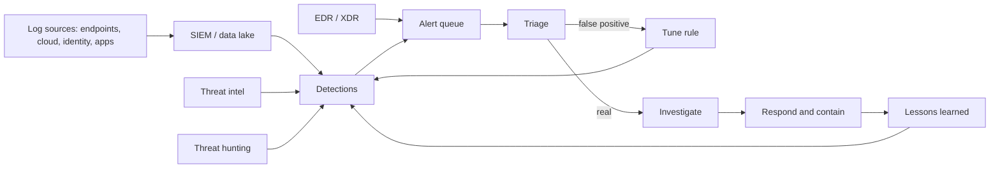
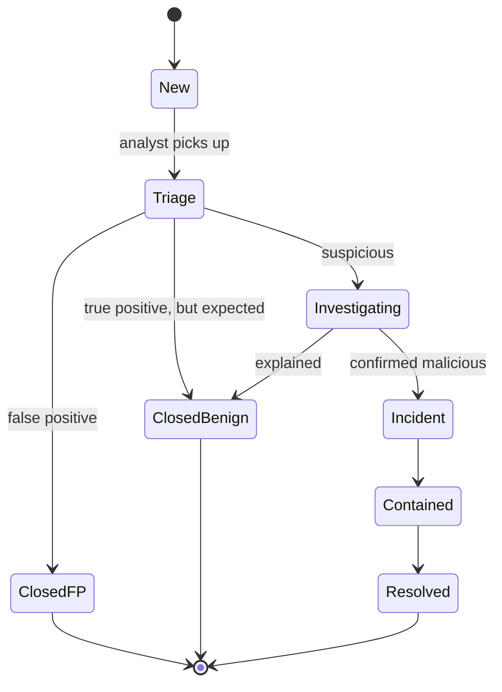

# The Security Operations Center

## Introduction

Firewalls, MFA and secure code all lower the chance of a breach. None of them lower it to zero. At some point an attacker gets a password, a laptop runs a malicious attachment, or a cloud key leaks in a public repository. What matters next is **how quickly someone notices and acts**.

A **Security Operations Center (SOC)** is the team, processes and tools that do the noticing and acting. It watches security telemetry from the whole organization, decides which signals matter, investigates them and coordinates the response.

Think of a hospital emergency department. Patients (alerts) arrive all day, and most are minor. A triage nurse sorts them by urgency, doctors investigate the serious ones, specialists are called for rare cases, and everything is written down so the hospital can improve. A SOC works the same way, and like an emergency department it is judged by speed, accuracy and how few serious cases slip through.

This page explains what a SOC does, who works in one, what tools it uses, how an alert moves from "new" to "closed", and how to choose a SOC model that fits your organization. The rest of this section goes deeper into each building block:

- [Security Logging and SIEM](./1-sec-logging-and-siem.mdx): collecting and searching the data
- [Detection Engineering](./2-sec-detection-engineering.mdx): writing the rules that create alerts
- [MITRE ATT&CK](./3-sec-mitre-attack.mdx): a shared language for attacker behavior
- [Threat Intelligence](./4-sec-threat-intelligence.mdx) and [Threat Hunting](./5-sec-threat-hunting.mdx): looking beyond the alerts
- [Vulnerability Management and CVSS](./6-sec-vulnerability-management.mdx) and [Malware Analysis Basics](./7-sec-malware-basics.mdx)

## What a SOC Does

The core loop of a SOC is simple to describe and hard to do well:

1. **Collect** logs and telemetry from endpoints, servers, cloud accounts, identity providers, network devices and applications.
2. **Detect** suspicious activity with rules, analytics and vendor detections.
3. **Triage** each alert: is it real, and how urgent is it?
4. **Investigate** real alerts to find the scope: which users, hosts and data are affected?
5. **Respond**: contain the threat, remove it, and restore normal operation, often together with IT and engineering.
6. **Improve**: tune noisy rules, add missing detections, fix the root cause, and update runbooks.

The NIST Cybersecurity Framework (CSF) 2.0 groups security outcomes into six functions: Govern, Identify, Protect, Detect, Respond and Recover. A SOC lives mostly in **Detect** and **Respond**, and feeds lessons back into the others. NIST SP 800-61 Revision 3 (April 2025) rewrote the U.S. government's incident response guidance as a CSF 2.0 Community Profile. It is a good reference for how SOC work connects to the rest of a security program. The [Incident Response Lifecycle](../12-sec-incident-response/0-sec-incident-response-lifecycle.mdx) page covers it in depth.



Notice the two feedback loops. Every false positive should make detections better, and every real incident should leave behind a new or improved detection. A SOC without these loops gets noisier every month.

## People and Roles

Small companies may have one or two people doing everything. Larger SOCs split the work into roles. The classic model uses tiers:

| Role | Main job | Typical skills |
| --- | --- | --- |
| Tier 1 analyst | Watch the queue, triage alerts, follow runbooks, escalate | Log reading, OS and network basics, attention to detail |
| Tier 2 analyst / incident responder | Deep investigation, scoping, containment | Forensics, scripting, attacker techniques |
| Tier 3 / senior analyst | Complex incidents, malware triage, threat hunting | Reverse engineering basics, cloud internals, ATT&CK |
| Detection engineer | Write, test and tune detection rules as code | Query languages, Python, CI/CD, data modeling |
| Threat intelligence analyst | Track threats relevant to the business | Research, writing, STIX/TAXII, ATT&CK mapping |
| SOC manager | Staffing, metrics, priorities, reporting | Leadership, risk communication |

The tier model is easy to staff, but it has well-known problems. Tier 1 work is repetitive, which leads to burnout, and handing alerts up through tiers adds delay. Many modern SOCs therefore:

- **Automate** the most repetitive tier 1 work (enrichment, deduplication, closing known-benign alerts).
- **Organize around pods** or domains (identity, cloud, endpoint) instead of strict tiers.
- **Treat detection as engineering**: rules live in Git, have tests, and are reviewed like code. See [Detection Engineering](./2-sec-detection-engineering.mdx).

Vendors push the same direction. For example, Microsoft's guidance for moving Microsoft Sentinel into the unified Defender portal notes that unified triage can reduce analyst workload and may combine tier 1 and tier 2 roles, while requiring broader analyst knowledge.

:::tip Career entry point
Tier 1 SOC analyst is a common first job in security. The [Cybersecurity Careers and Roles](../0-sec-fundamentals/9-sec-careers.mdx) page covers how to prepare for it.
:::

## The Technology Stack

You will meet these tool categories in almost every SOC:

| Tool | What it does | Examples (not endorsements) |
| --- | --- | --- |
| **SIEM** | Collects, normalizes, stores and searches logs; runs detection rules | Splunk, Microsoft Sentinel, Elastic Security, Google Security Operations, Wazuh |
| **EDR / XDR** | Endpoint telemetry, detection and response actions (isolate host, kill process) | Microsoft Defender for Endpoint, CrowdStrike Falcon, SentinelOne |
| **NDR** | Network traffic analysis | Zeek, Suricata, commercial NDR tools |
| **SOAR** | Automates enrichment and response steps with playbooks | Splunk SOAR, Sentinel playbooks (Logic Apps), Tines, Shuffle |
| **Case management** | Tracks investigations, evidence and decisions | TheHive, Jira, built-in SIEM incident queues |
| **Threat intel platform** | Stores and shares indicators and reports | MISP, OpenCTI |

Product names, features and licensing change often, so check the vendor's current documentation before you choose. The categories are also blurring: many SIEMs now include SOAR features, and XDR products ingest third-party logs.

The [Endpoint Protection and EDR](../9-sec-system-hardening/4-sec-endpoint-protection.mdx) page explains EDR in detail, and the next page, [Security Logging and SIEM](./1-sec-logging-and-siem.mdx), explains the SIEM.

## The Life of an Alert

Every alert passes through the same basic states. Writing them down helps you measure where time is lost.



Three closing verdicts matter, and good SOCs record them separately:

- **False positive (FP)**: the rule fired on something that does not match what it was meant to detect. Example: a "password spraying" rule fires because a load balancer health check fails logins. Fix the rule.
- **Benign true positive (BTP)**: the rule worked, and the activity is real, but it is authorized. Example: the IT team runs a vulnerability scanner. Add a documented exception or decide that the rule is too broad.
- **True positive (TP)**: real malicious or policy-violating activity. Open an incident.

If you lump BTPs in with FPs, you will "fix" rules that are working correctly and lose detections.

### Triage: deciding what to look at first

A busy SOC cannot work alerts in arrival order. A suspicious admin role grant on the production database matters more than a failed login on a laptop, even if both rules say "medium". Triage adds **context** the detection rule did not have:

- **Asset criticality**: production database or test VM?
- **Identity**: privileged account, service account, or contractor?
- **Threat intelligence**: is the source IP or file hash known bad?
- **History**: has this user or host alerted before?

Here is a minimal triage scorer that combines those signals. Real SOCs do this inside the SIEM or SOAR tool, but the logic is the same.

```python
from dataclasses import dataclass, field

# Context the SOC keeps outside the SIEM: asset criticality and known-bad indicators.
ASSET_CRITICALITY = {"db-prod-01": 3, "web-prod-02": 3, "build-07": 2, "laptop-anna": 1}
BAD_IPS = {"203.0.113.66"}          # example threat-intel hit
SEVERITY_POINTS = {"low": 1, "medium": 3, "high": 6, "critical": 9}

@dataclass
class Alert:
    id: str
    rule: str
    severity: str
    host: str
    user: str
    src_ip: str
    reasons: list = field(default_factory=list)
    score: int = 0

def score(alert: Alert) -> Alert:
    alert.score = SEVERITY_POINTS[alert.severity]
    alert.reasons.append(f"rule severity {alert.severity}")
    crit = ASSET_CRITICALITY.get(alert.host, 1)
    if crit > 1:
        alert.score += crit * 2
        alert.reasons.append(f"asset criticality {crit}")
    if alert.src_ip in BAD_IPS:
        alert.score += 5
        alert.reasons.append("source IP on intel list")
    if alert.user.endswith("-admin"):
        alert.score += 3
        alert.reasons.append("privileged account")
    return alert

def priority(score: int) -> str:
    if score >= 15:
        return "P1"
    if score >= 9:
        return "P2"
    if score >= 5:
        return "P3"
    return "P4"

alerts = [
    Alert("A-101", "Multiple failed logins", "medium", "laptop-anna", "anna", "198.51.100.23"),
    Alert("A-102", "New admin role granted", "high", "db-prod-01", "ops-admin", "192.0.2.10"),
    Alert("A-103", "Login from intel-listed IP", "medium", "web-prod-02", "svc-deploy", "203.0.113.66"),
    Alert("A-104", "EICAR test file detected", "low", "laptop-anna", "anna", "192.0.2.50"),
]

for a in sorted((score(a) for a in alerts), key=lambda a: a.score, reverse=True):
    print(f"{priority(a.score)} {a.id} score={a.score:2d} {a.rule:28s} <- {', '.join(a.reasons)}")
```

Output:

```text
P1 A-102 score=15 New admin role granted       <- rule severity high, asset criticality 3, privileged account
P2 A-103 score=14 Login from intel-listed IP   <- rule severity medium, asset criticality 3, source IP on intel list
P4 A-101 score= 3 Multiple failed logins       <- rule severity medium
P4 A-104 score= 1 EICAR test file detected     <- rule severity low
```

Two design choices are worth copying:

- **Every score comes with reasons.** An analyst should see *why* something is P1, not just a number. Opaque scores erode trust.
- **Context lives in data, not in code.** `ASSET_CRITICALITY` should come from your asset inventory or CMDB. If the inventory is wrong, triage is wrong, which is why asset management is a security control.

### Grouping alerts into cases

Attackers rarely trigger only one rule. A phished account might trigger "impossible travel", then "MFA push spam", then "new inbox forwarding rule" within minutes. Three analysts working three separate alerts will each see a fragment. Grouping alerts by entity (user, host) and time window turns them into one story:

```python
from collections import defaultdict
from datetime import datetime, timedelta

alerts = [
    {"id": "A-201", "time": "2026-10-11T09:00:05", "user": "maria", "rule": "Impossible travel"},
    {"id": "A-202", "time": "2026-10-11T09:02:40", "user": "maria", "rule": "MFA push spam"},
    {"id": "A-203", "time": "2026-10-11T09:04:10", "user": "maria", "rule": "New inbox forwarding rule"},
    {"id": "A-204", "time": "2026-10-11T09:30:00", "user": "tom", "rule": "Multiple failed logins"},
    {"id": "A-205", "time": "2026-10-11T13:15:00", "user": "maria", "rule": "Multiple failed logins"},
]

WINDOW = timedelta(minutes=30)

def group_by_entity(alerts):
    cases = defaultdict(list)          # (user, case_number) -> alerts
    last_seen, case_no = {}, defaultdict(int)
    for a in sorted(alerts, key=lambda a: a["time"]):
        t = datetime.fromisoformat(a["time"])
        u = a["user"]
        if u not in last_seen or t - last_seen[u] > WINDOW:
            case_no[u] += 1             # too far apart: open a new case
        last_seen[u] = t
        cases[(u, case_no[u])].append(a)
    return cases

for (user, n), items in group_by_entity(alerts).items():
    rules = " -> ".join(a["rule"] for a in items)
    print(f"case {user}#{n}: {len(items)} alert(s): {rules}")
```

Output:

```text
case maria#1: 3 alert(s): Impossible travel -> MFA push spam -> New inbox forwarding rule
case tom#1: 1 alert(s): Multiple failed logins
case maria#2: 1 alert(s): Multiple failed logins
```

The first case reads like an account takeover: the attacker signed in, pushed MFA prompts until the user accepted, and then set up mail forwarding to keep access. Commercial SIEM and XDR tools do this kind of correlation automatically, with more signals, but the principle is the same: **investigate entities and stories, not single alerts**.

## Runbooks: Making Good Decisions Repeatable

A **runbook** (or playbook) is a written procedure for a known alert type. It tells the analyst what to check, what to do, and when to escalate. Runbooks make a 2 a.m. response as good as a 2 p.m. one, and they are the starting point for automation.

Store runbooks as structured data in Git so they can be reviewed, versioned and partly executed by tools:

```yaml
id: RB-012
name: Suspicious sign-in followed by mailbox rule
trigger_rules:
  - "Impossible travel"
  - "New inbox forwarding rule"
severity_default: high
owner: soc-tier2
steps:
  - id: enrich
    action: Pull the user's last 24h of sign-ins, devices and MFA events
    automated: true
  - id: verify
    action: Contact the user via a known-good channel (phone, chat), not by replying to email
    automated: false
  - id: contain
    action: Revoke sessions, reset password, remove the forwarding rule
    automated: true
    requires_approval: true
  - id: scope
    action: Search for the same source IP and rule name across all mailboxes
    automated: true
  - id: close
    action: Record verdict, ATT&CK techniques and lessons learned in the case
    automated: false
escalate_if:
  - "Forwarding target is an external domain"
  - "User has admin roles"
```

Because the runbook is data, you can check it in CI. This small validator enforces a common SOC policy: **automated steps that change production must have a human approval gate**.

```python
import sys
import yaml  # pip install pyyaml

REQUIRED = {"id", "name", "trigger_rules", "owner", "steps"}

def check(path):
    rb = yaml.safe_load(open(path))
    problems = [f"missing field: {f}" for f in sorted(REQUIRED - rb.keys())]
    for step in rb.get("steps", []):
        destructive = step["id"] in {"contain", "isolate", "disable"}
        if destructive and step.get("automated") and not step.get("requires_approval"):
            problems.append(f"step '{step['id']}' changes production but has no approval gate")
    return rb, problems

rb, problems = check(sys.argv[1])
print(f"{rb['id']} {rb['name']}: {len(rb['steps'])} steps, "
      f"{sum(s.get('automated', False) for s in rb['steps'])} automated")
print("OK" if not problems else "\n".join(problems))
```

```bash
python3 check_runbook.py runbook.yaml
```

Output:

```text
RB-012 Suspicious sign-in followed by mailbox rule: 5 steps, 3 automated
OK
```

If someone removes `requires_approval: true` from the `contain` step, the check fails:

```text
RB-012 Suspicious sign-in followed by mailbox rule: 5 steps, 3 automated
step 'contain' changes production but has no approval gate
```

The [Incident Response Playbooks](../12-sec-incident-response/1-sec-incident-playbooks.mdx) page covers how to write full playbooks for incidents such as ransomware and leaked credentials.

### SOAR: automate the boring, gate the dangerous

**SOAR** (Security Orchestration, Automation and Response) tools run runbook steps automatically: look up an IP in threat intel, pull a user's recent sign-ins, open a ticket, post to chat. A practical rule of thumb:

| Action type | Example | Automate? |
| --- | --- | --- |
| Read-only enrichment | Geolocate IP, look up hash, fetch user's manager | Yes, always |
| Notification | Post to the SOC channel, create a ticket | Yes |
| Reversible containment | Revoke sessions, quarantine an email | Often, with approval or for high-confidence rules |
| Disruptive containment | Isolate a production server, disable an executive's account | Only with human approval |

Automation that acts on a false positive can cause an outage, and attackers can sometimes trigger your automation on purpose (for example, causing lockouts of real users). Start with enrichment and add response automation one rule at a time, for rules whose false positive rate you have measured.

:::note AI assistants in the SOC
Many SIEM and XDR products now include AI assistants that summarize incidents, explain queries or suggest next steps. Treat them like a new tier 1 analyst: helpful for speed, but their conclusions need checking, and they should not take disruptive actions without approval. The [AI Agents security section](../../../ai/agents/12-agents-safety-and-security/0-agents-security-introduction.mdx) explains the risks of giving tools to AI systems.
:::

## Measuring a SOC

You cannot improve what you do not measure. Common SOC metrics:

| Metric | Meaning | Why it matters |
| --- | --- | --- |
| **MTTD** (mean time to detect) | First malicious activity to first alert | How long attackers act unseen |
| **MTTA** (mean time to acknowledge) | Alert created to analyst picks it up | Queue health and staffing |
| **MTTR / time to contain** | Alert to containment | How quickly damage stops |
| **False positive rate** | FP closures / all closures | Rule quality and analyst fatigue |
| **Alerts per analyst per shift** | Workload | Burnout risk |
| **Detection coverage** | Techniques you can detect, often mapped to [ATT&CK](./3-sec-mitre-attack.mdx) | Gaps in visibility |

Use **medians** as well as means, since one long incident can distort an average. This script computes the main time metrics from a case management export:

```python
from datetime import datetime
from statistics import median

# One row per closed incident, exported from the case management tool.
incidents = [
    # first malicious activity, alert created, analyst acknowledged, contained
    ("2026-09-02T01:10", "2026-09-02T01:40", "2026-09-02T01:52", "2026-09-02T03:10"),
    ("2026-09-09T14:00", "2026-09-09T14:05", "2026-09-09T14:09", "2026-09-09T14:50"),
    ("2026-09-17T22:30", "2026-09-18T06:45", "2026-09-18T07:30", "2026-09-18T11:00"),
    ("2026-09-25T10:00", "2026-09-25T10:20", "2026-09-25T10:24", "2026-09-25T12:00"),
]

def minutes(a, b):
    return (datetime.fromisoformat(b) - datetime.fromisoformat(a)).total_seconds() / 60

ttd = [minutes(start, alert) for start, alert, ack, cont in incidents]
tta = [minutes(alert, ack) for start, alert, ack, cont in incidents]
ttc = [minutes(alert, cont) for start, alert, ack, cont in incidents]

print(f"Median time to detect:      {median(ttd):6.0f} min  (worst {max(ttd):.0f})")
print(f"Median time to acknowledge: {median(tta):6.0f} min  (worst {max(tta):.0f})")
print(f"Median time to contain:     {median(ttc):6.0f} min  (worst {max(ttc):.0f})")

closed_alerts = {"true_positive": 18, "benign_true_positive": 41, "false_positive": 141}
total = sum(closed_alerts.values())
print(f"False positive rate: {closed_alerts['false_positive'] / total:.0%} of {total} closed alerts")
```

Output:

```text
Median time to detect:          25 min  (worst 495)
Median time to acknowledge:      8 min  (worst 45)
Median time to contain:         95 min  (worst 255)
False positive rate: 70% of 200 closed alerts
```

The "worst" values tell the real story here. The third incident started at 22:30 and was not detected until 06:45 the next morning, which suggests a gap in overnight coverage or a detection that only runs in a daily batch. That is a staffing or engineering decision to discuss, and the median alone would have hidden it.

:::caution Metrics can be gamed
If analysts are rewarded for low MTTR, they will close alerts quickly, including ones that needed a deeper look. Pair speed metrics with quality checks, such as reviewing a random sample of closed alerts each week.
:::

## SOC Operating Models

Not every organization should build a 24x7 SOC. Running one around the clock takes several analysts per seat to cover nights, weekends, holidays and sick days, plus tools and engineering time. The main options:

- **In-house SOC**: your own team and tools. Most control and business context, highest cost.
- **MSSP** (Managed Security Service Provider): a provider monitors your logs and forwards alerts. Often focused on monitoring and notification; your team still does most of the response.
- **MDR** (Managed Detection and Response): a provider monitors, investigates and takes agreed response actions (for example, isolating a host through your EDR).
- **Hybrid / co-managed**: in-house team during business hours, provider at night, or provider for endpoints and in-house for cloud and application logs.

## Real-World Scenario

**BrightCart** is a 120-person e-commerce SaaS company. It runs on a public cloud with Kubernetes, uses a cloud identity provider with SSO, and has EDR on all laptops. Security today is two engineers who also own vulnerability management and compliance. An enterprise customer's security questionnaire asks: "Do you have 24x7 security monitoring with a defined response time?" Last quarter, a contractor's leaked cloud key was used for crypto mining over a weekend and only noticed on Monday through the cloud bill.

### The solution

BrightCart chooses a **hybrid model**:

1. **MDR for endpoints and identity, 24x7.** The MDR provider gets read access to EDR and identity provider alerts, plus pre-approved actions: isolate a laptop, revoke a user's sessions. Anything else requires a phone call to an on-call BrightCart engineer.
2. **In-house detection for cloud and application logs.** The two engineers send cloud audit logs, Kubernetes audit logs and application authentication logs to a SIEM, and write a small set of high-value detections as code: new access keys for IAM users, API calls from unusual countries, spikes in compute usage, admin role grants.
3. **One shared case queue.** MDR escalations and in-house alerts land in the same queue with the same severity scale and runbooks.
4. **Clear SLAs written into the contract**, such as how fast the provider must acknowledge and escalate a critical alert. These numbers are negotiated; there is no standard.
5. **Quarterly review**: false positive rates, missed detections from incidents, and new runbooks.

The weekend crypto-mining incident now has two chances to be caught: a cloud detection for unusual compute usage, and the MDR's after-hours monitoring of identity alerts.

### Why this approach

- Two engineers cannot cover nights and weekends, and hiring a 24x7 team would cost more than the rest of the security budget.
- An MDR provider sees many customers, so it often recognizes common attack patterns quickly.
- BrightCart's cloud and application context (which APIs are sensitive, what normal deployment looks like) is hard to hand to an outside provider, so those detections stay in-house.

### When to use it, and when not to

- **Use a hybrid model** when you need round-the-clock coverage but have a small team with deep product knowledge.
- **Do not rely on MSSP alert forwarding alone** if nobody at your company can act on an alert at 3 a.m.; a forwarded alert nobody reads is not monitoring.
- **Build a full in-house SOC** when you are large enough to staff it, handle very sensitive data, or face targeted threats where business context is critical, for example banks, large SaaS platforms and critical infrastructure.

### Alternatives and trade-offs

| Approach | Pros | Cons | Best for |
| --- | --- | --- | --- |
| In-house 24x7 SOC | Full control, deepest context, fastest internal coordination | Expensive, hard to hire and retain, slow to build | Large or highly regulated organizations |
| MSSP monitoring | Low cost, quick start, helps with compliance evidence | Often notification only; limited context; you still respond | Organizations that already have responders |
| MDR | 24x7 investigation and response actions, quick start | Vendor sees only its data sources; contract defines what it can do | Small and mid-size teams without night coverage |
| Hybrid / co-managed | Balances cost and context; covers nights | Two teams to coordinate; handoffs can drop details | Growing companies like BrightCart |
| No SOC (alerts emailed to IT) | Cheapest | Alerts ignored at night and weekends; no triage | Not recommended beyond the smallest teams |

## Common Mistakes

- **Collecting everything, detecting nothing.** A SIEM full of logs with no tested detections is an expensive archive. Start from the threats you care about and work back to the data you need.
- **No asset or identity context.** If analysts cannot tell a production server from a test VM, every alert takes longer. Feed the CMDB and HR or identity data into triage.
- **Treating every alert as equal.** Without prioritization, the urgent alert waits behind fifty low-value ones.
- **Never tuning.** A rule with a 99% false positive rate trains analysts to ignore it, including the one time it is right.
- **Automating disruptive actions too early.** Measure a rule's accuracy before you let it disable accounts or isolate servers.
- **Runbooks that live in someone's head.** Write them down, store them in Git, and review them after every incident.
- **Burning out analysts.** Constant night shifts and repetitive alerts drive people away. Rotate duties and automate repetitive work.

## Summary

- A SOC is the team, process and tooling that **detects, triages, investigates and responds** to security events, mainly covering the Detect and Respond functions of NIST CSF 2.0.
- Roles range from tier 1 analysts to detection engineers and threat hunters; modern SOCs automate repetitive work and treat detections as code.
- Core tools are a **SIEM**, **EDR/XDR**, **SOAR** and **case management**, with threat intel and hunting feeding detections.
- **Triage adds context** (asset criticality, identity, intel, history) and should explain its scores.
- **Group alerts by entity and time** to see attacks as stories.
- **Runbooks as code** make responses repeatable; automate enrichment freely, and gate disruptive actions behind approval.
- Measure **time to detect, acknowledge and contain**, plus false positive rate, using medians and worst cases.
- Choose an operating model (in-house, MSSP, MDR, hybrid) based on team size, required coverage and how much business context detection needs.

## Exercises

1. **Extend the triage scorer.** Add a `history` signal: if the same user had a true positive in the last 30 days, add 4 points. Decide whether a closed false positive should lower the score, and explain why or why not.
2. **Write a runbook.** Create a YAML runbook for "Cloud access key used from a new country". Include enrichment, verification, containment with approval, and escalation criteria. Run it through the validator.
3. **Fix the metric gap.** In the metrics example, the overnight incident took 495 minutes to detect. List three changes (staffing, detection or tooling) that could reduce that number, with the cost of each.
4. **Choose a model.** Pick an organization you know (a school, a small shop, a startup). Using the trade-off table, decide which SOC model fits it and what the first five log sources should be.

Continue with [Security Logging and SIEM](./1-sec-logging-and-siem.mdx) to see how the data behind every alert is collected, normalized and searched. For what happens after an alert becomes an incident, see the [Incident Response Lifecycle](../12-sec-incident-response/0-sec-incident-response-lifecycle.mdx).
